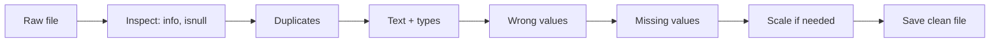

# Session 08: Cleaning of Imported Data

> Module: Data Science with Python · Term 5 (ADSE) · ⏱ ~2 hours

Imported data is almost never ready to use. Customers skip form fields, staff type "karachi" and " Karachi ", someone enters an age of 250, and dates arrive in three different styles. If you analyse this as it is, your averages and charts will be wrong. In this session you learn the standard cleaning steps: finding and filling **missing values**, fixing **text and duplicates**, **scaling** numbers, **parsing** dates and numbers, and handling **character encoding**.

## 🎯 Learning Objectives

By the end of this session you will be able to:

- Explain why cleaning comes before analysis and list common data problems
- Find missing values and choose between dropping and imputing them
- Remove duplicates, tidy text and fix impossible values
- Scale or normalise numeric columns with min-max and z-score methods
- Parse dates and numbers that arrive in different text formats
- Explain character encoding and read files with the correct encoding

## 📖 Concepts Explained

### 1. Garbage in, garbage out

A model or chart is only as good as its data. Typical problems:

| Problem | Example | Fix |
|---------|---------|-----|
| Missing values | blank age | drop or impute |
| Duplicates | same customer twice | `drop_duplicates()` |
| Inconsistent text | "lahore", "LAHORE", " Lahore " | `str.strip().str.title()` |
| Impossible values | age 250 | set to missing, then impute |
| Wrong types | "1,200" stored as text | `to_numeric` after removing commas |
| Mixed date styles | "15/02/2025", "April 5 2025" | `pd.to_datetime(format="mixed")` |
| Different scales | age 20–60, salary 40k–210k | min-max or standard scaling |



### 2. Missing values

pandas shows missing numbers as `NaN` and missing dates as `NaT`. Find them with `df.isnull().sum()`.

| Strategy | Code | When |
|----------|------|------|
| Drop rows | `df.dropna()` | few rows affected, lots of data |
| Drop a column | `df.drop(columns="x")` | column mostly empty |
| Fill with mean | `fillna(df["x"].mean())` | numbers without extreme values |
| Fill with median | `fillna(df["x"].median())` | numbers **with** outliers (safer) |
| Fill with mode | `fillna(df["x"].mode()[0])` | categories like city |
| Fill per group | `fillna(df.groupby("city")["x"].transform("mean"))` | groups behave differently |

Filling in a sensible value is called **imputation**. Always write down what you filled and why.

### 3. Scaling and normalising

Many machine learning methods (KNN, SVM, clustering) measure distances. If salary is in hundreds of thousands and age in tens, salary dominates. Scaling fixes that:

| Method | Formula | Result |
|--------|---------|--------|
| Min-max normalisation | (x − min) / (max − min) | values between 0 and 1 |
| Standardisation (z-score) | (x − mean) / std | mean 0, standard deviation 1 |

scikit-learn gives `MinMaxScaler` and `StandardScaler`; `fit_transform()` learns the numbers and applies them in one step.

### 4. Parsing data in different formats

**Parsing** means converting text into a proper type. `pd.to_datetime(col, format="mixed", errors="coerce")` reads many date styles; anything it cannot read becomes `NaT` instead of crashing. `pd.to_numeric(col, errors="coerce")` does the same for numbers. Once a column is a real date, `.dt.month_name()`, `.dt.year` and date maths work.

> **Watch out:** "03/04/2025" means 3 April in Pakistan but March 4 in the USA. If all dates use one style, give the exact format, for example `format="%d/%m/%Y"`.

### 5. Character encoding

Computers store text as bytes. An **encoding** is the rule that maps letters to bytes. **UTF-8** supports every language, including Urdu, and is the modern default. Reading a file with the wrong encoding gives garbled text ("mojibake") or a `UnicodeDecodeError`. Fixes: pass `encoding="utf-8"` (or `"utf-8-sig"` for CSVs from Excel, or `"latin-1"` for some old files).

## 💻 Code Examples

All scripts use [`raw_customers.csv`](./raw_customers.csv): 9 customer rows that contain blanks, a duplicate, messy city names, an age of 250 and three date styles.

### Example 1: Missing values

File: [`find_missing.py`](./find_missing.py)

```python
# find_missing.py - find and fix missing values
import pandas as pd

df = pd.read_csv("raw_customers.csv")
print(df, "\n")

# 1. Where are the blanks? (NaN = "Not a Number" = missing)
print("Missing per column:\n", df.isnull().sum(), "\n")

# 2. Which rows have any missing value?
print("Rows with blanks:\n", df[df.isnull().any(axis=1)], "\n")

# 3. Option A: drop rows that have a missing value
dropped = df.dropna()
print("After dropna:", len(dropped), "rows (was", len(df), ")")

# 4. Option B: impute (fill) missing values
filled = df.copy()
filled["age"] = filled["age"].fillna(filled["age"].median())          # middle value
filled["monthly_spend"] = filled["monthly_spend"].fillna(filled["monthly_spend"].mean())
print("\nAfter filling:\n", filled[["name", "age", "monthly_spend"]])
```

**How it works:** `isnull().sum()` counts blanks per column; `isnull().any(axis=1)` finds rows with at least one blank. `dropna()` removes those rows, while `fillna()` keeps them and fills age with the median and spend with the mean.

### Example 2: Text, duplicates and impossible values

File: [`fix_text_and_duplicates.py`](./fix_text_and_duplicates.py)

```python
# fix_text_and_duplicates.py - tidy text, remove duplicates, fix impossible values
import pandas as pd

df = pd.read_csv("raw_customers.csv")

# 1. Remove exact duplicate rows
print("Duplicates found:", df.duplicated().sum())
df = df.drop_duplicates()

# 2. Clean text: remove extra spaces and use one style of capital letters
df["city"] = df["city"].str.strip().str.title()     # " karachi " -> "Karachi"
df["name"] = df["name"].str.title()                 # "bilal ahmed" -> "Bilal Ahmed"
print("\nCities now:", df["city"].unique())

# 3. Fix an impossible value: nobody is 250 years old
print("\nSuspicious ages:\n", df[df["age"] > 100][["name", "age"]])
df.loc[df["age"] > 100, "age"] = None              # mark as missing for now
print("\nAfter fix:\n", df[["name", "city", "age"]])
```

**How it works:** `duplicated()` marks repeated rows. The `.str` methods clean every value of a text column at once. `df.loc[condition, "age"] = None` replaces only the impossible ages with missing values so they can be imputed later.

### Example 3: Scaling

File: [`scale_data.py`](./scale_data.py)

```python
# scale_data.py - put numbers on the same scale
import pandas as pd
from sklearn.preprocessing import MinMaxScaler, StandardScaler

df = pd.DataFrame({
    "age": [22, 35, 47, 29, 60],
    "salary": [40000, 85000, 150000, 62000, 210000],
})
print("Original:\n", df)

# 1. Min-max normalisation BY HAND: (x - min) / (max - min) -> values 0 to 1
by_hand = (df - df.min()) / (df.max() - df.min())
print("\nMin-max by hand:\n", by_hand.round(2))

# 2. The same with scikit-learn
minmax = MinMaxScaler()
scaled = minmax.fit_transform(df)                  # returns a NumPy array
print("\nMinMaxScaler:\n", pd.DataFrame(scaled, columns=df.columns).round(2))

# 3. Standardisation (z-score): (x - mean) / std -> mean 0, std 1
standard = StandardScaler()
z = standard.fit_transform(df)
print("\nStandardScaler:\n", pd.DataFrame(z, columns=df.columns).round(2))
```

**How it works:** the hand-made formula and `MinMaxScaler` give the same 0–1 values, which proves what the scaler does. `StandardScaler` centres each column on 0.

### Example 4: Parsing dates and numbers

File: [`parse_dates_and_types.py`](./parse_dates_and_types.py)

```python
# parse_dates_and_types.py - turn messy text into real dates and numbers
import pandas as pd

df = pd.read_csv("raw_customers.csv")
print("Types before:\n", df.dtypes, "\n")

# 1. Dates written in different styles -> one real date type
#    format="mixed" lets pandas guess each value; errors="coerce" turns bad ones into NaT
df["join_date"] = pd.to_datetime(df["join_date"], format="mixed", errors="coerce")
print(df[["name", "join_date"]], "\n")

# Now we can use date parts
df["join_month"] = df["join_date"].dt.month_name()
print(df[["name", "join_month"]], "\n")

# 2. Numbers stored as text -> real numbers
prices = pd.Series(["1,200", "850", "Rs 499", "unknown"])
clean = prices.str.replace("Rs", "").str.replace(",", "").str.strip()
numbers = pd.to_numeric(clean, errors="coerce")    # "unknown" -> NaN
print("Prices as numbers:\n", numbers, "\n")

# 3. Change a type directly
df["customer_id"] = df["customer_id"].astype(str)
print("Types after:\n", df.dtypes)
```

**How it works:** `format="mixed"` lets pandas read each date in its own style. For prices we remove "Rs" and commas with `str.replace`, then `to_numeric` with `errors="coerce"` turns "unknown" into `NaN` instead of crashing.

### Example 5: Encoding

File: [`encoding_demo.py`](./encoding_demo.py)

```python
# encoding_demo.py - why character encoding matters
# Text is stored as bytes; the ENCODING is the rule that maps characters to bytes.
import pandas as pd

text = "Karachi کراچی"                    # English + Urdu

# 1. Encode to bytes with UTF-8 (supports every language)
data = text.encode("utf-8")
print("UTF-8 bytes:", data)
print("Decoded back:", data.decode("utf-8"))

# 2. The wrong encoding gives "mojibake" (garbled text)
print("Wrong decoding:", data.decode("latin-1"))

# 3. Saving and reading a CSV with Urdu text
df = pd.DataFrame({"city": ["Karachi", "Lahore"], "urdu": ["کراچی", "لاہور"]})
df.to_csv("cities_utf8.csv", index=False, encoding="utf-8")
print(pd.read_csv("cities_utf8.csv", encoding="utf-8"))

# 4. If a file fails with UnicodeDecodeError, try another encoding
try:
    pd.read_csv("cities_utf8.csv", encoding="ascii")
except UnicodeDecodeError as error:
    print("\nASCII cannot read Urdu:", type(error).__name__)
# Tip: Excel on Windows likes encoding="utf-8-sig" when you save CSVs
```

**How it works:** the Urdu text becomes several bytes per letter in UTF-8. Decoding those bytes with Latin-1 shows garbage; reading the CSV with ASCII raises an error that we catch.

### Example 6: A complete cleaning pipeline

File: [`clean_pipeline.py`](./clean_pipeline.py)

```python
# clean_pipeline.py - all cleaning steps together, saved as a clean file
import pandas as pd

df = pd.read_csv("raw_customers.csv")
print("Raw rows:", len(df))

df = df.drop_duplicates()                                   # 1. duplicates
df["name"] = df["name"].str.strip().str.title()             # 2. text
df["city"] = df["city"].str.strip().str.title()
df.loc[(df["age"] < 10) | (df["age"] > 100), "age"] = None  # 3. impossible ages
df["age"] = df["age"].fillna(df["age"].median())            # 4. missing values
df["monthly_spend"] = df["monthly_spend"].fillna(df.groupby("city")["monthly_spend"].transform("mean"))
df["join_date"] = pd.to_datetime(df["join_date"], format="mixed",
                                 errors="coerce")  # 5. dates

print("Clean rows:", len(df))
print("Missing left:", int(df.isnull().sum().sum()))
print(df)

df.to_csv("clean_customers.csv", index=False)
print("\nSaved clean_customers.csv")
```

**How it works:** the steps run in a safe order: duplicates, text, wrong values, missing values, dates. Missing spend is filled with the average of the customer's **own city**. The result is saved as `clean_customers.csv`, ready for analysis.

## 🧪 Lab Practice

1. Add three messy rows of your own to `raw_customers.csv` (a blank city, a negative spend, a date like "7-Aug-2025") and make `clean_pipeline.py` handle them.
2. Fill a missing city with the most common city (the mode) instead of dropping the row.
3. Use `df.describe()` before and after cleaning and write down what changed.
4. Scale `monthly_spend` and `age` of the clean file with `MinMaxScaler` and save the result.

## 📝 Assignment

Create `raw_students.csv` with 15 rows containing at least five types of problems from the table in Concept 1. Write `clean_students.py` that fixes every problem with a comment explaining each choice, prints a short "cleaning log" (how many duplicates removed, values filled, dates fixed) and saves `clean_students.csv`.

## ❓ Quick Quiz

1. Why is the median often safer than the mean for filling missing values?
2. What does `errors="coerce"` do in `pd.to_numeric`?
3. What range does min-max normalisation produce?
4. Which method removes repeated rows?
5. What is mojibake and how do you avoid it?

<details>
<summary>Show answers</summary>

1. The median is not pulled up or down by extreme values (outliers)
2. Turns values it cannot convert into `NaN` instead of raising an error
3. 0 to 1
4. `drop_duplicates()`
5. Garbled text from reading bytes with the wrong encoding; read and write with the correct encoding, usually UTF-8

</details>

## 💼 Interview Questions

1. **How do you decide whether to drop or impute missing values?** — Look at how many values are missing, whether they are random, and how important the column is. Drop when very few rows are affected; impute (median, mode, group mean or a model) when dropping would lose too much data.
2. **Normalisation vs standardisation?** — Normalisation rescales to a fixed range (0–1) and is sensitive to outliers; standardisation centres on mean 0 with standard deviation 1 and suits algorithms that assume roughly normal data.
3. **Why fit a scaler on training data only?** — Fitting on all data leaks information from the test set into training, giving over-optimistic results. Fit on train, then transform both train and test.

## ✅ Summary

- Clean before you analyse: inspect, remove duplicates, tidy text, fix wrong values, handle missing values.
- Impute with mean, median, mode or group values, or drop when it is safe.
- Scale numbers with min-max (0–1) or z-score (mean 0, std 1).
- Parse dates and numbers with `to_datetime` and `to_numeric` using `errors="coerce"`.
- Use UTF-8 encoding to keep Urdu and special characters safe.

---

[⬅ Previous](../Session-07-Handling-Different-File-Formats/README.md) · [🏠 Module Home](../README.md) · [Next ➡](../Session-09-Data-Visualization-with-Matplotlib/README.md)

Prepared by Zeeshan Abbas · Aptech Learning North Nazimabad
