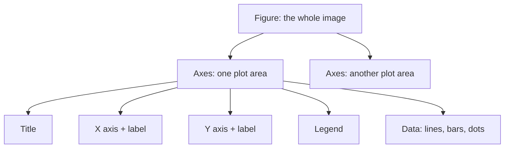
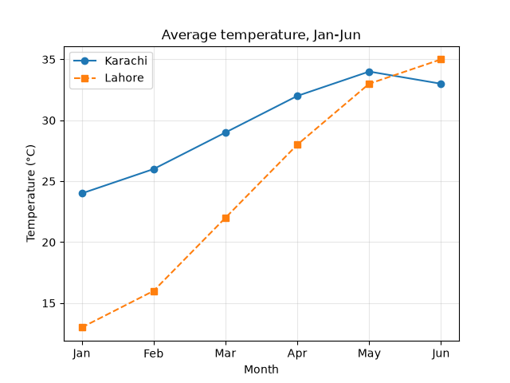
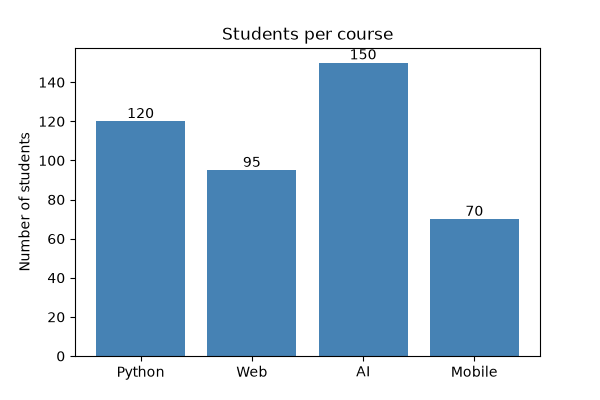
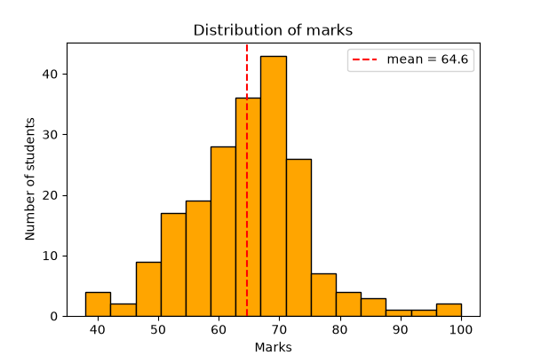
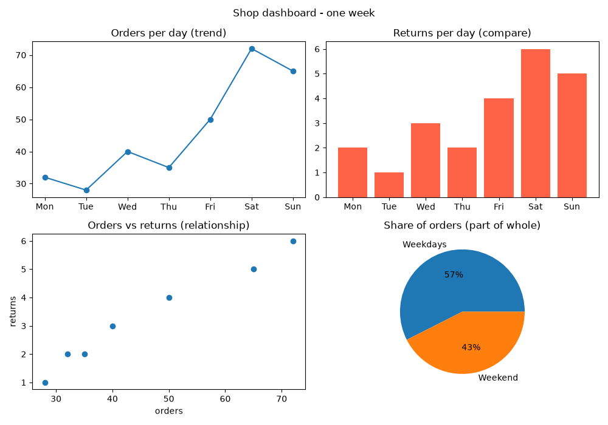

# Session 09: Data Visualization Using Matplotlib

> Module: Data Science with Python · Term 5 (ADSE) · ⏱ ~2 hours

A good chart can explain in five seconds what a table of 500 rows hides. **Matplotlib** is Python's original plotting library; pandas and Seaborn both draw with it behind the scenes. In this session you learn why graphs matter, the main types of plots, how to pick the right one for a question, and how to read information out of a chart.

## 🎯 Learning Objectives

By the end of this session you will be able to:

- Explain the importance of graphs and plots in data analysis
- Distinguish line, bar, pie, histogram, box and scatter plots
- Choose a plot type based on the problem you are trying to solve
- Add titles, labels, legends, annotations and save charts as PNG
- Combine several charts into one figure with `subplots`
- Read trends, comparisons, distributions and outliers from plots

## 📖 Concepts Explained

### 1. Why graphs and plots matter

- **Speed:** people see shapes and colours faster than they read numbers.
- **Patterns:** trends, seasons and relationships jump out of a chart.
- **Problems:** outliers, gaps and data-entry errors become visible.
- **Communication:** managers, clients and teachers understand a chart without code.

> **Analogy:** a table is like a list of street addresses; a chart is the map. Both have the same information, but the map shows where things are in relation to each other.

### 2. Anatomy of a Matplotlib chart



Import it as `import matplotlib.pyplot as plt`. Two styles exist: the quick `plt.plot(...)` style for one chart, and `fig, ax = plt.subplots()` for more control and several charts. Finish with `plt.savefig("name.png")` to save and/or `plt.show()` to open a window (in Jupyter charts show automatically).

### 3. Types of plots and when to use them

| Question you are asking | Plot | Function |
|-------------------------|------|----------|
| How does it change over time? | Line | `plt.plot()` |
| Which category is bigger? | Bar / horizontal bar | `plt.bar()`, `plt.barh()` |
| What share does each part have? | Pie (only 2–5 parts) | `plt.pie()` |
| How are values spread out? | Histogram | `plt.hist()` |
| What are the median, range and outliers? | Box plot | `plt.boxplot()` |
| Are two numbers related? | Scatter | `plt.scatter()` |

### 4. Choosing a plot from the problem definition

1. Write the question in one sentence ("Do weekend days have more orders?").
2. Identify the variable types: time, category or number.
3. Pick the plot from the table: time → line, category vs number → bar, number vs number → scatter, one number's spread → histogram or box.
4. Keep it simple: one message per chart, clear labels with units, no 3-D effects that distort.

### 5. Reading information from plots

| Plot | What to look for |
|------|------------------|
| Line | going up, down, flat; peaks; repeating seasons |
| Bar | biggest and smallest bars; big gaps |
| Histogram | where most values sit; long tail on one side (skew) |
| Box | the middle line is the median; dots outside the whiskers are outliers |
| Scatter | dots rising to the right = positive relationship; a cloud = no relationship |

### 6. Useful formatting options

`color`, `marker` (`"o"`, `"s"`), `linestyle` (`"--"`), `label` + `plt.legend()`, `plt.grid(alpha=0.3)`, `figsize=(w, h)`, `plt.bar_label()`, `plt.annotate()`, `plt.tight_layout()` and `dpi=` in `savefig` for sharper images.

## 💻 Code Examples

Each script saves its chart(s) as PNG files in this folder. The line `matplotlib.use("Agg")` tells Matplotlib to draw into files only; delete it if you want a pop-up window with `plt.show()`.

### Example 1: Line plot — trends

File: [`line_plot.py`](./line_plot.py)

```python
# line_plot.py - a line plot shows CHANGE OVER TIME
import matplotlib
matplotlib.use("Agg")                 # save to file; remove this line to see a window
import matplotlib.pyplot as plt

months = ["Jan", "Feb", "Mar", "Apr", "May", "Jun"]
karachi = [24, 26, 29, 32, 34, 33]     # average temperature (made-up)
lahore = [13, 16, 22, 28, 33, 35]

# Draw two lines on the same axes
plt.plot(months, karachi, marker="o", label="Karachi")
plt.plot(months, lahore, marker="s", linestyle="--", label="Lahore")

# Always add a title, axis labels and a legend
plt.title("Average temperature, Jan-Jun")
plt.xlabel("Month")
plt.ylabel("Temperature (°C)")
plt.legend()
plt.grid(alpha=0.3)                    # light grid helps reading values

plt.savefig("line_plot.png", dpi=100)
print("Saved line_plot.png")
```

**How it works:** two `plt.plot` calls draw two lines on the same axes. The `label` of each line appears in the legend. A light grid makes the values easier to read.



### Example 2: Bar, horizontal bar and pie

File: [`bar_and_pie.py`](./bar_and_pie.py)

```python
# bar_and_pie.py - bar charts COMPARE categories, pie charts show PARTS OF A WHOLE
import matplotlib
matplotlib.use("Agg")
import matplotlib.pyplot as plt

courses = ["Python", "Web", "AI", "Mobile"]
students = [120, 95, 150, 70]

# --- Bar chart ---
plt.figure(figsize=(6, 4))                          # width, height in inches
bars = plt.bar(courses, students, color="steelblue")
plt.bar_label(bars)                                 # print the value on each bar
plt.title("Students per course")
plt.ylabel("Number of students")
plt.savefig("bar_chart.png")
plt.close()                                         # finish this figure

# --- Horizontal bar: good when labels are long ---
plt.figure(figsize=(6, 4))
plt.barh(courses, students, color="seagreen")
plt.title("Students per course (horizontal)")
plt.savefig("barh_chart.png")
plt.close()

# --- Pie chart: use only for a few parts that add to 100% ---
plt.figure(figsize=(5, 5))
plt.pie(students, labels=courses, autopct="%1.0f%%", startangle=90)
plt.title("Share of students")
plt.savefig("pie_chart.png")
plt.close()

print("Saved bar_chart.png, barh_chart.png, pie_chart.png")
```

**How it works:** `plt.figure()` starts a new chart and `plt.close()` finishes it, so the three charts do not mix. `bar_label` writes the number on top of each bar. `autopct="%1.0f%%"` prints percentages on the pie.



### Example 3: Histogram and box plot — distributions

File: [`histogram_boxplot.py`](./histogram_boxplot.py)

```python
# histogram_boxplot.py - see how values are DISTRIBUTED
import numpy as np
import matplotlib
matplotlib.use("Agg")
import matplotlib.pyplot as plt

# 200 made-up exam marks around 65, plus two unusual high scores
rng = np.random.default_rng(seed=1)
marks = rng.normal(loc=65, scale=10, size=200).round()
marks = np.append(marks, [99, 100])

# Histogram: how many students fall in each range (bin) of marks
plt.figure(figsize=(6, 4))
plt.hist(marks, bins=15, color="orange", edgecolor="black")
plt.axvline(marks.mean(), color="red", linestyle="--", label=f"mean = {marks.mean():.1f}")
plt.title("Distribution of marks")
plt.xlabel("Marks")
plt.ylabel("Number of students")
plt.legend()
plt.savefig("histogram.png")
plt.close()

# Box plot: median, middle 50% (the box) and outliers (dots)
plt.figure(figsize=(4, 5))
plt.boxplot(marks)
plt.title("Box plot of marks")
plt.ylabel("Marks")
plt.savefig("boxplot.png")
plt.close()

print("Saved histogram.png and boxplot.png")
```

**How it works:** NumPy creates 200 marks clustered around 65, plus two unusual scores. The histogram shows most students between about 50 and 80, with a red dashed line at the mean. In the box plot, the two very high marks appear as dots above the whisker: outliers.



### Example 4: Scatter plot — relationships

File: [`scatter_plot.py`](./scatter_plot.py)

```python
# scatter_plot.py - a scatter plot shows the RELATIONSHIP between two numbers
import matplotlib
matplotlib.use("Agg")
import matplotlib.pyplot as plt

ad_spend = [5, 8, 12, 15, 18, 22, 25, 30]          # thousand rupees on ads
sales = [40, 52, 60, 75, 80, 95, 102, 120]         # thousand rupees of sales
city_size = [30, 60, 90, 40, 120, 70, 150, 100]    # used for dot size

plt.figure(figsize=(6, 4))
plt.scatter(ad_spend, sales, s=city_size, c=sales, cmap="viridis", alpha=0.8)
plt.colorbar(label="Sales")                        # explains the colours
plt.title("Advertising spend vs sales")
plt.xlabel("Ad spend (Rs 000)")
plt.ylabel("Sales (Rs 000)")

# Point out one interesting dot with an annotation
plt.annotate("best month", xy=(30, 120), xytext=(18, 112),
             arrowprops={"arrowstyle": "->"})

plt.savefig("scatter_plot.png")
print("Saved scatter_plot.png")
```

**How it works:** each dot is one month. Dots rise to the right, so more ad spend goes with more sales. Dot size (`s`) and colour (`c`) add extra information, and `annotate` draws an arrow to the best month.

### Example 5: A dashboard with subplots

File: [`subplots_dashboard.py`](./subplots_dashboard.py)

```python
# subplots_dashboard.py - several charts in ONE figure (a mini dashboard)
import pandas as pd
import matplotlib
matplotlib.use("Agg")
import matplotlib.pyplot as plt

# Weekly data of a small online shop
df = pd.DataFrame({
    "day": ["Mon", "Tue", "Wed", "Thu", "Fri", "Sat", "Sun"],
    "orders": [32, 28, 40, 35, 50, 72, 65],
    "returns": [2, 1, 3, 2, 4, 6, 5],
})

# 2 rows x 2 columns of charts; axes is a 2x2 grid of plot areas
fig, axes = plt.subplots(2, 2, figsize=(10, 7))

axes[0, 0].plot(df["day"], df["orders"], marker="o")
axes[0, 0].set_title("Orders per day (trend)")

axes[0, 1].bar(df["day"], df["returns"], color="tomato")
axes[0, 1].set_title("Returns per day (compare)")

axes[1, 0].scatter(df["orders"], df["returns"])
axes[1, 0].set_title("Orders vs returns (relationship)")
axes[1, 0].set_xlabel("orders")
axes[1, 0].set_ylabel("returns")

weekend = df["orders"][df["day"].isin(["Sat", "Sun"])].sum()
weekday = df["orders"].sum() - weekend
axes[1, 1].pie([weekday, weekend], labels=["Weekdays", "Weekend"], autopct="%1.0f%%")
axes[1, 1].set_title("Share of orders (part of whole)")

fig.suptitle("Shop dashboard - one week")
fig.tight_layout()                                  # stop titles from overlapping
fig.savefig("dashboard.png")
print("Saved dashboard.png")
```

**How it works:** `plt.subplots(2, 2)` returns a figure and a 2 × 2 grid of axes. Each `axes[row, col]` gets its own chart type, matched to its question. `tight_layout()` prevents overlapping titles.



## 🧪 Lab Practice

1. Plot the monthly petrol price for 12 months (make up realistic numbers) as a line plot with markers, title, labels and grid.
2. Use `shop_sales.csv` from Session 04: draw a bar chart of total revenue per item, sorted from highest to lowest.
3. Draw a histogram of 300 random heights (`rng.normal(165, 8, 300)`) and try `bins=10`, `20` and `40`. Which looks most useful?
4. Make a 1 × 3 subplot figure: line, bar and scatter of any data you choose, and save it at `dpi=150`.

## 📝 Assignment

Choose a small dataset (your monthly expenses, a cricket series, class marks). Write four questions about it, choose the right plot type for each, and build a 2 × 2 dashboard that answers them. Below the code, write one sentence per chart describing what it shows (the insight, not the chart type).

## ❓ Quick Quiz

1. Which plot is best for showing sales across 12 months?
2. When should you avoid a pie chart?
3. What do dots outside the whiskers of a box plot represent?
4. What does `plt.subplots(2, 3)` create?
5. Which function saves a chart to a file?

<details>
<summary>Show answers</summary>

1. A line plot
2. When there are many parts, parts do not add up to a whole, or values are very close to each other
3. Outliers
4. One figure with a grid of 2 rows × 3 columns of axes (6 plots)
5. `plt.savefig("file.png")`

</details>

## 💼 Interview Questions

1. **Histogram vs bar chart?** — A histogram shows the distribution of one numeric variable by grouping values into ranges (bins) that touch each other; a bar chart compares separate categories.
2. **What is the difference between a Figure and an Axes in Matplotlib?** — The Figure is the whole image or window; an Axes is one plotting area inside it with its own axes, title and data. A figure can hold many axes.
3. **How do you make a chart misleading, and how do you avoid it?** — Cutting the y-axis so small differences look huge, using 3-D effects, or using a pie for too many parts. Start bars at zero, label axes with units and keep one clear message per chart.

## ✅ Summary

- Charts reveal trends, comparisons, distributions, relationships and outliers quickly.
- Line = time, bar = categories, pie = parts of a whole, histogram/box = spread, scatter = relationship.
- Always give a title, axis labels with units and a legend when there are several series.
- `plt.subplots` builds dashboards; `savefig` saves PNG files.

---

[⬅ Previous](../Session-08-Cleaning-Imported-Data/README.md) · [🏠 Module Home](../README.md) · [Next ➡](../Session-10-Practice-Lab-Files-Cleaning-and-Matplotlib/README.md)

Prepared by Zeeshan Abbas · Aptech Learning North Nazimabad
