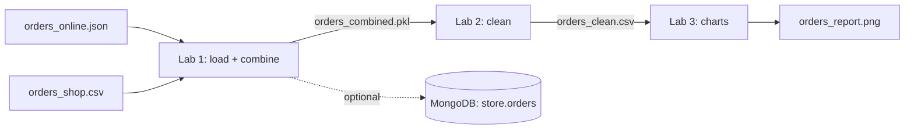
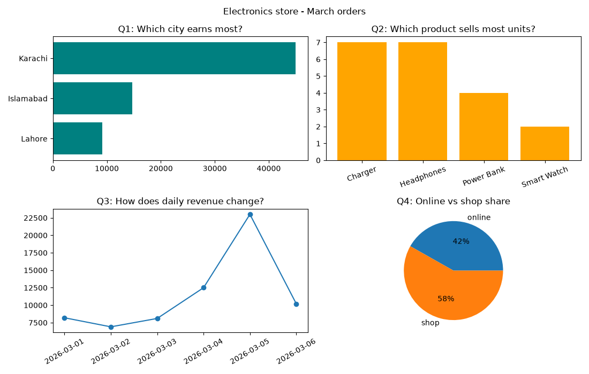

# Session 10: Practice Lab — Files, Cleaning and Matplotlib (Sessions 6–9)

> Module: Data Science with Python · Term 5 (ADSE) · ⏱ ~2 hours

Today you act as the data person for a small electronics store in Karachi. Orders arrive from two places: the website (JSON) and the physical shop (a CSV exported from the till). Both files are messy. You will load and combine them, clean them, and build a visual report for the owner. This lab joins Sessions 6–9 into one realistic workflow.

## 🎯 Learning Objectives

By the end of this lab you will be able to:

- Load JSON and CSV data and combine them with `pd.concat`
- Fix numbers with thousands separators and dates in day/month/year style
- Remove duplicates, standardise text, handle impossible and missing values
- Save data as Excel, pickle and CSV at different stages
- Answer business questions with a 2 × 2 Matplotlib dashboard

## 📖 Concepts Explained

### 1. The lab pipeline



Each lab saves a file that the next lab reads. This is how real projects work: every stage can be re-run on its own, and you can check the data in between.

### 2. New tools in this lab

| Tool | What it does |
|------|--------------|
| `pd.read_csv(..., thousands=",")` | reads `"1,200"` as the number 1200 |
| `pd.to_datetime(col, format="%d/%m/%Y")` | reads Pakistani-style dates exactly |
| `.dt.strftime("%Y-%m-%d")` | writes a date as text in ISO style |
| `pd.concat([df1, df2], ignore_index=True)` | stacks two tables with the same columns |
| `astype(int)` | turns float quantities like 2.0 into 2 |
| `tick_params(axis="x", rotation=30)` | tilts long labels so they do not overlap |

### 3. Problems hidden in the data

| File | Problem |
|------|---------|
| JSON | a missing `qty` (`null`), a duplicated order, `"lahore"` and `" Karachi"` |
| CSV | prices as text with commas, dates as `02/03/2026`, `KARACHI` in capitals, a blank qty, a negative qty (-2) |

### 4. Cleaning decisions (write them down!)

- Duplicates: removed, because the same order ID and values appear twice.
- Negative quantity: impossible, so set to missing.
- Missing quantity: filled with 1, because almost all orders in this store are single items. In a real job you would confirm this rule with the owner.

## 💻 Code Examples

Run the labs **in order** from inside this folder: Lab 1 → Lab 2 → Lab 3.

### Lab 1: Load and combine

File: [`lab1_load_and_combine.py`](./lab1_load_and_combine.py)

```python
# lab1_load_and_combine.py - Lab 1: load two different formats and combine them
import json
import pandas as pd

# Task 1: online orders come as JSON
with open("orders_online.json", encoding="utf-8") as file:
    online_records = json.load(file)           # a list of dictionaries
online = pd.DataFrame(online_records)
online["channel"] = "online"
print("Online orders:", online.shape)

# Task 2: shop orders come as CSV with prices like "1,200" and dates like 02/03/2026
shop = pd.read_csv("orders_shop.csv", thousands=",")   # thousands="," turns "1,200" into 1200
shop["date"] = pd.to_datetime(shop["date"], format="%d/%m/%Y").dt.strftime("%Y-%m-%d")
shop["channel"] = "shop"
print("Shop orders:", shop.shape)

# Task 3: stack both tables on top of each other
orders = pd.concat([online, shop], ignore_index=True)
print("\nCombined:\n", orders)

# Task 4: save the combined raw data (Excel for the manager, pickle for us)
orders.to_excel("orders_combined.xlsx", index=False)
orders.to_pickle("orders_combined.pkl")
print("\nSaved orders_combined.xlsx and orders_combined.pkl")
```

**How it works:** `json.load` gives a list of dictionaries, which becomes a DataFrame. The CSV is read with `thousands=","` and its dates converted to the same ISO text style as the JSON. A `channel` column remembers where each row came from before `concat` stacks them. Excel is saved for people, pickle for the next script.

### Lab 2: Clean

File: [`lab2_clean_orders.py`](./lab2_clean_orders.py)

```python
# lab2_clean_orders.py - Lab 2: clean the combined orders
import pandas as pd

orders = pd.read_pickle("orders_combined.pkl")      # created by Lab 1
print("Before cleaning:", orders.shape)
print("Missing:\n", orders.isnull().sum())

# Task 1: remove exact duplicates
orders = orders.drop_duplicates()

# Task 2: one spelling style for cities
orders["city"] = orders["city"].str.strip().str.title()

# Task 3: quantity can never be negative -> treat as missing
orders.loc[orders["qty"] < 0, "qty"] = None

# Task 4: fill missing quantity with 1 (most orders are single items)
orders["qty"] = orders["qty"].fillna(1).astype(int)

# Task 5: real dates and a revenue column
orders["date"] = pd.to_datetime(orders["date"])
orders["revenue"] = orders["qty"] * orders["price"]

print("\nAfter cleaning:", orders.shape)
print(orders)
orders.to_csv("orders_clean.csv", index=False)
print("\nSaved orders_clean.csv")
```

**How it works:** the steps follow the safe order from Session 08: duplicates, text, impossible values, missing values, types and new columns. The clean data has 12 rows with no blanks and a `revenue` column.

### Lab 3: Visual report

File: [`lab3_visual_report.py`](./lab3_visual_report.py)

```python
# lab3_visual_report.py - Lab 3: answer questions with charts
import pandas as pd
import matplotlib
matplotlib.use("Agg")
import matplotlib.pyplot as plt

orders = pd.read_csv("orders_clean.csv", parse_dates=["date"])   # created by Lab 2

# Questions -> summaries
by_city = orders.groupby("city")["revenue"].sum().sort_values()
by_product = orders.groupby("product")["qty"].sum().sort_values(ascending=False)
by_day = orders.groupby("date")["revenue"].sum()
by_channel = orders.groupby("channel")["revenue"].sum()

fig, axes = plt.subplots(2, 2, figsize=(11, 7))

axes[0, 0].barh(by_city.index, by_city.values, color="teal")
axes[0, 0].set_title("Q1: Which city earns most?")

axes[0, 1].bar(by_product.index, by_product.values, color="orange")
axes[0, 1].set_title("Q2: Which product sells most units?")
axes[0, 1].tick_params(axis="x", rotation=20)

axes[1, 0].plot(by_day.index, by_day.values, marker="o")
axes[1, 0].set_title("Q3: How does daily revenue change?")
axes[1, 0].tick_params(axis="x", rotation=30)

axes[1, 1].pie(by_channel.values, labels=by_channel.index, autopct="%1.0f%%")
axes[1, 1].set_title("Q4: Online vs shop share")

fig.suptitle("Electronics store - March orders")
fig.tight_layout()
fig.savefig("orders_report.png")
print("Saved orders_report.png")
print("Top city:", by_city.idxmax(), "| Top product:", by_product.idxmax())
```

**How it works:** four groupby summaries answer four questions, and each answer gets the chart type that suits it: horizontal bar for comparing cities, bar for products, line for change over days, pie for the share of two channels.



### Optional: store the clean orders in MongoDB

If you have MongoDB running (Session 06), add this to the end of Lab 2:

```python
from pymongo import MongoClient
client = MongoClient("mongodb://localhost:27017/", serverSelectionTimeoutMS=3000)
records = orders.astype({"date": str}).to_dict("records")   # DataFrame -> list of dicts
client["store"]["orders"].insert_many(records)
client.close()
```

**How it works:** `to_dict("records")` turns each row into a dictionary, exactly the shape PyMongo needs. Dates are turned into text first so every value is a simple type.

## 🧪 Lab Practice

1. Add two new orders to `orders_online.json` (one with a city in lower case) and re-run all three labs. Does the report update correctly?
2. In Lab 2, print a short **cleaning log**: duplicates removed, negative quantities fixed, blanks filled.
3. In Lab 3, add a fifth chart in a new figure: a histogram of order revenue.
4. Save the clean data to a second sheet called `Summary` in an Excel file, containing revenue per city.
5. Read your PNG report back into a PDF using `plt.imread` and `savefig("report.pdf")` (hint: `plt.imshow`, `plt.axis("off")`).

## 📝 Assignment

Create your own two-source dataset: `attendance.json` (online classes) and `attendance.csv` (campus classes) with at least 10 rows each and at least four kinds of mess. Write three lab scripts like today's (load + combine, clean, visualise) and a short `NOTES.md` listing every cleaning decision and the four insights your dashboard shows.

## ❓ Quick Quiz

1. Which `read_csv` option converts `"4,500"` into a number?
2. What does `ignore_index=True` do in `pd.concat`?
3. Why do we save a pickle between Lab 1 and Lab 2 instead of only Excel?
4. Why is a negative quantity set to missing before filling, rather than just made positive?
5. Which chart type did we use to show change over days, and why?

<details>
<summary>Show answers</summary>

1. `thousands=","`
2. Creates a fresh 0, 1, 2 ... index instead of keeping repeated indexes from both tables
3. Pickle keeps exact Python types and loads fast; Excel is for humans and can change types
4. We do not know the true value; -2 might be a typing error for 2, 20 or a return, so we treat it as unknown and apply our documented rule
5. A line plot, because the x-axis is time

</details>

## 💼 Interview Questions

1. **How do you combine data from different sources safely?** — Make the columns and types match first (same names, date formats, units), add a column recording the source, then concatenate or merge, and check row counts before and after.
2. **What is the difference between `concat` and `merge`?** — `concat` stacks tables on top of (or beside) each other; `merge` joins tables on a shared key column, like a SQL JOIN.
3. **Why split a pipeline into separate stages?** — Each stage can be tested, re-run and debugged on its own, and intermediate files show exactly where a problem was introduced.

## ✅ Summary

- Real projects mix formats: JSON, CSV, Excel, pickle, databases.
- Make columns and types match, then `concat` the sources.
- Clean in a fixed order and record every decision.
- Save intermediate files so each stage can be re-run.
- Match each business question to the right chart type in a dashboard.

---

[⬅ Previous](../Session-09-Data-Visualization-with-Matplotlib/README.md) · [🏠 Module Home](../README.md) · [Next ➡](../Session-11-Data-Visualization-with-Seaborn/README.md)

Prepared by Zeeshan Abbas · Aptech Learning North Nazimabad
