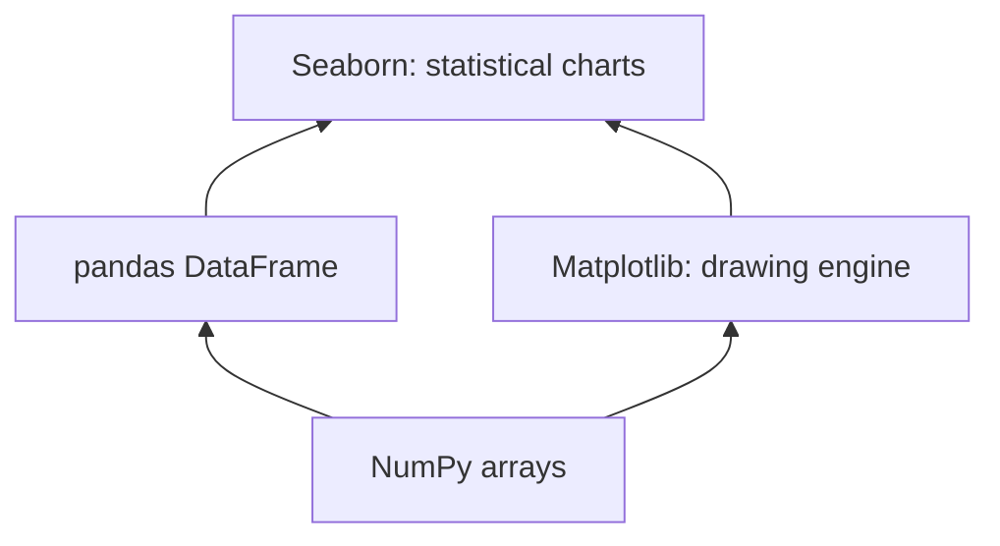
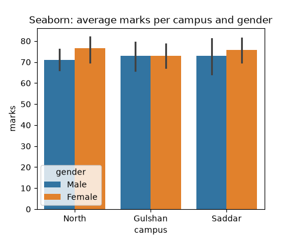
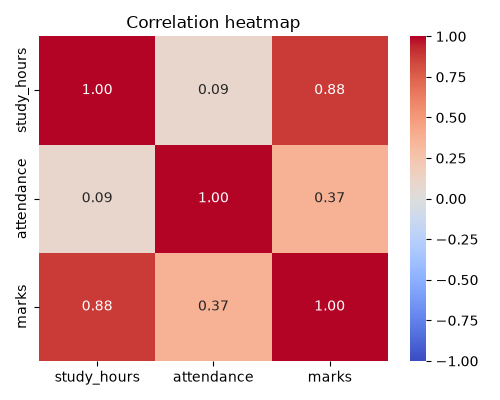
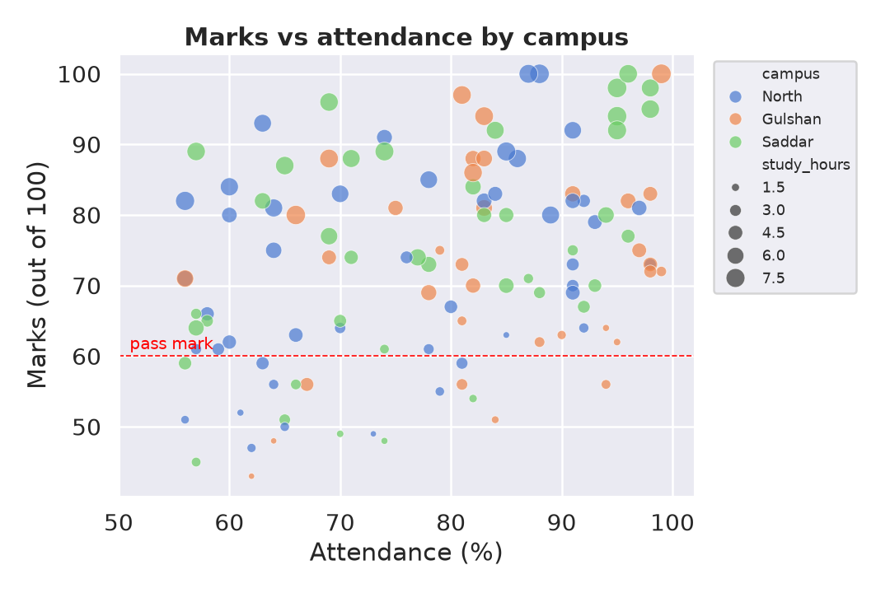
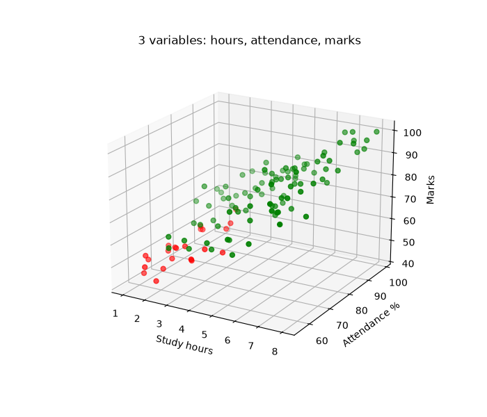

# Session 11: Data Visualization Using Seaborn

> Module: Data Science with Python · Term 5 (ADSE) · ⏱ ~2 hours

Matplotlib can draw anything, but you often write many lines to get a nice statistical chart. **Seaborn** is built on top of Matplotlib and works directly with pandas DataFrames: you name the columns, and it groups, averages, colours and labels for you. In this session you format professional 2-D plots, show several variables at once (including a 3-D plot), and see why Seaborn charts are often more informative than plain Matplotlib ones.

## 🎯 Learning Objectives

By the end of this session you will be able to:

- Explain how Seaborn relates to Matplotlib and pandas
- Draw distribution, category, relationship and correlation plots with Seaborn
- Use formatting features: themes, palettes, context, hue, size, titles, limits, reference lines and legends
- Show three or more variables using colour, size, pair plots and a 3-D scatter plot
- Compare a Seaborn chart with the equivalent Matplotlib chart and explain the difference

## 📖 Concepts Explained

### 1. Seaborn in the Python stack



Install with `pip install seaborn` and import it as `import seaborn as sns`. Every Seaborn function follows the same pattern:

```python
sns.<plot>(data=df, x="column", y="column", hue="column")
```

Because Seaborn draws on Matplotlib, you still use `plt.title()`, `plt.savefig()` and `ax.set_xlabel()` to finish your chart.

### 2. The main plot families

| Family | Functions | Answers |
|--------|-----------|---------|
| Distribution | `histplot`, `kdeplot`, `boxplot`, `violinplot` | How are values spread? |
| Categorical | `barplot`, `countplot`, `boxplot` | How do groups compare? |
| Relationship | `scatterplot`, `lineplot`, `regplot` | How do two numbers relate? |
| Matrix | `heatmap` | Which variables move together? |
| Multi-plot | `pairplot` | All pairs of variables at once |

### 3. Why Seaborn charts are more informative

| | Matplotlib | Seaborn |
|---|-----------|---------|
| Average per group | you calculate with groupby | `barplot` does it automatically |
| Uncertainty | none unless you add it | error bars (confidence interval) by default |
| Extra variable as colour | manual loop | `hue="column"` |
| Axis labels | you type them | taken from column names |
| Trend line | fit it yourself | `regplot` |
| Style | basic default | `set_theme()` gives a clean look |

**Error bars** show how sure we are about an average: a long bar means the values in that group vary a lot.

### 4. Formatting features of 2-D plots

| Feature | Code |
|---------|------|
| overall style | `sns.set_theme(style="whitegrid")` (`darkgrid`, `ticks`, `white`) |
| text size for slides | `context="talk"` (`paper`, `notebook`, `poster`) |
| colours | `palette="muted"`, `"Set2"`, `"coolwarm"` |
| extra variables | `hue=` (colour), `size=` (dot size), `style=` (marker shape) |
| title and labels | `ax.set_title(...)`, `ax.set_xlabel(...)` |
| axis range | `ax.set_xlim(a, b)`, `ax.set_ylim(a, b)` |
| reference line | `ax.axhline(60, linestyle="--")` |
| legend position | `ax.legend(bbox_to_anchor=(1.02, 1), loc="upper left")` |

### 5. Plotting many variables

A flat chart has only two axes, but you can show more variables with **colour (hue)**, **size** and **marker style**. For three numeric variables you can use a **3-D scatter** (Matplotlib's `projection="3d"`). 3-D plots look impressive but are hard to read on paper; often a pair plot or a coloured 2-D scatter is clearer. Use 3-D to explore, 2-D to present.

### 6. Correlation in one sentence

Correlation (from -1 to +1) measures how strongly two numbers move together in a straight line. +1: perfectly together; 0: no straight-line link; -1: perfectly opposite. A heatmap colours the full correlation table so strong links stand out.

## 💻 Code Examples

First run `make_students_csv.py` (already done for you, see [`students.csv`](./students.csv)): 120 made-up students with gender, campus, study hours, attendance, marks and result.

File: [`make_students_csv.py`](./make_students_csv.py)

```python
# make_students_csv.py - create a practice dataset (run once)
import numpy as np
import pandas as pd

rng = np.random.default_rng(seed=7)
n = 120                                            # number of students

study_hours = rng.uniform(1, 8, n).round(1)        # hours per day
attendance = rng.uniform(55, 100, n).round()       # percent
gender = rng.choice(["Female", "Male"], n)
campus = rng.choice(["North", "Gulshan", "Saddar"], n)

# Marks depend on study hours and attendance, plus some random noise
marks = (20 + study_hours * 6 + attendance * 0.35 + rng.normal(0, 6, n)).clip(0, 100).round()

df = pd.DataFrame({
    "gender": gender, "campus": campus, "study_hours": study_hours,
    "attendance": attendance, "marks": marks,
})
df["result"] = np.where(df["marks"] >= 60, "Pass", "Fail")
df.to_csv("students.csv", index=False)
print(df.head())
print("Saved students.csv with", len(df), "rows")
```

**How it works:** NumPy random values (with a fixed seed) build marks that really depend on study hours and attendance, so the charts show real patterns.

### Example 1: Seaborn vs Matplotlib

File: [`seaborn_vs_matplotlib.py`](./seaborn_vs_matplotlib.py)

```python
# seaborn_vs_matplotlib.py - the same question answered with both libraries
# Question: average marks per campus
import pandas as pd
import matplotlib
matplotlib.use("Agg")
import matplotlib.pyplot as plt
import seaborn as sns

df = pd.read_csv("students.csv")

# --- Matplotlib: we must calculate the averages ourselves ---
averages = df.groupby("campus")["marks"].mean()
plt.figure(figsize=(5, 4))
plt.bar(averages.index, averages.values)
plt.title("Matplotlib: average marks per campus")
plt.ylabel("marks")
plt.savefig("compare_matplotlib.png")
plt.close()

# --- Seaborn: give the DataFrame and column names; it groups, averages,
#     adds axis labels and even error bars (95% confidence interval) ---
plt.figure(figsize=(5, 4))
sns.barplot(data=df, x="campus", y="marks", hue="gender")
plt.title("Seaborn: average marks per campus and gender")
plt.savefig("compare_seaborn.png")
plt.close()

print("Saved compare_matplotlib.png and compare_seaborn.png")
```

**How it works:** Matplotlib needs a groupby before drawing. Seaborn's `barplot` computes the averages itself, splits each campus by gender with `hue`, and adds error bars.



### Example 2: Distribution plots

File: [`distribution_plots.py`](./distribution_plots.py)

```python
# distribution_plots.py - how are the marks spread out?
import pandas as pd
import matplotlib
matplotlib.use("Agg")
import matplotlib.pyplot as plt
import seaborn as sns

df = pd.read_csv("students.csv")
sns.set_theme(style="whitegrid")                   # one line for a clean look

fig, axes = plt.subplots(1, 3, figsize=(14, 4))

# 1. Histogram with a smooth density curve (kde)
sns.histplot(data=df, x="marks", kde=True, ax=axes[0])
axes[0].set_title("Histogram + KDE")

# 2. Box plot per campus: median, spread and outliers side by side
sns.boxplot(data=df, x="campus", y="marks", ax=axes[1])
axes[1].set_title("Box plot by campus")

# 3. Violin plot: box plot + shape of the distribution
sns.violinplot(data=df, x="result", y="study_hours", ax=axes[2])
axes[2].set_title("Study hours for Pass vs Fail")

fig.tight_layout()
fig.savefig("distributions.png")
print("Saved distributions.png")
```

**How it works:** passing `ax=axes[i]` tells each Seaborn function which subplot to draw in. The violin plot shows that students who pass usually study more hours.

### Example 3: Relationship plots

File: [`relationship_plots.py`](./relationship_plots.py)

```python
# relationship_plots.py - how do two or more numbers relate?
import pandas as pd
import matplotlib
matplotlib.use("Agg")
import matplotlib.pyplot as plt
import seaborn as sns

df = pd.read_csv("students.csv")
sns.set_theme(style="ticks")

# 1. Scatter plot with colour (hue) and marker style for extra variables
plt.figure(figsize=(6, 4))
sns.scatterplot(data=df, x="study_hours", y="marks", hue="result", style="gender")
plt.title("Study hours vs marks")
plt.savefig("scatter_hue.png")
plt.close()

# 2. Regression plot: scatter + best-fit straight line
plt.figure(figsize=(6, 4))
sns.regplot(data=df, x="attendance", y="marks", color="purple")
plt.title("Attendance vs marks with trend line")
plt.savefig("regplot.png")
plt.close()

# 3. Pair plot: every numeric column against every other in one picture
grid = sns.pairplot(df, vars=["study_hours", "attendance", "marks"], hue="result")
grid.savefig("pairplot.png")
print("Saved scatter_hue.png, regplot.png, pairplot.png")
```

**How it works:** `hue` and `style` add two category variables to a scatter plot. `regplot` adds a best-fit line with a shaded confidence band. `pairplot` draws every pair of the three numeric columns; the diagonal shows each column's distribution.

### Example 4: Heatmap and count plot

File: [`heatmap_and_counts.py`](./heatmap_and_counts.py)

```python
# heatmap_and_counts.py - correlation heatmap and category counts
import pandas as pd
import matplotlib
matplotlib.use("Agg")
import matplotlib.pyplot as plt
import seaborn as sns

df = pd.read_csv("students.csv")

# 1. Correlation heatmap: which numbers move together? (-1 to +1)
corr = df[["study_hours", "attendance", "marks"]].corr()
print("Correlation table:\n", corr.round(2))

plt.figure(figsize=(5, 4))
sns.heatmap(corr, annot=True, fmt=".2f", cmap="coolwarm", vmin=-1, vmax=1)
plt.title("Correlation heatmap")
plt.tight_layout()
plt.savefig("heatmap.png")
plt.close()

# 2. Count plot: how many students pass or fail in each campus?
plt.figure(figsize=(6, 4))
sns.countplot(data=df, x="campus", hue="result", palette="Set2")
plt.title("Pass / Fail count per campus")
plt.savefig("countplot.png")
plt.close()
print("Saved heatmap.png and countplot.png")
```

**How it works:** `corr()` builds the correlation table and `heatmap(annot=True)` writes each value in its cell. Study hours (0.88) are much more strongly linked to marks than attendance (0.37).



### Example 5: Formatting a 2-D plot

File: [`formatting_2d.py`](./formatting_2d.py)

```python
# formatting_2d.py - formatting features that make a 2-D plot professional
import pandas as pd
import matplotlib
matplotlib.use("Agg")
import matplotlib.pyplot as plt
import seaborn as sns

df = pd.read_csv("students.csv")

# Theme, context and palette change the whole look in one place
sns.set_theme(style="darkgrid", context="talk", palette="muted")

plt.figure(figsize=(9, 6))
ax = sns.scatterplot(data=df, x="attendance", y="marks", hue="campus",
                     size="study_hours", sizes=(20, 200), alpha=0.7)

ax.set_title("Marks vs attendance by campus", fontsize=18, weight="bold")
ax.set_xlabel("Attendance (%)")
ax.set_ylabel("Marks (out of 100)")
ax.set_xlim(50, 102)                                # control the axis range
ax.axhline(60, color="red", linestyle="--", linewidth=1)   # pass line
ax.text(51, 61, "pass mark", color="red", fontsize=12)
ax.legend(bbox_to_anchor=(1.02, 1), loc="upper left", fontsize=11)  # legend outside

plt.tight_layout()
plt.savefig("formatted_plot.png", dpi=120)
print("Saved formatted_plot.png")
```

**How it works:** one `set_theme` call sets style, text size and colours. Four variables appear in one chart: attendance (x), marks (y), campus (colour) and study hours (dot size). A dashed red line marks the pass mark, and the legend is moved outside the plot.



### Example 6: 3-D plot of three variables

File: [`plot_3d.py`](./plot_3d.py)

```python
# plot_3d.py - show THREE numeric variables at once with a 3-D scatter
import pandas as pd
import matplotlib
matplotlib.use("Agg")
import matplotlib.pyplot as plt

df = pd.read_csv("students.csv")
colours = df["result"].map({"Pass": "green", "Fail": "red"})   # colour by result

fig = plt.figure(figsize=(7, 6))
ax = fig.add_subplot(projection="3d")              # a 3-D axes

ax.scatter(df["study_hours"], df["attendance"], df["marks"], c=colours, s=25)
ax.set_xlabel("Study hours")
ax.set_ylabel("Attendance %")
ax.set_zlabel("Marks")
ax.set_title("3 variables: hours, attendance, marks")
ax.view_init(elev=20, azim=-60)                    # camera angle

fig.savefig("plot_3d.png")
print("Saved plot_3d.png  (green = Pass, red = Fail)")
```

**How it works:** `add_subplot(projection="3d")` creates a 3-D axes; `scatter` then takes x, y and z. `view_init` turns the camera. Green and red dots show that pass/fail depends on the combination of hours and attendance.



## 🧪 Lab Practice

1. Draw a `histplot` of `attendance` with `hue="result"`. What do you notice?
2. Draw a `boxplot` of marks by gender, then by campus with `hue="gender"`.
3. Change the theme to `"white"` and the palette to `"Set1"` in `formatting_2d.py`, and add a vertical line at 75% attendance.
4. Make a `lineplot` of average marks against rounded study hours (`df["hours_round"] = df["study_hours"].round()`).
5. Change the camera angle in `plot_3d.py` to three different views and save each one.

## 📝 Assignment

Using `students.csv` (or your own dataset with at least four columns), build a one-page "insight poster": a 2 × 2 figure with one distribution plot, one categorical plot, one relationship plot and one heatmap. Use one consistent theme and palette, give each chart a question as its title, and write the answer to each question in a comment.

## ❓ Quick Quiz

1. Which Seaborn function shows counts of each category?
2. What does `hue="gender"` do?
3. What do the black lines on top of Seaborn bars show?
4. Which Matplotlib argument creates a 3-D axes?
5. A correlation of 0.88 between hours and marks means what?

<details>
<summary>Show answers</summary>

1. `countplot`
2. Colours the data by gender, splitting each group into Female and Male
3. Error bars: the confidence interval (uncertainty) of the average
4. `projection="3d"` in `add_subplot`
5. A strong positive relationship: students who study more hours tend to get higher marks

</details>

## 💼 Interview Questions

1. **When would you use Seaborn instead of Matplotlib?** — For quick statistical charts straight from DataFrames (grouped bars, distributions, regressions, heatmaps); use Matplotlib for full low-level control or unusual custom charts.
2. **Box plot vs violin plot?** — A box plot shows median, quartiles and outliers; a violin plot also shows the full shape of the distribution, revealing things like two peaks.
3. **Does a high correlation prove one thing causes another?** — No. Correlation shows variables move together; a hidden third factor or coincidence may explain it. Experiments or domain reasoning are needed for causation.

## ✅ Summary

- Seaborn = Matplotlib + pandas-aware statistical charts with less code.
- Families: distribution, categorical, relationship, heatmap, pair plot.
- `hue`, `size` and `style` add extra variables; `set_theme` formats everything at once.
- 3-D scatter shows three numeric variables; prefer clear 2-D charts to present.
- Seaborn adds averages, error bars and trend lines automatically, making charts more informative.

---

[⬅ Previous](../Session-10-Practice-Lab-Files-Cleaning-and-Matplotlib/README.md) · [🏠 Module Home](../README.md) · [Next ➡](../Session-12-Non-Linear-Regression-Analysis/README.md)

Prepared by Zeeshan Abbas · Aptech Learning North Nazimabad
