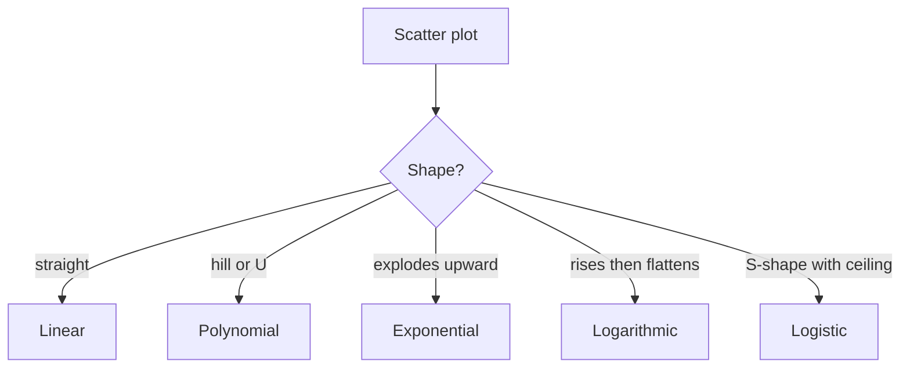
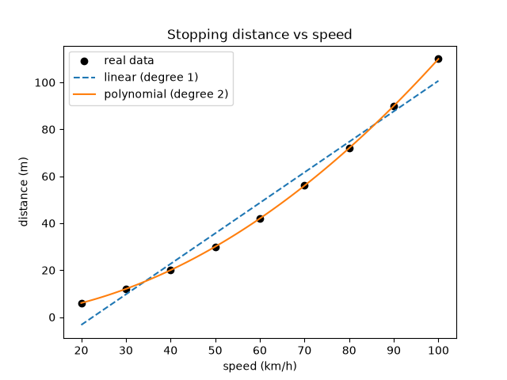
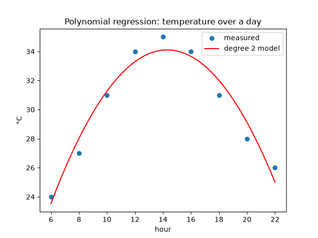
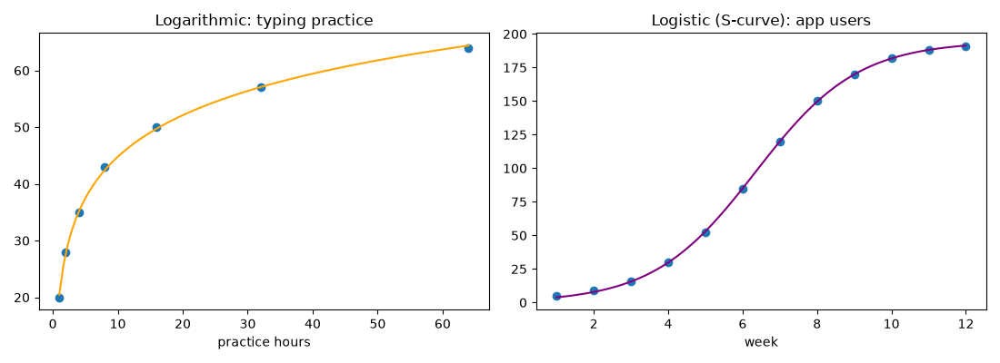

# Session 12: Non-Linear Regression Analysis

> Module: Data Science with Python · Term 5 (ADSE) · ⏱ ~2 hours

**Regression** means predicting a number: a price, a temperature, a distance. Simple linear regression draws a straight line through the data. But many things in life do not grow in a straight line: stopping distance shoots up with speed, a viral video's views explode, and typing speed improves quickly at first and then slowly. In this session you learn **non-linear regression**, which fits curves, and the important types you will meet in practice.

## 🎯 Learning Objectives

By the end of this session you will be able to:

- Describe non-linear regression and explain when a straight line is not enough
- Fit polynomial regression with NumPy and with scikit-learn
- Fit exponential, logarithmic and logistic (S-curve) models with SciPy's `curve_fit`
- Evaluate a model with the R² score on train and test data
- Recognise underfitting and overfitting when choosing model complexity

## 📖 Concepts Explained

### 1. From linear to non-linear

Linear regression assumes `y = a·x + b`: every extra unit of x adds the same amount of y. **Non-linear regression** allows the effect of x to change along the way, so the best-fit line becomes a **curve**.

> **Analogy:** a straight ruler cannot trace the edge of a cricket ball. You need a flexible curve.

How to tell you need it: draw a scatter plot first. If the dots bend (a hill, a U, a fast rise, a flattening), or a straight line misses the ends of the data, try a curve.

### 2. Important types of non-linear regression

| Type | Formula shape | Looks like | Real example |
|------|---------------|-----------|--------------|
| Polynomial (degree 2, 3 ...) | y = a + b·x + c·x² | hill or U | temperature over a day, stopping distance |
| Exponential | y = a·e^(b·x) | faster and faster growth | viral followers, compound interest, virus spread |
| Logarithmic | y = a + b·ln(x) | quick rise, then flattens | learning a skill, ad spend vs sales |
| Power | y = a·x^b | steady curve | area vs length, metabolism vs body weight |
| Logistic (S-curve) | y = L / (1 + e^(−k(x−m))) | slow, fast, then a ceiling | app adoption, product market share |



### 3. Tools in Python

| Tool | Use for |
|------|---------|
| `np.polyfit(x, y, deg)` + `np.polyval` | quick polynomial fits |
| `PolynomialFeatures` + `LinearRegression` (scikit-learn) | polynomial regression inside the ML workflow |
| `scipy.optimize.curve_fit(func, x, y, p0=...)` | any formula you can write as a Python function |

**Trick behind polynomial regression:** `PolynomialFeatures(degree=2)` turns the column `x` into `x` and `x²`. A normal linear regression on those columns then produces a curve. It is still "linear in the coefficients", which is why ordinary linear regression can solve it.

### 4. Measuring fit: R²

R² (R-squared) tells how much of the variation in y the model explains: **1.0** is perfect, **0** is no better than always guessing the average, and **negative** is worse than that. Always check R² on **test data** the model has not seen.

### 5. Underfitting vs overfitting

| | Underfitting | Good fit | Overfitting |
|---|-------------|----------|-------------|
| Model | too simple (straight line on a curve) | right shape | too wiggly (degree 12) |
| Train score | low | high | very high |
| Test score | low | high | **low** |

> **Analogy:** overfitting is like memorising past papers word for word: perfect on old questions, lost on new ones.

Choose the simplest model with the best **test** score.

## 💻 Code Examples

### Example 1: Straight line vs curve

File: [`linear_vs_nonlinear.py`](./linear_vs_nonlinear.py)

```python
# linear_vs_nonlinear.py - a straight line cannot follow a curve
import numpy as np
import matplotlib
matplotlib.use("Agg")
import matplotlib.pyplot as plt

# Car speed (km/h) and stopping distance (m): distance grows FASTER than speed
speed = np.array([20, 30, 40, 50, 60, 70, 80, 90, 100])
distance = np.array([6, 12, 20, 30, 42, 56, 72, 90, 110])

# np.polyfit(x, y, degree) finds the best curve of that degree
line = np.polyfit(speed, distance, deg=1)       # straight line: y = a*x + b
curve = np.polyfit(speed, distance, deg=2)      # parabola: y = a*x^2 + b*x + c
print("Line coefficients :", line.round(3))
print("Curve coefficients:", curve.round(4))

# np.polyval calculates y values from the coefficients
x_smooth = np.linspace(20, 100, 100)
plt.scatter(speed, distance, color="black", label="real data")
plt.plot(x_smooth, np.polyval(line, x_smooth), "--", label="linear (degree 1)")
plt.plot(x_smooth, np.polyval(curve, x_smooth), label="polynomial (degree 2)")
plt.title("Stopping distance vs speed")
plt.xlabel("speed (km/h)")
plt.ylabel("distance (m)")
plt.legend()
plt.savefig("linear_vs_nonlinear.png")

# Prediction for 120 km/h with both models
print("Predict 120 km/h -> line:", round(np.polyval(line, 120), 1),
      "m | curve:", round(np.polyval(curve, 120), 1), "m")
```

**How it works:** `polyfit` with `deg=1` fits a line and `deg=2` a parabola. The degree-2 coefficients come out as about 0.01 and 0.1, meaning distance ≈ 0.01·speed² + 0.1·speed. At 120 km/h the line predicts much too short a distance; the curve follows the real physics.



### Example 2: Polynomial regression with scikit-learn

File: [`polynomial_regression_sklearn.py`](./polynomial_regression_sklearn.py)

```python
# polynomial_regression_sklearn.py - polynomial regression with scikit-learn
import numpy as np
import matplotlib
matplotlib.use("Agg")
import matplotlib.pyplot as plt
from sklearn.preprocessing import PolynomialFeatures
from sklearn.linear_model import LinearRegression
from sklearn.pipeline import make_pipeline
from sklearn.metrics import r2_score

# Temperature during a day: rises until afternoon, then falls (a hill shape)
hour = np.array([6, 8, 10, 12, 14, 16, 18, 20, 22])
temp = np.array([24, 27, 31, 34, 35, 34, 31, 28, 26])

X = hour.reshape(-1, 1)        # scikit-learn wants X as a 2-D table (rows, columns)

# Pipeline: first make hour, hour^2 ; then fit an ordinary linear regression on them
model = make_pipeline(PolynomialFeatures(degree=2), LinearRegression())
model.fit(X, temp)

predicted = model.predict(X)
print("R2 score:", round(r2_score(temp, predicted), 3))      # 1.0 = perfect fit
print("Temperature at 13:00 ->", model.predict([[13]]).round(1)[0], "°C")

# Draw the smooth curve
x_smooth = np.linspace(6, 22, 100).reshape(-1, 1)
plt.scatter(hour, temp, label="measured")
plt.plot(x_smooth, model.predict(x_smooth), color="red", label="degree 2 model")
plt.title("Polynomial regression: temperature over a day")
plt.xlabel("hour")
plt.ylabel("°C")
plt.legend()
plt.savefig("polynomial_regression.png")
print("Saved polynomial_regression.png")
```

**How it works:** `reshape(-1, 1)` turns the 1-D hours into a one-column table. The pipeline adds the `hour²` column and then fits a linear regression, giving a hill-shaped curve. R² of about 0.95 shows a strong fit.



### Example 3: Exponential regression

File: [`exponential_curve_fit.py`](./exponential_curve_fit.py)

```python
# exponential_curve_fit.py - exponential growth fitted with scipy curve_fit
import numpy as np
import matplotlib
matplotlib.use("Agg")
import matplotlib.pyplot as plt
from scipy.optimize import curve_fit

# Followers of a new YouTube channel each month (grows faster and faster)
month = np.array([1, 2, 3, 4, 5, 6, 7, 8])
followers = np.array([110, 160, 250, 370, 560, 830, 1250, 1900])

# Step 1: write the shape of the curve as a Python function
def exponential(x, a, b):
    return a * np.exp(b * x)          # a = start size, b = growth rate

# Step 2: let curve_fit find the best a and b (p0 = first guesses)
params, _ = curve_fit(exponential, month, followers, p0=[100, 0.3])
a, b = params
print(f"Model: followers = {a:.1f} * e^({b:.3f} * month)")
print(f"Growth per month: {(np.exp(b) - 1) * 100:.1f}%")

# Step 3: predict month 10
print("Month 10 prediction:", round(exponential(10, a, b)))

x_smooth = np.linspace(1, 10, 100)
plt.scatter(month, followers, label="real")
plt.plot(x_smooth, exponential(x_smooth, a, b), color="green", label="exponential fit")
plt.title("Exponential regression")
plt.xlabel("month")
plt.ylabel("followers")
plt.legend()
plt.savefig("exponential_fit.png")
print("Saved exponential_fit.png")
```

**How it works:** we describe the shape `a·e^(b·x)` as a function and `curve_fit` searches for the a and b that make the curve closest to the dots. `p0` gives starting guesses, which helps the search. e^b − 1 converts b into a monthly growth percentage.

### Example 4: Logarithmic and logistic curves

File: [`logarithmic_and_logistic.py`](./logarithmic_and_logistic.py)

```python
# logarithmic_and_logistic.py - two more non-linear shapes
import numpy as np
import matplotlib
matplotlib.use("Agg")
import matplotlib.pyplot as plt
from scipy.optimize import curve_fit

# --- 1. Logarithmic: fast gains at first, then slow ("diminishing returns") ---
practice_hours = np.array([1, 2, 4, 8, 16, 32, 64])
typing_speed = np.array([20, 28, 35, 43, 50, 57, 64])    # words per minute

def logarithmic(x, a, b):
    return a + b * np.log(x)

(a1, b1), _ = curve_fit(logarithmic, practice_hours, typing_speed)
print(f"Log model: speed = {a1:.1f} + {b1:.1f} * ln(hours)")

# --- 2. Logistic (S-curve): slow start, fast middle, then levels off ---
week = np.arange(1, 13)
users = np.array([5, 9, 16, 30, 52, 85, 120, 150, 170, 182, 188, 191])  # thousands

def logistic(x, limit, rate, middle):
    return limit / (1 + np.exp(-rate * (x - middle)))

(limit, rate, middle), _ = curve_fit(logistic, week, users, p0=[200, 1, 6])
print(f"Logistic model: max ~ {limit:.0f}k users, middle at week {middle:.1f}")

# Plot both side by side
fig, axes = plt.subplots(1, 2, figsize=(11, 4))
x1 = np.linspace(1, 64, 100)
axes[0].scatter(practice_hours, typing_speed)
axes[0].plot(x1, logarithmic(x1, a1, b1), color="orange")
axes[0].set_title("Logarithmic: typing practice")
axes[0].set_xlabel("practice hours")

x2 = np.linspace(1, 12, 100)
axes[1].scatter(week, users)
axes[1].plot(x2, logistic(x2, limit, rate, middle), color="purple")
axes[1].set_title("Logistic (S-curve): app users")
axes[1].set_xlabel("week")

fig.tight_layout()
fig.savefig("log_and_logistic.png")
print("Saved log_and_logistic.png")
```

**How it works:** the same `curve_fit` method fits two different shapes. The logistic model also estimates the **ceiling** (about 194k users) and the week of fastest growth, both useful for business planning.



### Example 5: Choosing the degree

File: [`choose_degree.py`](./choose_degree.py)

```python
# choose_degree.py - too simple vs too complex: underfitting and overfitting
import numpy as np
from sklearn.model_selection import train_test_split
from sklearn.preprocessing import PolynomialFeatures
from sklearn.linear_model import LinearRegression
from sklearn.pipeline import make_pipeline
from sklearn.metrics import r2_score

# Made-up data that truly follows a curve, plus noise
rng = np.random.default_rng(seed=0)
x = rng.uniform(0, 10, 60)
y = 3 + 2 * x - 0.3 * x**2 + rng.normal(0, 1.5, 60)
X = x.reshape(-1, 1)

# Keep 30% of the data aside to TEST on data the model has never seen
X_train, X_test, y_train, y_test = train_test_split(X, y, test_size=0.3, random_state=1)

print("degree | train R2 | test R2")
for degree in [1, 2, 3, 6, 12]:
    model = make_pipeline(PolynomialFeatures(degree), LinearRegression())
    model.fit(X_train, y_train)
    train_r2 = r2_score(y_train, model.predict(X_train))
    test_r2 = r2_score(y_test, model.predict(X_test))
    print(f"{degree:>6} | {train_r2:8.3f} | {test_r2:7.3f}")

print("\nPick the degree with the best TEST score, not the best train score.")
```

**How it works:** the data is split into 70% train and 30% test. As the degree rises, the train score keeps climbing, but the test score peaks at degree 2 and then collapses (even below 0): classic overfitting.

## 🧪 Lab Practice

1. In `linear_vs_nonlinear.py`, try `deg=3`. Does it improve the prediction for 120 km/h? Is it worth the extra complexity?
2. Fit an exponential model to this savings data: years `[0, 1, 2, 3, 4, 5]`, balance `[100000, 112000, 125400, 140500, 157300, 176200]`. What yearly growth rate does it find?
3. Fit a logarithmic model to ad spend vs sales of your own made-up numbers and predict sales at double the highest spend.
4. Change `choose_degree.py` to test degrees 1 to 10 in a loop and plot train and test R² against degree.

## 📝 Assignment

Find (or make realistic) data for Pakistan's mobile internet users over 10–12 years. Fit linear, polynomial (degree 2) and logistic models, compare their R² on a train/test split, plot all three curves on one chart, and write three sentences: which model you choose, why, and what it predicts for two years ahead.

## ❓ Quick Quiz

1. Which model shape suits "fast gains at first, then slow improvement"?
2. What does `PolynomialFeatures(degree=2)` add to a column x?
3. What is the role of `p0` in `curve_fit`?
4. A model has train R² 0.99 and test R² 0.20. What is the problem?
5. What does an R² of 0 mean?

<details>
<summary>Show answers</summary>

1. Logarithmic
2. The column x² (plus a constant column of 1s)
3. Starting guesses for the parameters, which help the search find a good answer
4. Overfitting
5. The model is no better than always predicting the average of y

</details>

## 💼 Interview Questions

1. **Is polynomial regression a linear or non-linear model?** — The curve is non-linear in x, but the model is linear in its coefficients, so it is solved with ordinary linear regression on the expanded features.
2. **How do you detect overfitting?** — Compare performance on training data with performance on unseen test (or cross-validation) data; a large gap with a high train score signals overfitting.
3. **Why might you prefer a logistic curve to an exponential one for forecasting users?** — Exponential growth never stops, which is unrealistic; a logistic curve includes a saturation limit, matching how markets fill up.

## ✅ Summary

- Non-linear regression fits curves when a straight line misses the pattern.
- Main types: polynomial, exponential, logarithmic, power and logistic.
- Use `np.polyfit`, scikit-learn's `PolynomialFeatures` pipeline, or SciPy's `curve_fit`.
- Judge models with R² on test data.
- Too simple underfits, too complex overfits; choose the simplest model that tests well.

---

[⬅ Previous](../Session-11-Data-Visualization-with-Seaborn/README.md) · [🏠 Module Home](../README.md) · [Next ➡](../Session-13-Practice-Lab-Seaborn-and-Regression/README.md)

Prepared by Zeeshan Abbas · Aptech Learning North Nazimabad
