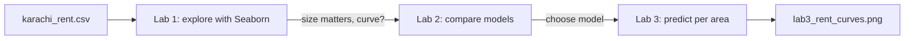
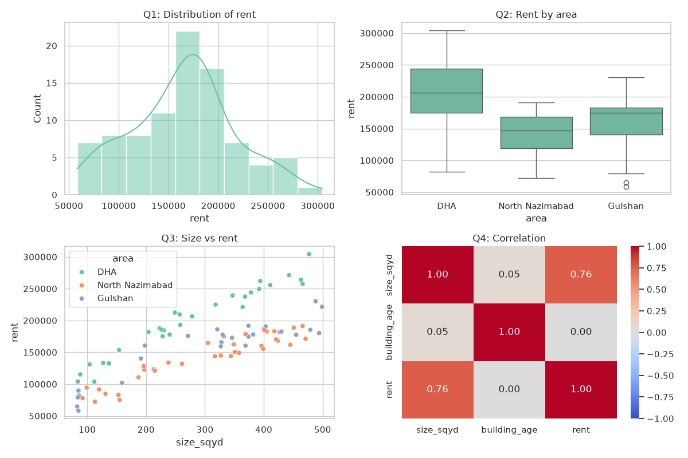
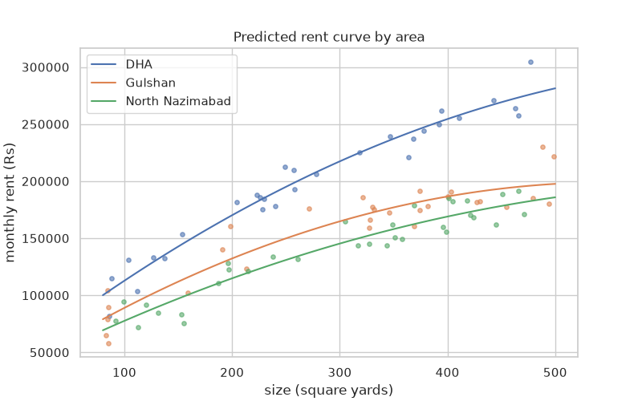

# Session 13: Practice Lab — Seaborn and Regression (Sessions 11–12)

> Module: Data Science with Python · Term 5 (ADSE) · ⏱ ~2 hours

A property website in Karachi wants a simple "rent estimator". You have 90 flats from three areas (DHA, Gulshan and North Nazimabad) with their size, building age and monthly rent. In this lab you first **explore** the data with Seaborn, then **compare** linear and non-linear regression models, and finally **predict** rents and draw a curve for each area.

## 🎯 Learning Objectives

By the end of this lab you will be able to:

- Plan and build a Seaborn exploration dashboard that answers specific questions
- Read a correlation heatmap and a box plot to choose useful features
- Compare linear, polynomial and logarithmic models fairly on a test set
- Decide between models whose scores are close, using the simplicity rule
- Train one model per group and present predictions with a clear chart

## 📖 Concepts Explained

### 1. The lab flow



### 2. The dataset

| Column | Meaning |
|--------|---------|
| `area` | DHA, Gulshan or North Nazimabad |
| `size_sqyd` | flat size in square yards |
| `building_age` | years since the building was made |
| `rent` | monthly rent in rupees (target to predict) |

The data is generated by [`make_rent_csv.py`](./make_rent_csv.py) with a fixed seed; it is realistic in shape but not real market data.

### 3. Exploration questions before modelling

1. How are rents spread? (histogram)
2. Does the area change rent? (box plot by area)
3. Is the link between size and rent straight or curved? (scatter with `hue`)
4. Which numeric columns relate to rent? (heatmap)

### 4. Comparing models fairly

- Use the **same** train/test split for every model.
- Compare **test** R², never train R².
- If two scores differ by only about 0.01, they are practically equal. Pick the **simpler** model (easier to explain and less likely to overfit). This idea is often called **Occam's razor**.

### 5. One model per group

Area changes rent a lot. A quick way to handle it is to train a separate model for each area using `groupby`. (Later you will learn to put the area into one model as an encoded feature.)

## 💻 Code Examples

File: [`make_rent_csv.py`](./make_rent_csv.py)

```python
# make_rent_csv.py - create a practice dataset of flat rents (run once)
import numpy as np
import pandas as pd

rng = np.random.default_rng(seed=21)
n = 90
area = rng.choice(["DHA", "Gulshan", "North Nazimabad"], n)
size = rng.uniform(80, 500, n).round()                  # size in square yards
age = rng.integers(0, 30, n)                            # building age in years

# Rent grows with size but more slowly for big flats (a curve), plus area effect
area_bonus = pd.Series(area).map({"DHA": 1.5, "Gulshan": 1.1, "North Nazimabad": 1.0}).to_numpy()
rent = (9000 * np.sqrt(size) * area_bonus - age * 900 + rng.normal(0, 12000, n)).round(-2)

df = pd.DataFrame({"area": area, "size_sqyd": size, "building_age": age, "rent": rent})
df.to_csv("karachi_rent.csv", index=False)
print(df.head())
print("Saved karachi_rent.csv with", len(df), "rows")
```

**How it works:** rent is built from the square root of size (so it bends), an area multiplier and a small penalty for older buildings, plus random noise.

### Lab 1: Explore with Seaborn

File: [`lab1_explore_seaborn.py`](./lab1_explore_seaborn.py)

```python
# lab1_explore_seaborn.py - Lab 1: explore the rent data visually
import pandas as pd
import matplotlib
matplotlib.use("Agg")
import matplotlib.pyplot as plt
import seaborn as sns

df = pd.read_csv("karachi_rent.csv")
print(df.describe().round(0))

sns.set_theme(style="whitegrid", palette="Set2")
fig, axes = plt.subplots(2, 2, figsize=(12, 8))

# Q1: how are rents spread?
sns.histplot(data=df, x="rent", kde=True, ax=axes[0, 0])
axes[0, 0].set_title("Q1: Distribution of rent")

# Q2: which area is most expensive?
sns.boxplot(data=df, x="area", y="rent", ax=axes[0, 1])
axes[0, 1].set_title("Q2: Rent by area")

# Q3: is the size-rent link straight or curved?
sns.scatterplot(data=df, x="size_sqyd", y="rent", hue="area", ax=axes[1, 0])
axes[1, 0].set_title("Q3: Size vs rent")

# Q4: which numbers move together?
corr = df[["size_sqyd", "building_age", "rent"]].corr()
sns.heatmap(corr, annot=True, fmt=".2f", cmap="coolwarm", vmin=-1, vmax=1, ax=axes[1, 1])
axes[1, 1].set_title("Q4: Correlation")

fig.tight_layout()
fig.savefig("lab1_explore.png")
print("Saved lab1_explore.png")
```

**How it works:** four questions, four charts. The box plot shows DHA rents clearly higher; the scatter shows rent rising with size but bending slightly; the heatmap shows size has a strong positive correlation with rent and building age a weak negative one.



### Lab 2: Compare models

File: [`lab2_compare_models.py`](./lab2_compare_models.py)

```python
# lab2_compare_models.py - Lab 2: linear vs polynomial vs logarithmic for size -> rent
import numpy as np
import pandas as pd
from scipy.optimize import curve_fit
from sklearn.model_selection import train_test_split
from sklearn.linear_model import LinearRegression
from sklearn.preprocessing import PolynomialFeatures
from sklearn.pipeline import make_pipeline
from sklearn.metrics import r2_score

df = pd.read_csv("karachi_rent.csv")
df = df[df["area"] == "Gulshan"]                    # one area, so only size matters
X = df[["size_sqyd"]]
y = df["rent"]
X_train, X_test, y_train, y_test = train_test_split(X, y, test_size=0.3, random_state=0)

results = {}

# Model 1: straight line
linear = LinearRegression().fit(X_train, y_train)
results["linear"] = r2_score(y_test, linear.predict(X_test))

# Model 2: polynomial degree 2
poly = make_pipeline(PolynomialFeatures(2), LinearRegression()).fit(X_train, y_train)
results["polynomial (2)"] = r2_score(y_test, poly.predict(X_test))

# Model 3: logarithmic curve with curve_fit
def log_curve(x, a, b):
    return a + b * np.log(x)

(a, b), _ = curve_fit(log_curve, X_train["size_sqyd"], y_train)
results["logarithmic"] = r2_score(y_test, log_curve(X_test["size_sqyd"], a, b))

print("Test R2 for each model:")
for name, score in results.items():
    print(f"  {name:<15} {score:.3f}")
print("Best model:", max(results, key=results.get))
```

**How it works:** we keep only Gulshan so area does not confuse the comparison. Three models are trained on the same 70% and tested on the same 30%. In this data all three score about 0.85–0.87; the gap is tiny, so a straight line or a degree-2 curve are both reasonable. Notice how the result depends on the range of sizes: within 80–500 square yards the curve is gentle.

### Lab 3: Predictions per area

File: [`lab3_prediction_report.py`](./lab3_prediction_report.py)

```python
# lab3_prediction_report.py - Lab 3: predict rents and show the curve per area
import numpy as np
import pandas as pd
import matplotlib
matplotlib.use("Agg")
import matplotlib.pyplot as plt
import seaborn as sns
from sklearn.linear_model import LinearRegression
from sklearn.preprocessing import PolynomialFeatures
from sklearn.pipeline import make_pipeline

df = pd.read_csv("karachi_rent.csv")
sns.set_theme(style="whitegrid")
plt.figure(figsize=(8, 5))

sizes_to_ask = pd.DataFrame({"size_sqyd": [120, 240, 400]})
x_smooth = pd.DataFrame({"size_sqyd": np.linspace(80, 500, 100)})

# One small model per area
for area_name, group in df.groupby("area"):
    model = make_pipeline(PolynomialFeatures(2), LinearRegression())
    model.fit(group[["size_sqyd"]], group["rent"])

    predictions = model.predict(sizes_to_ask).round(-2)
    print(f"{area_name:<16} 120/240/400 sq yd ->", predictions)

    plt.scatter(group["size_sqyd"], group["rent"], s=15, alpha=0.6)
    plt.plot(x_smooth["size_sqyd"], model.predict(x_smooth), label=area_name)

plt.title("Predicted rent curve by area")
plt.xlabel("size (square yards)")
plt.ylabel("monthly rent (Rs)")
plt.legend()
plt.savefig("lab3_rent_curves.png")
print("Saved lab3_rent_curves.png")
```

**How it works:** `groupby("area")` loops over the three areas; each gets its own degree-2 model. We predict rents for 120, 240 and 400 square yards and draw each area's curve over its dots.



## 🧪 Lab Practice

1. In Lab 1, add a `regplot` of `building_age` vs `rent`. Is the trend up or down?
2. In Lab 2, repeat the comparison for DHA and for North Nazimabad. Does the best model change?
3. Add `building_age` as a second feature to the linear model (`X = df[["size_sqyd", "building_age"]]`). Does test R² improve?
4. In Lab 3, print a small table (DataFrame) of predictions with areas as rows and sizes as columns, and save it as `rent_estimates.csv`.
5. Change `random_state` in Lab 2 to 1, 2 and 3. How much do the scores move? What does that tell you about small datasets?

## 📝 Assignment

Create (or collect) a dataset of 50+ used cars with `model_year`, `mileage_km` and `price`. Explore it with at least three Seaborn charts, compare a linear model with an exponential-decay model (`price = a·e^(−b·age)`) using `curve_fit`, and write a short conclusion: which model you would put on a website and why.

## ❓ Quick Quiz

1. Why do we filter to a single area before comparing models in Lab 2?
2. Two models score 0.864 and 0.865 on test data. Which should you prefer?
3. Which Seaborn chart quickly shows rent differences between areas?
4. Why must all models use the same train/test split?
5. What does a negative correlation between building age and rent mean?

<details>
<summary>Show answers</summary>

1. So the effect of area does not hide the size–rent relationship we are testing
2. Practically equal; prefer the simpler one (the straight line), unless you have a reason to expect a curve
3. A box plot (`sns.boxplot(x="area", y="rent")`)
4. Different splits give different test questions, so the comparison would not be fair
5. Older buildings tend to have lower rents

</details>

## 💼 Interview Questions

1. **How do you choose between several regression models?** — Use the same validation method (a fixed test set or cross-validation), compare a relevant metric such as R² or RMSE, and among similar scores choose the simpler, more explainable model.
2. **Why can results change with `random_state` on a small dataset?** — With few rows, which rows land in the test set changes the score noticeably; cross-validation averages over several splits for a more stable estimate.
3. **What would you check before trusting a rent estimator?** — Data quality and outliers, whether the training data covers the sizes and areas users will ask about, error size in rupees (e.g. RMSE), and whether the data is recent.

## ✅ Summary

- Explore first: distribution, groups, shape of the relationship, correlation.
- Compare models on the same split using test scores.
- When scores are close, choose the simpler model.
- Grouped models (one per area) are a quick way to handle a strong category effect.

---

[⬅ Previous](../Session-12-Non-Linear-Regression-Analysis/README.md) · [🏠 Module Home](../README.md) · [Next ➡](../Session-14-Classification-I-SVM-and-KNN/README.md)

Prepared by Zeeshan Abbas · Aptech Learning North Nazimabad
