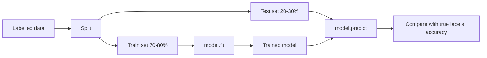
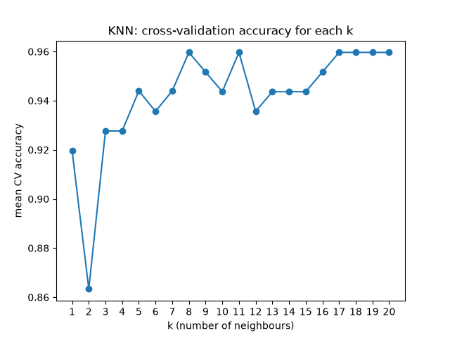
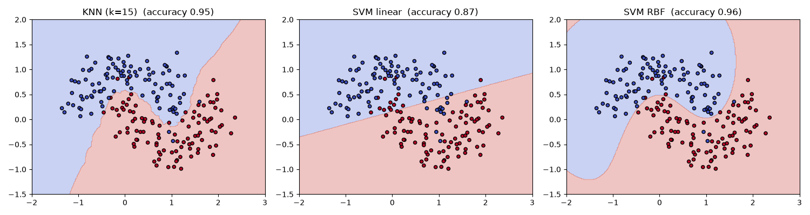

# Session 14: Classification I — Support Vector Machines and K-Nearest Neighbours

> Module: Data Science with Python · Term 5 (ADSE) · ⏱ ~2 hours

Regression predicts a number. **Classification** predicts a **category**: pass or fail, spam or not spam, fraud or genuine, malignant or benign. In this session you learn how classification works in scikit-learn and meet two classic algorithms: **K-Nearest Neighbours (KNN)**, which decides by looking at the closest examples, and **Support Vector Machines (SVM)**, which draw the widest possible boundary between classes.

## 🎯 Learning Objectives

By the end of this session you will be able to:

- Describe classification and give examples of binary and multi-class problems
- Explain features, labels, training and testing, and the fit/predict pattern
- Describe how KNN classifies using distance and majority vote, and why scaling matters
- Describe how an SVM finds a maximum-margin boundary and what kernels and `C` do
- Train, test and compare KNN and SVM classifiers in scikit-learn

## 📖 Concepts Explained

### 1. What is classification?

A classifier learns from examples whose answers are known (labelled data) and then predicts the label of new examples. This is **supervised learning**.

| Type | Number of classes | Example |
|------|-------------------|---------|
| Binary | 2 | pass/fail, spam/not spam, loan default yes/no |
| Multi-class | 3 or more | grape type, digit 0–9, news topic |



- **Features (X):** the inputs, such as study hours and attendance.
- **Label (y):** the answer to predict, such as Pass or Fail.
- **`stratify=y`** keeps the same class proportions in train and test.
- **Accuracy** = correct predictions ÷ all predictions (more metrics in Session 15).

Every scikit-learn model uses the same three steps: **create → `fit` → `predict`** (and `score` for accuracy).

### 2. K-Nearest Neighbours (KNN)

> **Analogy:** you move to a new street and want to know if it is a "cricket street" or a "football street". You look at your 5 nearest neighbours: if 4 of them play cricket, you guess cricket.

Steps for a new point:

1. Measure the distance to every training point (usually straight-line **Euclidean** distance).
2. Take the **k** closest points.
3. Majority vote: the most common label wins.

| Point | Detail |
|-------|--------|
| Training | almost none: it just stores the data ("lazy learner") |
| Prediction | slow on big data (must measure many distances) |
| Small k (1–3) | follows noise, may overfit |
| Large k | smoother, may underfit |
| Odd k | avoids ties in binary problems |
| **Scaling** | essential: a feature in thousands (grams, rupees) would dominate a feature in single digits |

### 3. Support Vector Machines (SVM)

> **Analogy:** two groups of students stand on a ground. You want to paint a line between them that keeps the **widest possible gap** from both groups, so a new student is classified confidently.

- The boundary is called the **hyperplane** (a line in 2-D, a plane in 3-D).
- The gap on both sides is the **margin**; SVM makes it as wide as possible.
- The few points touching the margin are the **support vectors**; they alone decide the boundary.
- **Kernel trick:** when classes cannot be split by a straight line, a kernel (such as **RBF**) lets SVM draw curved boundaries by imagining the data in a higher dimension.
- **C (regularisation):** small C allows some mistakes for a wider, smoother margin; large C tries to get every training point right, which can overfit.

| Kernel | Boundary | Use when |
|--------|----------|----------|
| `linear` | straight | many features, text data, roughly separable classes |
| `rbf` (default) | flexible curves | general purpose, non-linear patterns |
| `poly` | polynomial curves | specific curved patterns |

### 4. KNN vs SVM

| | KNN | SVM |
|---|-----|-----|
| Idea | vote of nearest neighbours | widest margin boundary |
| Training speed | instant | slower on very big data |
| Prediction speed | slow on big data | fast |
| Needs scaling | yes | yes |
| Main settings | `n_neighbors` | `kernel`, `C`, `gamma` |

## 💻 Code Examples

The bigger examples use datasets that ship with scikit-learn (`load_wine`, `load_breast_cancer`, `make_moons`), so no download is needed.

### Example 1: The classification workflow

File: [`classification_intro.py`](./classification_intro.py)

```python
# classification_intro.py - classification = predicting a CATEGORY (label)
import pandas as pd
from sklearn.model_selection import train_test_split
from sklearn.neighbors import KNeighborsClassifier

# Features (inputs) and label (output): will a student pass?
df = pd.DataFrame({
    "study_hours": [1, 2, 2, 3, 4, 5, 5, 6, 7, 8, 1.5, 6.5],
    "attendance":  [50, 60, 55, 65, 70, 80, 75, 85, 90, 95, 58, 88],
    "result":      ["Fail", "Fail", "Fail", "Fail", "Pass", "Pass",
                    "Pass", "Pass", "Pass", "Pass", "Fail", "Pass"],
})

X = df[["study_hours", "attendance"]]     # features: capital X (a table)
y = df["result"]                          # label: small y (one column)

# Split: the model learns from train, we check it on test
X_train, X_test, y_train, y_test = train_test_split(
    X, y, test_size=0.25, random_state=42, stratify=y)
print("Train rows:", len(X_train), "| Test rows:", len(X_test))

# Every scikit-learn model follows the same 3 steps
model = KNeighborsClassifier(n_neighbors=3)   # 1. create
model.fit(X_train, y_train)                   # 2. learn
predictions = model.predict(X_test)           # 3. predict

print("Predicted:", list(predictions))
print("Actual   :", list(y_test))
print("Accuracy :", model.score(X_test, y_test))

# Predict a brand-new student
new_student = pd.DataFrame({"study_hours": [4.5], "attendance": [72]})
print("New student ->", model.predict(new_student)[0])
```

**How it works:** X holds two features and y the label. After the split, the KNN model is created, fitted and asked to predict the test rows. `score` returns accuracy; finally we classify a new student.

### Example 2: KNN by hand

File: [`knn_by_hand.py`](./knn_by_hand.py)

```python
# knn_by_hand.py - how K-Nearest Neighbours decides, step by step
import math

# Known fruits: (weight in grams, sweetness 1-10) -> label
known = [
    ((150, 7), "Apple"), ((170, 6), "Apple"), ((140, 8), "Apple"),
    ((120, 9), "Mango"), ((200, 9), "Mango"), ((210, 8), "Mango"),
    ((300, 3), "Melon"), ((320, 4), "Melon"),
]
new_fruit = (190, 8)
k = 3

# Step 1: distance from the new fruit to every known fruit (straight-line / Euclidean)
distances = []
for (weight, sweet), label in known:
    d = math.sqrt((weight - new_fruit[0]) ** 2 + (sweet - new_fruit[1]) ** 2)
    distances.append((d, label))

# Step 2: sort by distance and keep the k closest
distances.sort()
nearest = distances[:k]
print("Nearest neighbours:")
for d, label in nearest:
    print(f"  {label:<6} distance = {d:.1f}")

# Step 3: majority vote
votes = {}
for _, label in nearest:
    votes[label] = votes.get(label, 0) + 1
print("Votes:", votes)
print("Prediction:", max(votes, key=votes.get))

# Note: weight (grams) is much bigger than sweetness (1-10), so weight dominates the
# distance. That is why we SCALE features before KNN (see knn_sklearn.py).
```

**How it works:** we compute the distance to every known fruit, keep the three closest and count votes. The comment at the end explains why weight (in grams) overwhelms sweetness: the reason scaling is needed.

### Example 3: KNN with scaling and choosing k

File: [`knn_sklearn.py`](./knn_sklearn.py)

```python
# knn_sklearn.py - KNN with scaling and choosing the best k
from sklearn.datasets import load_wine          # small dataset bundled with scikit-learn
from sklearn.model_selection import train_test_split, cross_val_score
from sklearn.preprocessing import StandardScaler
from sklearn.neighbors import KNeighborsClassifier
from sklearn.pipeline import make_pipeline
import matplotlib
matplotlib.use("Agg")
import matplotlib.pyplot as plt

# 178 wines, 13 chemical measurements, 3 grape types (labels 0, 1, 2)
X, y = load_wine(return_X_y=True, as_frame=True)
print("Data shape:", X.shape, "| classes:", sorted(y.unique().tolist()))

X_train, X_test, y_train, y_test = train_test_split(
    X, y, test_size=0.3, random_state=0, stratify=y)

# Without scaling vs with scaling (k = 5)
plain = KNeighborsClassifier(n_neighbors=5).fit(X_train, y_train)
scaled = make_pipeline(StandardScaler(), KNeighborsClassifier(n_neighbors=5)).fit(X_train, y_train)
print("Accuracy without scaling:", round(plain.score(X_test, y_test), 3))
print("Accuracy with scaling   :", round(scaled.score(X_test, y_test), 3))

# Choose k with 5-fold cross-validation on the TRAINING data only
# (the test set stays untouched until the very end)
k_values = range(1, 21)
scores = []
for k in k_values:
    model = make_pipeline(StandardScaler(), KNeighborsClassifier(n_neighbors=k))
    cv_scores = cross_val_score(model, X_train, y_train, cv=5)   # 5 mini train/test rounds
    scores.append(cv_scores.mean())

best_k = k_values[scores.index(max(scores))]
print("Best k by cross-validation:", best_k, "| CV accuracy:", round(max(scores), 3))

# Final check on the test set with the chosen k
final = make_pipeline(StandardScaler(), KNeighborsClassifier(n_neighbors=best_k)).fit(X_train, y_train)
print("Test accuracy with best k:", round(final.score(X_test, y_test), 3))

plt.plot(list(k_values), scores, marker="o")
plt.title("KNN: cross-validation accuracy for each k")
plt.xlabel("k (number of neighbours)")
plt.ylabel("mean CV accuracy")
plt.xticks(list(k_values))
plt.savefig("knn_choose_k.png")
print("Saved knn_choose_k.png")
```

**How it works:** without scaling accuracy is about 0.72; with `StandardScaler` it jumps to about 0.96. To choose k fairly we use **cross-validation** on the training data only (5 rounds of mini train/test), then check the chosen k once on the test set.



### Example 4: SVM kernels and C

File: [`svm_classifier.py`](./svm_classifier.py)

```python
# svm_classifier.py - Support Vector Machine with linear and RBF kernels
from sklearn.datasets import load_breast_cancer
from sklearn.model_selection import train_test_split
from sklearn.preprocessing import StandardScaler
from sklearn.svm import SVC
from sklearn.pipeline import make_pipeline

# 569 tumour samples, 30 measurements, label 0 = malignant, 1 = benign
X, y = load_breast_cancer(return_X_y=True)
X_train, X_test, y_train, y_test = train_test_split(
    X, y, test_size=0.25, random_state=1, stratify=y)

# SVM needs scaled features, so we always put a scaler in front
for kernel in ["linear", "rbf"]:
    model = make_pipeline(StandardScaler(), SVC(kernel=kernel, C=1.0))
    model.fit(X_train, y_train)
    print(f"{kernel:<6} kernel accuracy: {model.score(X_test, y_test):.3f}")

# The C setting: small C = wider, softer margin; large C = tries to classify every point
for c in [0.01, 1, 100]:
    model = make_pipeline(StandardScaler(), SVC(kernel="rbf", C=c)).fit(X_train, y_train)
    print(f"C = {c:<5} test accuracy: {model.score(X_test, y_test):.3f}")
```

**How it works:** both kernels score highly on this medical dataset, RBF slightly better. A tiny C (0.01) is too soft and accuracy drops sharply; C = 1 is a good balance here.

### Example 5: Seeing decision boundaries

File: [`decision_boundaries.py`](./decision_boundaries.py)

```python
# decision_boundaries.py - SEE how KNN and SVM split the space
import numpy as np
import matplotlib
matplotlib.use("Agg")
import matplotlib.pyplot as plt
from sklearn.datasets import make_moons
from sklearn.neighbors import KNeighborsClassifier
from sklearn.svm import SVC

# Two interleaving half-moons: a classic non-linear problem (2 features, 2 classes)
X, y = make_moons(n_samples=200, noise=0.25, random_state=3)

models = {
    "KNN (k=15)": KNeighborsClassifier(n_neighbors=15),
    "SVM linear": SVC(kernel="linear"),
    "SVM RBF": SVC(kernel="rbf", C=1),
}

# A fine grid of points covering the plot area
xx, yy = np.meshgrid(np.linspace(-2, 3, 300), np.linspace(-1.5, 2, 300))
grid = np.c_[xx.ravel(), yy.ravel()]

fig, axes = plt.subplots(1, 3, figsize=(15, 4))
for ax, (name, model) in zip(axes, models.items()):
    model.fit(X, y)
    zone = model.predict(grid).reshape(xx.shape)     # class of every grid point
    ax.contourf(xx, yy, zone, alpha=0.3, cmap="coolwarm")
    ax.scatter(X[:, 0], X[:, 1], c=y, cmap="coolwarm", edgecolor="k", s=20)
    ax.set_title(f"{name}  (accuracy {model.score(X, y):.2f})")

fig.tight_layout()
fig.savefig("decision_boundaries.png")
print("Saved decision_boundaries.png")
```

**How it works:** we predict the class of every point on a fine grid and colour the regions. The linear SVM can only draw a straight cut through the moons, while KNN and RBF SVM bend around them.



## 🧪 Lab Practice

1. In `knn_by_hand.py`, change k to 1 and to 5. Does the prediction change? Then divide every weight by 100 (simple scaling) and run again.
2. In `classification_intro.py`, predict three new students of your choice and explain each answer.
3. In `svm_classifier.py`, add the `poly` kernel and try `C` values 0.1, 10 and 1000.
4. In `decision_boundaries.py`, change `n_neighbors` to 1 and 50 and describe how the KNN boundary changes.

## 📝 Assignment

Use `load_iris()` from scikit-learn (150 flowers, 3 species). Split 75/25 with `stratify`, train a scaled KNN (choose k with cross-validation) and a scaled SVM (try linear and RBF). Print the accuracy of each, predict the species of a flower with measurements `[5.8, 2.7, 4.1, 1.0]`, and write two sentences comparing the models.

## ❓ Quick Quiz

1. Is predicting tomorrow's temperature classification or regression?
2. In KNN, what happens with k = 1?
3. What are support vectors?
4. Which SVM setting allows curved boundaries?
5. Why do KNN and SVM need feature scaling?

<details>
<summary>Show answers</summary>

1. Regression (a number); "hot or cold" would be classification
2. Each new point copies the label of its single closest neighbour, so the model follows noise and can overfit
3. The training points closest to the boundary, which define the margin
4. A non-linear kernel such as `kernel="rbf"`
5. Both rely on distances; features with large ranges would otherwise dominate

</details>

## 💼 Interview Questions

1. **Why is KNN called a lazy learner?** — It does no real training; it stores the data and does all the work (distance calculations) at prediction time.
2. **What is the kernel trick?** — A way for SVM to work as if the data were mapped into a higher-dimensional space where classes become separable, without computing that mapping directly, producing non-linear boundaries in the original space.
3. **What does the C parameter control in SVM?** — The trade-off between a wide margin and classifying every training point correctly: low C gives a softer, more general margin; high C fits training data tightly and may overfit.

## ✅ Summary

- Classification predicts categories from labelled examples (supervised learning).
- Workflow: split → `fit` → `predict` → evaluate; use `stratify` for fair splits.
- KNN: distance + majority vote of k neighbours; choose k with cross-validation; scale features.
- SVM: maximum-margin boundary; kernels allow curves; C balances margin vs errors.
- Always scale features for distance-based models.

---

[⬅ Previous](../Session-13-Practice-Lab-Seaborn-and-Regression/README.md) · [🏠 Module Home](../README.md) · [Next ➡](../Session-15-Classification-II-and-Evaluating-Models/README.md)

Prepared by Zeeshan Abbas · Aptech Learning North Nazimabad
