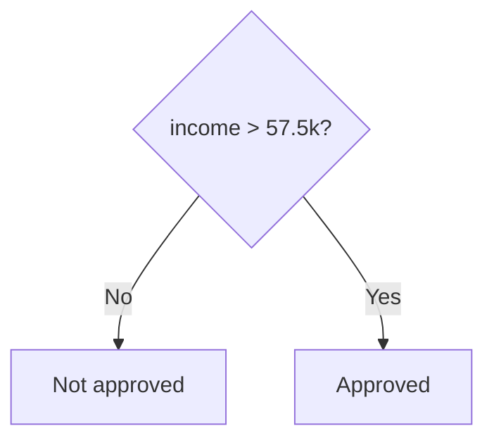
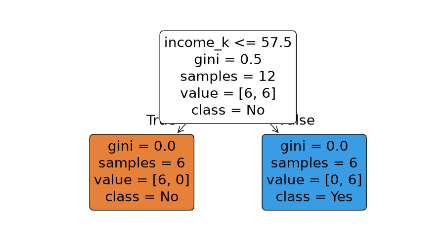
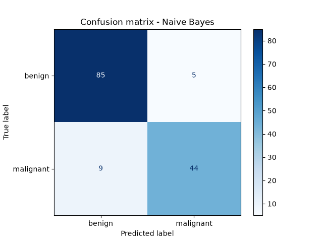
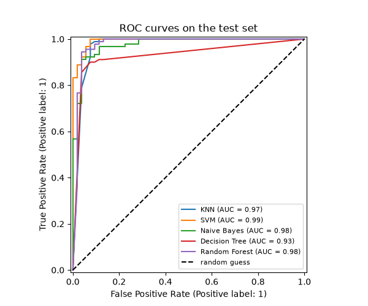

# Session 15: Classification II and Evaluating Classifier Models

> Module: Data Science with Python · Term 5 (ADSE) · ⏱ ~2 hours

This session adds three more classifiers to your toolbox: **Naive Bayes**, which uses probability; the **Decision Tree**, which learns a chain of if/else questions; and the **Random Forest**, where many trees vote together. Then we answer the most important question in machine learning: *how good is my model, really?* You will learn the confusion matrix, precision, recall, F1, ROC curves and cross-validation.

## 🎯 Learning Objectives

By the end of this session you will be able to:

- Describe the Naive Bayes classifier and use it for text (spam) and numeric data
- Describe how a Decision Tree splits data and how to keep it from overfitting
- Describe the Random Forest classifier and read feature importances
- Build and interpret a confusion matrix
- Calculate and choose between accuracy, precision, recall and F1
- Compare several classifiers fairly with cross-validation and ROC AUC

## 📖 Concepts Explained

### 1. Naive Bayes

Naive Bayes uses **probability**: "Given the words in this message, how likely is it to be spam?" It is based on **Bayes' theorem** and makes one simplifying ("naive") assumption: every feature is independent of the others. That assumption is rarely true, but the method still works surprisingly well, especially for text.

| Variant | Features | Example |
|---------|----------|---------|
| `MultinomialNB` | word counts | spam filters, news topics |
| `GaussianNB` | continuous numbers | medical measurements |
| `BernoulliNB` | yes/no features | word present or not |

Strengths: very fast, works with little data, gives probabilities. Weakness: probabilities can be over-confident.

### 2. Decision Tree

> **Analogy:** a doctor asking questions one after another: "Fever? Yes. Cough? No. Rash? Yes..." Each answer leads to the next question until a diagnosis is reached.



The tree chooses each question so that the groups after the split are as **pure** as possible (measured with **Gini impurity** or entropy). Trees are easy to explain, need no scaling and handle mixed features. But a tree allowed to grow without limits memorises the training data (**overfits**). Control it with `max_depth`, `min_samples_leaf` or pruning.

### 3. Random Forest

A **random forest** trains many trees (for example 200), each on a random sample of rows and a random subset of features, then lets them **vote**. Individual trees make different mistakes, and the vote cancels many of them out. This is called an **ensemble** (the "wisdom of the crowd").

| | Decision Tree | Random Forest |
|---|---------------|---------------|
| Explainability | very easy | harder (many trees) |
| Overfitting | high risk | much lower |
| Accuracy | good | usually better |
| Bonus | readable rules | `feature_importances_` |

### 4. The confusion matrix

For a binary problem with a "positive" class (the thing we want to find, such as cancer or fraud):

| | Predicted positive | Predicted negative |
|---|---|---|
| **Actually positive** | True Positive (TP) | False Negative (FN): missed |
| **Actually negative** | False Positive (FP): false alarm | True Negative (TN) |

### 5. Metrics and when to use them

| Metric | Formula | Question it answers | Important when |
|--------|---------|---------------------|----------------|
| Accuracy | (TP + TN) / all | How often is it right overall? | classes are balanced |
| Precision | TP / (TP + FP) | When it says positive, how often is it right? | false alarms are costly (spam filter deleting real mail) |
| Recall | TP / (TP + FN) | Of all real positives, how many did it find? | misses are costly (cancer, fraud) |
| F1 | 2·P·R / (P + R) | Balance of precision and recall | uneven classes |
| ROC AUC | area under ROC curve | How well does it rank positives above negatives? | comparing models at all thresholds |

> **Accuracy trap:** if only 1 in 100 transactions is fraud, a model that always says "not fraud" is 99% accurate and completely useless. Look at recall and precision.

### 6. Cross-validation

One train/test split can be lucky or unlucky. **k-fold cross-validation** splits the training data into k parts (folds), trains k times, each time testing on a different fold, and averages the scores. The mean shows typical performance; the standard deviation shows how stable it is.

## 💻 Code Examples

### Example 1: Naive Bayes spam filter

File: [`naive_bayes_spam.py`](./naive_bayes_spam.py)

```python
# naive_bayes_spam.py - Naive Bayes classifies short messages as spam or ham (normal)
from sklearn.feature_extraction.text import CountVectorizer
from sklearn.naive_bayes import MultinomialNB

messages = [
    "Congratulations you won a free iPhone click now",
    "Claim your free prize money today",
    "Win cash now limited offer",
    "Urgent your account is blocked send password",
    "Are we meeting for class tomorrow",
    "Please send me the lab notes",
    "Mama said dinner at 8 tonight",
    "The assignment deadline is Friday",
]
labels = ["spam", "spam", "spam", "spam", "ham", "ham", "ham", "ham"]

# Step 1: turn text into word counts (each word becomes a column)
vectorizer = CountVectorizer(lowercase=True)
X = vectorizer.fit_transform(messages)
print("Vocabulary size:", len(vectorizer.vocabulary_))

# Step 2: train Naive Bayes on the counts
model = MultinomialNB()
model.fit(X, labels)

# Step 3: classify new messages (use transform, NOT fit_transform, on new text)
new_messages = ["free cash prize click", "notes for tomorrow class", "send password now"]
X_new = vectorizer.transform(new_messages)
for text, label, probs in zip(new_messages, model.predict(X_new), model.predict_proba(X_new)):
    print(f"{text!r:<30} -> {label}  (P(ham)={probs[0]:.2f}, P(spam)={probs[1]:.2f})")
```

**How it works:** `CountVectorizer` turns each message into counts of words. `MultinomialNB` learns which words appear more in spam. For new text we call `transform` (not `fit_transform`) so the same vocabulary is used. `predict_proba` shows the probability of each class.

### Example 2: Decision tree for loan approval

File: [`decision_tree.py`](./decision_tree.py)

```python
# decision_tree.py - a Decision Tree learns if/else questions from data
import pandas as pd
import matplotlib
matplotlib.use("Agg")
import matplotlib.pyplot as plt
from sklearn.tree import DecisionTreeClassifier, plot_tree, export_text

# Should the bank approve a loan?
df = pd.DataFrame({
    "income_k":   [30, 85, 45, 120, 25, 60, 95, 40, 150, 55, 35, 70],   # monthly income (Rs 000)
    "has_job":    [1, 1, 1, 1, 0, 1, 1, 0, 1, 1, 0, 1],
    "late_bills": [3, 0, 2, 0, 4, 1, 0, 3, 0, 2, 5, 0],                 # late payments last year
    "approved":   ["No", "Yes", "No", "Yes", "No", "Yes", "Yes", "No", "Yes", "No", "No", "Yes"],
})
X = df[["income_k", "has_job", "late_bills"]]
y = df["approved"]

# max_depth limits how many questions in a row (keeps the tree simple)
tree = DecisionTreeClassifier(max_depth=2, random_state=0)
tree.fit(X, y)

# The learned rules as text
print(export_text(tree, feature_names=list(X.columns)))

# Predict two new applicants
applicants = pd.DataFrame({"income_k": [50, 90], "has_job": [1, 1], "late_bills": [3, 0]})
print("Predictions:", list(tree.predict(applicants)))

# Draw the tree
plt.figure(figsize=(9, 5))
plot_tree(tree, feature_names=list(X.columns), class_names=list(tree.classes_),
          filled=True, rounded=True)
plt.savefig("decision_tree.png")
print("Saved decision_tree.png")
```

**How it works:** with `max_depth=2` the tree may ask at most two questions. Here one question on income is already enough to separate the training data, so the tree stops after one split. `export_text` prints the rules and `plot_tree` draws them.



### Example 3: Random forest and feature importance

File: [`random_forest.py`](./random_forest.py)

```python
# random_forest.py - many trees vote together (an ensemble)
import pandas as pd
import matplotlib
matplotlib.use("Agg")
import matplotlib.pyplot as plt
from sklearn.datasets import load_breast_cancer
from sklearn.model_selection import train_test_split
from sklearn.tree import DecisionTreeClassifier
from sklearn.ensemble import RandomForestClassifier

data = load_breast_cancer(as_frame=True)
X, y = data.data, data.target
X_train, X_test, y_train, y_test = train_test_split(
    X, y, test_size=0.25, random_state=2, stratify=y)

# One deep tree vs a forest of 200 trees
single_tree = DecisionTreeClassifier(random_state=0).fit(X_train, y_train)
forest = RandomForestClassifier(n_estimators=200, random_state=0).fit(X_train, y_train)

print("Single tree  - train:", round(single_tree.score(X_train, y_train), 3),
      " test:", round(single_tree.score(X_test, y_test), 3))
print("Random forest - train:", round(forest.score(X_train, y_train), 3),
      " test:", round(forest.score(X_test, y_test), 3))

# Which features did the forest find most useful?
importance = pd.Series(forest.feature_importances_, index=X.columns)
top = importance.sort_values(ascending=False).head(8)
print("\nTop features:\n", top.round(3))

top.sort_values().plot(kind="barh", color="forestgreen", figsize=(7, 4),
                       title="Random forest: top 8 feature importances")
plt.tight_layout()
plt.savefig("feature_importance.png")
print("Saved feature_importance.png")
```

**How it works:** both models score 100% on training data, but the forest does better on unseen test data (about 0.96 vs 0.92). `feature_importances_` shows which measurements helped most.

### Example 4: Confusion matrix and metrics

File: [`evaluate_classifier.py`](./evaluate_classifier.py)

```python
# evaluate_classifier.py - confusion matrix, precision, recall and F1
import matplotlib
matplotlib.use("Agg")
import matplotlib.pyplot as plt
from sklearn.datasets import load_breast_cancer
from sklearn.model_selection import train_test_split
from sklearn.naive_bayes import GaussianNB
from sklearn.metrics import (accuracy_score, precision_score, recall_score, f1_score,
                             confusion_matrix, classification_report, ConfusionMatrixDisplay)

X, y = load_breast_cancer(return_X_y=True)
# In this dataset 0 = malignant (cancer), 1 = benign. We care about catching cancer,
# so we flip the labels: 1 = malignant (the "positive" class we want to find)
y = 1 - y
X_train, X_test, y_train, y_test = train_test_split(
    X, y, test_size=0.25, random_state=4, stratify=y)

model = GaussianNB().fit(X_train, y_train)          # Naive Bayes for number features
pred = model.predict(X_test)

# The confusion matrix counts each kind of right and wrong answer
tn, fp, fn, tp = confusion_matrix(y_test, pred).ravel()
print(f"True positives : {tp}  (cancer found)")
print(f"True negatives : {tn}  (healthy correctly cleared)")
print(f"False positives: {fp}  (false alarm)")
print(f"False negatives: {fn}  (cancer MISSED - the dangerous mistake)")

print("\nAccuracy :", round(accuracy_score(y_test, pred), 3))
print("Precision:", round(precision_score(y_test, pred), 3), " = TP / (TP + FP)")
print("Recall   :", round(recall_score(y_test, pred), 3), " = TP / (TP + FN)")
print("F1 score :", round(f1_score(y_test, pred), 3), " = balance of precision and recall")

print("\n", classification_report(y_test, pred, target_names=["benign", "malignant"]))

ConfusionMatrixDisplay.from_predictions(y_test, pred, display_labels=["benign", "malignant"],
                                        cmap="Blues")
plt.title("Confusion matrix - Naive Bayes")
plt.savefig("confusion_matrix.png")
print("Saved confusion_matrix.png")
```

**How it works:** we make "malignant" the positive class. `confusion_matrix(...).ravel()` gives the four counts. Recall (about 0.83) tells us 9 cancers were missed, which accuracy alone (0.90) hides. `classification_report` prints all metrics per class.



### Example 5: Comparing five classifiers

File: [`compare_models_cv.py`](./compare_models_cv.py)

```python
# compare_models_cv.py - compare 5 classifiers fairly with cross-validation and ROC AUC
import matplotlib
matplotlib.use("Agg")
import matplotlib.pyplot as plt
from sklearn.datasets import load_breast_cancer
from sklearn.model_selection import train_test_split, cross_val_score
from sklearn.preprocessing import StandardScaler
from sklearn.pipeline import make_pipeline
from sklearn.neighbors import KNeighborsClassifier
from sklearn.svm import SVC
from sklearn.naive_bayes import GaussianNB
from sklearn.tree import DecisionTreeClassifier
from sklearn.ensemble import RandomForestClassifier
from sklearn.metrics import RocCurveDisplay

X, y = load_breast_cancer(return_X_y=True)
X_train, X_test, y_train, y_test = train_test_split(
    X, y, test_size=0.25, random_state=0, stratify=y)

models = {
    "KNN": make_pipeline(StandardScaler(), KNeighborsClassifier(n_neighbors=7)),
    "SVM": make_pipeline(StandardScaler(), SVC(random_state=0)),
    "Naive Bayes": GaussianNB(),
    "Decision Tree": DecisionTreeClassifier(max_depth=4, random_state=0),
    "Random Forest": RandomForestClassifier(n_estimators=200, random_state=0),
}

# 1. 5-fold cross-validated F1 on the training data
print("Model          | CV F1 (mean ± std)")
for name, model in models.items():
    scores = cross_val_score(model, X_train, y_train, cv=5, scoring="f1")
    print(f"{name:<14} | {scores.mean():.3f} ± {scores.std():.3f}")

# 2. ROC curves on the test set (higher curve and AUC = better ranking of cases)
fig, ax = plt.subplots(figsize=(6, 5))
for name, model in models.items():
    model.fit(X_train, y_train)
    RocCurveDisplay.from_estimator(model, X_test, y_test, name=name, ax=ax)
ax.plot([0, 1], [0, 1], "k--", label="random guess")
ax.set_title("ROC curves on the test set")
ax.legend(loc="lower right", fontsize=8)
fig.savefig("roc_curves.png")
print("Saved roc_curves.png")
```

**How it works:** `cross_val_score(..., cv=5, scoring="f1")` gives five F1 scores per model; we print mean ± standard deviation. Then each model is trained once and its ROC curve drawn on the test set. On this data the scaled SVM is best; the single tree is weakest.



## 🧪 Lab Practice

1. Add five messages of your own (Roman Urdu is fine, like "aaj class hai?") to the spam example and test new ones.
2. In `decision_tree.py`, set `max_depth=None` and add three tricky applicants. How do the rules change?
3. In `random_forest.py`, try `n_estimators` = 5, 50 and 500. Does test accuracy keep improving?
4. In `evaluate_classifier.py`, swap `GaussianNB` for a `RandomForestClassifier`. Which has the better recall for malignant cases?
5. In `compare_models_cv.py`, change `scoring` to `"recall"` and then `"accuracy"`. Does the ranking change?

## 📝 Assignment

Using `load_wine()` (3 classes), compare Naive Bayes, a decision tree (`max_depth=3`) and a random forest. For each, report 5-fold cross-validated accuracy, then on a held-out test set print the confusion matrix and `classification_report`. Save one confusion-matrix PNG and write a paragraph recommending a model, mentioning both performance and explainability.

## ❓ Quick Quiz

1. Why is Naive Bayes called "naive"?
2. Which parameter stops a decision tree from growing too deep?
3. A fraud model must catch as many frauds as possible. Which metric matters most?
4. TP = 40, FP = 10, FN = 20. Calculate precision and recall.
5. Why is a random forest usually better than one tree?

<details>
<summary>Show answers</summary>

1. It assumes all features are independent of each other given the class
2. `max_depth` (also `min_samples_leaf`)
3. Recall
4. Precision = 40 / 50 = 0.80; Recall = 40 / 60 ≈ 0.67
5. Many trees trained on random data and features make different errors; their vote cancels many of them, reducing overfitting

</details>

## 💼 Interview Questions

1. **Precision vs recall: give a real example for each.** — Precision matters for a spam filter (do not hide real emails); recall matters for cancer screening (do not miss a patient). Improving one often lowers the other.
2. **What is Gini impurity?** — A measure of how mixed the classes in a node are: 0 means all one class. Trees choose splits that reduce impurity the most.
3. **Why use cross-validation instead of one test split?** — It uses the data more fully and averages over several splits, giving a more reliable and stable performance estimate, which helps in choosing models and settings.

## ✅ Summary

- Naive Bayes: fast probability-based classifier; great for text.
- Decision tree: readable if/else rules; limit depth to avoid overfitting.
- Random forest: many trees vote; more accurate and gives feature importances.
- Confusion matrix → precision, recall, F1; accuracy can mislead on uneven classes.
- Compare models with cross-validation and ROC AUC, then confirm on a test set.

---

[⬅ Previous](../Session-14-Classification-I-SVM-and-KNN/README.md) · [🏠 Module Home](../README.md) · [Next ➡](../Session-16-Practice-Lab-Classification/README.md)

Prepared by Zeeshan Abbas · Aptech Learning North Nazimabad
