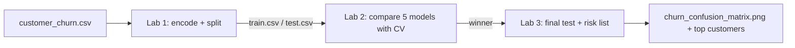
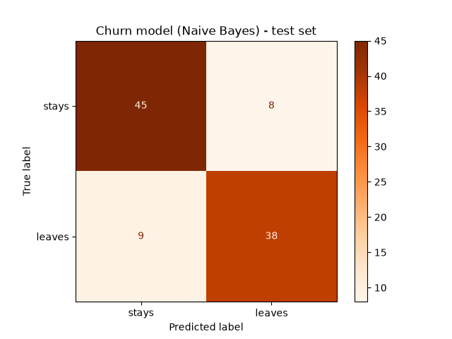

# Session 16: Practice Lab — Classification (Sessions 14–15)

> Module: Data Science with Python · Term 5 (ADSE) · ⏱ ~2 hours

A mobile network wants to know **which customers are about to leave** (this is called *churn*) so its retention team can call them with an offer. You have 400 customers with their city, package, months with the company, monthly bill, number of complaints and whether they left. In this lab you prepare the data, compare five classifiers with cross-validation, test the winner once, and produce a "customers to call" list.

## 🎯 Learning Objectives

By the end of this lab you will be able to:

- Encode text columns with one-hot encoding and create a stratified train/test split
- Compare KNN, SVM, Naive Bayes, Decision Tree and Random Forest with cross-validation
- Choose a metric that matches the business goal (recall and F1 for churn)
- Evaluate the chosen model once on the test set with a confusion matrix and report
- Turn predicted probabilities into a ranked action list and explain the drivers

## 📖 Concepts Explained

### 1. Lab flow



### 2. One-hot encoding

Models need numbers, but `city` holds text. **One-hot encoding** creates one 0/1 column per category: `city_Karachi`, `city_Lahore` (Islamabad is the case where both are 0). `pd.get_dummies(..., drop_first=True)` does this and drops one column per feature to avoid repeating information.

| city | city_Karachi | city_Lahore |
|------|--------------|-------------|
| Karachi | 1 | 0 |
| Lahore | 0 | 1 |
| Islamabad | 0 | 0 |

Never encode cities as 1, 2, 3: the model would think Islamabad (3) is "bigger" than Karachi (1).

### 3. Choosing the metric from the business goal

- Missing a customer who leaves (false negative) loses a whole contract.
- Calling a happy customer (false positive) costs only a phone call.

So **recall** for the "leaves" class matters a lot, and **F1** keeps precision from collapsing. Accuracy alone is not enough.

### 4. Rules of a fair experiment

1. The test set is touched **once**, at the very end.
2. All model choices are made with cross-validation on the training set.
3. Scaling is placed **inside** a pipeline so each CV fold is scaled using only its own training part.

### 5. Probabilities, not just labels

`predict_proba` returns how sure the model is. Sorting customers by probability of leaving gives the team a priority list. Remember from Session 15: Naive Bayes probabilities can be over-confident (you will see many 1.0 values), so treat them as a **ranking** rather than an exact chance.

## 💻 Code Examples

The data is generated by [`make_churn_csv.py`](./make_churn_csv.py) (fixed seed) and saved as [`customer_churn.csv`](./customer_churn.csv). Run the labs in order.

File: [`make_churn_csv.py`](./make_churn_csv.py)

```python
# make_churn_csv.py - create a practice dataset of mobile customers (run once)
import numpy as np
import pandas as pd

rng = np.random.default_rng(seed=11)
n = 400
months = rng.integers(1, 72, n)                          # months with the company
monthly_bill = rng.uniform(500, 4000, n).round()         # rupees
complaints = rng.poisson(1.2, n)                         # complaints last year
package = rng.choice(["Prepaid", "Postpaid"], n, p=[0.7, 0.3])
city = rng.choice(["Karachi", "Lahore", "Islamabad"], n)

# Churn (leaving) is more likely with many complaints, high bills, short stay, prepaid
score = (0.9 * complaints + monthly_bill / 1500 - months / 20
         + (package == "Prepaid") * 0.8 + rng.normal(0, 1, n))
churn = np.where(score > 1.5, "Yes", "No")

df = pd.DataFrame({"city": city, "package": package, "months": months,
                   "monthly_bill": monthly_bill, "complaints": complaints, "churn": churn})
df.to_csv("customer_churn.csv", index=False)
print(df.head())
print(df["churn"].value_counts())
```

**How it works:** a hidden "churn score" grows with complaints and bill size, shrinks with months of loyalty and is higher for prepaid users, plus random noise, so the patterns are realistic but not perfect.

### Lab 1: Prepare the data

File: [`lab1_prepare_data.py`](./lab1_prepare_data.py)

```python
# lab1_prepare_data.py - Lab 1: get the churn data ready for machine learning
import pandas as pd
from sklearn.model_selection import train_test_split

df = pd.read_csv("customer_churn.csv")

# Task 1: explore the label - are the classes balanced?
print(df["churn"].value_counts(normalize=True).round(2))

# Task 2: models need numbers, so turn text columns into 0/1 columns (one-hot encoding)
X = pd.get_dummies(df.drop(columns="churn"), columns=["city", "package"], drop_first=True)
y = (df["churn"] == "Yes").astype(int)          # 1 = customer left, 0 = stayed
print("\nFeature columns:", list(X.columns))

# Task 3: split with stratify so both sets keep the same churn rate
X_train, X_test, y_train, y_test = train_test_split(
    X, y, test_size=0.25, random_state=7, stratify=y)
print("\nTrain:", X_train.shape, "Test:", X_test.shape)
print("Churn rate train/test:", round(y_train.mean(), 2), round(y_test.mean(), 2))

# Task 4: save the prepared sets for the next labs
X_train.assign(churn=y_train).to_csv("train.csv", index=False)
X_test.assign(churn=y_test).to_csv("test.csv", index=False)
print("Saved train.csv and test.csv")
```

**How it works:** classes are fairly balanced (53% stay, 47% leave). `get_dummies` creates numeric columns; `stratify=y` keeps the 47% churn rate in both train and test. The sets are saved so the next labs start from the same split.

### Lab 2: Compare five classifiers

File: [`lab2_compare_models.py`](./lab2_compare_models.py)

```python
# lab2_compare_models.py - Lab 2: train five classifiers and compare them
import pandas as pd
from sklearn.model_selection import cross_val_score
from sklearn.preprocessing import StandardScaler
from sklearn.pipeline import make_pipeline
from sklearn.neighbors import KNeighborsClassifier
from sklearn.svm import SVC
from sklearn.naive_bayes import GaussianNB
from sklearn.tree import DecisionTreeClassifier
from sklearn.ensemble import RandomForestClassifier

train = pd.read_csv("train.csv")                 # created by Lab 1
X_train = train.drop(columns="churn")
y_train = train["churn"]

models = {
    "KNN": make_pipeline(StandardScaler(), KNeighborsClassifier(n_neighbors=9)),
    "SVM": make_pipeline(StandardScaler(), SVC()),
    "Naive Bayes": GaussianNB(),
    "Decision Tree": DecisionTreeClassifier(max_depth=4, random_state=0),
    "Random Forest": RandomForestClassifier(n_estimators=200, max_depth=6, random_state=0),
}

# Recall matters: we want to FIND the customers who are about to leave
rows = []
for name, model in models.items():
    recall = cross_val_score(model, X_train, y_train, cv=5, scoring="recall").mean()
    f1 = cross_val_score(model, X_train, y_train, cv=5, scoring="f1").mean()
    accuracy = cross_val_score(model, X_train, y_train, cv=5, scoring="accuracy").mean()
    rows.append({"model": name, "accuracy": accuracy, "recall": recall, "f1": f1})

results = pd.DataFrame(rows).sort_values("f1", ascending=False).round(3)
print(results.to_string(index=False))
results.to_csv("model_comparison.csv", index=False)
print("\nBest by F1:", results.iloc[0]["model"])
```

**How it works:** each model gets 5-fold cross-validated accuracy, recall and F1 on the training data only. In our run Naive Bayes and SVM lead (F1 about 0.82 and 0.81), the random forest is close behind, and the single tree is last. Scores this close mean several models are acceptable.

### Lab 3: Final test and business output

File: [`lab3_evaluate_best.py`](./lab3_evaluate_best.py)

```python
# lab3_evaluate_best.py - Lab 3: final test of the chosen model + business output
import pandas as pd
import matplotlib
matplotlib.use("Agg")
import matplotlib.pyplot as plt
from sklearn.naive_bayes import GaussianNB
from sklearn.ensemble import RandomForestClassifier
from sklearn.metrics import classification_report, ConfusionMatrixDisplay

train = pd.read_csv("train.csv")
test = pd.read_csv("test.csv")
X_train, y_train = train.drop(columns="churn"), train["churn"]
X_test, y_test = test.drop(columns="churn"), test["churn"]

# Chosen model: Naive Bayes won Lab 2 on F1 (change it if your Lab 2 result differs)
model = GaussianNB()
model.fit(X_train, y_train)

# 1. Final, one-time check on the untouched test set
pred = model.predict(X_test)
print(classification_report(y_test, pred, target_names=["stays", "leaves"]))

ConfusionMatrixDisplay.from_predictions(y_test, pred, display_labels=["stays", "leaves"],
                                        cmap="Oranges")
plt.title("Churn model (Naive Bayes) - test set")
plt.savefig("churn_confusion_matrix.png")
plt.close()

# 2. Risk list for the retention team: probability of leaving for each test customer
risk = X_test.copy()
risk["leave_probability"] = model.predict_proba(X_test)[:, 1].round(2)
top_risk = risk.sort_values("leave_probability", ascending=False).head(5)
print("Top 5 customers to call:\n",
      top_risk[["months", "monthly_bill", "complaints", "leave_probability"]])

# 3. What drives churn? Naive Bayes has no importance scores,
#    so we ask a random forest to explain which features matter most
forest = RandomForestClassifier(n_estimators=200, max_depth=6, random_state=0)
forest.fit(X_train, y_train)
importance = pd.Series(forest.feature_importances_, index=X_train.columns).sort_values()
print("\nFeature importance (from random forest):\n", importance.round(3))
print("\nSaved churn_confusion_matrix.png")
```

**How it works:** the winner is trained on all training data and tested once: about 0.83 accuracy and 0.81 recall for "leaves". The risk list sorts test customers by their probability of leaving. Because Naive Bayes has no importance scores, a random forest is used only to explain the drivers: months with the company, monthly bill and complaints.



## 🧪 Lab Practice

1. In Lab 1, print the churn rate per package and per city with `groupby`. Which group leaves most?
2. In Lab 2, add `LogisticRegression(max_iter=1000)` inside a scaled pipeline. Where does it rank?
3. In Lab 2, tune the random forest: try `max_depth` 3, 6 and None, and `n_estimators` 100 and 400.
4. In Lab 3, switch the final model to the SVM. Compare its confusion matrix with Naive Bayes.
5. Predict three new customers of your own (remember to create the same one-hot columns in the same order).

## 📝 Assignment

Write a one-page **churn report** (Markdown) for the network's manager: the business problem, the data, the metric you chose and why, a table of the five models' CV scores, the final test results with the confusion matrix image, the top three churn drivers, and two practical actions the company could take. Keep technical words to a minimum.

## ❓ Quick Quiz

1. Why use `drop_first=True` in `get_dummies`?
2. Why is recall important for a churn model?
3. Where must the scaler go when using cross-validation, and why?
4. How many times should you use the test set?
5. Why do we use a random forest in Lab 3 even though Naive Bayes is the chosen model?

<details>
<summary>Show answers</summary>

1. To avoid a redundant column: the dropped category is implied when all the others are 0
2. Missing a leaving customer is expensive; we want to find as many of them as possible
3. Inside a pipeline, so each fold is scaled using only its own training data (no data leakage)
4. Once, at the end, after all choices are made
5. Naive Bayes gives no feature importances; the forest helps explain which features drive churn

</details>

## 💼 Interview Questions

1. **What is data leakage?** — When information from the test data (or from the future) gets into training, for example scaling on the full dataset or using a column that is only known after the outcome. It makes scores look better than real-world performance.
2. **How would you handle a churn dataset where only 5% of customers leave?** — Use stratified splits, judge with recall, precision, F1 or PR AUC instead of accuracy, and consider class weights (`class_weight="balanced"`) or resampling.
3. **How do you explain a model's prediction to a manager?** — Show the main drivers (feature importances or similar tools), give concrete examples of high-risk customers and why, and express performance in business terms such as "finds 8 of 10 customers who leave".

## ✅ Summary

- Encode categories with one-hot columns; split with `stratify`.
- Pick models with cross-validation on training data; test once at the end.
- Choose the metric from the cost of each mistake (recall/F1 for churn).
- Use `predict_proba` to rank customers for action.
- Explain results with feature importances and plain language.

---

[⬅ Previous](../Session-15-Classification-II-and-Evaluating-Models/README.md) · [🏠 Module Home](../README.md) · [Next ➡](../Session-17-Clustering-and-Association-Rules/README.md)

Prepared by Zeeshan Abbas · Aptech Learning North Nazimabad
