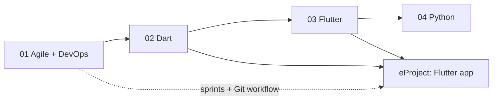

# Term 5: ADSE (Advanced Diploma in Software Engineering)

      

> ACCP in AI · Term 5 · 54 module sessions + a ~16-hour eProject · ⏱ ~2 hours per session

Term 5 takes you to the **Advanced Diploma** level. You first learn how professional teams plan and deliver software with Agile and DevOps. Then you learn the Dart language and use it with Flutter to build one app that runs on Android, iOS, the web and desktop, including data storage, REST APIs and on-device machine learning. Finally, you build practical applications in Python, from scripts and web apps to data handling and your first machine learning models. The term ends with a team eProject: a complete **cross-platform mobile app** built with Flutter and Dart.

## Modules

| No | Module | Sessions | Link |
|---|---|---|---|
| 01 | Agile and DevOps | 12 | [Open module](./01-Agile-and-DevOps/README.md) |
| 02 | Dart Programming | 8 | [Open module](./02-Dart-Programming/README.md) |
| 03 | Cross-Platform App Development with Flutter and Dart | 18 | [Open module](./03-Cross-Platform-App-Development-with-Flutter-and-Dart/README.md) |
| 04 | Application Based Programming in Python | 16 | [Open module](./04-Application-Based-Programming-in-Python/) |
| — | eProject: Cross-Platform App Development | ~8 (16 hours) | [Open eProject](./eProject/README.md) |

> Module 04 (Python) is being added session by session. Open the module folder to see the sessions that are ready.

## Learning Outcomes

After completing Term 5 you will be able to:

- Explain software process models and run a project the Agile way with Scrum and XP practices: user stories, sprints, stand-ups, reviews and retrospectives
- Describe the DevOps lifecycle and set up a simple CI/CD pipeline with Git and GitHub Actions
- Write modern Dart 3 code: sound null safety, classes and mixins, collections, Futures, Streams, packages and tests
- Build cross-platform Flutter apps with widgets, layouts, state management, navigation with go_router, themes and responsive design
- Store and fetch data with sqflite, Firebase and REST APIs, and add AI with TensorFlow Lite and ML Kit
- Develop Python applications: functions and modules, files and exceptions, regular expressions, Flask web apps, web scraping, Tkinter GUIs, databases, pandas, charts and basic machine learning
- Plan, build, test, document and present a cross-platform app as part of a team

## Suggested Study Order

Agile and DevOps give your team a way to work; use sprints, a task board and GitHub Actions in your eProject. Dart is the language of Flutter, so finish the Dart module before you start Flutter. Python is the bridge to the data science and AI work in the next term.

## eProject

A group project of **up to 4 students** (your centre decides the exact hours; plan for about **16 hours per student**): a cross-platform app built with Flutter and Dart in Android Studio or VS Code, with on-device AI using TensorFlow Lite where the specification asks for it. You submit the **source code** and a **project report**, then present it in a **viva** (marks: 60% source code, 20% documentation, 20% viva). Read the [eProject guide](./eProject/README.md) for phases, ideas, folder structure and tips.

## How to Study

1. **Set up once:** install Git, VS Code, the Flutter SDK (which includes Dart), Android Studio with an Android emulator, and Python 3.12. Each module README lists its tools with official links. Run `flutter doctor` until every line is green.
2. **One session at a time:** read the concepts, then type (do not copy-paste) and run every example in the session folder.
3. **Use a real phone too:** test Flutter apps on your own Android phone with USB debugging; it is faster than a slow emulator.
4. **Never skip practice labs:** they join several topics together, just like real work.
5. **Check yourself:** answer the quiz before opening the answers and practise the interview questions aloud.
6. **Work in sprints:** plan your week as a small sprint with a to-do, doing and done list, the same way the Agile module teaches.
7. **Push to GitHub weekly** and keep API keys out of your code (use a local config file that is in `.gitignore`).
8. **Ask early:** bring questions to class or open an Issue on this repository.

---

[🏠 Repository Home](../README.md) · [Start Module 01 ➡](./01-Agile-and-DevOps/README.md)

Prepared by Zeeshan Abbas · Aptech Learning North Nazimabad
