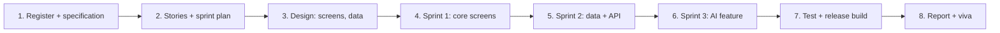

# Term 5 eProject: Cross-Platform App Development

     

> Term 5 (ADSE) · Group project (up to 4 students) · ~16 hours per student (about 8 sessions; your centre confirms the hours) · Build, document and present a cross-platform app

## What is the eProject?

The eProject is where you show that you can ship a **real app**. After your group registers, you receive a project specification. You plan the work in short sprints, design the screens, build the app in Flutter and Dart, store or fetch data, add a smart feature with on-device machine learning where needed, test it on a real device, write a report and explain your work in a viva.

| Module | What you use from it |
|---|---|
| [01 Agile and DevOps](../01-Agile-and-DevOps/README.md) | user stories, sprints, task board, Git workflow, CI with GitHub Actions |
| [02 Dart Programming](../02-Dart-Programming/README.md) | null safety, classes, collections, Futures and Streams, packages |
| [03 Cross-Platform App Development with Flutter and Dart](../03-Cross-Platform-App-Development-with-Flutter-and-Dart/README.md) | widgets, layouts, state management, go_router, themes, sqflite, Firebase, REST APIs, TensorFlow Lite, ML Kit |
| [04 Application Based Programming in Python](../04-Application-Based-Programming-in-Python/) | optional: a small Flask API or a Python script that prepares data for your app |

## Team rules

- Groups of **up to 4 students**; choose a **team leader** who talks to the faculty project guide.
- Your centre registers the group; the real **project specification** is shared only after registration. The ideas below are for practice.
- Your centre decides the exact project hours; this guide plans for about **16 hours per student**. Every member must write code.
- Every member must be able to explain **any** part of the app in the viva.
- Use one GitHub repository with small, clear commits; the history shows who did what.

## Technology stack

| Layer | Required | Version guide |
|---|---|---|
| Language | Dart | 3.5 or later |
| Framework | Flutter SDK | 3.24 or later |
| IDE | Android Studio (or VS Code with the Flutter extension) | Android Studio 2024 or later |
| Device | Android emulator and/or a real Android phone | Android 8.0+ |
| Local data | `shared_preferences` or `sqflite` | latest stable on pub.dev |
| Cloud data (optional) | Firebase Authentication and Cloud Firestore | latest FlutterFire packages |
| AI | TensorFlow Lite model (e.g. `tflite_flutter`) or Google ML Kit packages | latest stable on pub.dev |

**AI ideas that fit a mobile app:** classify a photo (plant, food, waste type) with a small TensorFlow Lite model, read text from a picture with ML Kit text recognition, detect faces or barcodes, or label images. Keep the model small and run it on the device so the app works offline. AI should support the app, not replace a solid core.

## Phases (about 8 sessions)



| Session | Phase | Output |
|---|---|---|
| 1 | Kick-off: read the specification, split roles, create the GitHub repo and the app with `flutter create` | repo, task board |
| 2 | Planning: write user stories with acceptance criteria, order the backlog, plan three short sprints | product backlog |
| 3 | Design: screen sketches and navigation map, data model classes, choose local or cloud storage | design document |
| 4 | Sprint 1: theme, routing with go_router, main screens and reusable widgets with sample data | clickable app |
| 5 | Sprint 2: real data with sqflite or Firebase, REST API calls, loading and error states, forms with validation | working app |
| 6 | Sprint 3: AI feature (TensorFlow Lite or ML Kit), camera or gallery input, polish the UI | smart feature |
| 7 | Testing: widget and unit tests for key logic, test on a real phone, build a release APK | tested APK |
| 8 | Report, final submission and viva rehearsal | final package |

## Deliverables checklist

### 1. Source code (60% of marks)
- [ ] The project runs with `flutter pub get` and `flutter run` on a clean machine
- [ ] Every feature in the specification works end to end
- [ ] Clean structure: screens, widgets, models and services in separate folders; meaningful names
- [ ] State management used consistently (for example Provider or Riverpod), no giant `setState` screens
- [ ] Forms validate input and show friendly messages; loading and error states for every network call
- [ ] Data saved correctly (sqflite, shared_preferences or Firebase) and survives an app restart
- [ ] AI feature works on a real device and fails gracefully if the model cannot run
- [ ] No API keys or `google-services.json` with private keys committed; a sample config file is provided
- [ ] `flutter analyze` shows no errors; at least a few unit or widget tests pass
- [ ] `README.md` with setup steps, screenshots, test login (if any) and team members
- [ ] A release APK attached to the submission or a GitHub release

### 2. Documentation (20% of marks)
- [ ] Title page, acknowledgement, table of contents
- [ ] Problem definition, objectives and scope
- [ ] User stories with acceptance criteria and the sprint plan
- [ ] Architecture diagram (UI widgets ↔ state ↔ services ↔ local database / API / ML model)
- [ ] Data design: model classes, tables or Firestore collections
- [ ] Screenshots of every screen with a one-line description
- [ ] Test cases table (input, expected result, actual result, pass/fail) and devices tested on
- [ ] Task sheet (who did what), limitations and future enhancements
- [ ] References (official documentation only)

### 3. Viva (20% of marks)
- [ ] Short live demo on a phone or emulator
- [ ] Each member explains their part and answers questions on widgets, state, data and the AI feature

## Suggested project ideas

| Idea | Core features | AI feature |
|---|---|---|
| **Plant Care Companion** | plant list, watering reminders, care notes, photos | identify the plant or a leaf disease from a photo (TFLite) |
| **Smart Expense Tracker** | income and expenses, categories, monthly charts, offline storage | read the total from a receipt photo (ML Kit text recognition) |
| **Campus Navigator** | buildings, rooms, timetable, favourites, events list | scan QR codes on doors to open room details (ML Kit barcode) |
| **Recipe Finder** | browse recipes from a REST API, favourites, shopping list | detect ingredients from a photo (image labelling) |
| **Waste Sorting Helper** | recycling guide, nearby drop-off points, tips | classify waste as plastic, paper, glass or organic (TFLite) |
| **Study Buddy** | subjects, tasks, Pomodoro timer, progress chart, Firebase sync | turn a photo of notes into text for revision (ML Kit) |
| **Pet Adoption App** | pet listings, filters, favourites, adoption request form | guess the pet breed from a photo (TFLite) |
| **Fitness Habit Tracker** | daily goals, streaks, history, reminders | count exercise reps with pose detection (ML Kit) |

## Suggested folder structure

```text
flutter_eproject/
├── lib/
│   ├── main.dart                # app entry, theme, router
│   ├── app_router.dart          # go_router routes
│   ├── models/                  # plain Dart classes (plant.dart ...)
│   ├── services/                # database_service.dart, api_service.dart, ml_service.dart
│   ├── providers/               # state classes (Provider / Riverpod)
│   ├── screens/                 # one file per screen (home_screen.dart ...)
│   └── widgets/                 # reusable pieces (plant_card.dart ...)
├── assets/
│   ├── images/
│   └── models/                  # model.tflite + labels.txt
├── test/                        # unit and widget tests
├── android/  ios/  web/         # platform folders created by Flutter
├── docs/
│   ├── Project-Report.docx
│   └── screenshots/
├── pubspec.yaml                 # packages + assets list
├── analysis_options.yaml
├── .gitignore
└── README.md
```

Quick start for a new group:

```bash
flutter create flutter_eproject
cd flutter_eproject
flutter pub add go_router provider sqflite path http
flutter pub add image_picker tflite_flutter      # only if your app needs the camera and TFLite
flutter analyze
flutter run
```

## Evaluation tips

1. **Specification first.** Turn every required feature into a user story; missing features cost more marks than missing animations.
2. **Work in sprints.** Finish a small, working version every sprint so you always have something to show.
3. **Design for small screens.** Test on a narrow phone and in landscape; nothing should overflow (no yellow and black stripes).
4. **Handle the slow and the broken.** Show a spinner while loading and a friendly message when there is no internet.
5. **Keep the model small.** Use a light TensorFlow Lite model, load it once, and explain its labels and accuracy honestly.
6. **Protect keys.** Examiners check that API keys and private config files are not in GitHub.
7. **Test on a real phone.** Camera, permissions and performance often behave differently from the emulator.
8. **Document as you go.** Take screenshots and record test cases during each sprint, not the night before.
9. **Rehearse the viva.** Each member should explain the widget tree of one screen, how state flows, and how data is saved or fetched.
10. **Submit early.** Clone the repo into a fresh folder, run `flutter pub get` and `flutter run`, and build the release APK before the deadline.

---

[⬅ Previous Module](../04-Application-Based-Programming-in-Python/) · [🏠 Term Home](../README.md)

Prepared by Zeeshan Abbas · Aptech Learning North Nazimabad
