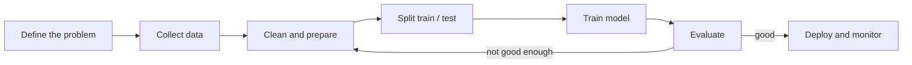

# Session 01: Introduction to AI and Machine Learning

> Module: AI Essentials · Term 6 (AI) · ⏱ ~2 hours

Artificial Intelligence is no longer a research topic only: it approves loans, recommends videos, reads X-rays and answers customer chats. This first session gives you the vocabulary and the mental map you will use for the whole term, and you will train your first machine learning model.

## 🎯 Learning Objectives

By the end of this session you will be able to:

- Define Artificial Intelligence (AI) and describe where it is used in real industries
- Differentiate narrow AI, general AI and super-intelligent AI
- Explain the key ML terms: dataset, features, labels, model, training and inference
- Describe the end-to-end machine learning workflow
- Compare supervised, unsupervised and reinforcement learning with examples
- Decide when machine learning is (and is not) the right tool for a problem

## 📖 Concepts Explained

### 1. What is Artificial Intelligence?

**AI** is the field of computer science that builds systems able to perform tasks that normally need human intelligence: understanding language, recognising images, making decisions, planning and learning from experience.

A useful way to think about it: traditional software follows rules a programmer wrote; an AI system either **reasons** with knowledge it was given, or **learns** its own rules from data.

| Traditional programming | Machine learning |
|---|---|
| Input: data + rules written by a developer | Input: data + correct answers (examples) |
| Output: answers | Output: rules (a trained model) |
| Example: "if income > 100k and no defaults then approve" | Example: model learns approval patterns from 10,000 past applications |

### 2. AI in industry

| Industry | Typical AI use | Example in daily life |
|---|---|---|
| Healthcare | Disease risk prediction, medical image analysis | Predicting diabetes risk from lab values |
| Finance | Credit scoring, fraud detection, algorithmic trading | Bank app flags an unusual card payment |
| E-commerce & Retail | Recommendations, demand forecasting, inventory | "Customers also bought" on Daraz |
| Manufacturing | Predictive maintenance, visual quality control | Camera rejects a faulty bottle cap |
| Education | Personalised learning paths, auto-grading | Quiz app adapts difficulty to the learner |
| Agriculture & Energy | Crop disease detection, load forecasting | Phone app identifies leaf disease from a photo |

AI also powers **image generation and understanding**. Common building blocks you will meet later: Convolutional Neural Networks (CNNs) for image classification, Mask R-CNN for pixel-level object segmentation, transfer learning (re-using a pre-trained model), attention mechanisms, GANs, neural style transfer and diffusion models (the technology behind modern text-to-image tools).

### 3. Types of AI systems

| Type | Also called | What it can do | Exists today? |
|---|---|---|---|
| Narrow AI | Weak AI | One task or a narrow family of tasks (chess, translation, face unlock) | Yes, everywhere |
| General AI | AGI, strong AI | Learn and reason across any domain like a human | Not yet (active research) |
| Super-intelligent AI | ASI | Exceed the best humans in every field | Hypothetical |

Even very capable chat assistants are still classified as narrow AI by most researchers, because they have no independent goals and fail outside their training patterns.

### 4. Key machine learning terms

- **Dataset**: a table of examples. Each row is one example (one loan application).
- **Features (X)**: the input columns the model looks at (income, credit score).
- **Label (y)**: the answer we want to predict (approved: yes/no).
- **Model**: a mathematical function with adjustable parameters.
- **Training**: adjusting the parameters so the model's predictions match the labels.
- **Inference / prediction**: using the trained model on new, unseen data.
- **Generalisation**: performing well on data the model never saw. This is the real goal.

### 5. The machine learning workflow



Analogy: preparing for an exam. Past papers are the **training data**, the final exam is the **test data**. A student who memorises past papers word for word (overfitting) fails when the questions change.

### 6. Types of learning

| Type | Data | Goal | Example |
|---|---|---|---|
| Supervised | Labelled (X and y) | Predict the label for new data | Spam / not spam, house price |
| Unsupervised | Unlabelled (only X) | Discover structure or groups | Customer segments, anomaly detection |
| Reinforcement | Rewards from an environment | Learn actions that maximise reward | Game-playing agents, robot navigation |

Supervised learning splits further into **classification** (predict a category) and **regression** (predict a number).

### 7. When should you use ML?

Use ML when the rules are too complex to write by hand, when patterns change over time, and when you have enough good-quality data. Avoid ML when a simple rule works perfectly (calculating tax), when there is almost no data, or when every decision must be fully explainable and a rule system can provide that.

## 💻 Code Examples

Install once for this module: `pip install numpy pandas scikit-learn`

### Example 1: Complete supervised ML workflow (loan approval)

📄 File: [`ml_workflow.py`](ml_workflow.py)

```python
"""Session 01 - A complete (small) supervised ML workflow.

Scenario: a microfinance company wants to predict whether a loan
application should be approved. We create a synthetic dataset so the
script runs offline, then follow the standard ML workflow:
collect -> prepare -> split -> train -> evaluate -> predict.
"""
import numpy as np
import pandas as pd
from sklearn.model_selection import train_test_split
from sklearn.tree import DecisionTreeClassifier
from sklearn.metrics import accuracy_score, classification_report

# 1) Collect data (synthetic, reproducible)
rng = np.random.default_rng(42)
n = 500
df = pd.DataFrame({
    "monthly_income_k": rng.integers(30, 400, n),     # PKR thousands
    "existing_loans": rng.integers(0, 4, n),
    "years_employed": rng.integers(0, 20, n),
    "credit_score": rng.integers(300, 850, n),
})
# Hidden "true" rule + a little noise creates the label
score = (df.monthly_income_k / 400) + (df.credit_score - 300) / 550 \
        + df.years_employed / 40 - df.existing_loans * 0.25
df["approved"] = ((score + rng.normal(0, 0.15, n)) > 1.0).astype(int)

print("First rows of the dataset:")
print(df.head(), "\n")
print("Label balance:\n", df.approved.value_counts(), "\n")

# 2) Prepare: features (X) and label (y)
X = df.drop(columns="approved")
y = df["approved"]

# 3) Split into training and testing sets
X_train, X_test, y_train, y_test = train_test_split(
    X, y, test_size=0.2, random_state=0, stratify=y)

# 4) Train a model
model = DecisionTreeClassifier(max_depth=4, random_state=0)
model.fit(X_train, y_train)

# 5) Evaluate on unseen data
pred = model.predict(X_test)
print(f"Test accuracy: {accuracy_score(y_test, pred):.2%}")
print(classification_report(y_test, pred, target_names=["rejected", "approved"]))

# 6) Use the model for a new applicant
new_applicant = pd.DataFrame([{"monthly_income_k": 180, "existing_loans": 1,
                               "years_employed": 6, "credit_score": 710}])
decision = model.predict(new_applicant)[0]
print("New applicant ->", "APPROVED" if decision else "REJECTED")

# Which features mattered most?
for name, imp in sorted(zip(X.columns, model.feature_importances_), key=lambda t: -t[1]):
    print(f"  {name:<18} importance = {imp:.2f}")
```

Run it:

```bash
python ml_workflow.py
```

**How it works**

- A synthetic dataset of 500 loan applications is generated with NumPy so the script works offline; a hidden formula plus noise creates the `approved` label.
- `train_test_split` keeps 20% of rows aside as unseen test data; `stratify=y` keeps the same approve/reject ratio in both parts.
- `DecisionTreeClassifier(max_depth=4)` learns if-then splits; limiting depth reduces overfitting.
- `classification_report` prints precision, recall and F1 for each class, not just accuracy.
- `feature_importances_` shows which inputs influenced the decisions most, a first step towards explainable AI.

### Example 2: Supervised, unsupervised and reinforcement learning side by side

📄 File: [`learning_types.py`](learning_types.py)

```python
"""Session 01 - The three types of learning in one file.

1. Supervised   : learn from labelled examples (classification)
2. Unsupervised : find groups in unlabelled data (clustering)
3. Reinforcement: learn by trial, error and reward (Q-learning)
"""
import numpy as np
from sklearn.datasets import load_iris
from sklearn.linear_model import LogisticRegression
from sklearn.cluster import KMeans
from sklearn.model_selection import train_test_split

# ---------- 1. Supervised learning ----------
X, y = load_iris(return_X_y=True)
X_tr, X_te, y_tr, y_te = train_test_split(X, y, test_size=0.3, random_state=1)
clf = LogisticRegression(max_iter=500).fit(X_tr, y_tr)
print(f"[Supervised]   Iris species accuracy: {clf.score(X_te, y_te):.2%}")

# ---------- 2. Unsupervised learning ----------
# Customers described by (visits per month, average bill in PKR hundreds)
customers = np.array([[2, 5], [3, 4], [2, 6], [12, 30], [14, 28],
                      [13, 35], [6, 15], [7, 14], [5, 16]])
km = KMeans(n_clusters=3, n_init=10, random_state=0).fit(customers)
print("[Unsupervised] Customer groups:", km.labels_.tolist())

# ---------- 3. Reinforcement learning ----------
# A robot walks on a 1-D corridor of 5 cells. Cell 4 holds the reward.
# Actions: 0 = left, 1 = right.
n_states, n_actions = 5, 2
Q = np.zeros((n_states, n_actions))
alpha, gamma, epsilon = 0.5, 0.9, 0.2
rng = np.random.default_rng(0)

for episode in range(200):
    state = 0
    while state != 4:
        if rng.random() < epsilon:
            action = rng.integers(n_actions)           # explore
        else:
            action = int(np.argmax(Q[state]))          # exploit
        nxt = max(0, state - 1) if action == 0 else min(4, state + 1)
        reward = 10 if nxt == 4 else -1
        Q[state, action] += alpha * (reward + gamma * Q[nxt].max() - Q[state, action])
        state = nxt

policy = ["L" if np.argmax(q) == 0 else "R" for q in Q[:4]]
print("[Reinforcement] Learned policy for cells 0-3:", policy)
```

Run it:

```bash
python learning_types.py
```

**How it works**

- **Supervised**: logistic regression is trained on the labelled Iris flowers and scored on a held-out set.
- **Unsupervised**: K-Means receives customer data with no labels and groups similar customers together.
- **Reinforcement**: a Q-table stores how good each action is in each cell. The robot explores randomly 20% of the time (epsilon) and otherwise exploits the best known action. After 200 episodes the learned policy is 'always go Right' towards the reward.

## 🧪 Lab Practice

1. Run `ml_workflow.py`. Change `max_depth` to 1, 4 and 12 and record test accuracy each time. Which value overfits?
2. Add a new feature `age` to the dataset and include it in the hidden rule. Does the model discover its importance?
3. Replace `DecisionTreeClassifier` with `LogisticRegression(max_iter=1000)` and compare the reports.
4. In `learning_types.py`, change K-Means to `n_clusters=2` and explain the new groups in plain words.
5. Make the RL corridor 8 cells long and check how many episodes are needed before the policy becomes all `R`.

## 📝 Assignment

Pick one industry from the table (or your own, e.g. ride-hailing). Write a one-page report that lists three AI use cases, states for each whether it is supervised, unsupervised or reinforcement learning, names the features and label you would need, and explains one risk (bias, privacy or errors). Add a small Python script that creates a fake dataset of 200 rows for one of your use cases and trains any scikit-learn classifier on it.

## ❓ Quick Quiz

**Q1.** Which type of AI exists in products today: narrow, general or super-intelligent?

<details><summary>Show answer</summary>

Narrow AI. General and super-intelligent AI are not yet achieved.

</details>

**Q2.** In a house-price model, is the price a feature or a label?

<details><summary>Show answer</summary>

The label (the value to predict). Size, location and rooms are features.

</details>

**Q3.** Grouping shoppers by behaviour without any predefined groups is an example of which learning type?

<details><summary>Show answer</summary>

Unsupervised learning (clustering).

</details>

**Q4.** Why do we keep a separate test set?

<details><summary>Show answer</summary>

To measure how well the model generalises to data it has never seen; scoring on training data hides overfitting.

</details>

**Q5.** Predicting tomorrow's temperature in °C is classification or regression?

<details><summary>Show answer</summary>

Regression, because the output is a continuous number.

</details>

## 💼 Interview Questions

**1. Explain the difference between AI, machine learning and deep learning.**

<details><summary>Model answer</summary>

AI is the broad goal of intelligent machines. Machine learning is a subset of AI where systems learn patterns from data instead of following hand-written rules. Deep learning is a subset of ML that uses multi-layer neural networks and works especially well on images, audio and text.

</details>

**2. What is overfitting and how would you detect it?**

<details><summary>Model answer</summary>

Overfitting is when a model memorises training data, including noise, and performs poorly on new data. You detect it when training accuracy is much higher than validation or test accuracy. Remedies include more data, simpler models, regularisation and cross-validation.

</details>

**3. Give an example where you would NOT use machine learning.**

<details><summary>Model answer</summary>

Calculating payroll tax: the rules are fixed and known, a deterministic program is cheaper, exact and fully explainable. ML adds cost and uncertainty with no benefit.

</details>

## ✅ Summary

- AI builds systems that perceive, reason, learn and act; ML is the data-driven part of AI.
- Today's AI is narrow AI; general and super-intelligent AI remain future or hypothetical.
- Features are inputs, labels are answers, and a model learns the mapping during training.
- The ML workflow is iterative: data → prepare → split → train → evaluate → deploy → monitor.
- Supervised uses labels, unsupervised finds structure, reinforcement learns from rewards.

---

⬅ Previous · [🏠 Module Home](../README.md) · [Next ➡](../Session-02-Deep-Learning-and-Neural-Networks/README.md)

Prepared by Zeeshan Abbas · Aptech Learning North Nazimabad
