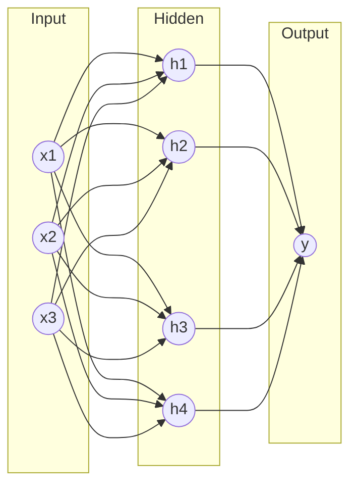

# Session 02: Deep Learning and Neural Networks

> Module: AI Essentials · Term 6 (AI) · ⏱ ~2 hours

Deep learning is the engine behind face unlock, voice assistants and large language models. In this session you will build a neuron by hand, see why hidden layers matter, and train neural networks with scikit-learn and PyTorch.

## 🎯 Learning Objectives

By the end of this session you will be able to:

- Define deep learning and explain how it relates to machine learning
- Compare deep learning with classical ML in terms of data, features and compute
- Describe the parts of an artificial neural network: neurons, weights, bias, activation, layers
- Explain forward propagation, loss and backpropagation in simple terms
- Identify well-known deep learning applications and architectures (CNN, RNN, Transformer)

## 📖 Concepts Explained

### 1. What is deep learning?

**Deep learning (DL)** is a branch of machine learning that uses **artificial neural networks with many layers** to learn complex patterns directly from raw data such as pixels, sound waves or text. "Deep" refers to the number of layers.

### 2. Machine learning vs deep learning

| Aspect | Classical ML | Deep learning |
|---|---|---|
| Feature engineering | Mostly manual (you choose columns, ratios) | Learned automatically from raw data |
| Data needed | Works with hundreds to thousands of rows | Shines with large datasets (thousands to millions) |
| Hardware | CPU is enough | GPU/TPU often needed for large models |
| Interpretability | Often easier (trees, linear models) | Harder ("black box") |
| Best for | Tabular business data | Images, audio, text, video |

Rule of thumb: for a spreadsheet of customer records, start with classical ML. For photos or speech, use deep learning.

### 3. The artificial neuron

A neuron takes inputs, multiplies each by a **weight**, adds a **bias**, and passes the sum through an **activation function**:

`output = activation(w1·x1 + w2·x2 + ... + b)`

Analogy: deciding whether to go to a cricket match. Inputs are weather, ticket price and whether friends are going; weights say how much each matters to you; the bias is your general mood; the activation is the final yes/no decision.

| Activation | Formula idea | Typical use |
|---|---|---|
| Step | 1 if sum > 0 else 0 | Classic perceptron (historical) |
| Sigmoid | squashes to 0..1 | Binary output probability |
| ReLU | max(0, x) | Hidden layers (fast, default choice) |
| Softmax | turns scores into probabilities that sum to 1 | Multi-class output layer |

### 4. Layers and networks



- **Input layer** receives features. **Hidden layers** build increasingly abstract representations (edges → shapes → faces). **Output layer** gives the prediction.
- A single neuron can only draw a straight line between classes. The XOR problem cannot be solved by one line, which is why hidden layers are essential.

### 5. How a network learns

1. **Forward pass**: compute predictions from inputs.
2. **Loss**: measure how wrong the predictions are (e.g. cross-entropy, mean squared error).
3. **Backpropagation**: use calculus (chain rule) to find how much each weight contributed to the error.
4. **Gradient descent**: nudge each weight a small step (the **learning rate**) in the direction that reduces loss.
5. Repeat over many **epochs** (full passes over the data).

### 6. Famous architectures and applications

| Architecture | Data it suits | Applications |
|---|---|---|
| Feed-forward network (MLP) | Fixed-size vectors | Tabular prediction, simple classifiers |
| CNN (convolutional) | Images, video frames | Face recognition, medical imaging, self-driving perception |
| RNN / LSTM | Sequences | Older speech and text models, time series |
| Transformer | Sequences with attention | ChatGPT-style LLMs, translation, Whisper speech recognition |
| GAN / Diffusion | Generating new data | Image generation, super-resolution |

Sectors using DL: healthcare (tumour detection), automotive (lane detection), finance (document reading), entertainment (recommendations, dubbing) and security (anomaly detection).

## 💻 Code Examples

Install: `pip install numpy scikit-learn` (and optionally `pip install torch --index-url https://download.pytorch.org/whl/cpu` for Example 3).

### Example 1: A neuron and a 2-layer network from scratch

📄 File: [`perceptron_numpy.py`](perceptron_numpy.py)

```python
"""Session 02 - A single artificial neuron and a tiny neural network, from scratch.

Part A: a perceptron learns the AND gate (linearly separable).
Part B: a 2-layer network with sigmoid learns XOR (NOT linearly separable),
        which a single neuron cannot do. This is why we need hidden layers.
"""
import numpy as np

X = np.array([[0, 0], [0, 1], [1, 0], [1, 1]], dtype=float)

# ---------------- Part A: perceptron for AND ----------------
y_and = np.array([0, 0, 0, 1])
w, b, lr = np.zeros(2), 0.0, 0.1
for epoch in range(20):
    for xi, target in zip(X, y_and):
        out = 1 if xi @ w + b > 0 else 0       # step activation
        err = target - out
        w += lr * err * xi                      # perceptron update rule
        b += lr * err
print("AND weights:", w, "bias:", round(b, 2))
print("AND predictions:", [1 if xi @ w + b > 0 else 0 for xi in X])

# ---------------- Part B: 2-layer network for XOR ----------------
def sigmoid(z):
    return 1 / (1 + np.exp(-z))

y_xor = np.array([[0], [1], [1], [0]], dtype=float)
rng = np.random.default_rng(1)
W1, b1 = rng.normal(0, 1, (2, 4)), np.zeros((1, 4))   # input -> hidden (4 neurons)
W2, b2 = rng.normal(0, 1, (4, 1)), np.zeros((1, 1))   # hidden -> output
lr = 1.0

for epoch in range(5000):
    # forward pass
    h = sigmoid(X @ W1 + b1)
    out = sigmoid(h @ W2 + b2)
    # backward pass (gradient of mean squared error)
    d_out = (out - y_xor) * out * (1 - out)
    d_h = (d_out @ W2.T) * h * (1 - h)
    W2 -= lr * h.T @ d_out
    b2 -= lr * d_out.sum(axis=0, keepdims=True)
    W1 -= lr * X.T @ d_h
    b1 -= lr * d_h.sum(axis=0, keepdims=True)
    if epoch % 1000 == 0:
        print(f"epoch {epoch:4d}  loss = {np.mean((out - y_xor) ** 2):.4f}")

print("XOR outputs:", out.round(2).ravel(), "-> rounded:", out.round().astype(int).ravel())
```

Run it:

```bash
python perceptron_numpy.py
```

**How it works**

- Part A applies the perceptron rule `w += lr * error * x`; after a few epochs it outputs the AND truth table correctly.
- Part B uses 4 hidden neurons with a sigmoid activation. The forward pass computes `h` and `out`.
- The backward pass multiplies the error by the sigmoid derivative `out*(1-out)` and passes it back through `W2` to the hidden layer: that is backpropagation.
- Loss falls from about 0.27 to almost 0, and the outputs round to 0 1 1 0, the XOR table that a single neuron cannot learn.

### Example 2: Linear model vs neural network on handwritten digits

📄 File: [`ml_vs_dl_digits.py`](ml_vs_dl_digits.py)

```python
"""Session 02 - Classic ML vs a neural network on handwritten digits.

The 8x8 digits dataset ships with scikit-learn, so no download is needed.
We compare a linear model with a multi-layer perceptron (MLP).
"""
from sklearn.datasets import load_digits
from sklearn.model_selection import train_test_split
from sklearn.preprocessing import StandardScaler
from sklearn.linear_model import LogisticRegression
from sklearn.neural_network import MLPClassifier
from sklearn.metrics import accuracy_score

X, y = load_digits(return_X_y=True)          # 1797 images, 64 pixels each
print("Data shape:", X.shape)

X_tr, X_te, y_tr, y_te = train_test_split(X, y, test_size=0.25, random_state=7, stratify=y)
scaler = StandardScaler().fit(X_tr)
X_tr, X_te = scaler.transform(X_tr), scaler.transform(X_te)

linear = LogisticRegression(max_iter=2000).fit(X_tr, y_tr)
mlp = MLPClassifier(hidden_layer_sizes=(128, 64), activation="relu",
                    max_iter=300, random_state=7).fit(X_tr, y_tr)

print(f"Logistic Regression accuracy : {accuracy_score(y_te, linear.predict(X_te)):.2%}")
print(f"Neural network (MLP) accuracy: {accuracy_score(y_te, mlp.predict(X_te)):.2%}")
print("MLP layers (weights shapes):", [w.shape for w in mlp.coefs_])
print("Total trainable parameters:",
      sum(w.size for w in mlp.coefs_) + sum(b.size for b in mlp.intercepts_))
```

Run it:

```bash
python ml_vs_dl_digits.py
```

**How it works**

- The built-in digits dataset has 1,797 images of 8x8 pixels flattened to 64 features.
- `StandardScaler` puts all pixels on the same scale, which helps both models converge.
- `MLPClassifier(hidden_layer_sizes=(128, 64))` builds a network with two hidden layers using ReLU.
- On such small, clean images both models score about 97%; deep learning's advantage appears with larger, messier data such as real photos.

### Example 3: The same network in PyTorch

📄 File: [`pytorch_mlp.py`](pytorch_mlp.py)

```python
"""Session 02 - The same digits task with PyTorch (optional, CPU is fine).

Install: pip install torch --index-url https://download.pytorch.org/whl/cpu
Shows the four steps every deep learning training loop has:
forward pass -> loss -> backward pass -> optimizer step.
"""
import torch
from torch import nn
from sklearn.datasets import load_digits
from sklearn.model_selection import train_test_split

torch.manual_seed(0)
X, y = load_digits(return_X_y=True)
X = X / 16.0                                     # scale pixels to 0..1
X_tr, X_te, y_tr, y_te = train_test_split(X, y, test_size=0.25, random_state=0)
X_tr, X_te = torch.tensor(X_tr, dtype=torch.float32), torch.tensor(X_te, dtype=torch.float32)
y_tr, y_te = torch.tensor(y_tr), torch.tensor(y_te)

model = nn.Sequential(
    nn.Linear(64, 128), nn.ReLU(),
    nn.Linear(128, 64), nn.ReLU(),
    nn.Linear(64, 10),                           # 10 output classes (digits 0-9)
)
loss_fn = nn.CrossEntropyLoss()
optimizer = torch.optim.Adam(model.parameters(), lr=1e-3)

for epoch in range(1, 201):
    model.train()
    logits = model(X_tr)                         # 1. forward
    loss = loss_fn(logits, y_tr)                 # 2. loss
    optimizer.zero_grad()
    loss.backward()                              # 3. backward (autograd)
    optimizer.step()                             # 4. update weights
    if epoch % 50 == 0:
        model.eval()
        with torch.no_grad():
            acc = (model(X_te).argmax(dim=1) == y_te).float().mean().item()
        print(f"epoch {epoch:2d}  loss={loss.item():.3f}  test_acc={acc:.2%}")
```

Run it:

```bash
python pytorch_mlp.py
```

**How it works**

- `nn.Sequential` stacks Linear and ReLU layers; the last layer outputs 10 scores (logits), one per digit.
- `CrossEntropyLoss` applies softmax internally and compares with the true digit.
- `loss.backward()` lets PyTorch's autograd compute every gradient automatically; `optimizer.step()` updates the weights with Adam.
- Accuracy climbs from random guessing to about 96% over 200 epochs.

## 🧪 Lab Practice

1. In `perceptron_numpy.py`, try to train the Part A perceptron on XOR labels `[0,1,1,0]`. Observe that it never gets all four right, and explain why.
2. Change the hidden layer in Part B from 4 neurons to 2, then to 8. Compare final loss.
3. In `ml_vs_dl_digits.py` try `hidden_layer_sizes=(32,)` and `(256,128,64)`. Note accuracy and parameter count.
4. In `pytorch_mlp.py` change the learning rate to `1e-1` and `1e-4`. Describe what happens to the loss.
5. Add `nn.Dropout(0.2)` after the first ReLU in PyTorch and compare test accuracy.

## 📝 Assignment

Using `load_breast_cancer()` from scikit-learn, compare `LogisticRegression`, `RandomForestClassifier` and `MLPClassifier`. Report accuracy, training time and number of parameters (for the MLP) in a table, and write 5-6 lines on which model you would choose for a hospital and why.

## ❓ Quick Quiz

**Q1.** What does 'deep' in deep learning refer to?

<details><summary>Show answer</summary>

The number of layers in the neural network (many hidden layers).

</details>

**Q2.** Which activation function is the usual default for hidden layers?

<details><summary>Show answer</summary>

ReLU (Rectified Linear Unit).

</details>

**Q3.** Why can't a single perceptron learn XOR?

<details><summary>Show answer</summary>

XOR is not linearly separable; one neuron can only draw a single straight decision boundary.

</details>

**Q4.** Name the algorithm that computes gradients layer by layer from output to input.

<details><summary>Show answer</summary>

Backpropagation (using the chain rule).

</details>

**Q5.** For classifying chest X-ray images, which architecture is most suitable: MLP, CNN or decision tree?

<details><summary>Show answer</summary>

CNN, because convolutions capture local visual patterns in images.

</details>

## 💼 Interview Questions

**1. When would you choose classical ML over deep learning?**

<details><summary>Model answer</summary>

With small or medium tabular datasets, when interpretability matters, when compute is limited, or when a simple model already meets the target. Gradient-boosted trees often beat neural networks on tabular data.

</details>

**2. What is the role of the learning rate?**

<details><summary>Model answer</summary>

It controls the step size of each weight update. Too high and training diverges or oscillates; too low and training is very slow or gets stuck. Schedulers and adaptive optimisers like Adam help.

</details>

**3. Explain vanishing gradients.**

<details><summary>Model answer</summary>

In deep networks with saturating activations like sigmoid, gradients shrink as they are multiplied backward through many layers, so early layers learn very slowly. ReLU, careful initialisation, batch normalisation and residual connections reduce the problem.

</details>

## ✅ Summary

- Deep learning uses multi-layer neural networks to learn features automatically from raw data.
- A neuron computes a weighted sum plus bias and passes it through an activation function.
- Hidden layers let networks model non-linear patterns such as XOR.
- Training loop: forward pass → loss → backpropagation → gradient descent step.
- CNNs suit images, Transformers dominate language and speech, MLPs handle simple vectors.

---

[⬅ Previous](../Session-01-Introduction-to-AI-and-Machine-Learning/README.md) · [🏠 Module Home](../README.md) · [Next ➡](../Session-03-Problem-Solving-and-AI-Agents/README.md)

Prepared by Zeeshan Abbas · Aptech Learning North Nazimabad
