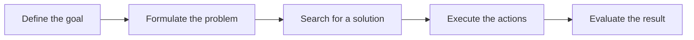

# Session 03: Problem Solving and AI Agents

> Module: AI Essentials · Term 6 (AI) · ⏱ ~2 hours

Before an AI system can solve anything, someone has to describe the problem in a form a computer can search through. This session teaches you how to formulate problems and how intelligent agents perceive and act in an environment.

## 🎯 Learning Objectives

By the end of this session you will be able to:

- Explain why structured problem solving is central to AI
- Formulate a problem using states, actions, transition model, goal test and path cost
- Describe the PEAS framework for specifying an agent's task environment
- Compare simple reflex, model-based, goal-based, utility-based and learning agents
- Break a complex problem into smaller sub-problems and solve it step by step

## 📖 Concepts Explained

### 1. Why problem solving matters in AI

Many AI tasks (route planning, puzzle solving, scheduling classes, robot movement) are really **search for a sequence of actions** that leads from where you are to where you want to be. If the problem is defined clearly, a general algorithm can solve it; if it is defined badly, no algorithm helps.

### 2. Steps of problem solving



### 3. Formulating a problem

| Component | Meaning | Water-jug example (4 L and 3 L jugs, need 2 L) |
|---|---|---|
| Initial state | Where we start | (0, 0) both jugs empty |
| Actions | What the agent can do | Fill, empty, pour one jug into the other |
| Transition model | Result of an action in a state | Pour 4L→3L from (4,0) gives (1,3) |
| Goal test | How we know we are done | 4 L jug contains exactly 2 |
| Path cost | Cost of a solution | 1 per action, so fewer steps is better |

The set of all reachable states forms the **state space**. A solution is a path through it; an **optimal** solution has the lowest cost.

### 4. Decomposing complex problems

Large problems become manageable when broken into **sub-goals**. Planning a class timetable can be split into: assign rooms, then assign teachers, then check clashes. Each sub-problem is smaller, can be solved separately and then combined. This is the same idea as functions in programming.

### 5. What is an agent?

An **agent** is anything that **perceives** its environment through **sensors** and **acts** on it through **actuators**. A **rational agent** chooses the action expected to maximise its performance measure, given what it has perceived.

**PEAS** describes an agent's task:

| | Self-driving taxi | Spam filter |
|---|---|---|
| **P**erformance | Safety, time, comfort, fare | Spam caught, good mail not blocked |
| **E**nvironment | Roads, traffic, pedestrians | Incoming mailbox |
| **A**ctuators | Steering, brakes, horn, display | Move to spam, mark safe |
| **S**ensors | Cameras, GPS, lidar, speedometer | Email text, sender, links |

### 6. Types of agents

| Agent type | How it decides | Example |
|---|---|---|
| Simple reflex | Current percept + if-then rules, no memory | Automatic door opens when sensor detects motion |
| Model-based reflex | Keeps an internal model of the world it cannot see right now | Robot vacuum remembers which rooms are clean |
| Goal-based | Chooses actions that reach a goal (needs search/planning) | Google Maps finding a route to a destination |
| Utility-based | Chooses the action with the best "happiness" score among many goals | Ride app balancing price, time and driver rating |
| Learning agent | Improves its behaviour from feedback over time | Recommendation system learning your taste |

### 7. Environment properties

Fully vs partially observable, deterministic vs stochastic, static vs dynamic, discrete vs continuous, single vs multi-agent. Chess is fully observable, deterministic and discrete; driving in Karachi traffic is partially observable, stochastic, dynamic, continuous and multi-agent, which is why it is so hard.

## 💻 Code Examples

No extra libraries needed: these examples use only the Python standard library.

### Example 1: Reflex, model-based and goal-based agents in a cleaning world

📄 File: [`agents.py`](agents.py)

```python
"""Session 03 - Three kinds of AI agents in a two-room cleaning world.

Rooms "A" and "B" can be Dirty or Clean. The agent perceives
(current_room, status) and chooses an action: Suck, Left, Right, NoOp.
"""
import random

class Environment:
    def __init__(self, seed=3):
        random.seed(seed)
        self.status = {"A": random.choice(["Dirty", "Clean"]),
                       "B": random.choice(["Dirty", "Clean"])}
        self.location = "A"

    def percept(self):
        return self.location, self.status[self.location]

    def execute(self, action):
        if action == "Suck":
            self.status[self.location] = "Clean"
        elif action == "Right":
            self.location = "B"
        elif action == "Left":
            self.location = "A"


def simple_reflex_agent(percept):
    """Acts only on the current percept using condition-action rules."""
    room, status = percept
    if status == "Dirty":
        return "Suck"
    return "Right" if room == "A" else "Left"


class ModelBasedAgent:
    """Keeps an internal model (memory) of rooms it has already seen."""
    def __init__(self):
        self.model = {"A": None, "B": None}

    def __call__(self, percept):
        room, status = percept
        self.model[room] = status
        if status == "Dirty":
            self.model[room] = "Clean"
            return "Suck"
        if all(v == "Clean" for v in self.model.values()):
            return "NoOp"                       # knows the job is done
        return "Right" if room == "A" else "Left"


class GoalBasedAgent(ModelBasedAgent):
    """Same memory, but explicitly checks a goal test before acting."""
    goal = {"A": "Clean", "B": "Clean"}

    def __call__(self, percept):
        action = super().__call__(percept)
        if self.model == self.goal:
            print("    goal reached, stopping early")
        return action


def run(agent, name, steps=6):
    env = Environment()
    print(f"\n{name}  (start: {env.status})")
    for t in range(steps):
        p = env.percept()
        a = agent(p)
        print(f"  t={t} percept={p} -> action={a}")
        env.execute(a)
        if a == "NoOp":
            break

run(simple_reflex_agent, "Simple reflex agent")
run(ModelBasedAgent(), "Model-based agent")
run(GoalBasedAgent(), "Goal-based agent")
```

Run it:

```bash
python agents.py
```

**How it works**

- `Environment` holds two rooms with random dirt and tells the agent its current percept.
- The **simple reflex agent** never stops: with no memory it keeps moving between clean rooms.
- The **model-based agent** stores what it has seen in `self.model` and returns `NoOp` once both rooms are known to be clean, saving energy.
- The **goal-based agent** reuses that memory and explicitly compares it with a goal state.

### Example 2: Problem formulation + breadth-first search

📄 File: [`water_jug.py`](water_jug.py)

```python
"""Session 03 - Formulating and solving a problem: the water jug puzzle.

You have a 4-litre jug and a 3-litre jug, no markings, and a tap.
Goal: get exactly 2 litres in the 4-litre jug.

Problem formulation
  State        : (a, b) litres in the 4L and 3L jug
  Initial state: (0, 0)
  Actions      : fill, empty, or pour one jug into the other
  Goal test    : a == 2
  Path cost    : 1 per action
"""
from collections import deque

CAP_A, CAP_B, TARGET = 4, 3, 2

def successors(state):
    a, b = state
    pour_ab = min(a, CAP_B - b)
    pour_ba = min(b, CAP_A - a)
    return {
        "Fill 4L": (CAP_A, b),
        "Fill 3L": (a, CAP_B),
        "Empty 4L": (0, b),
        "Empty 3L": (a, 0),
        "Pour 4L->3L": (a - pour_ab, b + pour_ab),
        "Pour 3L->4L": (a + pour_ba, b - pour_ba),
    }

def solve(start=(0, 0)):
    frontier = deque([(start, [])])
    visited = {start}
    while frontier:
        state, path = frontier.popleft()
        if state[0] == TARGET:                       # goal test
            return path
        for action, nxt in successors(state).items():
            if nxt not in visited:
                visited.add(nxt)
                frontier.append((nxt, path + [(action, nxt)]))
    return None

steps = solve()
print(f"Solved in {len(steps)} steps:")
print("  start      -> (0, 0)")
for action, state in steps:
    print(f"  {action:<11}-> {state}")
```

Run it:

```bash
python water_jug.py
```

**How it works**

- `successors()` is the transition model: it returns every action and the state it produces.
- A queue (`deque`) explores states level by level, so the first solution found uses the fewest actions.
- The `visited` set prevents revisiting states and looping forever.
- The script prints a 6-step plan ending with 2 L in the 4 L jug.

## 🧪 Lab Practice

1. Write the PEAS description for a chatbot that answers Aptech admission queries.
2. Change the water-jug target to 1 litre, then to 3 litres. Record the number of steps.
3. Modify `Environment` to have three rooms (A, B, C) and update the model-based agent.
4. Add a utility-based agent that gets -1 point per move and +10 per room cleaned, and print its total score.
5. Classify five environments (Ludo, online shopping assistant, traffic light controller, crossword, drone delivery) by the seven environment properties.

## 📝 Assignment

Formulate the **Missionaries and Cannibals** puzzle (3 missionaries, 3 cannibals, a boat for 2; cannibals may never outnumber missionaries on either bank). Write the state representation, actions, goal test and path cost in your README, then solve it in Python with breadth-first search and print the steps.

## ❓ Quick Quiz

**Q1.** What are the five components of a problem formulation?

<details><summary>Show answer</summary>

Initial state, actions, transition model, goal test and path cost.

</details>

**Q2.** What does PEAS stand for?

<details><summary>Show answer</summary>

Performance measure, Environment, Actuators, Sensors.

</details>

**Q3.** Which agent type has no memory of past percepts?

<details><summary>Show answer</summary>

Simple reflex agent.

</details>

**Q4.** Is a taxi-driving environment deterministic or stochastic?

<details><summary>Show answer</summary>

Stochastic: the same action can lead to different results because of other drivers, weather, etc.

</details>

**Q5.** Why does the water-jug solver keep a visited set?

<details><summary>Show answer</summary>

To avoid exploring the same state again and getting stuck in loops.

</details>

## 💼 Interview Questions

**1. What is a rational agent?**

<details><summary>Model answer</summary>

An agent that, for every possible percept sequence, selects the action expected to maximise its performance measure given its knowledge. Rational does not mean all-knowing; it means best expected outcome with available information.

</details>

**2. Difference between goal-based and utility-based agents?**

<details><summary>Model answer</summary>

A goal-based agent only distinguishes goal vs non-goal states. A utility-based agent assigns a numeric preference to states, so it can choose the best among several ways to reach a goal or trade off conflicting goals.

</details>

**3. How would you break down a large AI problem in a project?**

<details><summary>Model answer</summary>

Identify the end goal, split it into independent sub-goals with clear inputs and outputs, solve or prototype each one, then integrate and test. For example a chatbot: intent detection, entity extraction, response retrieval, and conversation state management.

</details>

## ✅ Summary

- AI problem solving means finding a sequence of actions through a state space.
- A good formulation defines initial state, actions, transitions, goal test and cost.
- Agents perceive with sensors and act with actuators; PEAS specifies their task.
- Agent sophistication grows from reflex → model-based → goal-based → utility-based → learning.
- Decomposing big problems into sub-problems makes them tractable.

---

[⬅ Previous](../Session-02-Deep-Learning-and-Neural-Networks/README.md) · [🏠 Module Home](../README.md) · [Next ➡](../Session-04-Search-Techniques-in-AI/README.md)

Prepared by Zeeshan Abbas · Aptech Learning North Nazimabad
