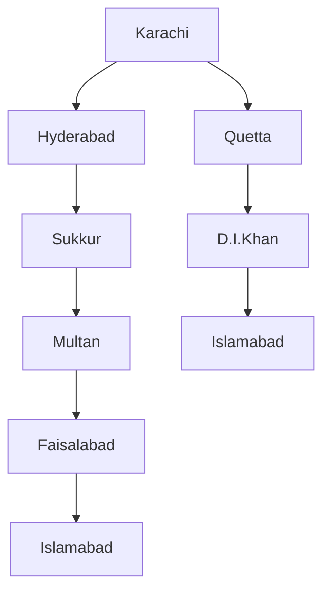

# Session 04: Search Techniques in AI

> Module: AI Essentials · Term 6 (AI) · ⏱ ~2 hours

Once a problem is formulated, the agent needs a strategy to explore the state space. In this session you will implement the classic uninformed and informed search algorithms and compare them on a map of Pakistan and the 8-puzzle.

## 🎯 Learning Objectives

By the end of this session you will be able to:

- Analyse a problem's requirements, constraints and state space before searching
- Explain how search is used in AI applications such as navigation, games and planning
- Implement BFS, DFS and Uniform Cost Search (uninformed search)
- Implement Greedy Best-First and A* search using heuristics (informed search)
- Compare algorithms on completeness, optimality, time and memory

## 📖 Concepts Explained

### 1. Understanding the problem first

Before choosing an algorithm ask: How big is the state space? Do actions have different costs? Is there a way to estimate how far the goal is? Do we need the **best** solution or **any** solution quickly? The answers decide the algorithm.

### 2. Where search is used

Route finding (maps, delivery apps), game playing (chess engines), puzzle solving, robot motion planning, scheduling exams, network packet routing, and even inside LLM reasoning frameworks that explore several reasoning paths.

### 3. The search tree

Search builds a tree from the start state. The **frontier** is the set of nodes discovered but not yet expanded. Algorithms differ only in **which frontier node they expand next**.



### 4. Uninformed (blind) search

These use no knowledge about where the goal is.

| Algorithm | Frontier | Complete? | Optimal? | Notes |
|---|---|---|---|---|
| Breadth-First (BFS) | Queue (FIFO) | Yes | Only if all steps cost the same | Fewest steps; high memory |
| Depth-First (DFS) | Stack (LIFO) | Not in infinite spaces | No | Low memory; may find long paths |
| Uniform Cost (UCS) | Priority queue by path cost g(n) | Yes | Yes | Dijkstra-like; good with varied costs |
| Depth-Limited / Iterative Deepening | Stack with depth limit | IDS: yes | IDS: yes for equal costs | Combines DFS memory with BFS completeness |

### 5. Informed (heuristic) search

A **heuristic h(n)** estimates the cost from node n to the goal (e.g. straight-line distance to Islamabad).

| Algorithm | Expands node with lowest | Optimal? |
|---|---|---|
| Greedy Best-First | h(n) | No, it is fast but can be fooled |
| A* | f(n) = g(n) + h(n) | Yes, if h is **admissible** (never overestimates) |

Analogy: Greedy is a tourist who always walks toward the tower they can see, even into a dead-end street. A* also counts how far they have already walked, so it balances distance travelled with distance remaining.

**Better heuristics = fewer nodes.** For the 8-puzzle, "Manhattan distance" is closer to the true cost than "misplaced tiles", so A* expands far fewer nodes while still finding the optimal solution.

### 6. Present-day uses

GPS navigation (A* and variants), video game characters finding paths, warehouse robots, airline crew scheduling, and AI planners that search over sequences of tool calls.

## 💻 Code Examples

Standard library only (`heapq`, `collections`).

### Example 1: Five search algorithms on a Pakistan road map

📄 File: [`route_search.py`](route_search.py)

```python
"""Session 04 - Uninformed vs informed search on a simplified Pakistan road map.

Distances are rounded, approximate road kilometres for teaching only.
Heuristic h(n) = rough straight-line km from the city to Islamabad.
"""
import heapq
from collections import deque

GRAPH = {
    "Karachi":    {"Hyderabad": 165, "Quetta": 690},
    "Hyderabad":  {"Karachi": 165, "Sukkur": 330},
    "Sukkur":     {"Hyderabad": 330, "Multan": 470, "Quetta": 390},
    "Quetta":     {"Karachi": 690, "Sukkur": 390, "D.I.Khan": 520},
    "Multan":     {"Sukkur": 470, "Lahore": 340, "Faisalabad": 240, "D.I.Khan": 330},
    "Faisalabad": {"Multan": 240, "Lahore": 180, "Islamabad": 300},
    "Lahore":     {"Multan": 340, "Faisalabad": 180, "Islamabad": 375},
    "D.I.Khan":   {"Quetta": 520, "Multan": 330, "Islamabad": 400},
    "Islamabad":  {"Lahore": 375, "Faisalabad": 300, "D.I.Khan": 400},
}
H_TO_ISLAMABAD = {"Karachi": 1140, "Hyderabad": 1000, "Sukkur": 730, "Quetta": 700,
                  "Multan": 450, "Faisalabad": 250, "Lahore": 270, "D.I.Khan": 280,
                  "Islamabad": 0}

def path_cost(path):
    return sum(GRAPH[a][b] for a, b in zip(path, path[1:]))

def bfs(start, goal):
    frontier, seen, expanded = deque([[start]]), {start}, 0
    while frontier:
        path = frontier.popleft(); expanded += 1
        if path[-1] == goal:
            return path, expanded
        for nb in GRAPH[path[-1]]:
            if nb not in seen:
                seen.add(nb); frontier.append(path + [nb])

def dfs(start, goal):
    stack, seen, expanded = [[start]], set(), 0
    while stack:
        path = stack.pop(); node = path[-1]
        if node in seen:
            continue
        seen.add(node); expanded += 1
        if node == goal:
            return path, expanded
        for nb in GRAPH[node]:
            if nb not in seen:
                stack.append(path + [nb])

def best_first(start, goal, use_g, use_h):
    """use_g only -> Uniform Cost; use_h only -> Greedy; both -> A*."""
    frontier = [(0, 0, [start])]
    best_g, expanded = {start: 0}, 0
    while frontier:
        _, g, path = heapq.heappop(frontier); node = path[-1]
        if g > best_g.get(node, float("inf")):
            continue
        expanded += 1
        if node == goal:
            return path, expanded
        for nb, km in GRAPH[node].items():
            g2 = g + km
            if g2 < best_g.get(nb, float("inf")):
                best_g[nb] = g2
                f = (g2 if use_g else 0) + (H_TO_ISLAMABAD[nb] if use_h else 0)
                heapq.heappush(frontier, (f, g2, path + [nb]))

algorithms = {
    "BFS (uninformed)": lambda s, t: bfs(s, t),
    "DFS (uninformed)": lambda s, t: dfs(s, t),
    "Uniform Cost (uninformed)": lambda s, t: best_first(s, t, True, False),
    "Greedy Best-First (informed)": lambda s, t: best_first(s, t, False, True),
    "A* (informed)": lambda s, t: best_first(s, t, True, True),
}
for name, algo in algorithms.items():
    path, expanded = algo("Karachi", "Islamabad")
    print(f"{name:<30} cost={path_cost(path):5d} km  expanded={expanded}  path={' -> '.join(path)}")
```

Run it:

```bash
python route_search.py
```

**How it works**

- `GRAPH` stores neighbours with approximate road distances; `H_TO_ISLAMABAD` is the heuristic (rough straight-line km).
- `bfs` uses a queue and `dfs` a stack: they find a 3-hop route via Quetta but it is 1,610 km long because they ignore distance.
- `best_first` covers three algorithms with one priority queue: ordering by g gives UCS, by h gives Greedy, by g+h gives A*.
- UCS and A* both find the 1,505 km route through Sukkur, Multan and Faisalabad; A* expands fewer nodes than UCS thanks to the heuristic.
- Greedy expands the fewest nodes but returns a longer route, showing it is not optimal.

### Example 2: A* on the 8-puzzle with two heuristics

📄 File: [`eight_puzzle_astar.py`](eight_puzzle_astar.py)

```python
"""Session 04 - A* on the 8-puzzle with two heuristics.

State: a tuple of 9 numbers read row by row, 0 = blank.
h1 = number of misplaced tiles, h2 = total Manhattan distance.
Both are admissible, but h2 is better informed, so A* expands fewer nodes.
"""
import heapq

GOAL = (1, 2, 3, 4, 5, 6, 7, 8, 0)

def neighbours(state):
    i = state.index(0)
    r, c = divmod(i, 3)
    for dr, dc in ((-1, 0), (1, 0), (0, -1), (0, 1)):
        nr, nc = r + dr, c + dc
        if 0 <= nr < 3 and 0 <= nc < 3:
            j = nr * 3 + nc
            s = list(state); s[i], s[j] = s[j], s[i]
            yield tuple(s)

def misplaced(state):
    return sum(1 for a, b in zip(state, GOAL) if a and a != b)

def manhattan(state):
    total = 0
    for idx, tile in enumerate(state):
        if tile:
            g = GOAL.index(tile)
            total += abs(idx // 3 - g // 3) + abs(idx % 3 - g % 3)
    return total

def astar(start, h):
    frontier = [(h(start), 0, start, [start])]
    best_g, expanded = {start: 0}, 0
    while frontier:
        f, g, state, path = heapq.heappop(frontier)
        if g > best_g[state]:
            continue
        expanded += 1
        if state == GOAL:
            return path, expanded
        for nxt in neighbours(state):
            if g + 1 < best_g.get(nxt, 1e9):
                best_g[nxt] = g + 1
                heapq.heappush(frontier, (g + 1 + h(nxt), g + 1, nxt, path + [nxt]))

def show(state):
    for r in range(3):
        print("   ", " ".join(str(x) if x else "_" for x in state[r * 3:r * 3 + 3]))

start = (7, 2, 4, 5, 0, 6, 8, 3, 1)   # solvable; try (8, 6, 7, 2, 5, 4, 3, 0, 1) for a 31-move challenge
print("Start state:"); show(start)
for name, h in (("misplaced tiles", misplaced), ("Manhattan distance", manhattan)):
    path, expanded = astar(start, h)
    print(f"A* with {name:<20}: {len(path) - 1} moves, {expanded} nodes expanded")
```

Run it:

```bash
python eight_puzzle_astar.py
```

**How it works**

- Each state is a 9-tuple; `neighbours()` slides the blank up, down, left or right.
- `misplaced()` counts tiles out of place; `manhattan()` sums how many rows+columns each tile is from home.
- Both heuristics give the same optimal 20-move solution, but Manhattan expands about 280 nodes compared with about 3,700 for misplaced tiles.

## 🧪 Lab Practice

1. Add Peshawar to `GRAPH` (connected to Islamabad ≈ 185 km and D.I.Khan ≈ 300 km) with a heuristic of 150. Re-run all algorithms.
2. Change the goal city to Lahore. You must build a new heuristic table; keep it admissible.
3. Make the heuristic inadmissible by doubling all values. Does A* still find the cheapest route?
4. Implement iterative deepening search and compare nodes expanded with BFS.
5. Run the 31-move 8-puzzle mentioned in the code comment and time both heuristics with `time.perf_counter()`.

## 📝 Assignment

Build a **campus navigator**: model at least 10 locations of your Aptech centre or neighbourhood as a weighted graph (walking metres). Implement BFS, UCS and A* (heuristic = straight-line distance you estimate), print the route and nodes expanded for three different queries, and write a short comparison of results.

## ❓ Quick Quiz

**Q1.** Which data structure does BFS use for its frontier?

<details><summary>Show answer</summary>

A FIFO queue.

</details>

**Q2.** What does A* use to rank nodes?

<details><summary>Show answer</summary>

f(n) = g(n) + h(n): cost so far plus estimated cost to goal.

</details>

**Q3.** What makes a heuristic admissible?

<details><summary>Show answer</summary>

It never overestimates the true remaining cost to the goal.

</details>

**Q4.** Which uninformed algorithm is optimal when step costs differ?

<details><summary>Show answer</summary>

Uniform Cost Search.

</details>

**Q5.** Why is Greedy Best-First not optimal?

<details><summary>Show answer</summary>

It ignores the cost already travelled (g) and can commit to a path that looks close but is expensive.

</details>

## 💼 Interview Questions

**1. Compare BFS and DFS in memory use and completeness.**

<details><summary>Model answer</summary>

BFS stores the whole frontier level, so memory grows exponentially with depth, but it is complete and finds the shallowest goal. DFS stores only one path plus siblings, so memory is linear in depth, but it can go down infinite branches and is not optimal.

</details>

**2. Why does a better heuristic make A* faster?**

<details><summary>Model answer</summary>

A heuristic closer to the true cost gives A* more accurate guidance, so fewer non-promising nodes have f-values below the optimal cost and fewer nodes are expanded.

</details>

**3. Where have you seen search in real software?**

<details><summary>Model answer</summary>

Navigation apps, game AI pathfinding, compilers searching optimisations, autocomplete over a trie, and AI agents that plan sequences of tool calls.

</details>

## ✅ Summary

- Search explores a state space; algorithms differ in the order they expand the frontier.
- BFS, DFS and UCS are uninformed; Greedy and A* use heuristics.
- A* with an admissible heuristic is complete and optimal.
- Better heuristics reduce the number of expanded nodes dramatically.
- Always analyse the problem (costs, size, need for optimality) before picking an algorithm.

---

[⬅ Previous](../Session-03-Problem-Solving-and-AI-Agents/README.md) · [🏠 Module Home](../README.md) · [Next ➡](../Session-05-Knowledge-Representation/README.md)

Prepared by Zeeshan Abbas · Aptech Learning North Nazimabad
