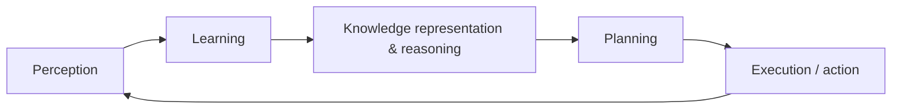

# Session 05: Knowledge Representation

> Module: AI Essentials · Term 6 (AI) · ⏱ ~2 hours

An intelligent system needs more than data: it needs knowledge it can reason with. This session shows how facts and rules are encoded so a computer can draw conclusions, using rules, semantic networks and frames.

## 🎯 Learning Objectives

By the end of this session you will be able to:

- Explain knowledge representation (KR) and its role in AI applications
- Describe the relationship between knowledge and intelligent behaviour
- Outline the AI knowledge cycle from perception to action
- Compare KR approaches: logical, rule-based, semantic networks and frames
- Implement forward and backward chaining in Python

## 📖 Concepts Explained

### 1. What is knowledge representation?

**Knowledge representation** is the way we encode facts, rules and relationships about the world so a computer can store them and **reason** with them. Data says "temperature = 39"; knowledge says "if temperature > 38 then the person has a fever".

Types of knowledge:

| Type | Meaning | Example |
|---|---|---|
| Declarative | Facts: "what is" | Lahore is in Punjab |
| Procedural | How to do something | Steps to change a car tyre |
| Meta-knowledge | Knowledge about knowledge | This rule is reliable only for adults |
| Heuristic | Rules of thumb from experience | Traffic is heavy on Shahrah-e-Faisal at 6 pm |
| Structural | How concepts relate | A parrot is a bird |

### 2. Knowledge and intelligence

Intelligence is the ability to **use** knowledge to reach goals in new situations. A system with lots of knowledge but no reasoning is just a database; a system with reasoning but no knowledge has nothing to reason about.

### 3. The AI knowledge cycle



Planning and decision-making sit on top of KR: the agent uses what it knows to choose actions.

### 4. Approaches to KR

| Approach | Idea | Strength | Weakness |
|---|---|---|---|
| Logical (propositional / first-order logic) | Precise sentences with truth values | Rigorous, provable conclusions | Hard to express uncertainty |
| Production rules | IF conditions THEN conclusion | Easy to read, used in expert systems | Many rules become hard to maintain |
| Semantic network | Graph of concepts and relations (is_a, has) | Visual, supports inheritance | Ambiguous meaning of links |
| Frames | Objects with slots and default values | Natural for structured knowledge | Exceptions need care |
| Ontologies / knowledge graphs | Large shared vocabularies (e.g. Wikidata) | Power search engines and assistants | Expensive to build |

### 5. Inference: forward vs backward chaining

| | Forward chaining | Backward chaining |
|---|---|---|
| Direction | Data-driven: facts → conclusions | Goal-driven: goal → required facts |
| Starts with | Known facts | A hypothesis to prove |
| Good for | Monitoring, alarms, deriving everything possible | Diagnosis, answering a specific question |
| Example | Sensor values trigger alerts | "Does this patient have flu?" |

### 6. Inheritance and exceptions

In a semantic network, properties flow down `is_a` links: if birds fly and a parrot is a bird, a parrot flies. Exceptions (penguins do not fly) are stored on the more specific node and **override** the inherited value.

### 7. Real applications

Medical expert systems, legal rule engines, product configurators, knowledge graphs behind search results, chatbot FAQ systems and, more recently, knowledge graphs that ground LLM answers in verified facts.

## 💻 Code Examples

Standard library only.

### Example 1: Forward and backward chaining inference engine

📄 File: [`inference_engine.py`](inference_engine.py)

```python
"""Session 05 - Rule-based knowledge representation with forward and backward chaining.

Domain: a tiny "first-aid advisor" knowledge base (for teaching only, not medical advice).
Facts are strings. Rules are IF all(conditions) THEN conclusion.
"""

RULES = [
    ({"fever", "cough"}, "possible_flu"),
    ({"possible_flu", "body_ache"}, "likely_flu"),
    ({"sneezing", "itchy_eyes"}, "possible_allergy"),
    ({"likely_flu"}, "advice_rest_and_fluids"),
    ({"possible_allergy"}, "advice_avoid_dust"),
    ({"fever", "stiff_neck"}, "advice_see_doctor_now"),
]

def forward_chain(facts):
    """Data-driven: keep firing rules until no new fact appears."""
    facts = set(facts)
    fired = True
    while fired:
        fired = False
        for conditions, conclusion in RULES:
            if conditions <= facts and conclusion not in facts:
                print(f"  rule fired: IF {sorted(conditions)} THEN {conclusion}")
                facts.add(conclusion)
                fired = True
    return facts

def backward_chain(goal, facts, depth=0):
    """Goal-driven: to prove a goal, prove all conditions of a rule that concludes it."""
    pad = "  " * (depth + 1)
    if goal in facts:
        print(f"{pad}{goal}: known fact")
        return True
    for conditions, conclusion in RULES:
        if conclusion == goal:
            print(f"{pad}trying to prove {goal} via {sorted(conditions)}")
            if all(backward_chain(c, facts, depth + 1) for c in conditions):
                return True
    print(f"{pad}{goal}: cannot be proven")
    return False

patient = {"fever", "cough", "body_ache"}
print("FORWARD CHAINING from facts:", sorted(patient))
derived = forward_chain(patient)
print("  advice:", sorted(f for f in derived if f.startswith("advice")))

print("\nBACKWARD CHAINING: is 'advice_rest_and_fluids' supported?")
print("  result:", backward_chain("advice_rest_and_fluids", patient))
```

Run it:

```bash
python inference_engine.py
```

**How it works**

- Each rule is a pair `(set_of_conditions, conclusion)`. Using sets makes `conditions <= facts` a simple subset test.
- `forward_chain` loops until no rule fires, adding each new conclusion to the fact set, and prints the reasoning trace.
- `backward_chain` starts from a goal and recursively tries to prove every condition of any rule that concludes it.
- Both methods reach `advice_rest_and_fluids` but from opposite directions.

### Example 2: Semantic network with inheritance + frames

📄 File: [`semantic_network_frames.py`](semantic_network_frames.py)

```python
"""Session 05 - Semantic networks and frames.

A semantic network stores knowledge as (subject, relation, object) triples.
"is_a" links allow inheritance: properties flow down from general to specific.
Frames group the slots (attributes) of one concept, with defaults.
"""

TRIPLES = [
    ("Animal", "can", "breathe"),
    ("Bird", "is_a", "Animal"),
    ("Bird", "can", "fly"),
    ("Bird", "has", "feathers"),
    ("Penguin", "is_a", "Bird"),
    ("Penguin", "cannot", "fly"),          # exception overrides inheritance
    ("Parrot", "is_a", "Bird"),
    ("Mithu", "instance_of", "Parrot"),
]

def parents(node):
    return [o for s, r, o in TRIPLES if s == node and r in ("is_a", "instance_of")]

def can(node, ability):
    """Walk up the is_a chain; the most specific fact wins."""
    for s, r, o in TRIPLES:
        if s == node and o == ability and r in ("can", "cannot"):
            return r == "can"
    return any(can(p, ability) for p in parents(node))

for who in ("Mithu", "Penguin", "Bird"):
    print(f"Can {who} fly? {can(who, 'fly')}   breathe? {can(who, 'breathe')}")

# ---------------- Frames ----------------
class Frame:
    def __init__(self, name, parent=None, **slots):
        self.name, self.parent, self.slots = name, parent, slots

    def get(self, slot):
        if slot in self.slots:
            return self.slots[slot]
        return self.parent.get(slot) if self.parent else None

course = Frame("Course", duration_hours=2, delivery="classroom")
ai_session = Frame("AI_Session", parent=course, module="AI Essentials", lab=True)
online_ai = Frame("Online_AI_Session", parent=ai_session, delivery="online")

print("\nFrame lookup with inheritance and overriding:")
for slot in ("module", "duration_hours", "delivery", "lab"):
    print(f"  {online_ai.name}.{slot} = {online_ai.get(slot)}")
```

Run it:

```bash
python semantic_network_frames.py
```

**How it works**

- Knowledge is stored as triples. `can()` first looks for a direct fact on the node, then climbs `is_a` / `instance_of` links.
- Mithu (a parrot) inherits 'can fly' from Bird and 'can breathe' from Animal; Penguin's own 'cannot fly' overrides the inherited value.
- `Frame.get()` returns a slot from the frame itself or asks its parent, so `Online_AI_Session` overrides `delivery` but inherits `duration_hours`.

## 🧪 Lab Practice

1. Add three rules for 'dengue' (fever, joint_pain, rash) and test forward chaining with new symptoms.
2. Ask backward chaining to prove `advice_see_doctor_now` for a patient with only fever. Read the trace.
3. Add 'Ostrich' and 'Eagle' to the semantic network with correct flying abilities.
4. Add a `relations(node)` function that prints every triple about a node, including inherited ones.
5. Create frames for `Vehicle → Car → ElectricCar` with slots wheels, fuel and doors.

## 📝 Assignment

Build a small **expert system** for one domain (choosing a laptop, recommending a course at Aptech, or diagnosing why a PC won't start). Use at least 12 rules, support both forward and backward chaining, and let the user type facts in the console. Include a README with your rule list and three sample runs.

## ❓ Quick Quiz

**Q1.** What is the difference between data and knowledge?

<details><summary>Show answer</summary>

Data is raw values; knowledge adds meaning and relationships that support reasoning (e.g. rules, categories).

</details>

**Q2.** Which chaining starts from a goal?

<details><summary>Show answer</summary>

Backward chaining.

</details>

**Q3.** In a semantic network, what does an `is_a` link enable?

<details><summary>Show answer</summary>

Inheritance of properties from a general concept to a specific one.

</details>

**Q4.** What is a slot in a frame?

<details><summary>Show answer</summary>

An attribute of the concept, possibly with a default value.

</details>

**Q5.** Give one weakness of production-rule systems.

<details><summary>Show answer</summary>

Large rule sets become hard to maintain and can conflict; they also handle uncertainty poorly.

</details>

## 💼 Interview Questions

**1. Explain forward vs backward chaining with an example.**

<details><summary>Model answer</summary>

Forward chaining starts from facts and fires rules to derive all conclusions, like a smoke detector system raising alarms. Backward chaining starts from a hypothesis and checks if facts support it, like a doctor testing whether symptoms confirm a suspected disease.

</details>

**2. What is a knowledge graph and where is it used?**

<details><summary>Model answer</summary>

A graph of entities and typed relationships, often large-scale. Search engines use it for info panels, e-commerce uses it for product relations, and LLM systems use it to ground answers in verified facts.

</details>

**3. How do symbolic KR and machine learning complement each other?**

<details><summary>Model answer</summary>

ML learns patterns from data but can be opaque and inconsistent; symbolic KR is explicit and explainable but hard to scale. Hybrid (neuro-symbolic) systems use ML for perception and KR for reasoning and constraints.

</details>

## ✅ Summary

- KR encodes facts, rules and relationships in a form computers can reason with.
- The knowledge cycle links perception, learning, reasoning, planning and action.
- Main approaches: logic, production rules, semantic networks, frames and ontologies.
- Forward chaining is data-driven; backward chaining is goal-driven.
- Inheritance with overrides makes semantic networks and frames compact.

---

[⬅ Previous](../Session-04-Search-Techniques-in-AI/README.md) · [🏠 Module Home](../README.md) · [Next ➡](../Session-06-Logical-Reasoning-and-AI-Trends/README.md)

Prepared by Zeeshan Abbas · Aptech Learning North Nazimabad
