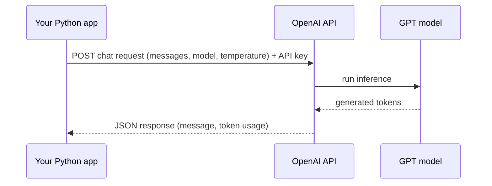

# Session 07: Working with the OpenAI API

> Module: AI Essentials · Term 6 (AI) · ⏱ ~2 hours

Large language models become truly useful when you call them from your own code. In this session you will connect Python to OpenAI's chat models, write better prompts, use few-shot examples and build a chatbot with memory. Every script also runs in an offline **mock mode**, so you can practise without an API key.

## 🎯 Learning Objectives

By the end of this session you will be able to:

- Explain what the OpenAI API is and how Python connects to GPT models
- Compare model tiers (fast/cheap vs most capable) and choose one for a task
- Send chat requests with system, user and assistant messages
- Refine prompts and control output with parameters such as temperature and max tokens
- Apply few-shot prompting to control behaviour and output format
- Maintain conversation history in chat applications

## 📖 Concepts Explained

### 1. What is the OpenAI API?

An **API** (Application Programming Interface) lets your program send a request to a remote service and receive a result. The OpenAI API accepts a list of **messages** and returns the model's reply as JSON. The official `openai` Python package wraps the HTTP calls for you.



### 2. Getting set up safely

1. Create an account at platform.openai.com and generate an **API key**.
2. Store it as an environment variable, never in code or GitHub:
   - Windows PowerShell: `setx OPENAI_API_KEY "sk-..."` (open a new terminal afterwards)
   - macOS/Linux: `export OPENAI_API_KEY="sk-..."`
3. `pip install openai`
4. Usage is billed per **token** (roughly ¾ of an English word). Set a monthly limit in your account.

### 3. Choosing a model

Model names change often, so always check the official models page. The trade-off stays the same:

| Tier | Strength | Typical use |
|---|---|---|
| Small / "mini" models | Fast, cheap, good enough for most tasks | Chatbots, classification, extraction, students' projects |
| Flagship models | Best reasoning, longer context, multimodal | Complex analysis, coding, long documents |
| Reasoning models | Think step by step before answering | Maths, planning, hard logic |

Older names you may see in tutorials (for example `gpt-3.5-turbo` and `gpt-4-turbo-preview`) illustrate the same idea: the first was the fast, low-cost option; the second offered stronger reasoning and a larger context window at a higher price. Many older models are now retired or replaced, which is why our code reads the model name from the `OPENAI_MODEL` environment variable.

### 4. Message roles

| Role | Purpose | Example |
|---|---|---|
| `system` | Sets behaviour, persona, rules | "You are a polite tutor. Answer in 3 bullets." |
| `user` | The human's input | "Explain overfitting." |
| `assistant` | Previous model replies (or examples you write) | "Overfitting is ..." |

### 5. Useful parameters

- `temperature` (0-2): low = focused and repeatable; high = creative and varied. Use 0-0.3 for extraction, 0.7-1.0 for brainstorming.
- `max_tokens`: upper limit on reply length (controls cost).
- `model`: which model to use.

### 6. Writing better prompts

| Weak prompt | Refined prompt |
|---|---|
| "Tell me about Python." | "You are a tutor for beginners. In 3 bullet points, explain why Python is popular for AI, with one real example each." |

A good prompt states the **role**, the **task**, the **context**, the **format** and any **constraints**.

### 7. Few-shot prompting

Give the model a few input → output examples as alternating user/assistant messages. It then copies the pattern, which is very effective for fixed formats like JSON labels.

### 8. Conversation history

The API is **stateless**: each request is independent. To make a chatbot "remember", you resend previous turns every time. Because models have a context limit and you pay per token, real apps **trim or summarise** old history.

## 💻 Code Examples

Install: `pip install openai`. Without `OPENAI_API_KEY` the scripts print `(mock)` replies; set the key to get real answers. Optionally set `OPENAI_MODEL` to any chat model your account can use.

### Example 1: A reusable chat helper with offline mock

📄 File: [`llm_client.py`](llm_client.py)

```python
"""Session 07 - Shared helper: talk to an OpenAI chat model, or a local mock.

If the `openai` package is installed AND the OPENAI_API_KEY environment
variable is set, real requests are sent. Otherwise a tiny offline mock
answers, so every example in this folder still runs in class.

Set the model with OPENAI_MODEL (default below). Model names change over
time, so check https://platform.openai.com/docs/models for current ones.
"""
import os

DEFAULT_MODEL = os.getenv("OPENAI_MODEL", "gpt-4o-mini")


def _mock_reply(messages):
    last = messages[-1]["content"]
    names = [m["content"] for m in messages if m["role"] == "user" and "my name is" in m["content"].lower()]
    if "name" in last.lower() and "?" in last and names:
        return f"(mock) You told me earlier: '{names[-1]}'."
    return f"(mock) I received {len(messages)} message(s). Last one was: {last[:60]!r}"


def chat(messages, model=DEFAULT_MODEL, temperature=0.7, max_tokens=300):
    """Send a list of {'role','content'} dicts and return the reply text."""
    key = os.getenv("OPENAI_API_KEY")
    try:
        from openai import OpenAI
    except ImportError:
        OpenAI = None
    if not key or OpenAI is None:
        return _mock_reply(messages)
    client = OpenAI()                       # reads OPENAI_API_KEY automatically
    response = client.chat.completions.create(
        model=model,
        messages=messages,
        temperature=temperature,
        max_tokens=max_tokens,
    )
    return response.choices[0].message.content


if __name__ == "__main__":
    mode = "LIVE" if os.getenv("OPENAI_API_KEY") else "MOCK (no OPENAI_API_KEY set)"
    print("Mode:", mode, "| model:", DEFAULT_MODEL)
    print(chat([{"role": "user", "content": "Say hello to Aptech AI students in one line."}]))
```

Run it:

```bash
python llm_client.py
```

**How it works**

- `chat()` builds an `OpenAI()` client, which reads the key from the environment, and calls `client.chat.completions.create` with model, messages, temperature and max tokens.
- `response.choices[0].message.content` holds the reply text.
- If the key or the package is missing, `_mock_reply` returns a short fake answer so the rest of the session still runs.
- The model name comes from `OPENAI_MODEL`, so you can switch models without editing code.

### Example 2: Refining prompts and few-shot classification

📄 File: [`prompts_and_few_shot.py`](prompts_and_few_shot.py)

```python
"""Session 07 - System prompts, refining prompts and few-shot prompting."""
from llm_client import chat

# 1) A vague prompt vs a refined prompt
vague = [{"role": "user", "content": "Tell me about Python."}]
refined = [
    {"role": "system", "content": "You are a patient programming tutor for beginners in Pakistan. "
                                  "Answer in at most 3 bullet points, simple English."},
    {"role": "user", "content": "Why is Python popular for AI? Give one real example per point."},
]
print("VAGUE   ->", chat(vague, temperature=0.7))
print("REFINED ->", chat(refined, temperature=0.3))

# 2) Few-shot prompting: show examples of the exact output format we want
few_shot = [
    {"role": "system", "content": "Classify customer messages. Reply with JSON only: "
                                  '{"intent": <billing|delivery|complaint|other>, "urgent": <true|false>}'},
    {"role": "user", "content": "My parcel was supposed to arrive yesterday."},
    {"role": "assistant", "content": '{"intent": "delivery", "urgent": false}'},
    {"role": "user", "content": "You charged my card twice, fix it today!"},
    {"role": "assistant", "content": '{"intent": "billing", "urgent": true}'},
    {"role": "user", "content": "The rider was very rude to my mother."},    # new input
]
print("FEW-SHOT ->", chat(few_shot, temperature=0))
```

Run it:

```bash
python prompts_and_few_shot.py
```

**How it works**

- The vague and refined prompts are sent one after another so you can compare answer quality.
- The refined prompt uses a `system` message for role and format, and a lower temperature for focus.
- The few-shot list contains two worked examples (user message + ideal JSON reply) before the real input; with temperature 0 a live model returns consistent JSON such as `{"intent": "complaint", "urgent": false}`.

### Example 3: Chatbot that remembers the conversation

📄 File: [`chat_with_history.py`](chat_with_history.py)

```python
"""Session 07 - A console chatbot that remembers the conversation.

The API is stateless: the model only "remembers" what you send again.
So we keep a `history` list and append every user and assistant turn.
We also trim old turns so the request never grows without limit.

Run interactively:  python chat_with_history.py
Run the demo only:  python chat_with_history.py --demo
"""
import sys
from llm_client import chat

MAX_TURNS = 10   # keep the system prompt + last 10 messages

history = [{"role": "system", "content": "You are StudyBot, a friendly helper for AI students. Keep answers short."}]

def ask(user_text):
    history.append({"role": "user", "content": user_text})
    trimmed = [history[0]] + history[1:][-MAX_TURNS:]
    reply = chat(trimmed)
    history.append({"role": "assistant", "content": reply})
    return reply

if "--demo" in sys.argv or not sys.stdin.isatty():
    for line in ["Hi, my name is Sana.", "What is a neural network in one line?", "What is my name?"]:
        print("You :", line)
        print("Bot :", ask(line))
else:
    print("Type 'quit' to exit.")
    while (text := input("You : ").strip()).lower() != "quit":
        print("Bot :", ask(text))
print(f"\n(history now holds {len(history)} messages)")
```

Run it:

```bash
python chat_with_history.py --demo
```

**How it works**

- `history` starts with a system message; `ask()` appends each user message, calls the model, and appends the reply.
- `trimmed` keeps the system message plus the last 10 messages to control cost and context length.
- In the demo the bot answers 'What is my name?' correctly only because the earlier message was resent in the history.
- Run without `--demo` for an interactive console chat; type `quit` to exit.

## 🧪 Lab Practice

1. Run all three scripts in mock mode. Then set your API key and run them live; compare outputs.
2. Run `prompts_and_few_shot.py` live with temperature 0 and 1.2 three times each. Which output varies more?
3. Add two more few-shot examples (a refund request and a general question) and test five new messages.
4. Change `MAX_TURNS` to 2 in `chat_with_history.py` and show that the bot forgets your name.
5. Print `response.usage` in `llm_client.py` to see prompt and completion token counts.

## 📝 Assignment

Build a **Course Advisor bot** in the console. It must use a system prompt describing three fictional courses (name, duration, fee), keep conversation history, and answer only questions about those courses, politely refusing other topics. Include at least two few-shot examples showing the refusal style. Submit the script and a transcript of a 6-turn conversation (mock or live).

## ❓ Quick Quiz

**Q1.** Where should you store your API key?

<details><summary>Show answer</summary>

In an environment variable or secret manager, never hard-coded or pushed to GitHub.

</details>

**Q2.** Which message role sets the assistant's behaviour?

<details><summary>Show answer</summary>

The `system` role.

</details>

**Q3.** What does a lower temperature do?

<details><summary>Show answer</summary>

Makes output more deterministic and focused.

</details>

**Q4.** Why must a chatbot resend earlier messages?

<details><summary>Show answer</summary>

The API is stateless; the model only sees the messages included in the current request.

</details>

**Q5.** What is few-shot prompting?

<details><summary>Show answer</summary>

Including a few example inputs and ideal outputs in the prompt so the model follows the same pattern.

</details>

## 💼 Interview Questions

**1. How would you reduce the cost of an LLM-powered chatbot?**

<details><summary>Model answer</summary>

Use a smaller model where possible, cap max tokens, trim or summarise history, cache frequent answers, and keep system prompts concise.

</details>

**2. How do you get reliable structured output from an LLM?**

<details><summary>Model answer</summary>

Give a clear schema in the system prompt, add few-shot examples, use temperature 0, use the provider's structured-output or JSON mode when available, and validate the result in code with a retry on failure.

</details>

**3. What risks do you consider before shipping an LLM feature?**

<details><summary>Model answer</summary>

Hallucinated facts, prompt injection, leaking private data, harmful content, cost spikes, latency and model deprecation. Mitigations include grounding, moderation, input validation, logging, rate limits and configurable model names.

</details>

## ✅ Summary

- The OpenAI API turns a list of role-tagged messages into a model reply over HTTPS.
- Keep API keys in environment variables and track token usage.
- Pick model tiers by trade-off between cost, speed and reasoning ability.
- Clear role, task, format and constraints make prompts reliable; few-shot examples lock the format.
- Chat memory is just history you resend; trim it to manage cost and context.

---

[⬅ Previous](../Session-06-Logical-Reasoning-and-AI-Trends/README.md) · [🏠 Module Home](../README.md) · Next ➡

Prepared by Zeeshan Abbas · Aptech Learning North Nazimabad
