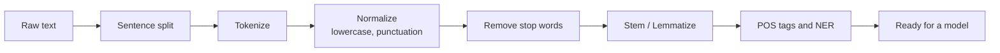

# Session 01: Introduction to NLP and NLU

> Module: Next-Gen NLP Applications with AI · Term 6 (AI) · ⏱ ~2 hours

Every chatbot, search engine and translator starts by turning messy human text into something a computer can work with. In this session you learn the classic NLP pipeline step by step, and then see how NLU goes one level deeper to understand what the user actually wants.

## 🎯 Learning Objectives

By the end of this session you will be able to:

- Define NLP and NLU and explain where they fit inside AI
- Describe the main milestones in the history of NLP, up to transformers
- Run the core pipeline steps: tokenization, normalization and stop-word removal
- Compare stemming with lemmatization and read POS tags and named entities
- Explain intent detection, slot filling and dialogue state tracking
- List real applications that combine NLP and NLU

## 📖 Concepts Explained

### 1. NLP and NLU in one picture

- **NLP (Natural Language Processing)** is the whole field of getting computers to read, process and produce human language (text or speech).
- **NLU (Natural Language Understanding)** is the part of NLP that cares about *meaning*: what does the person want, and what details did they give?

Analogy: NLP is a clerk who neatly sorts and labels every word of a letter. NLU is the manager who reads the sorted letter and says "this customer wants a refund for order 552".

### 2. A short history

| Era | Main idea | Example |
|---|---|---|
| 1950s | Can a machine talk like a human? | The Turing Test |
| 1950s-1980s | Hand-written grammar rules | Early rule-based translation |
| 1990s | Statistics from large text collections (corpora) | Spam filters, speech recognition with probabilities |
| 2000s | Machine learning + the web's huge text | Search engines, statistical translation |
| 2013-2017 | Deep learning, word vectors, RNNs | Word2Vec, sequence-to-sequence models |
| 2017-today | Transformers and large language models | BERT, GPT, chat assistants |

### 3. The NLP pipeline



| Step | What it does | Example |
|---|---|---|
| Tokenization | Splits text into pieces (tokens) | "I'm happy!" → `I`, `'m`, `happy`, `!` |
| Normalization | Makes text uniform | "HeLLo" → "hello", removes punctuation |
| Stop-word removal | Drops very common words | "the", "is", "in" |
| Stemming | Cuts word endings by rules | "studies" → "studi" |
| Lemmatization | Finds the dictionary form | "went" → "go", "children" → "child" |
| POS tagging | Labels the grammar role | "run" → VERB, "Karachi" → PROPN |
| NER | Finds names of things | "Karachi" → location (GPE) |

Not every project needs every step. Modern transformer models do their own tokenization and usually work on the original text, but these steps are still used for search, analytics and classic machine learning.

### 4. From NLP to NLU

NLU turns a sentence into a structured meaning:

| Concept | Meaning | Example for "Book two tickets to Lahore for Friday" |
|---|---|---|
| Intent | The goal of the user | `book_ticket` |
| Slots (entities) | The details needed for that goal | quantity = 2, city = Lahore, day = Friday |
| Dialogue act | What the sentence *does* in a chat | request, question, confirm, greet |
| Dialogue state | Everything remembered so far | {city: Lahore, day: Friday, quantity: 2} |

### 5. NLP vs NLU

| | NLP | NLU |
|---|---|---|
| Focus | Processing the form of language | Understanding meaning and intent |
| Level | Words and grammar | Meaning and context |
| Typical tasks | Tokenizing, tagging, parsing | Intent detection, slot filling, state tracking |
| Output | Clean, labelled text | An action the system can take |
| Used in | Search indexing, text analytics | Chatbots, voice assistants, agents |

### 6. Where you see them

Voice assistants, customer-support chatbots, email spam filters, Google-style search, grammar checkers, translation apps, and sentiment analysis of product reviews.

## 💻 Code Examples

Install once: `pip install nltk spacy scikit-learn` and `python -m spacy download en_core_web_sm`.

### Example 1: The NLP pipeline with NLTK

📄 Saved in this folder as [`nlp_pipeline_nltk.py`](nlp_pipeline_nltk.py).

```python
"""Session 01 - Example 1: the basic NLP pipeline with NLTK.

Steps: raw text -> sentences -> tokens -> lowercase -> remove punctuation -> remove stop words
Run:   python nlp_pipeline_nltk.py
"""
import string
import nltk

# Step 0: download the small data files NLTK needs (only the first time)
nltk.download("punkt_tab", quiet=True)    # sentence and word splitter
nltk.download("stopwords", quiet=True)    # list of common words like "the", "is"

from nltk.tokenize import sent_tokenize, word_tokenize
from nltk.corpus import stopwords

text = "Aptech students in Karachi are building chatbots. The chatbots answer questions about fees!"

# Step 1: split the text into sentences
sentences = sent_tokenize(text)
print("1) Sentences :", sentences)

# Step 2: split the text into words and punctuation (tokens)
tokens = word_tokenize(text)
print("2) Tokens    :", tokens)

# Step 3: normalization - make every token lowercase
lower_tokens = [token.lower() for token in tokens]
print("3) Lowercase :", lower_tokens)

# Step 4: remove punctuation marks such as "." and "!"
no_punctuation = [token for token in lower_tokens if token not in string.punctuation]
print("4) No punct. :", no_punctuation)

# Step 5: remove stop words (very common words that carry little meaning)
english_stop_words = set(stopwords.words("english"))
content_words = [token for token in no_punctuation if token not in english_stop_words]
print("5) Content   :", content_words)
```

**How it works**

- `sent_tokenize` and `word_tokenize` split the text; punctuation becomes its own token.
- Each list comprehension does one cleaning job, so you can print and inspect every stage.
- The final list keeps only the "content" words a model would care about.

### Example 2: Stemming vs lemmatization

📄 Saved in this folder as [`stem_vs_lemma.py`](stem_vs_lemma.py).

```python
"""Session 01 - Example 2: stemming vs lemmatization.

Stemming chops word endings with simple rules (fast, sometimes not a real word).
Lemmatization uses a dictionary to find the real base word (slower, more accurate).
Run: python stem_vs_lemma.py
"""
import nltk

# Download the WordNet dictionary used by the lemmatizer (first time only)
nltk.download("wordnet", quiet=True)

from nltk.stem import PorterStemmer, WordNetLemmatizer

stemmer = PorterStemmer()
lemmatizer = WordNetLemmatizer()

words = ["studies", "studying", "running", "better", "children", "went"]

print(f"{'WORD':<10} {'STEM':<10} {'LEMMA (as verb)':<16} LEMMA (as noun)")
for word in words:
    stem = stemmer.stem(word)                           # rule-based chopping
    lemma_verb = lemmatizer.lemmatize(word, pos="v")    # dictionary lookup, treat as verb
    lemma_noun = lemmatizer.lemmatize(word, pos="n")    # dictionary lookup, treat as noun
    print(f"{word:<10} {stem:<10} {lemma_verb:<16} {lemma_noun}")
```

**How it works**

- The Porter stemmer only removes endings, so "studies" becomes "studi" (not a real word).
- The WordNet lemmatizer looks words up, so "went" becomes "go" when we say it is a verb.
- Notice that the lemma depends on the part of speech you give it.

### Example 3: POS tags and entities with spaCy

📄 Saved in this folder as [`spacy_pipeline.py`](spacy_pipeline.py).

```python
"""Session 01 - Example 3: POS tags, lemmas and named entities with spaCy.

Setup (one time):
    pip install spacy
    python -m spacy download en_core_web_sm
Run: python spacy_pipeline.py
"""
import spacy

# Step 1: load the small English model (tokenizer + tagger + parser + NER)
nlp = spacy.load("en_core_web_sm")

# Step 2: run the whole pipeline on a sentence with one call
doc = nlp("Sana booked a flight from Karachi to Dubai on Monday for 85,000 rupees.")

# Step 3: look at every token
print(f"{'TOKEN':<10}{'LEMMA':<10}{'POS':<7}STOP WORD?")
for token in doc:
    print(f"{token.text:<10}{token.lemma_:<10}{token.pos_:<7}{token.is_stop}")

# Step 4: look at the named entities spaCy found
print("\nNamed entities:")
for entity in doc.ents:
    print(f"  {entity.text:<15} {entity.label_:<8} ({spacy.explain(entity.label_)})")
```

**How it works**

- `nlp(...)` runs tokenizer, tagger, lemmatizer and NER in one go and returns a `Doc`.
- Each token has `.lemma_`, `.pos_` and `.is_stop`; `doc.ents` holds the entities.
- `spacy.explain` turns short labels like `GPE` into plain English.

### Example 4: Intent, slots and dialogue state (NLU)

📄 Saved in this folder as [`nlu_intent_slots.py`](nlu_intent_slots.py).

```python
"""Session 01 - Example 4: NLU = intent detection + slot filling + dialogue state.

A food-ordering bot must know WHAT the user wants (intent),
the DETAILS (slots) and REMEMBER them across turns (dialogue state).
Run: python nlu_intent_slots.py
"""
from sklearn.feature_extraction.text import TfidfVectorizer
from sklearn.linear_model import LogisticRegression
from sklearn.pipeline import make_pipeline

# Step 1: a tiny training set of (sentence, intent)
training_sentences = [
    "I want to order a pizza", "get me two burgers", "can I have biryani", "order a shawarma",
    "where is my order", "track my delivery", "how long will my food take", "is the rider close",
    "cancel my order", "I do not want the food", "stop my delivery", "please cancel it",
]
training_intents = [
    "order_food", "order_food", "order_food", "order_food",
    "track_order", "track_order", "track_order", "track_order",
    "cancel_order", "cancel_order", "cancel_order", "cancel_order",
]

# Step 2: train an intent classifier (TF-IDF numbers + logistic regression)
intent_model = make_pipeline(TfidfVectorizer(), LogisticRegression())
intent_model.fit(training_sentences, training_intents)

# Step 3: slot filling with simple keyword rules
DISHES = ["pizza", "burger", "biryani", "shawarma"]
NUMBERS = {"one": 1, "two": 2, "three": 3}

def find_slots(sentence):
    slots = {}
    for word in sentence.lower().split():
        if word in NUMBERS:
            slots["quantity"] = NUMBERS[word]
        for dish in DISHES:
            if word.startswith(dish):          # "pizzas" also matches "pizza"
                slots["dish"] = dish
    return slots

# Step 4: dialogue state = what we remember so far in this conversation
state = {}

conversation = ["I want to order two pizzas", "where is my order", "please cancel it"]
for user_text in conversation:
    intent = intent_model.predict([user_text])[0]
    slots = find_slots(user_text)
    state.update(slots)                        # remember new details
    print(f"USER : {user_text}")
    print(f"  intent = {intent}, slots = {slots}, remembered = {state}")
```

**How it works**

- TF-IDF turns each sentence into numbers; logistic regression learns which numbers mean which intent.
- `find_slots` uses simple keyword rules to pull out the dish and the quantity.
- `state` is a dictionary that keeps the details across turns, which is exactly what dialogue state tracking means.

## 🧪 Lab Practice

1. Run `nlp_pipeline_nltk.py` on a paragraph from a news site. How many tokens are removed as stop words?
2. Add five more words to `stem_vs_lemma.py` (for example "flies", "better", "geese") and note where stem and lemma differ.
3. In `spacy_pipeline.py`, try a sentence with a company, a price and a date. Which entities are missed?
4. Add a new intent `greet` with four example sentences to `nlu_intent_slots.py` and test "hello there".
5. Add a `time` slot that recognises words like "tonight" or "now".

## 📝 Assignment

Write `ticket_nlu.py` for a bus-ticket bot. It must detect three intents (`book_ticket`, `check_fare`, `cancel_ticket`) with at least five training sentences each, extract two slots (city and day), and keep a dialogue state over a 4-turn sample conversation. Print the intent, slots and state after every turn.

## ❓ Quick Quiz

**Q1.** What is the difference between NLP and NLU?

<details><summary>Show answer</summary>

NLP covers all processing of language; NLU is the part that extracts meaning, intent and context.

</details>

**Q2.** Why might "studies" become "studi"?

<details><summary>Show answer</summary>

A stemmer cuts endings by rules and does not check whether the result is a real word.

</details>

**Q3.** Name two stop words.

<details><summary>Show answer</summary>

Any common words such as "the", "is", "and", "in".

</details>

**Q4.** In "Order three burgers", what are the intent and the slots?

<details><summary>Show answer</summary>

Intent: order_food. Slots: quantity = 3, dish = burger.

</details>

**Q5.** Which architecture started the current era of NLP in 2017?

<details><summary>Show answer</summary>

The transformer.

</details>

## 💼 Interview Questions

**1. When would you NOT remove stop words?**

<details><summary>Model answer</summary>

When small words change meaning, such as "not" in sentiment analysis, or when using transformer models that need the full sentence for context.

</details>

**2. Stemming or lemmatization for a search engine?**

<details><summary>Model answer</summary>

Stemming is faster and usually good enough to match "running" with "run"; lemmatization is better when you need real words, for example in analytics shown to users.

</details>

**3. How does a chatbot remember details across turns?**

<details><summary>Model answer</summary>

It keeps a dialogue state (for example a dictionary of slots) that is updated after every user message and checked before asking for missing details.

</details>

## ✅ Summary

- NLP processes language; NLU understands intent and meaning.
- The classic pipeline: tokenize, normalize, remove stop words, stem or lemmatize, tag.
- spaCy runs the whole pipeline in one call and gives POS tags and entities.
- NLU = intent + slots + dialogue state, the core of every chatbot.

---

Previous · [🏠 Module Home](../README.md) · [Next ➡](../Session-02-Named-Entity-Recognition-with-LLMs/README.md)

Prepared by Zeeshan Abbas · Aptech Learning North Nazimabad
