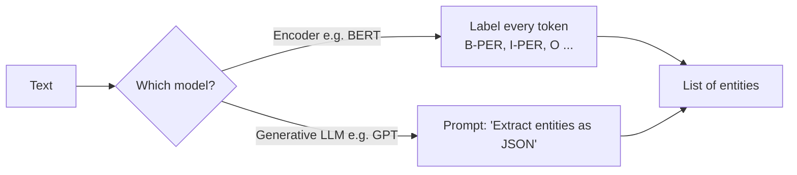

# Session 02: Named Entity Recognition (NER) with Large Language Models

> Module: Next-Gen NLP Applications with AI · Term 6 (AI) · ⏱ ~2 hours

A bank receives thousands of emails a day. Before anyone reads them, software can already pull out the customer's name, account number, amount and city. That skill is **Named Entity Recognition**. In this session you build NER four ways, from simple rules to an LLM prompt, and learn how to score them fairly.

## 🎯 Learning Objectives

By the end of this session you will be able to:

- Define NER and explain why it matters for search, chatbots and analytics
- Recognise common entity types such as PERSON, ORGANIZATION, LOCATION, DATE and MONEY
- Build a rule-based NER using a dictionary and regular expressions
- Explain how machine learning, deep learning and transformer models label entities
- Use an LLM prompt to extract entities as JSON
- Evaluate an NER system with precision, recall and F1-score

## 📖 Concepts Explained

### 1. What is NER?

NER finds the **names of real-world things** in text and gives each one a type.

> "**Ayesha** [PERSON] joined **Microsoft** [ORGANIZATION] in **Seattle** [LOCATION] in **March 2025** [DATE]."

Where it is used: search engines (find pages about a person), question answering (the answer to "Who?" is usually a PERSON), resume screening, news tagging, extracting data from invoices and medical notes.

### 2. Common entity types

| Type | Examples | spaCy label |
|---|---|---|
| Person | Imran, Dr. Sana Ali | `PERSON` |
| Organization | Aptech, World Bank | `ORG` |
| Location / country / city | Karachi, Pakistan | `GPE`, `LOC` |
| Date and time | 14 August, Friday | `DATE`, `TIME` |
| Money and numbers | Rs. 2,500, 20% | `MONEY`, `PERCENT` |
| Custom (your domain) | medicine names, course codes | you define them |

### 3. Four ways to build NER

| Approach | How it works | Strength | Weakness |
|---|---|---|---|
| Rules and dictionaries | Lists of known names + regex patterns | Simple, no training data, explainable | Misses anything not in the rules |
| Classic machine learning (CRF) | Learns from hand-made features such as capital letters and nearby words | Better than rules | Needs feature engineering |
| Deep learning (BiLSTM-CRF) | A neural network reads the sentence in both directions | Learns features itself | Needs lots of labelled data |
| Transformers / LLMs | BERT labels each token; GPT-style models follow a prompt | Best accuracy, understands context | Bigger, slower, can cost money |

### 4. How a model labels tokens: the BIO scheme

ML models label **every token**. `B-` = beginning of an entity, `I-` = inside, `O` = outside.

| Token | Ali | Raza | works | at | State | Bank | . |
|---|---|---|---|---|---|---|---|
| Label | B-PER | I-PER | O | O | B-ORG | I-ORG | O |

This is a **sequence labelling** task: the label of one word depends on its neighbours.

### 5. Transformers and LLMs for NER



- **Encoder models (BERT)** are fine-tuned on labelled data and are fast and consistent.
- **Generative LLMs** need no training: you describe the labels in the prompt (zero-shot) or add a few examples (few-shot). Great for new or unusual entity types; always validate the JSON they return.

### 6. Measuring quality

| Term | Meaning |
|---|---|
| True Positive (TP) | Entity found with the correct text and type |
| False Positive (FP) | Something labelled as an entity that is wrong |
| False Negative (FN) | A real entity the system missed |

- **Precision** = TP / (TP + FP): "How trustworthy are my answers?"
- **Recall** = TP / (TP + FN): "How many real entities did I catch?"
- **F1** = 2 × P × R / (P + R): the balance of both.

## 💻 Code Examples

Install: `pip install spacy transformers torch openai` and `python -m spacy download en_core_web_sm`. The file [`llm_client.py`](llm_client.py) is a small shared helper: with `OPENAI_API_KEY` set it calls the real model, otherwise it returns a sample answer marked `(mock)`.

### Example 1: Rule-based NER

📄 Saved in this folder as [`ner_rule_based.py`](ner_rule_based.py).

```python
"""Session 02 - Example 1: rule-based NER (dictionary + regular expressions).

No training data needed. Fast and easy to explain, but it only finds
what you wrote rules for.
Run: python ner_rule_based.py
"""
import re

# Step 1: a dictionary (gazetteer) of names we already know
KNOWN_ENTITIES = {
    "Karachi": "LOCATION",
    "Lahore": "LOCATION",
    "Aptech": "ORGANIZATION",
    "State Bank of Pakistan": "ORGANIZATION",
}

# Step 2: patterns for entities that follow a fixed shape
PATTERNS = {
    "EMAIL": r"[\w.]+@[\w.]+\.\w+",                # name@site.com
    "PHONE": r"03\d{2}-\d{7}",                     # 0300-1234567
    "MONEY": r"Rs\. ?[\d,]+",                      # Rs. 2,500
}

text = ("Aptech in Karachi will hold an AI seminar. The fee is Rs. 2,500. "
        "Contact info@example.com or 0300-1234567.")

found = []

# Step 3: look for every known name in the text
for name, label in KNOWN_ENTITIES.items():
    if name in text:
        found.append((name, label))

# Step 4: look for every pattern in the text
for label, pattern in PATTERNS.items():
    for match in re.findall(pattern, text):
        found.append((match, label))

# Step 5: print the results
for entity, label in found:
    print(f"{label:<13} {entity}")
```

**How it works**

- `KNOWN_ENTITIES` is a gazetteer: if a known name appears in the text, we label it.
- Each regex in `PATTERNS` describes the shape of an email, phone number or amount.
- It is quick and clear, but a new city like "Quetta" is missed until you add it.

### Example 2: Statistical NER with spaCy

📄 Saved in this folder as [`ner_spacy.py`](ner_spacy.py).

```python
"""Session 02 - Example 2: statistical NER with a pre-trained spaCy model.

Setup: pip install spacy  and  python -m spacy download en_core_web_sm
Run:   python ner_spacy.py
"""
import spacy

# Step 1: load a model that was trained on thousands of labelled sentences
nlp = spacy.load("en_core_web_sm")

sentences = [
    "Ayesha Malik joined Microsoft in Seattle in March 2025.",
    "The Pakistan Cricket Board met in Lahore on Friday.",
]

# Step 2: run the model on each sentence and print the entities
for sentence in sentences:
    doc = nlp(sentence)
    print(sentence)
    for entity in doc.ents:
        print(f"   {entity.label_:<8} {entity.text}")
```

**How it works**

- `en_core_web_sm` was trained on labelled news and web text, so it recognises names it has never seen in a list.
- Notice it sometimes includes "The" inside an organization name; small models make small mistakes.

### Example 3: Transformer NER with BERT

📄 Saved in this folder as [`ner_transformer.py`](ner_transformer.py).

```python
"""Session 02 - Example 3: transformer (BERT) NER with Hugging Face.

Setup: pip install transformers torch
The model dslim/bert-base-NER (~430 MB) downloads once, then is cached.
Run:   python ner_transformer.py
"""
from transformers import pipeline

# Step 1: create a ready-made NER pipeline.
# aggregation_strategy="simple" joins word pieces ("Ay", "##esha") into whole names.
ner = pipeline("token-classification", model="dslim/bert-base-NER",
               aggregation_strategy="simple")

text = "Ayesha Malik joined Microsoft in Seattle after studying at LUMS."

# Step 2: run the model
results = ner(text)

# Step 3: print each entity with its type and confidence score
for entity in results:
    print(f"{entity['entity_group']:<5} {entity['word']:<15} score={entity['score']:.2f}")
```

**How it works**

- `pipeline("token-classification")` loads a BERT model fine-tuned for PER, ORG, LOC and MISC.
- BERT splits rare words into pieces; `aggregation_strategy="simple"` joins them back into full names.
- Each result has a confidence `score` between 0 and 1.

### Example 4: NER with an LLM prompt

📄 Saved in this folder as [`ner_with_llm_prompt.py`](ner_with_llm_prompt.py).

````python
"""Session 02 - Example 4: NER with a large language model (zero-shot prompt).

We describe the task in plain English and ask for JSON back.
Works live with OPENAI_API_KEY, or prints a mock answer without it.
Run: python ner_with_llm_prompt.py
"""
import json
from llm_client import ask_llm

text = "Bilal Ahmed works at Systems Limited in Lahore and earns Rs. 300,000 a month."

# Step 1: write a clear prompt with the labels and the output format we want
prompt = f"""Extract named entities from the text.
Use only these labels: PERSON, ORGANIZATION, LOCATION, MONEY.
Return JSON only, as a list of objects with "text" and "label".

Text: {text}"""

# Step 2: this is what a good answer looks like (used only in mock mode)
sample = ('[{"text": "Bilal Ahmed", "label": "PERSON"}, '
          '{"text": "Systems Limited", "label": "ORGANIZATION"}, '
          '{"text": "Lahore", "label": "LOCATION"}, '
          '{"text": "Rs. 300,000", "label": "MONEY"}]')

# Step 3: ask the model (temperature 0 = most consistent answer)
answer = ask_llm(prompt, mock_answer=sample, temperature=0)
print("Raw answer:", answer)

# Step 4: turn the JSON text into Python objects so a program can use it
json_text = answer.replace("(mock) ", "").strip()
json_text = json_text.removeprefix("```json").removesuffix("```").strip()   # some models wrap JSON
try:
    entities = json.loads(json_text)
    for item in entities:
        print(f"{item['label']:<13} {item['text']}")
except json.JSONDecodeError:
    print("The model did not return valid JSON. Try a stricter prompt.")
````

**How it works**

- The prompt lists the allowed labels and asks for JSON only, so the answer is easy to parse.
- `temperature=0` makes the model choose its most likely answer every time.
- `json.loads` converts the text into a Python list; the `try/except` handles a badly formatted reply.

### Example 5: Precision, recall and F1

📄 Saved in this folder as [`ner_evaluation.py`](ner_evaluation.py).

```python
"""Session 02 - Example 5: measuring NER with precision, recall and F1.

Precision = of the entities we predicted, how many were right?
Recall    = of the real entities, how many did we find?
F1        = one number that balances both
Run: python ner_evaluation.py
"""

# Step 1: the correct answers (gold labels) written by a human
gold = {("Imran", "PERSON"), ("Lahore", "LOCATION"), ("World Bank", "ORGANIZATION"),
        ("Friday", "DATE")}

# Step 2: what our system predicted
predicted = {("Imran", "PERSON"), ("Lahore", "LOCATION"), ("Bank", "ORGANIZATION")}

# Step 3: count matches and mistakes using set operations
true_positives = len(gold & predicted)       # in both sets: correct
false_positives = len(predicted - gold)      # predicted but wrong
false_negatives = len(gold - predicted)      # real entity we missed

# Step 4: apply the formulas
precision = true_positives / (true_positives + false_positives)
recall = true_positives / (true_positives + false_negatives)
f1 = 2 * precision * recall / (precision + recall)

print("Correct (TP):", true_positives, "| Wrong (FP):", false_positives, "| Missed (FN):", false_negatives)
print(f"Precision = {precision:.2f}")
print(f"Recall    = {recall:.2f}")
print(f"F1 score  = {f1:.2f}")
```

**How it works**

- Entities are stored as `(text, label)` pairs in sets, so `&` gives matches and `-` gives mistakes.
- "Bank" instead of "World Bank" counts as wrong: real evaluations usually require the exact span.

## 🧪 Lab Practice

1. Add a `DATE` regex (for example `14 November 2026`) and a new city to `ner_rule_based.py`.
2. Run `ner_spacy.py` on five sentences from a Pakistani news site. Note one mistake.
3. Run `ner_transformer.py` on the same sentences and compare with spaCy.
4. Change the LLM prompt to add a `COURSE` label and test it on "Hina enrolled in ACCP AI at Aptech."
5. Use `ner_evaluation.py` to score the spaCy results from task 2 against your own gold labels.

## 📝 Assignment

Create `invoice_ner.py` that extracts CUSTOMER, DATE, AMOUNT and INVOICE_NO from five short invoice texts you write yourself. Use rules for DATE, AMOUNT and INVOICE_NO and spaCy (or an LLM prompt) for CUSTOMER. Write gold labels by hand and print precision, recall and F1.

## ❓ Quick Quiz

**Q1.** What does NER do?

<details><summary>Show answer</summary>

It finds names of real-world things in text and classifies them into types such as PERSON, ORG and LOCATION.

</details>

**Q2.** In BIO tagging, what does `I-ORG` mean?

<details><summary>Show answer</summary>

The token is inside (not the first word of) an organization name.

</details>

**Q3.** Your system predicts 10 entities and 8 are correct. What is the precision?

<details><summary>Show answer</summary>

8 / 10 = 0.80.

</details>

**Q4.** Give one advantage of rule-based NER.

<details><summary>Show answer</summary>

No training data needed, fast, and easy to explain or debug.

</details>

**Q5.** Why ask an LLM to return JSON?

<details><summary>Show answer</summary>

So your program can parse the result reliably instead of reading free text.

</details>

## 💼 Interview Questions

**1. When would you choose an LLM over a fine-tuned BERT model for NER?**

<details><summary>Model answer</summary>

When you have little or no labelled data, need new entity types quickly, or volume is low. For high volume, low cost and consistent output, a fine-tuned encoder is usually better.

</details>

**2. Why can high precision but low recall be a problem?**

<details><summary>Model answer</summary>

The system is careful but misses many real entities, which is risky in tasks like medical or legal extraction where missing information matters.

</details>

**3. How do you handle domain entities such as medicine names?**

<details><summary>Model answer</summary>

Combine a domain dictionary with a model fine-tuned on labelled domain text, or use an LLM with clear label definitions and few-shot examples, then validate the output.

</details>

## ✅ Summary

- NER labels people, organizations, places, dates, money and custom types in text.
- Approaches range from rules to CRFs, neural networks, BERT and LLM prompts.
- Models label tokens with the BIO scheme; LLMs can return entities as JSON.
- Measure NER with precision, recall and F1 on exact matches.

---

[⬅ Previous](../Session-01-Introduction-to-NLP-and-NLU/README.md) · [🏠 Module Home](../README.md) · [Next ➡](../Session-03-Text-Summarization-and-Generation/README.md)

Prepared by Zeeshan Abbas · Aptech Learning North Nazimabad
