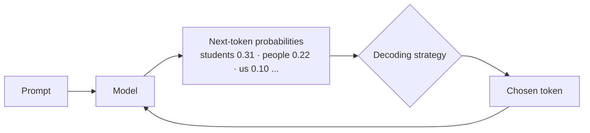

# Session 03: Text Summarization and Generation with LLMs

> Module: Next-Gen NLP Applications with AI · Term 6 (AI) · ⏱ ~2 hours

Nobody has time to read a 40-page report, 300 customer reviews or a long email thread. Summarization turns long text into a short, faithful version, and text generation lets a model write new content. In this session you build a summarizer from scratch, use an LLM and a small open model, and learn the settings that control how a model writes.

## 🎯 Learning Objectives

By the end of this session you will be able to:

- Explain what text summarization is and why it is useful
- Distinguish extractive from abstractive summarization
- Classify summarization models as classical, deep learning or transformer-based
- Write prompts that control the length, audience and format of a summary
- Explain controllability, factuality and coherence in generated text
- Compare decoding strategies: greedy, beam search, temperature and top-p sampling

## 📖 Concepts Explained

### 1. What is summarization?

Summarization produces a **shorter text that keeps the key information and meaning** of a longer one. Uses: news digests, meeting minutes, legal and medical document review, product review highlights, email thread summaries.

### 2. Extractive vs abstractive

| | Extractive | Abstractive |
|---|---|---|
| Idea | Copy the most important original sentences | Write new sentences in its own words |
| Analogy | Highlighting lines with a marker | Explaining the chapter to a friend |
| Grammar | Always correct (original text) | Usually fluent, sometimes awkward |
| Risk | Can be choppy, may miss connections | Can **hallucinate** facts not in the source |
| Tools | Word frequency, TF-IDF, TextRank | BART, T5, Pegasus, GPT-style LLMs |

### 3. Families of summarization models

| Family | Examples | How it works |
|---|---|---|
| Classical | Word frequency, TF-IDF, TextRank (graph of sentences) | Scores sentences with statistics |
| Deep learning | Seq2seq RNN/LSTM with attention, pointer-generator | An encoder reads, a decoder writes; can copy words from the source |
| Transformer | BART, T5, Pegasus | Pre-trained on huge text, fine-tuned for summarizing |
| LLM prompting | GPT-style chat models, FLAN-T5 | You *instruct* the model what summary to write |

### 4. Prompt-based summarization

With an LLM, the prompt is your control panel:

| You want | Add to the prompt |
|---|---|
| Length | "in one sentence", "under 50 words", "exactly 3 bullets" |
| Audience | "for a 10-year-old", "for a bank manager" |
| Focus | "focus on costs and dates only" |
| Format | "as a table", "as JSON with keys title and points" |
| Safety | "use only facts from the text; say 'not stated' if unsure" |

For very long documents, use **map-reduce**: summarize each chunk, then summarize the summaries.

### 5. Judging a summary

- **Controllability**: did it follow the requested length, style and focus?
- **Factuality (faithfulness)**: is every claim supported by the source? This is the biggest risk with abstractive models.
- **Coherence**: does it read smoothly and logically?
- Automatic metric: **ROUGE** compares word overlap with a human-written summary. Human review is still important.

### 6. How a model generates text (decoding)

A language model predicts a probability for every possible next token. **Decoding** is how we choose:



| Strategy | How it chooses | Result |
|---|---|---|
| Greedy | Always the top token | Safe but repetitive |
| Beam search | Keeps several best partial sentences | Good for summaries and translation |
| Temperature | Low (<1) sharpens, high (>1) flattens the probabilities | Low = focused, high = creative |
| Top-k / Top-p | Sample only from the k best tokens / the smallest set covering p% probability | Variety without nonsense |

## 💻 Code Examples

Install: `pip install transformers torch openai`. [`llm_client.py`](llm_client.py) calls OpenAI when `OPENAI_API_KEY` is set and otherwise returns sample answers marked `(mock)`.

### Example 1: Extractive summary from scratch

📄 Saved in this folder as [`extractive_summary.py`](extractive_summary.py).

```python
"""Session 03 - Example 1: extractive summarization by word frequency.

Extractive = choose the most important ORIGINAL sentences.
Idea: a sentence is important if it contains words that appear often in the article.
Run: python extractive_summary.py   (needs only Python)
"""
import re

ARTICLE = """Karachi's new electric bus service started on two routes last year.
The buses now carry thousands of passengers every day.
Passengers say the electric buses are cleaner and cheaper than rickshaws.
The city plans to add four more bus routes by next summer.
Some shopkeepers complained about lost parking spaces.
Experts say bus lanes are needed so the buses do not get stuck in traffic."""

STOP_WORDS = {"the", "a", "and", "are", "is", "to", "on", "by", "of", "in", "than",
              "so", "do", "not", "get", "say", "some", "about", "now", "every", "more"}

# Step 1: split the article into sentences
sentences = [s.strip() for s in re.split(r"(?<=[.!?])\s+", ARTICLE) if s.strip()]

# Step 2: count how often each useful word appears in the whole article
word_counts = {}
for word in re.findall(r"[a-z']+", ARTICLE.lower()):
    if word not in STOP_WORDS:
        word_counts[word] = word_counts.get(word, 0) + 1

# Step 3: give every sentence a score = total count of its words
scores = []
for sentence in sentences:
    words = re.findall(r"[a-z']+", sentence.lower())
    score = sum(word_counts.get(word, 0) for word in words)
    scores.append(score)
    print(f"score {score:>2} | {sentence}")

# Step 4: pick the 2 best sentences, then keep them in their original order
best_positions = sorted(range(len(sentences)), key=lambda i: scores[i], reverse=True)[:2]
summary = [sentences[i] for i in sorted(best_positions)]

print("\nSUMMARY:")
print(" ".join(summary))
```

**How it works**

- Words that appear many times (like "bus", "electric") are treated as the article's main topic.
- Each sentence scores the sum of its word counts; the top 2 become the summary.
- Sentences are printed in their original order so the summary reads naturally.

### Example 2: Abstractive summaries with an LLM prompt

📄 Saved in this folder as [`abstractive_summary_llm.py`](abstractive_summary_llm.py).

```python
"""Session 03 - Example 2: abstractive summarization with an LLM prompt.

Abstractive = write NEW sentences that keep the meaning.
The prompt controls length, audience and format.
Works live with OPENAI_API_KEY, or shows mock answers without it.
Run: python abstractive_summary_llm.py
"""
from llm_client import ask_llm

ARTICLE = ("Karachi's new electric bus service started on two routes last year and now carries "
           "thousands of passengers daily. Riders say it is cleaner and cheaper than rickshaws. "
           "The city plans four more routes by next summer, but experts say dedicated bus lanes "
           "and better footpaths are also needed to reduce traffic jams.")

# Step 1: three prompts for three different kinds of summary
prompts = {
    "one sentence": f"Summarize this article in one sentence:\n{ARTICLE}",
    "3 bullet points": f"Summarize this article in exactly 3 short bullet points:\n{ARTICLE}",
    "for a child": f"Explain this news to a 10-year-old in two simple sentences:\n{ARTICLE}",
}

# Step 2: sample answers, used only when there is no API key
mock_answers = {
    "one sentence": "Karachi's popular electric buses will expand to four new routes, though experts want bus lanes too.",
    "3 bullet points": "- Electric buses run on two routes\n- Riders find them clean and cheap\n- Four more routes planned; bus lanes needed",
    "for a child": "Karachi has new clean buses that many people like. The city wants more of them, but they need their own lanes.",
}

# Step 3: ask for each summary and print it
for name, prompt in prompts.items():
    summary = ask_llm(prompt, mock_answer=mock_answers[name], temperature=0.3)
    print(f"[{name}]\n{summary}\n")
```

**How it works**

- The same article gets three prompts; only the instruction changes the result.
- `temperature=0.3` keeps the summaries focused and factual.
- In mock mode you see the kind of output a live model would give.

### Example 3: A small open model on your laptop

📄 Saved in this folder as [`summarize_flan_t5.py`](summarize_flan_t5.py).

```python
"""Session 03 - Example 3: abstractive summary with a small open model on your laptop.

Model: google/flan-t5-small (~300 MB, runs on CPU, downloads once).
Setup: pip install transformers torch
Run:   python summarize_flan_t5.py
"""
from transformers import AutoTokenizer, AutoModelForSeq2SeqLM

MODEL_NAME = "google/flan-t5-small"

# Step 1: load the tokenizer (text -> numbers) and the model
tokenizer = AutoTokenizer.from_pretrained(MODEL_NAME)
model = AutoModelForSeq2SeqLM.from_pretrained(MODEL_NAME)

article = ("The college library will stay open until 10 pm during exam week. "
           "Students must show their ID card at the entrance. "
           "Extra seats have been added on the second floor.")

# Step 2: FLAN-T5 follows instructions, so we start the input with "summarize:"
inputs = tokenizer("summarize: " + article, return_tensors="pt")

# Step 3: generate up to 40 new tokens using beam search (tries 4 options, keeps the best)
output_ids = model.generate(**inputs, max_new_tokens=40, num_beams=4)

# Step 4: turn the numbers back into text
print("Summary:", tokenizer.decode(output_ids[0], skip_special_tokens=True))
```

**How it works**

- FLAN-T5 is an encoder-decoder transformer trained to follow instructions like "summarize:".
- `num_beams=4` uses beam search, which usually gives cleaner summaries than greedy decoding.
- No API key or internet is needed after the first download.

### Example 4: Decoding strategies

📄 Saved in this folder as [`text_generation_decoding.py`](text_generation_decoding.py).

```python
"""Session 03 - Example 4: how decoding settings change generated text.

Model: distilgpt2 (~350 MB), a small decoder-only language model.
Setup: pip install transformers torch
Run:   python text_generation_decoding.py
"""
from transformers import pipeline, set_seed

# Step 1: create a text-generation pipeline
generator = pipeline("text-generation", model="distilgpt2")
set_seed(42)                                   # same "random" results every run

prompt = "Artificial intelligence will help students"

# Step 2: greedy decoding - always pick the single most likely next word
greedy = generator(prompt, max_new_tokens=20, do_sample=False)
print("GREEDY  :", greedy[0]["generated_text"], "\n")

# Step 3: sampling with LOW temperature - safe, focused choices
low_temp = generator(prompt, max_new_tokens=20, do_sample=True, temperature=0.3)
print("TEMP 0.3:", low_temp[0]["generated_text"], "\n")

# Step 4: sampling with HIGH temperature - more creative (and more random)
high_temp = generator(prompt, max_new_tokens=20, do_sample=True, temperature=1.3)
print("TEMP 1.3:", high_temp[0]["generated_text"], "\n")

# Step 5: top-p (nucleus) sampling - choose only from the most likely words
top_p = generator(prompt, max_new_tokens=20, do_sample=True, top_p=0.9)
print("TOP-P   :", top_p[0]["generated_text"])
```

**How it works**

- `do_sample=False` gives greedy decoding; the same prompt always gives the same output.
- Low temperature stays close to the most likely words; high temperature takes more risks.
- `top_p=0.9` samples only from the words that together make up 90% of the probability.

## 🧪 Lab Practice

1. Paste a 10-sentence news article into `extractive_summary.py` and produce a 3-sentence summary.
2. Add a fourth prompt to `abstractive_summary_llm.py` that returns JSON with `title` and `key_points`.
3. Run `summarize_flan_t5.py` with `num_beams=1` and `num_beams=6`. Which summary is better?
4. Run `text_generation_decoding.py` three times with `set_seed` removed. Which outputs change?
5. Find one sentence in an abstractive summary that is *not* supported by the article (a hallucination), or explain why there is none.

## 📝 Assignment

Write `review_summarizer.py` that takes 8 short product reviews (write them yourself), produces (a) an extractive 2-sentence summary and (b) an LLM summary with "Pros", "Cons" and an overall verdict. Add a comment comparing the two for factuality and readability.

## ❓ Quick Quiz

**Q1.** Which type of summary copies original sentences?

<details><summary>Show answer</summary>

Extractive summarization.

</details>

**Q2.** What is the main risk of abstractive summaries?

<details><summary>Show answer</summary>

Hallucination: stating facts that are not in the source text.

</details>

**Q3.** What does a high temperature do?

<details><summary>Show answer</summary>

Makes the output more random and creative by flattening the probability distribution.

</details>

**Q4.** Name two transformer models used for summarization.

<details><summary>Show answer</summary>

Any two of BART, T5, Pegasus, or a GPT-style LLM.

</details>

**Q5.** How can you summarize a document longer than the model's input limit?

<details><summary>Show answer</summary>

Split it into chunks, summarize each chunk, then summarize the combined summaries (map-reduce).

</details>

## 💼 Interview Questions

**1. How would you reduce hallucinations in an LLM summarizer?**

<details><summary>Model answer</summary>

Use low temperature, instruct the model to use only the given text, ask it to quote or cite source sentences, check key facts (names, numbers) automatically against the source, and review high-risk outputs.

</details>

**2. Beam search or sampling for summarization?**

<details><summary>Model answer</summary>

Beam search or low-temperature decoding, because summaries need accuracy and consistency more than creativity.

</details>

**3. What does ROUGE measure and what is its limitation?**

<details><summary>Model answer</summary>

Word or n-gram overlap with a reference summary. It does not directly measure factual correctness or fluency, and a good summary using different words can score low.

</details>

## ✅ Summary

- Summarization shortens text while keeping key meaning; extractive copies, abstractive rewrites.
- Models range from frequency scoring to BART/T5 and prompted LLMs.
- Prompts control length, audience, focus and format.
- Judge summaries on controllability, factuality and coherence.
- Decoding (greedy, beam, temperature, top-p) decides how creative generated text is.

---

[⬅ Previous](../Session-02-Named-Entity-Recognition-with-LLMs/README.md) · [🏠 Module Home](../README.md) · [Next ➡](../Session-04-Transformers-and-Attention/README.md)

Prepared by Zeeshan Abbas · Aptech Learning North Nazimabad
