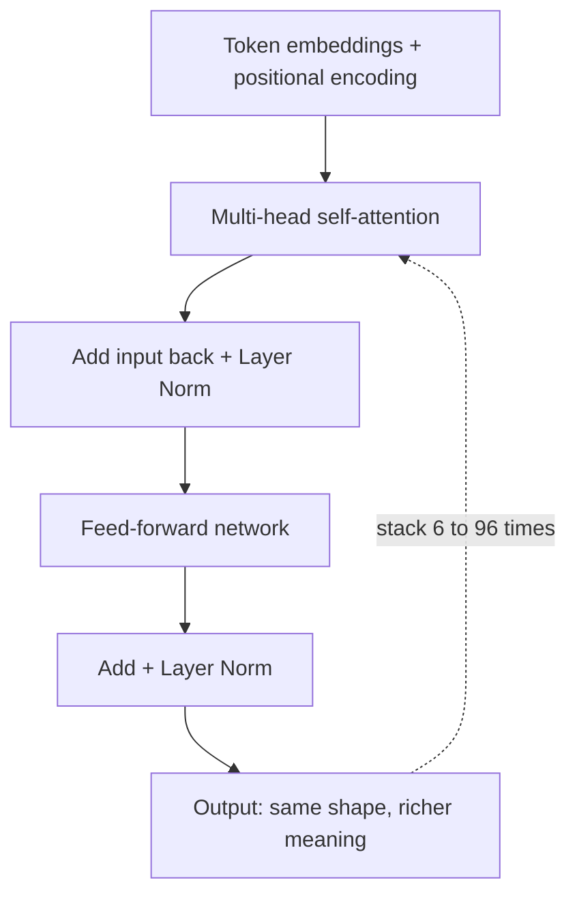

# Session 04: Understanding Transformers and Attention Mechanisms

> Module: Next-Gen NLP Applications with AI · Term 6 (AI) · ⏱ ~2 hours

BERT, GPT, Gemini, Llama and almost every modern language model share one design: the **transformer**. Its secret ingredient is **attention**, a way for every word to look at the other words that matter to it. In this session you compute attention by hand in NumPy, add word order with positional encoding, build one transformer block in PyTorch and compare encoder and decoder models.

## 🎯 Learning Objectives

By the end of this session you will be able to:

- Explain why attention improved on older sequence models (RNNs and LSTMs)
- Describe scaled dot-product attention using Query, Key and Value
- Explain multi-head attention and the causal mask
- Describe positional encoding, feed-forward layers, residual connections and layer normalization
- Distinguish encoder-only, decoder-only and encoder-decoder transformers

## 📖 Concepts Explained

### 1. The problem attention solves

Older models (RNNs, LSTMs) read a sentence **one word at a time** and squeeze everything into one memory vector. Long sentences lose details, and training is slow because words cannot be processed in parallel.

Consider: *"The trophy did not fit in the suitcase because **it** was too big."* To understand "it", the model must connect it with "trophy", several words away. Attention lets "it" look directly at every other word and decide which ones matter.

### 2. Query, Key and Value (library analogy)

| Part | Library analogy | In the model |
|---|---|---|
| Query (Q) | The question you bring to the librarian | What this token is looking for |
| Key (K) | The label on each book's spine | What each token offers |
| Value (V) | The content inside the book | The information passed along |

Each token's embedding is multiplied by three learned weight matrices to get its Q, K and V vectors.

### 3. Scaled dot-product attention

```text
Attention(Q, K, V) = softmax( Q · Kᵀ / √d ) · V
```

1. **Dot product** Q · Kᵀ: how well each query matches each key (a score table).
2. **Scale** by √d: stops big numbers from making softmax too extreme.
3. **Softmax**: turns each row of scores into weights that add up to 1.
4. **Weighted sum** of V: each token gets a new vector that mixes in information from the tokens it attends to.

### 4. Multi-head attention and masking

- **Multi-head**: run several attentions in parallel (for example 8 or 12 heads), each with its own weights. One head may track grammar, another track who "it" refers to. Outputs are joined and projected back.
- **Causal mask**: in GPT-style models, a token may only look at itself and earlier tokens, never the future. Blocked scores are set to a huge negative number so softmax gives them weight 0.

### 5. Inside a transformer block



| Component | Purpose |
|---|---|
| Embedding | Turns each token id into a vector |
| Positional encoding | Adds word-order information (attention itself ignores order) |
| Self-attention | Lets every token gather context from other tokens |
| Feed-forward network | Two small linear layers that process each token separately |
| Residual connection | Adds the input back so information and gradients flow easily |
| Layer normalization | Keeps numbers in a stable range for smooth training |

### 6. Three transformer families

| Family | Sees | Best for | Examples |
|---|---|---|---|
| Encoder-only | Whole sentence, both directions | Understanding: classification, NER, search embeddings | BERT, RoBERTa, DistilBERT |
| Decoder-only | Only previous tokens (causal mask) | Generating text, chat | GPT family, Llama, Mistral |
| Encoder-decoder | Encoder reads input, decoder writes output | Translation, summarization | T5, BART |

## 💻 Code Examples

Examples 1-3 need only `numpy`. Example 4 needs `torch`; Example 5 needs `transformers` and downloads two small models.

### Example 1: Attention step by step

📄 Saved in this folder as [`attention_numpy.py`](attention_numpy.py).

```python
"""Session 04 - Example 1: scaled dot-product attention, step by step in NumPy.

Formula:  Attention(Q, K, V) = softmax(Q x K^T / sqrt(d)) x V
Run: python attention_numpy.py   (needs only numpy)
"""
import numpy as np

np.random.seed(0)                       # same random numbers every run
tokens = ["the", "cat", "sat"]
d = 4                                   # size of each vector

# Step 1: pretend each token already has an embedding vector (3 tokens x 4 numbers)
X = np.random.randn(len(tokens), d)

# Step 2: make Query, Key and Value vectors with three weight matrices
W_query = np.random.randn(d, d)
W_key = np.random.randn(d, d)
W_value = np.random.randn(d, d)
Q = X @ W_query        # what each token is looking for
K = X @ W_key          # what each token offers
V = X @ W_value        # the information each token passes on

# Step 3: score how well every query matches every key (dot product)
scores = Q @ K.T

# Step 4: scale the scores so they do not get too large
scores = scores / np.sqrt(d)

# Step 5: softmax turns each row into weights that add up to 1
weights = np.exp(scores) / np.exp(scores).sum(axis=1, keepdims=True)

# Step 6: each output is a weighted mix of the Value vectors
output = weights @ V

print("Attention weights (row = token asking, column = token it looks at):")
print("        " + "  ".join(f"{t:>5}" for t in tokens))
for token, row in zip(tokens, weights):
    print(f"{token:>6}  " + "  ".join(f"{w:5.2f}" for w in row))
print("\nOutput shape:", output.shape, "(one new vector per token)")
```

**How it works**

- Each line of the formula is one step in code, so you can print and inspect any of them.
- Every row of `weights` sums to 1: it shows where that token "looks".
- The output has the same number of rows as the input: one context-aware vector per token.

### Example 2: The causal mask

📄 Saved in this folder as [`causal_mask_numpy.py`](causal_mask_numpy.py).

```python
"""Session 04 - Example 2: the causal mask used by GPT-style (decoder) models.

When generating text, a token must not look at FUTURE tokens.
We block them by setting their scores to a very large negative number.
Run: python causal_mask_numpy.py
"""
import numpy as np

tokens = ["I", "love", "NLP", "class"]
n = len(tokens)

# Step 1: start with equal scores for every pair of tokens
scores = np.zeros((n, n))

# Step 2: build a lower-triangle mask: True = allowed to look, False = future
mask = np.tril(np.ones((n, n), dtype=bool))
print("Mask (1 = can see):")
print(mask.astype(int))

# Step 3: replace blocked positions with -1e9 so softmax gives them ~0 weight
scores = np.where(mask, scores, -1e9)

# Step 4: softmax row by row
weights = np.exp(scores) / np.exp(scores).sum(axis=1, keepdims=True)

print("\nAttention weights with the causal mask:")
for token, row in zip(tokens, weights):
    print(f"{token:>6}: " + "  ".join(f"{w:.2f}" for w in row))
```

**How it works**

- `np.tril` creates a lower triangle: token 2 can see tokens 0, 1 and 2 only.
- With equal scores, each token spreads its attention evenly over the tokens it is allowed to see.

### Example 3: Positional encoding

📄 Saved in this folder as [`positional_encoding.py`](positional_encoding.py).

```python
"""Session 04 - Example 3: sinusoidal positional encoding.

Attention alone does not know word ORDER. We add a unique pattern of
sine and cosine values to each position so the model can tell
"dog bites man" from "man bites dog".
Run: python positional_encoding.py
"""
import numpy as np

num_positions = 5      # sentence length
d_model = 6            # size of each vector

encoding = np.zeros((num_positions, d_model))

# Step 1: fill the table one position and one dimension at a time
for pos in range(num_positions):
    for i in range(0, d_model, 2):
        angle = pos / (10000 ** (i / d_model))
        encoding[pos, i] = np.sin(angle)          # even columns use sine
        encoding[pos, i + 1] = np.cos(angle)      # odd columns use cosine

# Step 2: show the table - every row (position) is different
np.set_printoptions(precision=2, suppress=True)
print("Positional encoding (rows = positions 0..4):")
print(encoding)

# Step 3: in a transformer, this is ADDED to the word embeddings
word_embeddings = np.ones((num_positions, d_model))    # fake embeddings
model_input = word_embeddings + encoding
print("\nEmbedding + position for position 0 and 1:")
print(model_input[:2])
```

**How it works**

- Each position gets a different mix of sine and cosine values, like a unique fingerprint.
- Adding it to the embeddings means the same word at a different position becomes a slightly different vector.

### Example 4: One transformer block in PyTorch

📄 Saved in this folder as [`transformer_block_pytorch.py`](transformer_block_pytorch.py).

```python
"""Session 04 - Example 4: one transformer encoder block in PyTorch.

Block = multi-head self-attention -> add & layer norm -> feed-forward -> add & layer norm
Setup: pip install torch
Run:   python transformer_block_pytorch.py
"""
import torch
from torch import nn

torch.manual_seed(0)
d_model = 16        # size of each token vector
num_heads = 4       # attention heads working in parallel


class EncoderBlock(nn.Module):
    def __init__(self):
        super().__init__()
        # multi-head self-attention layer
        self.attention = nn.MultiheadAttention(d_model, num_heads, batch_first=True)
        # layer normalization keeps the numbers in a stable range
        self.norm1 = nn.LayerNorm(d_model)
        self.norm2 = nn.LayerNorm(d_model)
        # feed-forward network: applied to each token separately
        self.feed_forward = nn.Sequential(
            nn.Linear(d_model, 64),
            nn.ReLU(),
            nn.Linear(64, d_model),
        )

    def forward(self, x):
        # 1) self-attention: every token looks at every other token (Q = K = V = x)
        attn_output, attn_weights = self.attention(x, x, x)
        # 2) residual connection (add the input back) + layer norm
        x = self.norm1(x + attn_output)
        # 3) feed-forward + residual + layer norm
        x = self.norm2(x + self.feed_forward(x))
        return x, attn_weights


# Step 1: a fake batch with 1 sentence of 5 tokens, each a 16-number vector
tokens = torch.randn(1, 5, d_model)

# Step 2: pass it through the block
block = EncoderBlock()
output, weights = block(tokens)

print("Input shape  :", tuple(tokens.shape))
print("Output shape :", tuple(output.shape), "-> same shape, but now each token knows its context")
print("Attention map:", tuple(weights.shape), "-> 5 x 5 weights (averaged over heads)")
print("Trainable parameters:", sum(p.numel() for p in block.parameters()))
```

**How it works**

- `nn.MultiheadAttention` does Q/K/V, scaling, softmax and the 4 heads for us.
- The two `x + ...` lines are residual connections; `LayerNorm` stabilises the values.
- Input and output shapes match, which is why blocks can be stacked many times.

### Example 5: Encoder vs decoder models

📄 Saved in this folder as [`encoder_vs_decoder.py`](encoder_vs_decoder.py).

```python
"""Session 04 - Example 5: encoder-only (BERT) vs decoder-only (GPT-2) in practice.

Encoder (DistilBERT) reads the WHOLE sentence -> good at understanding (fill in the blank).
Decoder (DistilGPT-2) reads LEFT to RIGHT -> good at writing the next words.
Setup: pip install transformers torch   (two small models download once)
Run:   python encoder_vs_decoder.py
"""
from transformers import pipeline

# Step 1: encoder-only model fills a blank using words on BOTH sides
fill_mask = pipeline("fill-mask", model="distilbert-base-uncased")
print("ENCODER (DistilBERT): 'Students use Python to [MASK] machine learning models.'")
for guess in fill_mask("Students use Python to [MASK] machine learning models.")[:3]:
    print(f"   {guess['token_str']:<8} score={guess['score']:.2f}")

# Step 2: decoder-only model continues the text one token at a time
generator = pipeline("text-generation", model="distilgpt2")
result = generator("Students use Python to", max_new_tokens=12, do_sample=False)
print("\nDECODER (DistilGPT-2):")
print("  ", result[0]["generated_text"])
```

**How it works**

- DistilBERT predicts the hidden word using words on both sides of `[MASK]`.
- DistilGPT-2 can only continue text to the right, which is how chat models write answers.

## 🧪 Lab Practice

1. In `attention_numpy.py`, change `tokens` to 5 words and print the shape of every matrix.
2. Remove the scaling by √d and compare how extreme the weights become.
3. Change `causal_mask_numpy.py` so each token can see only itself and the one token before it.
4. In `transformer_block_pytorch.py`, set `num_heads = 8`. Does the parameter count change? Why or why not?
5. Try three different sentences with `[MASK]` in `encoder_vs_decoder.py`.

## 📝 Assignment

Write `two_head_attention.py` in NumPy that computes attention with **two heads** (each with its own Q, K, V weights of size 4×2), joins the two outputs side by side, and prints the attention weights of both heads for the sentence "students love learning AI". Add a comment explaining why two heads can capture more patterns than one.

## ❓ Quick Quiz

**Q1.** Write the attention formula.

<details><summary>Show answer</summary>

softmax(Q · Kᵀ / √d) · V

</details>

**Q2.** Why do transformers need positional encoding?

<details><summary>Show answer</summary>

Self-attention treats tokens as a set and has no sense of order; positional encoding adds the position information.

</details>

**Q3.** What does the causal mask prevent?

<details><summary>Show answer</summary>

It stops a token from attending to future tokens during generation.

</details>

**Q4.** Is BERT encoder-only or decoder-only?

<details><summary>Show answer</summary>

Encoder-only.

</details>

**Q5.** What is the job of a residual connection?

<details><summary>Show answer</summary>

It adds the block's input to its output so information and gradients flow easily through deep stacks.

</details>

## 💼 Interview Questions

**1. Why are transformers faster to train than RNNs?**

<details><summary>Model answer</summary>

All tokens are processed in parallel with matrix operations instead of one step at a time, which suits GPUs well.

</details>

**2. What is the main cost limitation of self-attention?**

<details><summary>Model answer</summary>

Every token attends to every other token, so compute and memory grow with the square of the sequence length. Long contexts are expensive.

</details>

**3. Which model family would you use for sentence classification, and which for a chatbot?**

<details><summary>Model answer</summary>

An encoder-only model such as BERT for classification; a decoder-only model such as a GPT-style LLM for a chatbot.

</details>

## ✅ Summary

- Attention lets each token weigh every other token using Query, Key and Value vectors.
- Scaling and softmax turn scores into weights; multi-head attention learns several patterns at once.
- A transformer block = attention + feed-forward, each with residual connections and layer norm.
- Positional encoding adds word order; the causal mask hides the future in decoders.
- Encoders understand, decoders generate, encoder-decoders transform one text into another.

---

[⬅ Previous](../Session-03-Text-Summarization-and-Generation/README.md) · [🏠 Module Home](../README.md) · [Next ➡](../Session-05-Advanced-Prompt-Engineering-and-Reasoning/README.md)

Prepared by Zeeshan Abbas · Aptech Learning North Nazimabad
