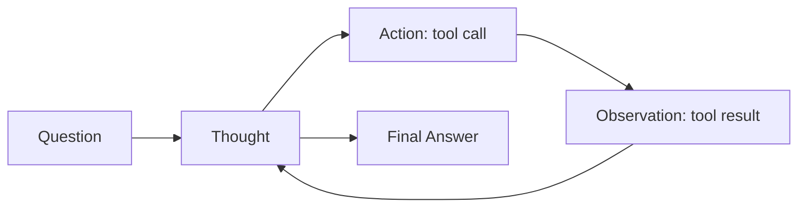

# Session 05: Advanced Prompt Engineering and Reasoning Techniques

> Module: Next-Gen NLP Applications with AI · Term 6 (AI) · ⏱ ~2 hours

The same LLM can give a weak answer or an excellent one depending on how you ask. Prompt engineering is the skill of asking well: giving examples, asking for reasoning steps, letting the model use tools and testing which prompt works best. In this session you try each technique with small Python scripts.

## 🎯 Learning Objectives

By the end of this session you will be able to:

- Use zero-shot and few-shot prompts to adapt an LLM to a new task
- Explain how chain-of-thought, self-consistency, ReAct and tree-of-thoughts improve reasoning
- Apply reasoning prompts to multi-step and decision-making NLP tasks
- Describe automatic prompt optimization: prompt search, prompt tuning and soft prompts
- Follow best practices and recognise the limits of prompt engineering

## 📖 Concepts Explained

### 1. Anatomy of a good prompt

| Part | Example |
|---|---|
| Role | "You are a support agent for an online shoe store." |
| Task | "Classify the customer message." |
| Context / input | The message, document or data |
| Output format | "Reply with JSON: {\"intent\": ..., \"urgent\": true/false}" |
| Constraints | "Use only the given text. If unsure, say 'unknown'." |

### 2. Zero-shot and few-shot

| | Zero-shot | Few-shot |
|---|---|---|
| What you give | Instructions only | Instructions + 2-5 solved examples |
| Good for | Common, simple tasks | Fixed formats, tricky labels, your own categories |
| Cost | Short prompt | Longer prompt (more tokens) |

Few-shot examples teach the **format and the decision boundary** (for example what counts as "Mixed"). Use varied, correct examples and keep their format identical.

### 3. Reasoning techniques

| Technique | Idea | When to use |
|---|---|---|
| Chain-of-Thought (CoT) | "Think step by step"; the model writes its middle steps | Maths, logic, multi-step questions |
| Self-consistency | Sample several CoT answers (temperature > 0) and take a majority vote | When one reasoning path is unreliable |
| ReAct (Reason + Act) | Loop of Thought → Action (tool call) → Observation | When facts or calculations come from tools, search or databases |
| Tree-of-Thoughts (ToT) | Explore several partial solutions like branches, score them, keep the best | Puzzles, planning, choices with many options |



Newer "reasoning models" do much of this thinking internally, but these patterns still matter when you design agents and pipelines.

### 4. Reasoning for real NLP tasks

- **Multi-step extraction**: first list the entities, then link them, then output JSON.
- **Decision tasks**: "List the pros and cons of each loan option, then recommend one with a reason."
- **Decomposition**: break a big question into sub-questions and answer them in order.

### 5. Automatic prompt optimization

| Method | What changes | Needs model access? |
|---|---|---|
| Prompt search | Try many written prompts, score each on a labelled set, keep the best (an LLM can even suggest new candidates) | No, only the API |
| Prompt tuning | Learn a few extra "virtual token" vectors added to the input while the model stays frozen | Yes, model weights |
| Soft prompts | Those learned vectors: not real words, just numbers the model reads like a prompt | Yes |

### 6. Best practices and limitations

**Do:** be specific, give the format, put instructions before the data, separate data with clear markers, test on several examples, keep a version history of prompts.

**Limits:** results change between models and versions; long prompts cost more; CoT can produce confident but wrong reasoning; prompts cannot add knowledge the model lacks (use RAG, Session 07); prompt injection can override instructions, so validate outputs in code.

## 💻 Code Examples

Install: `pip install openai`. Every script imports [`llm_client.py`](llm_client.py). Without `OPENAI_API_KEY` you get `(mock)` sample answers so the logic still runs; with a key you see real model behaviour.

### Example 1: Zero-shot vs few-shot

📄 Saved in this folder as [`zero_vs_few_shot.py`](zero_vs_few_shot.py).

```python
"""Session 05 - Example 1: zero-shot vs few-shot prompting.

Zero-shot: describe the task only.
Few-shot : describe the task AND show a few solved examples first.
Run: python zero_vs_few_shot.py   (mock answers without OPENAI_API_KEY)
"""
from llm_client import ask_llm

review = "Delivery was late but the shirt quality is excellent."

# Step 1: zero-shot prompt - instructions only
zero_shot = f"""Classify the sentiment of the review as Positive, Negative or Mixed.
Review: {review}
Sentiment:"""

# Step 2: few-shot prompt - the same task with three solved examples
few_shot = f"""Classify the sentiment of each review as Positive, Negative or Mixed.

Review: The phone charges fast and looks great.
Sentiment: Positive

Review: The shoes tore after one week.
Sentiment: Negative

Review: Tasty food, but the waiter was rude.
Sentiment: Mixed

Review: {review}
Sentiment:"""

# Step 3: send both and compare
print("ZERO-SHOT:", ask_llm(zero_shot, mock_answer="The review is somewhat positive overall.", temperature=0))
print("FEW-SHOT :", ask_llm(few_shot, mock_answer="Mixed", temperature=0))
```

**How it works**

- Both prompts classify the same review; only the few-shot prompt shows what "Mixed" looks like.
- The few-shot examples also fix the output format: a single label after `Sentiment:`.

### Example 2: Chain-of-thought

📄 Saved in this folder as [`chain_of_thought.py`](chain_of_thought.py).

```python
"""Session 05 - Example 2: chain-of-thought (CoT) prompting.

Asking the model to "think step by step" helps on maths and logic,
because it writes the middle steps instead of guessing the answer at once.
Run: python chain_of_thought.py
"""
from llm_client import ask_llm

question = ("A canteen had 23 samosas. It sold 15 in the morning and then made 12 more. "
            "How many samosas does it have now?")

# Step 1: direct prompt - asks only for the final answer
direct_prompt = f"{question}\nGive only the final number."

# Step 2: chain-of-thought prompt - asks for the steps, then the answer on its own line
cot_prompt = f"""{question}
Think step by step. Show each step on a new line.
Finish with a line in the form: Answer: <number>"""

cot_sample = "Start with 23.\nSold 15: 23 - 15 = 8.\nMade 12 more: 8 + 12 = 20.\nAnswer: 20"

print("DIRECT:\n", ask_llm(direct_prompt, mock_answer="20", temperature=0))
print("\nCHAIN OF THOUGHT:\n", ask_llm(cot_prompt, mock_answer=cot_sample, temperature=0))
```

**How it works**

- The CoT prompt asks for the working, so mistakes become visible and easier to catch.
- The fixed last line `Answer: <number>` makes the final answer easy to read in code.

### Example 3: Self-consistency

📄 Saved in this folder as [`self_consistency.py`](self_consistency.py).

```python
"""Session 05 - Example 3: self-consistency = ask several times, take a majority vote.

One reasoning path can go wrong. If we sample 5 different paths
(temperature > 0) and pick the most common final answer, accuracy improves.
Run: python self_consistency.py
"""
from collections import Counter
from llm_client import ask_llm

question = ("Ali is older than Bilal. Bilal is older than Sana. "
            "Who is the youngest? Think step by step, then end with 'Answer: <name>'.")

# Sample answers for mock mode: four reasoning paths agree, one makes a mistake
mock_paths = [
    "Ali > Bilal > Sana, so the youngest is Sana. Answer: Sana",
    "Bilal is older than Sana, and Ali is older than Bilal. Answer: Sana",
    "Ali is oldest... I think Bilal. Answer: Bilal",
    "Order: Ali, Bilal, Sana. Answer: Sana",
    "Sana is younger than Bilal who is younger than Ali. Answer: Sana",
]

final_answers = []

# Step 1: ask the same question 5 times with some randomness
for i in range(5):
    reply = ask_llm(question, mock_answer=mock_paths[i], temperature=0.8)
    # Step 2: keep only the text after "Answer:"
    answer = reply.split("Answer:")[-1].strip().rstrip(".")
    final_answers.append(answer)
    print(f"Path {i + 1}: {answer}")

# Step 3: majority vote
votes = Counter(final_answers)
winner, count = votes.most_common(1)[0]
print(f"\nVotes: {dict(votes)}")
print(f"Self-consistent answer: {winner} ({count} of 5 votes)")
```

**How it works**

- The same question is asked five times with `temperature=0.8`, giving different reasoning paths.
- `split("Answer:")` pulls out each final answer and `Counter` counts the votes.
- One wrong path is outvoted by four correct ones.

### Example 4: ReAct loop with tools

📄 Saved in this folder as [`react_agent.py`](react_agent.py).

```python
"""Session 05 - Example 4: a tiny ReAct loop (Reason + Act).

The model writes a Thought, then an Action (a tool call). Our code runs the
tool and sends back an Observation. This repeats until a Final Answer.
Run: python react_agent.py   (mock mode replays a sample conversation)
"""
from llm_client import chat

# Step 1: the tools our program can run
def calculator(expression):
    allowed = "0123456789+-*/(). "
    if all(ch in allowed for ch in expression):        # only allow simple maths
        return str(eval(expression))
    return "error: only numbers and + - * / allowed"

def fee_lookup(course):
    fees = {"ACCP AI": 25000, "Web Design": 12000}       # fees per month (sample data)
    return str(fees.get(course, "unknown course"))

TOOLS = {"calculator": calculator, "fee_lookup": fee_lookup}

# Step 2: the system prompt teaches the model the ReAct format
system = """Answer the question using this format:
Thought: what you should do next
Action: tool_name[input]      (tools: calculator, fee_lookup)
Wait for an Observation after each Action.
When you know the answer write:  Final Answer: <answer>"""

question = "What is the total fee for 6 months of the ACCP AI course?"
messages = [{"role": "system", "content": system}, {"role": "user", "content": question}]

# Sample model replies used only in mock mode, one per loop round
mock_steps = [
    "Thought: I need the monthly fee first.\nAction: fee_lookup[ACCP AI]",
    "Thought: Now multiply the monthly fee by 6.\nAction: calculator[25000*6]",
    "Thought: I have the total.\nFinal Answer: The total fee is Rs. 150,000.",
]

# Step 3: the loop - at most 5 rounds so it can never run forever
for step in range(5):
    reply = chat(messages, mock_answer=mock_steps[min(step, 2)], temperature=0)
    print(reply.replace("(mock) ", ""))
    messages.append({"role": "assistant", "content": reply})

    if "Final Answer:" in reply:                     # finished
        break

    # Step 4: read the Action line, e.g. "Action: calculator[25000*6]"
    action_lines = [line for line in reply.splitlines() if line.startswith("Action:")]
    if not action_lines:                             # model broke the format: stop safely
        print("No Action found - stopping.")
        break
    action_line = action_lines[0]
    tool_name = action_line.split(":")[1].split("[")[0].strip()
    tool_input = action_line.split("[")[1].rstrip("]")

    # Step 5: run the tool and send the result back as an Observation
    if tool_name in TOOLS:
        observation = TOOLS[tool_name](tool_input)
    else:
        observation = f"unknown tool {tool_name}"
    print("Observation:", observation)
    messages.append({"role": "user", "content": f"Observation: {observation}"})
```

**How it works**

- The system prompt teaches the Thought / Action / Final Answer format.
- Our code, not the model, runs the tools and returns an `Observation`, so the numbers are real.
- The loop stops at `Final Answer` or after 5 rounds, and stops safely if the format is broken.
- `calculator` only allows digits and operators before using `eval`, which keeps this demo safe.

### Example 5: Prompt search

📄 Saved in this folder as [`prompt_search.py`](prompt_search.py).

```python
"""Session 05 - Example 5: automatic prompt optimization (simple prompt search).

Instead of guessing which prompt is best, we TEST several candidate prompts
on a small labelled set and keep the one with the highest accuracy.
Run: python prompt_search.py
"""
from llm_client import ask_llm, is_live

# Step 1: a small labelled test set
test_set = [
    ("I love this phone", "Positive"),
    ("Worst service ever", "Negative"),
    ("Battery life is amazing", "Positive"),
    ("The parcel arrived broken", "Negative"),
]

# Step 2: candidate prompt templates ({text} is replaced with each review)
candidates = [
    "What do you think about this review? {text}",
    "Is this review Positive or Negative? {text}",
    "Classify the review as Positive or Negative. Reply with one word only.\nReview: {text}",
]

def mock_model(prompt, text):
    """Offline stand-in: follows the format only if the prompt clearly asks for it."""
    guess = "Positive" if any(w in text.lower() for w in ["love", "amazing"]) else "Negative"
    if "one word" in prompt:
        return guess
    if "Positive or Negative" in prompt:
        return f"I would say it is {guess}."
    return "This review shares the customer's opinion."

# Step 3: score every candidate prompt
best_prompt, best_score = None, -1
for template in candidates:
    correct = 0
    for text, label in test_set:
        prompt = template.format(text=text)
        answer = ask_llm(prompt, mock_answer=mock_model(template, text), temperature=0)
        answer = answer.replace("(mock) ", "").strip().rstrip(".")
        if answer == label:                       # strict check: exact label only
            correct += 1
    accuracy = correct / len(test_set)
    print(f"accuracy {accuracy:.0%} | {template[:60]!r}")
    if accuracy > best_score:
        best_prompt, best_score = template, accuracy

# Step 4: report the winner
print("\nMode:", "LIVE" if is_live() else "MOCK")
print("Best prompt:", repr(best_prompt))
```

**How it works**

- Each template is tested on the same labelled reviews with a strict exact-match check.
- The prompt that clearly asks for a one-word label wins, because its output is easy to check.
- In mock mode `mock_model` imitates a model that follows formats only when asked clearly.

## 🧪 Lab Practice

1. Add a fourth review to `zero_vs_few_shot.py` that is sarcastic. Does few-shot handle it?
2. Write a CoT prompt for: "A shirt costs Rs. 1,200 with 25% off. Two shirts plus Rs. 150 delivery?"
3. In `self_consistency.py`, change the number of samples to 3 and 7. How does the vote change?
4. Add a `days_until` tool to `react_agent.py` and ask a question that needs it.
5. Add two new candidate prompts to `prompt_search.py` and four more test reviews.

## 📝 Assignment

Build `complaint_router.py`: classify 10 customer complaints into `billing`, `delivery`, `product` or `other` with **urgent/not urgent**. Compare a zero-shot prompt, a few-shot prompt and a CoT prompt using prompt search on your own labelled set, and print the accuracy table and the winning prompt.

## ❓ Quick Quiz

**Q1.** What is the difference between zero-shot and few-shot prompting?

<details><summary>Show answer</summary>

Zero-shot gives only instructions; few-shot adds a few solved examples to the prompt.

</details>

**Q2.** What phrase is commonly used to trigger chain-of-thought?

<details><summary>Show answer</summary>

"Think step by step" (or "Let's think step by step").

</details>

**Q3.** How does self-consistency choose the final answer?

<details><summary>Show answer</summary>

By majority vote over several sampled reasoning paths.

</details>

**Q4.** In ReAct, who produces the Observation?

<details><summary>Show answer</summary>

The program or tool, not the model. The program runs the action and returns its result.

</details>

**Q5.** What is a soft prompt?

<details><summary>Show answer</summary>

A set of learned vectors (virtual tokens) added to the model input during prompt tuning, while the model weights stay frozen.

</details>

## 💼 Interview Questions

**1. How would you make an LLM's output reliable enough for production code?**

<details><summary>Model answer</summary>

Specify a strict format, use few-shot examples and low temperature, validate the output with a schema, retry on failure, and test prompts on a labelled set before release.

</details>

**2. When would you use ReAct instead of plain chain-of-thought?**

<details><summary>Model answer</summary>

When the answer depends on fresh or exact information (search, databases, calculations) that the model should fetch with tools instead of guessing.

</details>

**3. What is prompt injection and how do you reduce its risk?**

<details><summary>Model answer</summary>

Text in the input that tries to override your instructions. Reduce it by separating instructions from data, limiting tool permissions, filtering inputs, and checking outputs in code before acting on them.

</details>

## ✅ Summary

- Good prompts state role, task, context, format and constraints.
- Few-shot examples teach format and labels; CoT exposes reasoning steps.
- Self-consistency votes over many paths; ReAct mixes reasoning with tool calls; ToT explores branches.
- Prompt search tests prompts on data; prompt tuning learns soft prompts.
- Prompting cannot add missing knowledge and must be validated.

---

[⬅ Previous](../Session-04-Transformers-and-Attention/README.md) · [🏠 Module Home](../README.md) · [Next ➡](../Session-06-Fine-Tuning-with-LoRA-and-QLoRA/README.md)

Prepared by Zeeshan Abbas · Aptech Learning North Nazimabad
