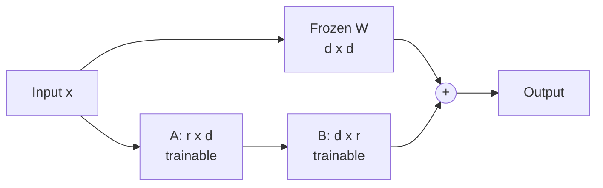
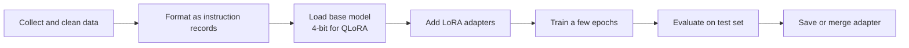

# Session 06: Parameter-Efficient Fine-Tuning with LoRA and QLoRA

> Module: Next-Gen NLP Applications with AI · Term 6 (AI) · ⏱ ~2 hours

Prompting (Session 05) changes what you *say* to a model. Fine-tuning changes the *model itself*, so it learns your style, your labels or your domain words. Training every weight of a large model is far too expensive for a laptop or a small company, so in this session you learn the clever shortcut used everywhere today: **LoRA** (Low-Rank Adaptation) and its memory-saving cousin **QLoRA**.

## 🎯 Learning Objectives

By the end of this session you will be able to:

- Explain the difference between prompting, full fine-tuning and parameter-efficient fine-tuning (PEFT)
- Describe how LoRA adds two small matrices (A and B) beside a frozen weight matrix
- Calculate how many parameters LoRA trains for a given rank
- Explain how 4-bit quantization lets QLoRA fine-tune big models on one GPU
- Prepare an instruction dataset in JSON Lines format
- Choose sensible LoRA settings (rank, alpha, target modules) and know when fine-tuning is the wrong tool

## 📖 Concepts Explained

### 1. Three ways to adapt an LLM

| Approach | What changes | Cost | Good for |
|---|---|---|---|
| Prompt engineering | Only the input text | Very low | Quick experiments, general tasks |
| Full fine-tuning | **All** model weights | Very high (many GPUs, a full copy of the model per task) | Big labs with lots of data |
| PEFT (LoRA, QLoRA) | A tiny set of **extra** weights; the base model stays frozen | Low (one GPU, small adapter files) | Custom style, labels, domain language |

**Analogy:** full fine-tuning is rebuilding a whole house to add a study room. LoRA is adding a small, removable cabin in the garden. The house (base model) is untouched, and you can swap cabins (adapters) for different tasks.

### 2. How LoRA works

Inside a transformer, most of the work is done by large weight matrices (for example the query and value projections from Session 04). Call one of them **W** with size *d × d*.

LoRA freezes W and learns an update made of two thin matrices:

- **A** with size *r × d*
- **B** with size *d × r*
- The update is **ΔW = B · A** and the layer uses **W + ΔW**

The number **r** is the *rank*. It is small (4, 8, 16) while *d* is large (768, 4096). Instead of *d × d* trainable numbers you train only *2 × d × r*.



Why it works: research shows that the *change* a model needs for a new task is usually simple (low rank), so a thin update captures most of it.

| LoRA setting | Meaning | Typical value |
|---|---|---|
| `r` (rank) | Width of A and B; higher = more capacity, more memory | 8 or 16 |
| `lora_alpha` | Scaling factor; the update is multiplied by alpha / r | 2 × r |
| `target_modules` | Which layers get adapters (often attention q and v) | depends on model |
| `lora_dropout` | Dropout on the adapter to reduce overfitting | 0.05 - 0.1 |

B starts at zero, so at the start of training ΔW = 0 and the model behaves exactly like the original. After training you can **merge** ΔW into W (no extra speed cost) or keep it as a separate small file.

### 3. QLoRA: LoRA on a compressed model

Memory is the real limit. A 7-billion-parameter model in 16-bit needs about 14 GB just to load. **QLoRA** does two things:

1. Stores the frozen base model in **4-bit** numbers (only 16 possible levels per weight), about 3.5 GB for 7B parameters.
2. Trains normal LoRA adapters in higher precision on top of it.

The small rounding error of 4-bit storage hardly hurts quality, because the adapters learn to compensate. QLoRA also uses a special 4-bit format (NF4) designed for weights that follow a bell curve, and "paged" optimizers that avoid out-of-memory crashes.

### 4. The fine-tuning workflow



A typical instruction record looks like `{"instruction": ..., "input": ..., "output": ...}`. Quality beats quantity: 500 clean, consistent examples often beat 5,000 messy ones.

### 5. When should you fine-tune?

| Situation | Better choice |
|---|---|
| The model lacks **facts** (your fees, your policies) | RAG (Session 07) |
| You need a fixed **format, tone or label set** | Fine-tuning |
| You have fewer than ~50 examples | Few-shot prompting |
| You need a smaller, cheaper model to act like a big one | Fine-tune the small model |

Common risks: **overfitting** (memorising the training set), **catastrophic forgetting** (losing general skills, much smaller with LoRA), and copying private data into the model.

## 💻 Code Examples

Examples 1, 2, 3 and 5 need only `pip install numpy` (Example 5 needs nothing). Example 4 is optional: it downloads a small model and needs `pip install torch transformers peft`.

### Example 1: The LoRA idea with NumPy

📄 Saved in this folder as [`lora_idea_numpy.py`](lora_idea_numpy.py).

```python
"""Session 06 - Example 1: the LoRA idea with small NumPy matrices.

Full fine-tuning changes every number in a big weight matrix W.
LoRA keeps W frozen and learns two thin matrices A and B instead.
The update is  delta_W = B @ A  and the new weight is  W + delta_W.
Run: python lora_idea_numpy.py
"""
import numpy as np

np.random.seed(0)                      # same random numbers every run

d = 8          # size of the layer (real models use 768, 4096, ...)
r = 2          # LoRA rank: how "thin" A and B are

# Step 1: the pre-trained weight matrix - FROZEN, we never change it
W = np.random.randn(d, d)

# Step 2: the two small LoRA matrices - these are the only trainable parts
A = np.random.randn(r, d) * 0.01       # r x d, small random start
B = np.zeros((d, r))                   # d x r, starts at zero, so delta_W starts at zero

# Step 3: pretend training has changed B a little (random small values here)
B = np.random.randn(d, r) * 0.1

# Step 4: build the low-rank update and the adapted weight
delta_W = B @ A                        # (d x r) @ (r x d) = d x d
W_adapted = W + delta_W

# Step 5: compare how many numbers each approach must train
full_params = W.size                   # every number in W
lora_params = A.size + B.size          # only A and B
print("Shape of W       :", W.shape)
print("Shape of A and B :", A.shape, B.shape)
print("Shape of delta_W :", delta_W.shape)
print("Full fine-tuning trains", full_params, "numbers")
print("LoRA trains       ", lora_params, "numbers")
print("Rank of delta_W  :", np.linalg.matrix_rank(delta_W), "(never more than r)")

# Step 6: a forward pass works exactly like before, just with W_adapted
x = np.random.randn(d)                 # one input vector
print("Output changed by:", np.round(W_adapted @ x - W @ x, 3))
```

**How it works**

- `W` is frozen; only `A` and `B` would be trained.
- `B @ A` creates a full-size update from two thin matrices, and its rank is at most `r`.
- Even in this tiny 8 × 8 example LoRA trains half the numbers; with real sizes the saving is huge.

### Example 2: Counting trainable parameters

📄 Saved in this folder as [`lora_param_calculator.py`](lora_param_calculator.py).

```python
"""Session 06 - Example 2: how many parameters does LoRA really train?

We count trainable numbers for a transformer where LoRA is added to the
query (q) and value (v) projection of every layer - a very common setup.
Run: python lora_param_calculator.py
"""

def lora_params_per_matrix(d_in, d_out, rank):
    """A is rank x d_in and B is d_out x rank."""
    return rank * d_in + d_out * rank


# Step 1: describe a model similar to a 7-billion-parameter LLM
total_model_params = 7_000_000_000
hidden_size = 4096        # width of each layer
num_layers = 32           # number of transformer blocks
matrices_per_layer = 2    # we adapt q_proj and v_proj only

# Step 2: try several ranks and print a small table
print(f"{'rank':>5} | {'trainable params':>17} | {'% of model':>10}")
print("-" * 40)
for rank in [4, 8, 16, 64]:
    one_matrix = lora_params_per_matrix(hidden_size, hidden_size, rank)
    trainable = one_matrix * matrices_per_layer * num_layers
    percent = trainable / total_model_params * 100
    print(f"{rank:>5} | {trainable:>17,} | {percent:>9.3f}%")

# Step 3: the size of the saved adapter file (16-bit numbers = 2 bytes each)
rank = 8
adapter_params = lora_params_per_matrix(hidden_size, hidden_size, rank) * matrices_per_layer * num_layers
print(f"\nAdapter file at rank {rank}: about {adapter_params * 2 / 1_000_000:.1f} MB")
print(f"Full model copy in 16-bit : about {total_model_params * 2 / 1_000_000_000:.0f} GB")
```

**How it works**

- Each adapted matrix needs `r × d_in + d_out × r` numbers.
- With rank 8 on q and v of every layer, LoRA trains well under 1% of a 7B model.
- The saved adapter is a few megabytes, so you can keep one adapter per task.

### Example 3: 4-bit quantization

📄 Saved in this folder as [`quantization_demo.py`](quantization_demo.py).

```python
"""Session 06 - Example 3: what "4-bit quantization" in QLoRA means.

QLoRA stores the frozen base model with only 4 bits per number (16 levels)
instead of 16 bits. We squeeze some weights into 16 levels and measure
the memory saved and the small error we pay for it.
Run: python quantization_demo.py
"""
import numpy as np

np.random.seed(1)

# Step 1: some "weights" (real layers hold millions of these)
weights = np.random.randn(10).astype(np.float32)

# Step 2: 4 bits can store 2**4 = 16 different levels (0..15)
levels = 2 ** 4
w_min, w_max = weights.min(), weights.max()
step = (w_max - w_min) / (levels - 1)          # distance between two levels

# Step 3: QUANTIZE - turn each weight into a small whole number 0..15
codes = np.round((weights - w_min) / step).astype(np.uint8)

# Step 4: DEQUANTIZE - turn the codes back into approximate weights
restored = codes * step + w_min

# Step 5: compare
for original, code, back in zip(weights, codes, restored):
    print(f"original {original:+.4f} -> code {code:2d} -> restored {back:+.4f}")

error = np.abs(weights - restored).mean()
print(f"\nAverage error: {error:.4f}")

# Step 6: memory for a 7B model at different precisions
params = 7_000_000_000
for name, bits in [("32-bit float", 32), ("16-bit float", 16), ("8-bit", 8), ("4-bit (QLoRA)", 4)]:
    gigabytes = params * bits / 8 / 1_000_000_000
    print(f"{name:<14}: {gigabytes:5.1f} GB")
```

**How it works**

- Every weight is mapped to one of 16 levels (a number from 0 to 15) and later mapped back.
- The restored weights are close but not exact; this small error is the price of 4x less memory than 16-bit.
- Real QLoRA uses smarter levels (NF4) and quantizes in small blocks, but the idea is the same.

### Example 4 (optional): LoRA with Hugging Face PEFT

📄 Saved in this folder as [`lora_peft_setup.py`](lora_peft_setup.py).

```python
"""Session 06 - Example 4 (optional, needs downloads): add LoRA to a real model with PEFT.

This only PREPARES the model and prints how many parameters are trainable.
Training itself is best done on Google Colab with a GPU.
Install: pip install torch transformers peft
Run:     python lora_peft_setup.py
"""
try:
    from transformers import AutoModelForCausalLM
    from peft import LoraConfig, get_peft_model
except ImportError:
    print("Please install first:  pip install torch transformers peft")
    raise SystemExit

# Step 1: load a small pre-trained model (about 330 MB, downloaded once)
model_name = "distilgpt2"
model = AutoModelForCausalLM.from_pretrained(model_name)

# Step 2: describe the LoRA adapters we want
config = LoraConfig(
    r=8,                          # rank of A and B
    lora_alpha=16,                # scaling: the update is multiplied by alpha / r
    lora_dropout=0.05,            # a little dropout to reduce overfitting
    target_modules=["c_attn"],    # the attention projection layer in GPT-2 models
    task_type="CAUSAL_LM",        # we are adapting a text-generation model
)

# Step 3: wrap the model - the original weights are frozen automatically
model = get_peft_model(model, config)

# Step 4: see how few parameters will be trained
model.print_trainable_parameters()

# Step 5 (on Colab): train with transformers.Trainer, then save only the adapter:
# model.save_pretrained("my-lora-adapter")    # a few MB instead of the full model
```

**How it works**

- `LoraConfig` holds the settings from the table above; `get_peft_model` adds the adapters and freezes the rest.
- `print_trainable_parameters()` shows that only a small percentage of DistilGPT-2 will be trained.
- If the libraries are missing, the script prints the install command instead of crashing.

### Example 5: Preparing a dataset

📄 Saved in this folder as [`prepare_dataset.py`](prepare_dataset.py).

```python
"""Session 06 - Example 5: prepare an instruction dataset for fine-tuning.

Fine-tuning data is usually a list of (instruction, input, output) records
saved as JSON Lines (.jsonl): one JSON object per line.
Run: python prepare_dataset.py   -> creates train.jsonl and test.jsonl
"""
import json
import random

# Step 1: a few hand-written examples (real projects use hundreds or thousands)
examples = [
    {"instruction": "Classify the complaint", "input": "My fee voucher shows the wrong amount.", "output": "billing"},
    {"instruction": "Classify the complaint", "input": "The parcel has not arrived after 10 days.", "output": "delivery"},
    {"instruction": "Classify the complaint", "input": "The laptop screen flickers.", "output": "product"},
    {"instruction": "Classify the complaint", "input": "I was charged twice this month.", "output": "billing"},
    {"instruction": "Classify the complaint", "input": "Courier left the box at the wrong house.", "output": "delivery"},
    {"instruction": "Classify the complaint", "input": "The charger stopped working in a week.", "output": "product"},
]

# Step 2: clean each record - strip spaces and drop empty ones
clean = []
for row in examples:
    row = {key: value.strip() for key, value in row.items()}
    if row["input"] and row["output"]:
        clean.append(row)

# Step 3: shuffle, then keep about 80% for training and 20% for testing
random.seed(42)
random.shuffle(clean)
split = int(len(clean) * 0.8)
train, test = clean[:split], clean[split:]

# Step 4: write JSON Lines files
def save_jsonl(rows, filename):
    with open(filename, "w", encoding="utf-8") as f:
        for row in rows:
            f.write(json.dumps(row) + "\n")

save_jsonl(train, "train.jsonl")
save_jsonl(test, "test.jsonl")

# Step 5: show how one record becomes a single training prompt
first = train[0]
prompt = f"### Instruction:\n{first['instruction']}\n### Input:\n{first['input']}\n### Response:\n{first['output']}"
print(f"train: {len(train)} rows, test: {len(test)} rows")
print("\nOne formatted training example:\n" + prompt)
```

**How it works**

- Records are cleaned, shuffled with a fixed seed and split 80/20.
- JSON Lines keeps one example per line, which training libraries read easily.
- The last part shows the prompt template the model would actually see during training.

## 🧪 Lab Practice

1. In `lora_idea_numpy.py`, change `d` to 512 and `r` to 8. What percentage of the full parameters does LoRA train now?
2. In `lora_param_calculator.py`, add adapters to all four attention matrices (q, k, v, o) by setting `matrices_per_layer = 4`. How does the table change?
3. In `quantization_demo.py`, change `levels` to `2 ** 8` (8-bit). Compare the average error with 4-bit.
4. Add 10 more complaint examples to `prepare_dataset.py`, including a new label `other`, and re-run it.
5. (Colab, optional) Run `lora_peft_setup.py`, then change `r` to 16 and note the new trainable percentage.

## 📝 Assignment

Write `finetune_plan.md` for a company that wants a model to reply to customer emails in its own polite tone in English and Roman Urdu. Include: why fine-tuning (and not only RAG or prompting), the dataset format with 5 sample records, chosen LoRA settings with reasons, the hardware needed (use the memory table from Example 3), and how you will test the result.

## ❓ Quick Quiz

**Q1.** In LoRA, which weights are trained?

<details><summary>Show answer</summary>

Only the small adapter matrices A and B. The original weights W stay frozen.

</details>

**Q2.** If d = 1000 and r = 4, how many numbers does one LoRA adapter train?

<details><summary>Show answer</summary>

2 × 1000 × 4 = 8,000 (compared with 1,000,000 for the full matrix).

</details>

**Q3.** Why is B usually initialised to zero?

<details><summary>Show answer</summary>

So that ΔW = B·A starts at zero and the model initially behaves exactly like the pre-trained model.

</details>

**Q4.** What does the "Q" in QLoRA add?

<details><summary>Show answer</summary>

Quantization: the frozen base model is stored in 4-bit precision to save memory, while LoRA adapters are trained on top.

</details>

**Q5.** Your chatbot gives wrong fee amounts. Fine-tune or RAG?

<details><summary>Show answer</summary>

RAG. Missing or changing facts should come from retrieved documents, not be baked into weights.

</details>

## 💼 Interview Questions

**1. Explain LoRA to a non-technical manager.**

<details><summary>Model answer</summary>

We keep the big model unchanged and attach a small add-on that learns our task. It is cheap to train, the add-on file is tiny, and we can swap add-ons for different tasks while sharing one base model.

</details>

**2. What trade-offs come with choosing a higher LoRA rank?**

<details><summary>Model answer</summary>

Higher rank gives more capacity to learn complex changes but uses more memory, trains slower and can overfit small datasets. Start with 8 or 16 and increase only if validation results improve.

</details>

**3. How do you know a fine-tuned model is actually better?**

<details><summary>Model answer</summary>

Compare it with the base model (and a good prompt) on a held-out test set using task metrics such as accuracy or F1, plus human review of sample outputs, and check that general abilities did not get worse.

</details>

## ✅ Summary

- PEFT adapts a model by training a tiny number of extra parameters while the base stays frozen.
- LoRA learns ΔW = B·A with a small rank r, often under 1% of the model's parameters.
- QLoRA loads the base model in 4-bit, making 7B-parameter fine-tuning possible on a single GPU.
- Good data in a clean instruction format matters more than its size.
- Fine-tune for format, tone and labels; use RAG for facts.

---

[⬅ Previous](../Session-05-Advanced-Prompt-Engineering-and-Reasoning/README.md) · [🏠 Module Home](../README.md) · [Next ➡](../Session-07-Retrieval-Augmented-Generation-RAG/README.md)

Prepared by Zeeshan Abbas · Aptech Learning North Nazimabad
