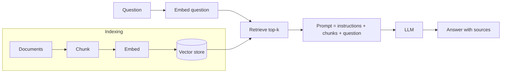

# Session 07: Retrieval-Augmented Generation (RAG) Systems

> Module: Next-Gen NLP Applications with AI · Term 6 (AI) · ⏱ ~2 hours

An LLM only knows what it saw during training. It does not know your institute's fee policy, last week's notice or your company's product manual, and when it does not know, it may confidently invent an answer. **Retrieval-Augmented Generation (RAG)** fixes this by first *finding* the right pieces of your own documents and then asking the LLM to answer *only from them*. RAG is the most common pattern in real business LLM apps today.

## 🎯 Learning Objectives

By the end of this session you will be able to:

- Explain why LLMs hallucinate and how RAG reduces it
- Describe the two stages of RAG: indexing and retrieval + generation
- Split documents into overlapping chunks
- Retrieve relevant chunks with TF-IDF and understand how embeddings and vector databases improve this
- Build a grounded prompt that cites its sources and refuses when the answer is missing
- Evaluate a RAG system and list its common failure points

## 📖 Concepts Explained

### 1. The problem: knowledge and hallucination

| Limitation of a plain LLM | Example |
|---|---|
| Knowledge cut-off | Does not know about this month's timetable change |
| No private data | Has never seen your internal policies |
| Hallucination | Invents a "late fee of Rs. 300" because it sounds plausible |
| No sources | Cannot show where an answer came from |

**Analogy:** a plain LLM is a student answering from memory in a closed-book exam. RAG turns it into an **open-book exam**: before answering, the student quickly finds the right page and reads it.

### 2. How RAG works

RAG has two stages.

**Stage A - Indexing (done once, or whenever documents change):**

1. **Load** documents (PDF, web pages, text files, database rows).
2. **Chunk** them into small pieces (a few sentences or 200-500 tokens).
3. **Embed** each chunk into a vector (a list of numbers that captures its meaning).
4. **Store** the vectors in a **vector store** (an index you can search by similarity).

**Stage B - Query time (for every question):**

1. Embed the user's question.
2. **Retrieve** the top-k most similar chunks.
3. **Augment**: put those chunks into the prompt as context.
4. **Generate**: the LLM answers from that context and cites sources.



### 3. Chunking choices

| Setting | Too small | Too large |
|---|---|---|
| Chunk size | Loses context ("It is closed on Sundays" - what is "it"?) | Mixes topics, wastes tokens, weaker matches |
| Overlap | Sentences cut between chunks | Many duplicates |

A good start: chunks of a few sentences (or ~300 tokens) with a small overlap, and keep the **source** (file name, page) with each chunk so you can cite it.

### 4. Retrieval: keywords vs meaning

| Method | How it matches | Strength | Weakness |
|---|---|---|---|
| Keyword / TF-IDF / BM25 | Shared words, rare words weigh more | Fast, no model needed, great for names and codes | Misses synonyms ("pay" vs "fee") |
| Dense embeddings | Meaning, via vectors from a neural model | Finds paraphrases | Needs a model; can miss exact codes |
| Hybrid | Both scores combined | Best of both | Slightly more work |

Similarity is usually measured with **cosine similarity**: 1 means the same direction (very similar), 0 means unrelated.

**Vector databases** (FAISS, Chroma, pgvector, Pinecone, and others) store millions of vectors and find nearest neighbours quickly. For a few hundred chunks, a NumPy array or scikit-learn is enough.

### 5. The grounded prompt

A RAG prompt has clear rules:

- Answer **only** from the context.
- If the answer is not in the context, say "I don't know".
- Cite the source number, such as [1].

Add a **guard in code** as well: if retrieval finds nothing relevant, reply "not found" without calling the LLM at all. This saves money and prevents invented answers.

### 6. Evaluating and improving RAG

| Check | Question to ask |
|---|---|
| Retrieval hit rate | Is the right chunk in the top-k for each test question? |
| Faithfulness | Does the answer use only facts from the retrieved chunks? |
| Answer relevance | Does it actually answer the question? |
| Refusal | Does it say "I don't know" for out-of-scope questions? |

Common upgrades: hybrid search, **re-ranking** the top results with a stronger model, query rewriting, metadata filters (for example, only 2026 policies) and better chunking.

## 💻 Code Examples

Install: `pip install scikit-learn openai`. The `docs/` folder holds four short policy files used as the knowledge base. `rag_answer.py` uses [`llm_client.py`](llm_client.py); without `OPENAI_API_KEY` it returns a `(mock)` answer that quotes the best chunk, so the whole pipeline runs offline.

### Example 1: Loading and chunking

📄 Saved in this folder as [`chunk_documents.py`](chunk_documents.py).

```python
"""Session 07 - Example 1: load documents and split them into chunks.

RAG never sends whole books to the LLM. We cut documents into small,
overlapping chunks (here: 2 sentences each, sharing 1 sentence with the
next chunk) so we can later retrieve only the useful pieces.
Run: python chunk_documents.py
"""
import os
import re

def load_documents(folder):
    """Read every .txt file in the folder into a dictionary {filename: text}."""
    documents = {}
    for filename in sorted(os.listdir(folder)):
        if filename.endswith(".txt"):
            with open(os.path.join(folder, filename), encoding="utf-8") as f:
                documents[filename] = f.read()
    return documents


def split_sentences(text):
    """Very simple sentence splitter: break after '.', '?' or '!' followed by a space."""
    text = text.replace("\n", " ")
    return [s.strip() for s in re.split(r"(?<=[.?!])\s+", text) if s.strip()]


def chunk_text(text, sentences_per_chunk=2, overlap=1):
    """Group sentences into chunks; neighbouring chunks share `overlap` sentences."""
    sentences = split_sentences(text)
    chunks = []
    step = sentences_per_chunk - overlap           # how far to move each time
    for start in range(0, len(sentences), step):
        chunk = " ".join(sentences[start:start + sentences_per_chunk])
        chunks.append(chunk)
        if start + sentences_per_chunk >= len(sentences):   # last chunk reached
            break
    return chunks


if __name__ == "__main__":
    # Step 1: load the four policy files from the docs folder
    docs = load_documents("docs")
    print("Loaded:", list(docs))

    # Step 2: chunk each document and remember where each chunk came from
    all_chunks = []
    for filename, text in docs.items():
        for chunk in chunk_text(text):
            all_chunks.append({"source": filename, "text": chunk})

    # Step 3: show the result
    print("Total chunks:", len(all_chunks))
    for chunk in all_chunks[:3]:
        print(f"- [{chunk['source']}] {chunk['text']}")
```

**How it works**

- `load_documents` reads every `.txt` file in `docs/`.
- `split_sentences` uses a simple regular expression to cut after `.`, `?` or `!`.
- `chunk_text` groups 2 sentences per chunk and repeats 1 sentence in the next chunk (overlap), so no fact is cut in half.
- Each chunk keeps its `source` so answers can cite it later.

### Example 2: Retrieval with TF-IDF

📄 Saved in this folder as [`tfidf_retriever.py`](tfidf_retriever.py).

```python
"""Session 07 - Example 2: find the most relevant chunks for a question (TF-IDF).

TF-IDF turns each chunk and the question into a vector of word weights.
Cosine similarity then tells us which chunks are closest to the question.
Install: pip install scikit-learn
Run:     python tfidf_retriever.py
"""
from sklearn.feature_extraction.text import TfidfVectorizer
from sklearn.metrics.pairwise import cosine_similarity
from chunk_documents import load_documents, chunk_text

# Step 1: build the list of chunks (the "knowledge base")
chunks = []
for filename, text in load_documents("docs").items():
    for piece in chunk_text(text):
        chunks.append({"source": filename, "text": piece})

# Step 2: learn the vocabulary and turn every chunk into a vector
vectorizer = TfidfVectorizer(stop_words="english")
chunk_vectors = vectorizer.fit_transform([c["text"] for c in chunks])


def retrieve(question, top_k=2):
    """Return the top_k chunks most similar to the question."""
    question_vector = vectorizer.transform([question])            # Step 3: embed the question
    scores = cosine_similarity(question_vector, chunk_vectors)[0]  # Step 4: compare with all chunks
    best = scores.argsort()[::-1][:top_k]                          # Step 5: highest scores first
    return [(round(float(scores[i]), 3), chunks[i]) for i in best]


if __name__ == "__main__":
    for question in ["What is the late fee?", "When is the centre closed?"]:
        print("\nQ:", question)
        for score, chunk in retrieve(question):
            print(f"  {score}  [{chunk['source']}] {chunk['text']}")
```

**How it works**

- `fit_transform` learns the vocabulary from all chunks and creates one vector per chunk.
- The question is turned into a vector with the *same* vocabulary using `transform`.
- `cosine_similarity` scores every chunk; `argsort()[::-1]` puts the highest scores first.

### Example 3: Full RAG pipeline with sources

📄 Saved in this folder as [`rag_answer.py`](rag_answer.py).

```python
"""Session 07 - Example 3: a complete mini RAG system.

Retrieve -> build a grounded prompt -> generate an answer with sources.
Works without an API key: the mock answer simply quotes the best chunk.
Run: python rag_answer.py
"""
from llm_client import ask_llm
from tfidf_retriever import retrieve

def answer(question):
    # Step 1: RETRIEVE the most relevant chunks
    results = retrieve(question, top_k=2)

    # Step 2: if nothing matches at all, say so instead of guessing
    if results[0][0] == 0:
        return "I could not find this in the documents.", []

    # Step 3: AUGMENT - put the chunks into the prompt as numbered context
    context = ""
    for number, (score, chunk) in enumerate(results, start=1):
        context += f"[{number}] ({chunk['source']}) {chunk['text']}\n"

    prompt = f"""Answer the question using ONLY the context below.
If the answer is not in the context, say "I don't know".
Mention the source number like [1].

Context:
{context}
Question: {question}
Answer:"""

    # Step 4: GENERATE - the mock answer quotes the top chunk so it works offline
    best_chunk = results[0][1]
    mock = f"{best_chunk['text']} [1]"
    reply = ask_llm(prompt, mock_answer=mock, temperature=0)
    sources = [chunk["source"] for _, chunk in results]
    return reply, sources


if __name__ == "__main__":
    for question in ["How much is the re-exam fee?",
                     "What time do evening classes start?",
                     "Who won the cricket match yesterday?"]:
        reply, sources = answer(question)
        print("Q:", question)
        print("A:", reply)
        print("Sources:", sources, "\n")
```

**How it works**

- Retrieval runs first; a score of 0 means no shared words, so the code refuses without calling the LLM (the cricket question).
- The prompt numbers each chunk and instructs the model to answer only from them and cite `[1]`.
- The function returns both the answer and the list of sources for display.

### Example 4 (optional): Semantic search with embeddings

📄 Saved in this folder as [`embeddings_search.py`](embeddings_search.py).

```python
"""Session 07 - Example 4 (optional, needs a download): semantic retrieval with embeddings.

TF-IDF only matches the same WORDS. Embeddings match MEANING, so
"How much do I pay each month?" can find "The monthly fee is PKR 25,000".
Install: pip install sentence-transformers
Run:     python embeddings_search.py
"""
try:
    from sentence_transformers import SentenceTransformer
except ImportError:
    print("Please install first:  pip install sentence-transformers")
    raise SystemExit

import numpy as np

sentences = [
    "The monthly fee for the ACCP AI programme is PKR 25,000.",
    "The centre is closed on Sundays and public holidays.",
    "Students may borrow two books for 14 days.",
]

# Step 1: load a small embedding model (about 90 MB, downloaded once)
model = SentenceTransformer("all-MiniLM-L6-v2")

# Step 2: turn each sentence into a vector; normalize so dot product = cosine similarity
sentence_vectors = model.encode(sentences, normalize_embeddings=True)

# Step 3: embed a question that uses DIFFERENT words from the documents
question = "How much do I pay every month?"
question_vector = model.encode([question], normalize_embeddings=True)[0]

# Step 4: score and rank
scores = sentence_vectors @ question_vector
for i in np.argsort(scores)[::-1]:
    print(f"{scores[i]:.3f}  {sentences[i]}")
```

**How it works**

- `SentenceTransformer` turns sentences into 384-number vectors that capture meaning.
- With normalized vectors, the dot product `@` equals cosine similarity.
- The fee sentence wins even though the question shares almost no words with it; this is what TF-IDF cannot do.

## 🧪 Lab Practice

1. Add a new file `docs/scholarships.txt` with three sentences, then ask `rag_answer.py` a question about it.
2. In `chunk_documents.py`, try `sentences_per_chunk=1` and `3`. Which retrieves the best chunk for "What is the late fee?"
3. Change `top_k` to 3 in `rag_answer.py` and print the full prompt. How many tokens (roughly words) does it add?
4. Write five test questions with the expected source file and calculate the retrieval hit rate.
5. (Optional) Replace TF-IDF in `tfidf_retriever.py` with the embedding model from Example 4 and compare results for "How much do I pay each month?".

## 📝 Assignment

Build `my_rag_bot.py` for a topic you know (a shop's product list, your college rules, or a cricket team's history). Use at least 8 documents, chunking with overlap, top-3 retrieval, a grounded prompt with citations and a refusal guard. Submit the code, the documents and a table of 8 test questions showing the retrieved source, the answer and whether it was correct.

## ❓ Quick Quiz

**Q1.** What do the letters R, A and G stand for in RAG?

<details><summary>Show answer</summary>

Retrieval, Augmented, Generation: retrieve relevant text, add it to the prompt, then generate the answer.

</details>

**Q2.** Why do we use overlap between chunks?

<details><summary>Show answer</summary>

So that information near a chunk boundary is not split and lost; neighbouring chunks share some text.

</details>

**Q3.** Which retrieval method finds "pay each month" for the text "monthly fee": TF-IDF or embeddings?

<details><summary>Show answer</summary>

Embeddings, because they match meaning, not just the same words.

</details>

**Q4.** What should a RAG bot do if the answer is not in the retrieved context?

<details><summary>Show answer</summary>

Say it does not know (or that the information is not in the documents) instead of guessing.

</details>

**Q5.** Name one metric for evaluating the retrieval step.

<details><summary>Show answer</summary>

Hit rate (or recall@k): how often the correct chunk appears in the top-k results.

</details>

## 💼 Interview Questions

**1. RAG or fine-tuning for a company policy chatbot? Why?**

<details><summary>Model answer</summary>

RAG. Policies change often and answers must be traceable to a source. Updating documents updates the bot instantly, with no retraining. Fine-tuning can be added later for tone or format.

</details>

**2. Your RAG bot gives wrong answers. How do you debug it?**

<details><summary>Model answer</summary>

Check retrieval first: print the retrieved chunks for failing questions. If the right chunk is missing, improve chunking, use hybrid search or re-ranking. If the chunk is there but the answer is wrong, tighten the prompt, lower temperature or use a stronger model.

</details>

**3. What is a vector database and when do you need one?**

<details><summary>Model answer</summary>

A store that indexes embedding vectors for fast nearest-neighbour search, with filtering and updates. You need one when you have many thousands or millions of chunks, or need persistence and scaling; small projects can use an in-memory array.

</details>

## ✅ Summary

- RAG grounds LLM answers in your own documents, reducing hallucination and adding sources.
- Indexing: load, chunk, embed, store. Query: embed, retrieve, augment, generate.
- TF-IDF matches words; embeddings match meaning; hybrid search combines both.
- Grounded prompts plus a code-level refusal guard keep answers honest.
- Evaluate retrieval and answers separately to find what to fix.

---

[⬅ Previous](../Session-06-Fine-Tuning-with-LoRA-and-QLoRA/README.md) · [🏠 Module Home](../README.md) · [Next ➡](../Session-08-Building-Conversational-Agents/README.md)

Prepared by Zeeshan Abbas · Aptech Learning North Nazimabad
