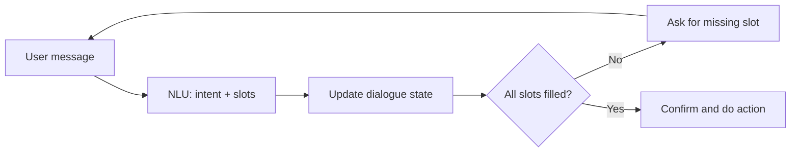
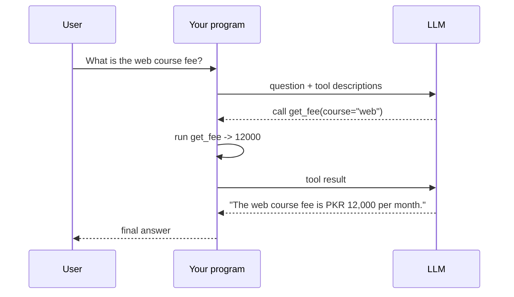

# Session 08: Building Intelligent Conversational Agents

> Module: Next-Gen NLP Applications with AI · Term 6 (AI) · ⏱ ~2 hours

Chatbots answer bank queries, book doctor appointments and help students choose courses. A good conversational agent does more than reply to one message: it understands the user's goal, remembers the conversation, asks for missing details and takes real actions such as checking a database. In this session you build four small bots, from a classic rule-based bot to an LLM agent that calls Python functions.

## 🎯 Learning Objectives

By the end of this session you will be able to:

- Compare rule-based, retrieval-based and LLM-based conversational systems
- Explain intents, slots, dialogue acts and dialogue state tracking
- Give an LLM short-term memory by sending conversation history, and control its size
- Build an agent that uses tool (function) calling to take actions
- Design safe and helpful bot behaviour: fallbacks, confirmations and human hand-off

## 📖 Concepts Explained

### 1. Types of conversational systems

| Type | How it replies | Strengths | Weaknesses |
|---|---|---|---|
| Rule-based | Keyword or pattern → fixed template | Predictable, cheap, easy to test | Breaks on new wording, hard to scale |
| Retrieval-based | Finds the closest stored answer (FAQ) | Answers are always approved text | Cannot combine or reason |
| Generative (LLM) | Writes a new reply each time | Flexible, natural, multi-turn | Can hallucinate, needs guard-rails |
| Agent (LLM + tools) | Plans, calls tools, then replies | Can act: look up, book, calculate | More moving parts to secure |

Real products often mix them: rules for greetings and hand-off, RAG for policy questions, tools for actions.

### 2. Understanding the user (NLU recap)

| Term | Meaning | Example ("Book an AI counselling on Saturday") |
|---|---|---|
| Intent | What the user wants | `book_counselling` |
| Slots / entities | Details needed to do it | course = AI, day = Saturday |
| Dialogue act | The role of the message | request, inform, confirm, greet, thank |
| Dialogue state | Everything known so far in this conversation | `{course: ai, day: saturday, name: ?}` |

**Dialogue state tracking** updates the state after every turn. **Dialogue policy** decides the next move: ask for a missing slot, confirm, or perform the action.



### 3. Memory in LLM chatbots

An LLM API is **stateless**: each request is independent. "Memory" means your program sends previous messages again with each request.

| Memory type | How | Trade-off |
|---|---|---|
| Full history | Send every message | Simple, but cost grows and context fills up |
| Sliding window | Send only the last *n* turns | Cheap, but forgets older facts |
| Summary memory | Replace old turns with a short summary | Keeps the gist with few tokens |
| Long-term memory | Save facts (name, preferences) in a database and retrieve them | Persistent across sessions, needs privacy care |

### 4. Tool calling (function calling)

With tool calling you describe functions (name, description, parameters as JSON Schema). The model does **not** run code; it returns a structured request like `get_fee(course="web")`. Your program runs the function, sends the result back, and the model writes the final reply.



This is the same Thought → Action → Observation idea as ReAct (Session 05), but built into the API with reliable JSON.

### 5. Designing a good agent

- **Persona and scope** in the system prompt: who the bot is and what it must not do.
- **Fallbacks**: a polite "I did not understand" with suggestions, never silence.
- **Confirm before acting** on anything important (payments, bookings, deletions).
- **Human hand-off** when the user is upset or the bot fails twice.
- **Least privilege**: tools should only do what is necessary (read fees, not edit them).
- **Log and evaluate**: task success rate, number of turns, fallback rate, user satisfaction.

## 💻 Code Examples

Examples 1 and 2 use plain Python. Examples 3 and 4 use [`llm_client.py`](llm_client.py) (`pip install openai`); without `OPENAI_API_KEY` they run in mock mode.

### Example 1: Rule-based bot

📄 Saved in this folder as [`rule_based_bot.py`](rule_based_bot.py).

```python
"""Session 08 - Example 1: a simple rule-based chatbot.

Before LLMs, many bots matched keywords to intents and replied from
templates. This is still useful for small, predictable tasks.
Run: python rule_based_bot.py   (type 'bye' to quit)
"""

# Step 1: each intent has some keywords and a fixed reply
INTENTS = {
    "greeting": (["hello", "hi", "salam", "assalam"], "Hello! How can I help you today?"),
    "timings":  (["time", "timing", "open", "close"], "We are open Monday to Saturday, 9 am to 9 pm."),
    "fees":     (["fee", "fees", "cost", "price"], "The monthly fee is PKR 25,000."),
    "goodbye":  (["bye", "goodbye", "khuda hafiz"], "Goodbye! Have a great day."),
}

def detect_intent(message):
    """Return the first intent whose keyword appears in the message."""
    text = message.lower().replace("?", "").replace("!", "")
    words = text.split()                                  # list of single words
    for intent, (keywords, _reply) in INTENTS.items():
        for keyword in keywords:
            if " " in keyword:                            # two-word keyword, e.g. "khuda hafiz"
                if keyword in text:
                    return intent
            elif keyword in words:                        # one-word keyword must match a whole word
                return intent
    return "unknown"

def reply_to(message):
    intent = detect_intent(message)
    if intent == "unknown":
        return intent, "Sorry, I did not understand. Ask me about fees or timings."
    return intent, INTENTS[intent][1]

# Step 2: the chat loop
if __name__ == "__main__":
    print("Bot: Hi! Ask me about fees or timings. Type 'bye' to quit.")
    while True:
        user = input("You: ")
        intent, answer = reply_to(user)
        print(f"Bot: {answer}   [intent={intent}]")
        if intent == "goodbye":
            break
```

**How it works**

- Each intent has keywords and one fixed reply.
- Single words must match whole words, so "hi" does not match inside "this".
- Anything unmatched goes to a helpful fallback message.

### Example 2: Dialogue state tracking

📄 Saved in this folder as [`dialogue_state.py`](dialogue_state.py).

```python
"""Session 08 - Example 2: dialogue state tracking (slot filling).

A task bot must remember what it already knows and ask only for what is
missing. Here the bot books a counselling session and needs 3 slots.
Run: python dialogue_state.py   (uses a scripted conversation)
"""

# Step 1: the slots we must fill, and the question for each
REQUIRED_SLOTS = {
    "name": "May I have your name?",
    "course": "Which course are you interested in?",
    "day": "Which day suits you for the counselling session?",
}
COURSES = ["ai", "web", "python"]
DAYS = ["monday", "tuesday", "wednesday", "thursday", "friday", "saturday"]

def update_state(state, message):
    """Read the message and fill any slot we can recognise."""
    text = message.lower()
    for course in COURSES:
        if course in text.split():
            state["course"] = course
    for day in DAYS:
        if day in text:
            state["day"] = day
    if "my name is" in text:
        start = text.index("my name is") + len("my name is")   # position right after the phrase
        state["name"] = message[start:].strip().title()
    return state

def next_question(state):
    """Return the question for the first empty slot, or None when all are filled."""
    for slot, question in REQUIRED_SLOTS.items():
        if slot not in state:
            return question
    return None

# Step 2: a scripted user so the example runs without typing
user_turns = ["Hi, I want to learn AI", "My name is Ayesha Khan", "Saturday please"]

state = {}                                      # the dialogue state starts empty
for message in user_turns:
    print("User :", message)
    state = update_state(state, message)        # Step 3: track the state
    print("State:", state)
    question = next_question(state)             # Step 4: decide what to ask next
    if question:
        print("Bot  :", question, "\n")
    else:
        print(f"Bot  : Booked! {state['name']}, your {state['course'].upper()} counselling is on {state['day'].title()}.")
```

**How it works**

- `state` is a dictionary that grows as the user gives details, in any order.
- `next_question` asks only for the first missing slot (the dialogue policy).
- When every slot is filled, the bot confirms the booking.

### Example 3: LLM chat with memory

📄 Saved in this folder as [`chat_with_memory.py`](chat_with_memory.py).

```python
"""Session 08 - Example 3: an LLM chatbot with short-term memory.

LLMs do not remember earlier messages by themselves. WE send the
conversation history every time. To control cost we keep only the
last few turns (a "sliding window").
Run: python chat_with_memory.py   (scripted turns, mock answers without a key)
"""
from llm_client import chat

MAX_TURNS = 3          # keep the last 3 user+assistant pairs

system_message = {"role": "system", "content": "You are a friendly study buddy for Python learners. Keep answers short."}
history = []           # list of {"role": ..., "content": ...}

def trimmed_history():
    """Keep only the last MAX_TURNS pairs (each pair = 2 messages)."""
    return history[-MAX_TURNS * 2:]

def ask(user_text, mock):
    history.append({"role": "user", "content": user_text})          # Step 1: remember the question
    messages = [system_message] + trimmed_history()                  # Step 2: build the request
    reply = chat(messages, mock_answer=mock)                         # Step 3: call the model
    history.append({"role": "assistant", "content": reply})          # Step 4: remember the answer
    return reply

# Scripted conversation: the 2nd question only makes sense with memory ("it")
turns = [
    ("My name is Hamza and I am learning lists.", "Nice to meet you, Hamza! Lists store many items in order."),
    ("How do I add an item to it?", "Use append, for example: fruits.append('mango')."),
    ("What is my name?", "Your name is Hamza."),
]
for text, mock in turns:
    print("You:", text)
    print("Bot:", ask(text, mock), "\n")

print("Messages stored:", len(history), "| messages sent last time:", len(trimmed_history()) + 1)
```

**How it works**

- Every user message and bot reply is appended to `history`.
- Only the last `MAX_TURNS` pairs plus the system message are sent, which caps cost.
- With a real key, the model can answer "What is my name?" only because the history was sent.

### Example 4: Tool-calling agent

📄 Saved in this folder as [`tool_calling_agent.py`](tool_calling_agent.py).

```python
"""Session 08 - Example 4: an agent that calls Python functions (tools).

Modern LLM APIs support "tool calling": we describe our functions, the
model decides which one to call and with what arguments, our code runs
it, and the model writes the final reply using the result.
Run: python tool_calling_agent.py
  - with OPENAI_API_KEY: real tool calling
  - without a key      : a simple keyword router plays the model's part
"""
import json
from llm_client import is_live, MODEL

# Step 1: the real Python tools
def get_fee(course):
    fees = {"ai": 25000, "web": 12000, "python": 9000}
    return {"course": course, "monthly_fee_pkr": fees.get(course.lower(), "unknown")}

def get_class_time(course):
    times = {"ai": "5 pm - 7 pm", "web": "9 am - 11 am", "python": "11 am - 1 pm"}
    return {"course": course, "time": times.get(course.lower(), "unknown")}

TOOLS = {"get_fee": get_fee, "get_class_time": get_class_time}

# Step 2: describe the tools in the JSON format the API expects
TOOL_SPECS = [
    {"type": "function", "function": {
        "name": name,
        "description": description,
        "parameters": {"type": "object",
                       "properties": {"course": {"type": "string", "description": "ai, web or python"}},
                       "required": ["course"]}}}
    for name, description in [("get_fee", "Monthly fee of a course"),
                              ("get_class_time", "Class timing of a course")]
]

def mock_router(question):
    """Offline stand-in for the model: pick a tool and argument with keywords."""
    course = next((c for c in ["ai", "web", "python"] if c in question.lower().split()), "ai")
    tool = "get_fee" if "fee" in question.lower() else "get_class_time"
    result = TOOLS[tool](course)
    return f"(mock) I called {tool}({course!r}) and got {result}"

def run_agent(question):
    if not is_live():
        return mock_router(question)

    from openai import OpenAI
    client = OpenAI()
    messages = [{"role": "user", "content": question}]

    # Step 3: first call - the model may ask for a tool
    response = client.chat.completions.create(model=MODEL, messages=messages, tools=TOOL_SPECS)
    message = response.choices[0].message
    if not message.tool_calls:                     # no tool needed
        return message.content

    # Step 4: run every requested tool and send the results back
    messages.append(message)
    for call in message.tool_calls:
        args = json.loads(call.function.arguments)
        result = TOOLS[call.function.name](**args)
        messages.append({"role": "tool", "tool_call_id": call.id, "content": json.dumps(result)})

    # Step 5: second call - the model writes the final answer using the tool results
    final = client.chat.completions.create(model=MODEL, messages=messages)
    return final.choices[0].message.content

if __name__ == "__main__":
    for q in ["What is the fee for the web course?", "When is the python class?"]:
        print("Q:", q)
        print("A:", run_agent(q), "\n")
```

**How it works**

- `TOOL_SPECS` describes each function with a JSON Schema for its arguments.
- With a key, the first API call returns `tool_calls`; the code runs those Python functions and sends results with `role: "tool"`.
- The second call turns the tool results into a natural answer.
- Without a key, `mock_router` imitates the decision with keywords so you can still follow the flow.

## 🧪 Lab Practice

1. Add a `courses` intent to `rule_based_bot.py` that lists the available courses.
2. In `dialogue_state.py`, add a fourth slot `phone` and recognise an 11-digit number starting with `03`.
3. Add two more scripted turns to `chat_with_memory.py` and set `MAX_TURNS = 1`. With a real key, does the bot still remember the name?
4. Add a third tool `get_teacher(course)` to `tool_calling_agent.py`, including its spec, and test it.
5. Add a confirmation step: before "booking", the bot must ask "Shall I confirm? (yes/no)".

## 📝 Assignment

Build `clinic_bot.py`: a bot that books a doctor's appointment. It must track the slots patient name, doctor type and day; ask only for missing slots; use one tool `check_availability(doctor, day)` that returns free times from a dictionary; confirm before booking; and hand off to a human if the user types "agent". Submit the code and two sample conversations.

## ❓ Quick Quiz

**Q1.** In "Book a web class for Monday", what is the intent and what are the slots?

<details><summary>Show answer</summary>

Intent: book a class. Slots: course = web, day = Monday.

</details>

**Q2.** Why do LLM chatbots need the program to resend history?

<details><summary>Show answer</summary>

Because the API is stateless; the model only sees what is in the current request.

</details>

**Q3.** In tool calling, who actually runs the function?

<details><summary>Show answer</summary>

Your program. The model only returns the function name and arguments.

</details>

**Q4.** Name one disadvantage of a sliding-window memory.

<details><summary>Show answer</summary>

It forgets facts mentioned before the window, such as the user's name from early in the chat.

</details>

**Q5.** When should a bot confirm before acting?

<details><summary>Show answer</summary>

Before important or hard-to-undo actions such as payments, bookings, cancellations or deletions.

</details>

## 💼 Interview Questions

**1. How would you keep a long conversation within the model's context window?**

<details><summary>Model answer</summary>

Use a sliding window for recent turns plus a running summary of older turns, and store key facts (name, order number) separately so they can be re-inserted when needed.

</details>

**2. What security risks come with giving an agent tools?**

<details><summary>Model answer</summary>

Prompt injection can trick it into calling tools wrongly, and tools may expose or change data. Limit tool permissions, validate arguments, require confirmation for risky actions, and log every call.

</details>

**3. How do you measure whether a chatbot is good?**

<details><summary>Model answer</summary>

Task completion rate, average turns to complete, fallback and hand-off rates, answer accuracy on a test set, and user satisfaction ratings.

</details>

## ✅ Summary

- Conversational systems range from rule-based bots to LLM agents with tools.
- Intents, slots and dialogue state let a bot pursue a goal over many turns.
- LLM memory is history your program resends; trim or summarise it to control cost.
- Tool calling lets the model request actions while your code stays in control.
- Good agents have clear scope, fallbacks, confirmations and human hand-off.

---

[⬅ Previous](../Session-07-Retrieval-Augmented-Generation-RAG/README.md) · [🏠 Module Home](../README.md) · [Next ➡](../Session-09-Multimodal-AI-Vision-and-Language/README.md)

Prepared by Zeeshan Abbas · Aptech Learning North Nazimabad
