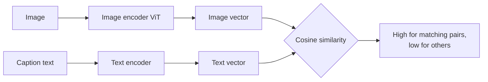

# Session 09: Multimodal AI: Integrating Vision and Language Models

> Module: Next-Gen NLP Applications with AI · Term 6 (AI) · ⏱ ~2 hours

Humans understand the world through many senses at once: we read a menu, look at the food photo and listen to the waiter. **Multimodal AI** gives models more than one "sense", most often images and text together. Today's assistants can read a photo of a bill, explain a chart, caption a picture for a blind user or find products from a screenshot. In this session you learn how images become numbers, how vision and language share one space, and how to send an image to an LLM.

## 🎯 Learning Objectives

By the end of this session you will be able to:

- Define modality and explain why multimodal models are useful
- Describe how an image is stored as pixels and turned into tokens by a Vision Transformer
- Explain contrastive image-text learning (the CLIP idea) and zero-shot image classification
- Name the main vision-language tasks: captioning, visual question answering, OCR-free document understanding
- Send an image plus a question to a vision-capable LLM from Python
- Discuss the limits and risks of multimodal systems

## 📖 Concepts Explained

### 1. What is a modality?

A **modality** is a type of data: text, images, audio, video, sensor readings. A **multimodal** model takes in, or produces, more than one of them.

| Input → Output | Task | Example |
|---|---|---|
| Image → Text | Image captioning | "A boy flying a kite on a beach" |
| Image + Text → Text | Visual Question Answering (VQA) | "How many people are wearing helmets?" → "Two" |
| Text → Image | Text-to-image generation | "A rickshaw painted with truck art" → picture |
| Image + Text → Score | Image-text retrieval | Search a photo library with words |
| Document image → Structured data | Document understanding | Read totals from a receipt photo |

### 2. Images are numbers

A grayscale image is a grid of brightness values from 0 (black) to 255 (white). A colour image stores three values per pixel (Red, Green, Blue), so its shape is *height × width × 3*. Before a model uses it, the image is usually resized (for example to 224 × 224) and the values are scaled to 0-1.

### 3. From pixels to tokens: Vision Transformers

Earlier vision models used **CNNs** (convolutional neural networks) that slide small filters over the image. Modern multimodal systems mostly use a **Vision Transformer (ViT)**:

1. Cut the image into patches (for example 16 × 16 pixels).
2. Flatten each patch and project it to an embedding vector.
3. Add position embeddings.
4. Feed the sequence of patch tokens into normal transformer layers (Session 04).

**Analogy:** a ViT reads an image like a sentence, where each patch is one "word".

### 4. One shared space: contrastive learning (CLIP)

CLIP-style models train an **image encoder** and a **text encoder** together on hundreds of millions of image-caption pairs. The training goal is simple: the vector of an image should be close to the vector of *its* caption and far from other captions.



This gives **zero-shot classification**: write captions such as "a photo of a cat" and "a photo of a car", embed them, and pick the caption closest to the image. No extra training is needed for new labels.

### 5. Vision-language models (VLMs) that chat

Chat models that "see" usually connect three parts:

| Part | Job |
|---|---|
| Vision encoder | Turns the image into patch embeddings |
| Projector / adapter | Maps those embeddings into the language model's token space |
| Language model (decoder) | Reads image tokens + text tokens and writes the answer |

To the language model, the image simply becomes extra tokens at the start of the prompt. That is why you can ask follow-up questions about a picture just like about text. Note that images cost tokens too: a big, detailed image is more expensive than a small one.

### 6. Limits and risks

- **Hallucination** still happens: the model may "see" objects that are not there or misread numbers.
- **Counting and small text** are weak points; crop or zoom important regions.
- **Privacy**: photos can contain faces, ID cards and locations; get consent and remove sensitive images.
- **Bias**: training images over-represent some regions, skin tones and cultures.
- **Prompt injection through images**: text written inside an image can carry hidden instructions.

## 💻 Code Examples

Examples 1-3 need only `pip install numpy`. Example 4 uses [`llm_client.py`](llm_client.py) and `pip install openai` (mock answer without a key). Example 5 is optional and downloads an open model.

### Example 1: Images as numbers

📄 Saved in this folder as [`image_as_numbers.py`](image_as_numbers.py).

```python
"""Session 09 - Example 1: to a computer, an image is just a grid of numbers.

We build tiny images with NumPy so no image file is needed.
Run: python image_as_numbers.py
"""
import numpy as np

# Step 1: a 5x5 grayscale image. 0 = black, 255 = white. This draws a plus sign.
gray = np.zeros((5, 5), dtype=np.uint8)
gray[2, :] = 255          # middle row white
gray[:, 2] = 255          # middle column white
print("Grayscale image (5 x 5):")
print(gray)

# Step 2: show it with characters so we can "see" it
for row in gray:
    print("".join("##" if pixel > 127 else ". " for pixel in row))

# Step 3: a colour image has 3 numbers per pixel: Red, Green, Blue
color = np.zeros((2, 2, 3), dtype=np.uint8)
color[0, 0] = [255, 0, 0]       # red pixel
color[0, 1] = [0, 255, 0]       # green pixel
color[1, 0] = [0, 0, 255]       # blue pixel
color[1, 1] = [255, 255, 0]     # yellow = red + green
print("\nColour image shape (height, width, channels):", color.shape)

# Step 4: models usually want numbers between 0 and 1 ("normalization")
normalized = color / 255.0
print("Top-left pixel normalized:", normalized[0, 0])

# Step 5: a phone photo is much bigger
height, width = 3000, 4000
print(f"\nA 12-megapixel photo holds {height * width * 3:,} numbers")
```

**How it works**

- A NumPy array of shape (5, 5) is a grayscale image; we draw a plus sign by setting a row and a column to 255.
- A colour image adds a third dimension of size 3 for the RGB channels.
- Dividing by 255 normalizes values to the 0-1 range that models expect.

### Example 2: Patches for a Vision Transformer

📄 Saved in this folder as [`vit_patches.py`](vit_patches.py).

```python
"""Session 09 - Example 2: how a Vision Transformer (ViT) "reads" an image.

A ViT cuts the image into small square PATCHES, flattens each patch into
a vector and treats the patches like words (tokens) in a sentence.
Run: python vit_patches.py
"""
import numpy as np

np.random.seed(0)

# Step 1: a fake 8x8 grayscale image with random pixel values
image = np.random.randint(0, 256, size=(8, 8))
patch_size = 4                                   # 4x4 patches -> 2 x 2 = 4 patches

# Step 2: cut the image into patches, row by row
patches = []
for top in range(0, image.shape[0], patch_size):
    for left in range(0, image.shape[1], patch_size):
        patch = image[top:top + patch_size, left:left + patch_size]
        patches.append(patch.flatten())          # 4x4 grid -> 16 numbers

patches = np.array(patches)
print("Number of patches (image tokens):", len(patches))
print("Numbers per patch:", patches.shape[1])

# Step 3: a learned "projection" turns each patch into an embedding (here size 6)
embedding_size = 6
projection = np.random.randn(patches.shape[1], embedding_size) * 0.01
patch_embeddings = (patches / 255.0) @ projection

# Step 4: add position information so the model knows where each patch was
positions = np.arange(len(patches)).reshape(-1, 1) * 0.1
tokens = patch_embeddings + positions

print("Token matrix shape:", tokens.shape, "-> ready for transformer layers (Session 04)")
print("A 224x224 image with 16x16 patches gives", (224 // 16) ** 2, "tokens")
```

**How it works**

- Two loops cut the 8 × 8 image into four 4 × 4 patches and flatten each into 16 numbers.
- A projection matrix turns each patch into a short embedding, like a word embedding.
- Position values are added so the order of patches is not lost.

### Example 3: CLIP-style zero-shot labelling

📄 Saved in this folder as [`clip_style_matching.py`](clip_style_matching.py).

```python
"""Session 09 - Example 3: CLIP-style matching of images and text.

CLIP-like models put images and sentences into the SAME vector space.
A matching image and caption get vectors pointing in a similar direction.
Here we use small hand-made vectors to show the maths of zero-shot labelling.
Run: python clip_style_matching.py
"""
import numpy as np

def normalize(vector):
    return vector / np.linalg.norm(vector)

# Step 1: pretend an image encoder produced this vector for a photo.
# The 4 dimensions loosely mean: [animal, vehicle, food, outdoor]
image_vector = normalize(np.array([0.9, 0.0, 0.1, 0.6]))   # looks like an animal outdoors

# Step 2: pretend a text encoder produced vectors for candidate captions
captions = {
    "a photo of a cat in a garden": np.array([0.8, 0.0, 0.0, 0.7]),
    "a photo of a car on a road":   np.array([0.0, 0.9, 0.0, 0.5]),
    "a photo of a plate of biryani": np.array([0.0, 0.0, 1.0, 0.1]),
}

# Step 3: cosine similarity between the image and each caption
scores = {}
for caption, vector in captions.items():
    scores[caption] = float(image_vector @ normalize(vector))

# Step 4: softmax turns scores into probabilities (CLIP multiplies by a "temperature" first)
logits = np.array(list(scores.values())) * 10
probabilities = np.exp(logits) / np.exp(logits).sum()

for (caption, score), prob in zip(scores.items(), probabilities):
    print(f"{prob:6.1%}  (similarity {score:.2f})  {caption}")
print("\nPredicted label:", max(scores, key=scores.get))
```

**How it works**

- Image and captions live in the same 4-dimensional space (real models use 512 or more dimensions).
- Cosine similarity measures how well each caption matches the image.
- Softmax converts similarities into probabilities; the highest one is the predicted label.

### Example 4: Asking a vision LLM about a photo

📄 Saved in this folder as [`vision_llm_prompt.py`](vision_llm_prompt.py).

```python
"""Session 09 - Example 4: ask a vision-language model about an image.

Many chat models accept an image together with a text question.
We send the image as base64 text inside the message.
Run: python vision_llm_prompt.py [path/to/image.jpg]
  - with OPENAI_API_KEY and an image path: real answer
  - otherwise: a mock answer so the code still runs
"""
import base64
import sys
from llm_client import is_live, MODEL

# PLACEHOLDER: never write your real key in code. Set it in the terminal instead:
#   Windows:  set OPENAI_API_KEY=sk-...      macOS/Linux:  export OPENAI_API_KEY=sk-...

question = "Describe this image in one sentence, then list any text you can read in it."
image_path = sys.argv[1] if len(sys.argv) > 1 else None

def image_to_data_url(path):
    """Read an image file and turn it into a data URL the API understands."""
    with open(path, "rb") as f:
        encoded = base64.b64encode(f.read()).decode("utf-8")
    image_type = "png" if path.lower().endswith(".png") else "jpeg"
    return f"data:image/{image_type};base64,{encoded}"

# Step 1: fall back to a mock answer when we cannot make a real call
if not (is_live() and image_path):
    print("(mock) A student is writing Python code on a laptop. Text: 'print(\"Hello\")'")
    print("Tip: set OPENAI_API_KEY and run:  python vision_llm_prompt.py photo.jpg")
    raise SystemExit

# Step 2: build one user message that contains BOTH text and an image
from openai import OpenAI
client = OpenAI()
messages = [{
    "role": "user",
    "content": [
        {"type": "text", "text": question},
        {"type": "image_url", "image_url": {"url": image_to_data_url(image_path)}},
    ],
}]

# Step 3: send it to a vision-capable model and print the reply
response = client.chat.completions.create(model=MODEL, messages=messages)
print(response.choices[0].message.content)
```

**How it works**

- The image file is read as bytes and encoded as base64 inside a `data:` URL.
- The message `content` is a list holding both a text part and an image part.
- The key is never written in the code; without a key or image path, the script prints a mock answer.

### Example 5 (optional): Offline captioning with an open model

📄 Saved in this folder as [`caption_with_transformers.py`](caption_with_transformers.py).

```python
"""Session 09 - Example 5 (optional, needs downloads): free image captioning offline.

Uses a small open captioning model from Hugging Face. No API key needed,
but the first run downloads about 1 GB.
Install: pip install torch transformers pillow
Run:     python caption_with_transformers.py photo.jpg
"""
import sys

try:
    from transformers import pipeline
except ImportError:
    print("Please install first:  pip install torch transformers pillow")
    raise SystemExit

if len(sys.argv) < 2:
    print("Usage: python caption_with_transformers.py photo.jpg")
    raise SystemExit

# Step 1: create an image-to-text pipeline with a BLIP captioning model
captioner = pipeline("image-to-text", model="Salesforce/blip-image-captioning-base")

# Step 2: caption the image given on the command line
result = captioner(sys.argv[1])

# Step 3: print the generated caption
print("Caption:", result[0]["generated_text"])
```

**How it works**

- `pipeline("image-to-text")` loads a BLIP captioning model and its image processor in one line.
- The pipeline resizes and normalizes the image for you and returns the generated caption.

## 🧪 Lab Practice

1. In `image_as_numbers.py`, draw the letter **L** in a 6 × 6 image and print it with characters.
2. In `vit_patches.py`, change `patch_size` to 2. How many tokens do you get? What happens to the cost of attention?
3. Add a fourth caption "a photo of a dog in a park" to `clip_style_matching.py` with your own vector. Does the prediction change?
4. With an API key, run `vision_llm_prompt.py` on a photo of a printed receipt and ask for the total amount as JSON.
5. Make a table of three apps you use that are multimodal and write which modalities each one uses.

## 📝 Assignment

Write `receipt_reader.py` that takes a receipt image path, asks a vision LLM to return JSON with `shop`, `date`, `items` (name, price) and `total`, then checks in Python that the item prices add up to the total and prints a warning if not. Include a mock mode with a sample JSON reply so it runs without a key. Submit code plus a short note on two errors you observed.

## ❓ Quick Quiz

**Q1.** What is the shape of a 100 × 200 colour image in NumPy?

<details><summary>Show answer</summary>

(100, 200, 3): height, width and three colour channels.

</details>

**Q2.** How many 16 × 16 patches does a 224 × 224 image produce?

<details><summary>Show answer</summary>

(224 / 16)² = 14 × 14 = 196 patches.

</details>

**Q3.** What does CLIP learn?

<details><summary>Show answer</summary>

To place matching images and captions close together in a shared vector space, using contrastive training on image-text pairs.

</details>

**Q4.** What is visual question answering?

<details><summary>Show answer</summary>

Answering a natural-language question about the content of an image.

</details>

**Q5.** Name one risk specific to multimodal models.

<details><summary>Show answer</summary>

Any one of: privacy (faces, IDs in photos), hidden prompt injection in image text, misreading numbers or small text, or visual hallucination.

</details>

## 💼 Interview Questions

**1. How does zero-shot image classification work without training on your labels?**

<details><summary>Model answer</summary>

A CLIP-style model embeds the image and a caption for each label ("a photo of a ...") into one space; the label whose caption vector is most similar to the image vector is chosen.

</details>

**2. How would you build a product search where users upload a photo?**

<details><summary>Model answer</summary>

Embed all catalogue images with an image encoder and store the vectors in a vector index. Embed the uploaded photo the same way and return the nearest products. Text search can use the same space with the text encoder.

</details>

**3. A vision model misreads amounts on invoices. What would you do?**

<details><summary>Model answer</summary>

Use higher resolution or crop the relevant region, ask for structured JSON, validate totals in code, try a dedicated OCR step for numbers, and route low-confidence results to a human.

</details>

## ✅ Summary

- Multimodal AI combines data types such as images and text.
- Images are pixel arrays; ViTs turn them into patch tokens for transformers.
- CLIP-style training aligns images and text in one vector space, enabling zero-shot labels and search.
- Vision-language chat models feed image tokens into a language model to answer questions.
- Validate outputs and protect privacy, because visual hallucination and misreading still happen.

---

[⬅ Previous](../Session-08-Building-Conversational-Agents/README.md) · [🏠 Module Home](../README.md) · [Next ➡](../Session-10-Speech-AI-with-Whisper-and-TTS/README.md)

Prepared by Zeeshan Abbas · Aptech Learning North Nazimabad
