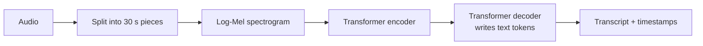
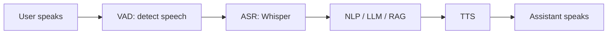

# Session 10: Modern Speech AI with Whisper and Text-to-Speech

> Module: Next-Gen NLP Applications with AI · Term 6 (AI) · ⏱ ~2 hours

Voice is the most natural interface of all. Voice notes, call-centre recordings, lecture videos and smart speakers produce huge amounts of spoken language. **Speech AI** turns that speech into text (so NLP can work on it) and turns text back into natural speech (so machines can talk). In this session you learn how audio is stored, how the Whisper model transcribes it, how text-to-speech works, and how these join into a voice assistant.

## 🎯 Learning Objectives

By the end of this session you will be able to:

- Explain how sound is stored digitally: samples, sample rate and bit depth
- Describe automatic speech recognition (ASR) and how Whisper works at a high level
- Transcribe audio with local Whisper or a speech API, with a safe fallback
- Explain text-to-speech (TTS) and generate speech from Python
- Design a voice assistant pipeline (ASR → NLP → TTS) and know its challenges
- Measure ASR quality with Word Error Rate (WER)

## 📖 Concepts Explained

### 1. Sound as numbers

Sound is a vibration in the air. A microphone measures it many times per second; each measurement is a **sample**.

| Term | Meaning | Typical value |
|---|---|---|
| Sample rate | Samples per second | 16,000 Hz for speech models, 44,100 Hz for music |
| Bit depth | Size of each sample | 16-bit (values from -32,768 to 32,767) |
| Channels | Mono (1) or stereo (2) | Mono for speech |
| Format | WAV (raw), MP3/OGG/M4A (compressed) | WhatsApp voice notes are OGG/Opus |

Speech models do not read raw samples directly. They first compute a **spectrogram**, a picture of which frequencies are loud at each moment. Whisper uses a *log-Mel spectrogram*, which spaces frequencies the way human hearing does.

### 2. Automatic Speech Recognition (ASR)

Older ASR systems had separate parts: an acoustic model (sounds), a pronunciation dictionary and a language model (likely word sequences). Modern systems are **end-to-end**: one neural network goes from audio straight to text.

### 3. How Whisper works

Whisper is an open-source **encoder-decoder transformer** trained on hundreds of thousands of hours of multilingual audio from the web.



| Feature | What it means for you |
|---|---|
| Multilingual | Transcribes about 100 languages, including Urdu, and detects the language |
| Translation | Can translate speech in other languages directly into English text |
| Timestamps | Gives start and end times for segments, useful for subtitles |
| Model sizes | `tiny` and `base` run on a laptop CPU; `medium` and `large` are more accurate but need a GPU |
| Robust | Handles accents and background noise better than older systems |

Whisper's weak points: it can hallucinate words during long silences or music, struggles with heavy code-switching (Urdu-English in one sentence) and with names it has never heard.

### 4. Measuring ASR: Word Error Rate

**WER = (Substitutions + Deletions + Insertions) / Number of words in the correct transcript**

Example: correct = "the fee is due on monday" (6 words); heard = "the fees due on monday". "fee" → "fees" is 1 substitution and "is" is 1 deletion, so WER = 2 / 6 ≈ 33%. Lower is better.

### 5. Text-to-Speech (TTS)

TTS works in the opposite direction.

1. **Text normalization**: "Rs. 500" → "five hundred rupees", "5 pm" → "five p m".
2. **Acoustic model**: predicts a spectrogram (or audio features) from the text, including rhythm and intonation (prosody).
3. **Vocoder**: turns the spectrogram into an audio waveform.

| TTS option | Pros | Cons |
|---|---|---|
| OS voices (pyttsx3) | Offline, free, instant | Robotic sound |
| Cloud APIs (OpenAI, Azure, Google) | Very natural, many voices | Needs internet and a key; costs per character |
| Open neural models (e.g. Piper, Coqui) | Natural and private | Setup and compute needed |

**Voice cloning** can copy a person's voice from a short sample. It is powerful for accessibility, but it is also used for scams, so always get consent and label generated speech.

### 6. The voice assistant pipeline



Challenges: **latency** (users expect a reply within about a second), background noise, interruptions, accents and privacy of recordings. Some new models handle speech-to-speech directly, but the pipeline above is still the easiest to build and debug.

## 💻 Code Examples

Examples 1, 2 and 5 use only the Python standard library. Example 3 needs `pip install openai-whisper` plus [ffmpeg](https://ffmpeg.org/download.html), or an OpenAI key. Example 4 needs `pip install pyttsx3` or an OpenAI key. All of them fall back to a mock message so they never crash in class.

### Example 1: Generate a WAV file

📄 Saved in this folder as [`make_test_audio.py`](make_test_audio.py).

```python
"""Session 10 - Example 1: create a WAV audio file with plain Python.

Sound is a wave. A computer stores it as many small numbers (samples)
per second. We generate: 1 s tone, 0.5 s silence, 1 s higher tone.
Run: python make_test_audio.py   -> creates test_audio.wav
"""
import math
import struct
import wave

SAMPLE_RATE = 16000          # 16,000 samples per second (what Whisper uses)

def tone(frequency, seconds, volume=0.5):
    """Return a list of samples for a sine-wave tone."""
    samples = []
    for i in range(int(SAMPLE_RATE * seconds)):
        value = volume * math.sin(2 * math.pi * frequency * i / SAMPLE_RATE)
        samples.append(int(value * 32767))          # scale to 16-bit whole numbers
    return samples

def silence(seconds):
    return [0] * int(SAMPLE_RATE * seconds)

# Step 1: build the sound: tone, pause, higher tone
samples = tone(440, 1.0) + silence(0.5) + tone(880, 1.0)

# Step 2: save as a mono, 16-bit WAV file
with wave.open("test_audio.wav", "wb") as wav:
    wav.setnchannels(1)              # mono
    wav.setsampwidth(2)              # 2 bytes = 16 bits per sample
    wav.setframerate(SAMPLE_RATE)
    wav.writeframes(struct.pack(f"<{len(samples)}h", *samples))

print(f"Saved test_audio.wav: {len(samples):,} samples = {len(samples) / SAMPLE_RATE} seconds")
```

**How it works**

- A sine wave sampled 16,000 times per second creates a pure tone; zeros create silence.
- Each value is scaled to a 16-bit whole number and packed into bytes with `struct.pack`.
- The `wave` module writes a standard WAV header so any media player can open the file.

### Example 2: Audio properties and simple voice activity detection

📄 Saved in this folder as [`audio_basics.py`](audio_basics.py).

```python
"""Session 10 - Example 2: read a WAV file and find where the sound is.

Speech systems first check the audio: duration, sample rate, and which
parts are silence. Finding speech vs silence is called Voice Activity
Detection (VAD). Run make_test_audio.py first.
Run: python audio_basics.py [file.wav]
"""
import struct
import sys
import wave

filename = sys.argv[1] if len(sys.argv) > 1 else "test_audio.wav"

# Step 1: open the file and read its properties
with wave.open(filename, "rb") as wav:
    sample_rate = wav.getframerate()
    channels = wav.getnchannels()
    frame_count = wav.getnframes()
    raw = wav.readframes(frame_count)

print("Sample rate:", sample_rate, "Hz | channels:", channels)
print("Duration   :", round(frame_count / sample_rate, 2), "seconds")

# Step 2: turn the bytes into numbers (16-bit mono assumed)
samples = struct.unpack(f"<{frame_count * channels}h", raw)

# Step 3: cut into 250 ms windows and measure loudness (average absolute value)
window = sample_rate // 4                       # 250 ms of samples
print("\nTime   Loudness  Sound?")
for start in range(0, len(samples), window):
    chunk = samples[start:start + window]
    loudness = sum(abs(s) for s in chunk) / len(chunk)
    is_sound = loudness > 500                    # simple threshold
    seconds = start / sample_rate
    bar = "#" * int(loudness / 1000)
    print(f"{seconds:5.2f}s  {loudness:8.0f}  {'yes' if is_sound else 'no '}  {bar}")
```

**How it works**

- The `wave` module reads the sample rate, channel count and raw bytes.
- `struct.unpack` turns bytes back into numbers.
- Loudness per 250 ms window above a threshold is treated as sound; the silent gap in the middle is detected. Real VAD uses smarter features, but the idea is the same.

### Example 3: Transcribe with Whisper

📄 Saved in this folder as [`transcribe_whisper.py`](transcribe_whisper.py).

```python
"""Session 10 - Example 3: speech-to-text with Whisper (two options + fallback).

Option A: the open-source Whisper model on your own computer (free).
          pip install openai-whisper   (also needs ffmpeg installed)
Option B: the OpenAI transcription API (needs OPENAI_API_KEY).
          pip install openai
If neither is available, a mock transcript is printed.
Run: python transcribe_whisper.py my_voice.mp3
"""
import os
import sys

audio_file = sys.argv[1] if len(sys.argv) > 1 else "my_voice.mp3"

def transcribe_local(path):
    """Option A: run the small Whisper model locally."""
    import whisper                                  # the openai-whisper package
    model = whisper.load_model("base")              # tiny, base, small, medium, large
    result = model.transcribe(path)                 # language is detected automatically
    return result["text"]

def transcribe_api(path):
    """Option B: send the file to the OpenAI API."""
    from openai import OpenAI
    client = OpenAI()                               # reads OPENAI_API_KEY from the environment
    with open(path, "rb") as f:
        result = client.audio.transcriptions.create(model="whisper-1", file=f)
    return result.text

# Step 1: check the file exists
if not os.path.exists(audio_file):
    print(f"(mock) File '{audio_file}' not found. Sample transcript:")
    print("(mock) Assalam o alaikum, I want to know the fee for the AI course.")
    raise SystemExit

# Step 2: try local Whisper, then the API, then give up politely
try:
    print("Local Whisper:", transcribe_local(audio_file))
except ImportError:
    if os.getenv("OPENAI_API_KEY"):
        print("OpenAI API:", transcribe_api(audio_file))
    else:
        print("(mock) Install openai-whisper or set OPENAI_API_KEY to get a real transcript.")
```

**How it works**

- `transcribe_local` loads the `base` model and returns the full text; Whisper detects the language itself.
- If the local package is missing, `transcribe_api` sends the file to the API using the key from the environment.
- Without a file, package or key, it prints a mock transcript so the lesson continues.

### Example 4: Text-to-speech

📄 Saved in this folder as [`text_to_speech.py`](text_to_speech.py).

```python
"""Session 10 - Example 4: text-to-speech (TTS) with an offline engine or an API.

Option A: pyttsx3 uses the voices already on your computer (offline, free).
          pip install pyttsx3
Option B: the OpenAI speech API (needs OPENAI_API_KEY), natural voices.
If neither is available, the script explains what would happen.
Run: python text_to_speech.py
"""
import os

text = "Welcome to Aptech. Your class starts at five pm today."

def speak_offline(message):
    """Option A: save speech to a WAV file with the computer's own voice."""
    import pyttsx3
    engine = pyttsx3.init()
    engine.setProperty("rate", 160)                 # words per minute
    engine.save_to_file(message, "speech_offline.wav")
    engine.runAndWait()
    return "speech_offline.wav"

def speak_api(message):
    """Option B: ask the OpenAI API for an MP3 file."""
    from openai import OpenAI
    client = OpenAI()
    response = client.audio.speech.create(model="tts-1", voice="alloy", input=message)
    with open("speech_api.mp3", "wb") as f:
        f.write(response.content)
    return "speech_api.mp3"

# Step 1: try the offline engine first
try:
    print("Saved:", speak_offline(text))
except Exception:                                   # missing package or no voice engine
    # Step 2: then the API, if a key is set
    if os.getenv("OPENAI_API_KEY"):
        print("Saved:", speak_api(text))
    else:
        # Step 3: fallback so the lesson continues
        print("(mock) Would turn this text into speech:", text)
        print("(mock) Install pyttsx3 or set OPENAI_API_KEY to create an audio file.")
```

**How it works**

- `pyttsx3` uses the voices installed in Windows, macOS or Linux and saves a WAV file.
- The API option returns natural-sounding MP3 audio.
- A broad `except` catches a missing package or voice engine and moves to the next option.

### Example 5: A voice assistant pipeline

📄 Saved in this folder as [`voice_assistant_pipeline.py`](voice_assistant_pipeline.py).

```python
"""Session 10 - Example 5: the voice assistant pipeline, step by step.

Speech -> text (ASR) -> understand and answer (NLP/LLM) -> speech (TTS).
Each stage is a small function; here they are simple stand-ins so the
flow runs offline. Swap in Examples 3 and 4 for real audio.
Run: python voice_assistant_pipeline.py
"""

def speech_to_text(audio_name):
    """Stage 1 (ASR). Stand-in: pretend we transcribed the audio file."""
    fake_transcripts = {
        "q1.wav": "what time does the centre open",
        "q2.wav": "how much is the monthly fee",
    }
    return fake_transcripts.get(audio_name, "")

def understand_and_answer(text):
    """Stage 2 (NLU + answer). A tiny keyword brain; an LLM or RAG could go here."""
    if "time" in text or "open" in text:
        return "The centre opens at 9 am, Monday to Saturday."
    if "fee" in text:
        return "The monthly fee is 25,000 rupees."
    return "Sorry, could you repeat that?"

def text_to_speech(text):
    """Stage 3 (TTS). Stand-in: show what would be spoken."""
    return f"[speaking] {text}"

# Run the full pipeline for two recorded questions
for audio in ["q1.wav", "q2.wav", "q3.wav"]:
    heard = speech_to_text(audio)
    answer = understand_and_answer(heard)
    print(f"{audio}: heard='{heard}'")
    print("        ", text_to_speech(answer))
```

**How it works**

- Each stage is one function, so you can replace a stand-in with the real thing without changing the others.
- Empty or unclear transcripts lead to a polite "could you repeat that?" instead of a wrong answer.

## 🧪 Lab Practice

1. Change `make_test_audio.py` to create three beeps with two silences, then confirm them with `audio_basics.py`.
2. Record a 10-second voice note on your phone, convert it to MP3 or WAV and transcribe it with Example 3 (local `tiny` or `base` model).
3. Write the correct transcript by hand and calculate the WER of Whisper's output.
4. Change the speaking rate and text in `text_to_speech.py` and listen to the result.
5. In `voice_assistant_pipeline.py`, replace `speech_to_text` with the real `transcribe_local` from Example 3.

## 📝 Assignment

Build `lecture_notes.py`: it takes an audio recording of a short lecture (2-3 minutes), transcribes it with Whisper, saves the transcript to `transcript.txt`, creates a 5-bullet summary (use your Session 03 summarizer or an LLM with mock fallback) and optionally reads the summary aloud with TTS. Submit the code, the transcript and a note on recognition errors you found.

## ❓ Quick Quiz

**Q1.** What sample rate does Whisper expect?

<details><summary>Show answer</summary>

16,000 Hz (16 kHz). Other audio is resampled automatically.

</details>

**Q2.** What type of transformer architecture does Whisper use?

<details><summary>Show answer</summary>

Encoder-decoder: the encoder reads the spectrogram, the decoder writes text tokens.

</details>

**Q3.** Reference "please send the file" vs output "please sent file". What is the WER?

<details><summary>Show answer</summary>

1 substitution (send → sent) + 1 deletion (the) = 2 errors / 4 words = 50%.

</details>

**Q4.** What does a vocoder do in TTS?

<details><summary>Show answer</summary>

It converts the predicted spectrogram (acoustic features) into an audio waveform.

</details>

**Q5.** Why is latency important in voice assistants?

<details><summary>Show answer</summary>

Users expect a quick spoken reply; long pauses make the conversation feel broken.

</details>

## 💼 Interview Questions

**1. How would you transcribe thousands of call-centre recordings cheaply?**

<details><summary>Model answer</summary>

Run an open Whisper model in batches on a GPU server (or a faster optimized version), remove silence first with VAD to save compute, store transcripts with timestamps, and sample results to measure WER.

</details>

**2. What are the risks of voice cloning and how can a company reduce them?**

<details><summary>Model answer</summary>

Fraud, impersonation and misinformation. Require consent from the voice owner, watermark or label synthetic audio, restrict access to cloning features and never use voice alone for authentication.

</details>

**3. Your voice bot misunderstands Urdu-English mixed speech. What could you try?**

<details><summary>Model answer</summary>

Try a larger Whisper model, give a language hint or prompt with common domain words, fine-tune on local code-switched recordings, and let the NLP stage tolerate spelling variations of Roman Urdu.

</details>

## ✅ Summary

- Digital audio is a sequence of samples; speech models use 16 kHz mono and spectrograms.
- Whisper is a multilingual encoder-decoder transformer for transcription and translation.
- WER measures ASR accuracy; lower is better.
- TTS normalizes text, predicts acoustic features and uses a vocoder to make audio.
- Voice assistants chain VAD, ASR, NLP and TTS; latency, noise and consent are key concerns.

---

[⬅ Previous](../Session-09-Multimodal-AI-Vision-and-Language/README.md) · [🏠 Module Home](../README.md) · [Next ➡](../Session-11-Deploying-NLP-Applications/README.md)

Prepared by Zeeshan Abbas · Aptech Learning North Nazimabad
