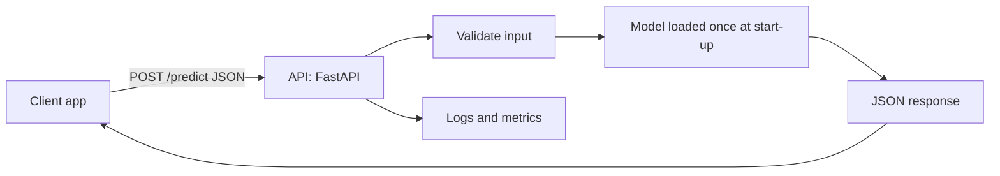

# Session 11: Deploying NLP Applications to Production

> Module: Next-Gen NLP Applications with AI · Term 6 (AI) · ⏱ ~2 hours

A model that only runs in your notebook helps nobody. **Deployment** means putting your NLP model or LLM feature behind a reliable service that websites, mobile apps and other programs can call, every day, for many users. In this session you save a trained model, wrap it in a REST API (with FastAPI and with plain Python), test it, package it with Docker, and learn what it takes to keep it healthy in production.

## 🎯 Learning Objectives

By the end of this session you will be able to:

- Describe the path from notebook to production and the main deployment options
- Save and load a trained scikit-learn pipeline with `joblib`
- Build a REST API for an NLP model with FastAPI, including input validation and a health check
- Test an API from Python and handle errors with correct HTTP status codes
- Package an app with Docker and explain environment variables for secrets
- Plan monitoring, scaling and cost control for NLP and LLM services

## 📖 Concepts Explained

### 1. From notebook to production

| Notebook / prototype | Production |
|---|---|
| Runs once, by you | Runs all day, for many users |
| Data in memory, model retrained each run | Model trained once, saved, loaded at start-up |
| Errors are fine | Errors must be handled and logged |
| Secrets typed in code | Secrets in environment variables or a secret manager |
| "Works on my laptop" | Same environment everywhere (requirements file, container) |

### 2. Deployment options

| Option | What it is | Good for |
|---|---|---|
| REST API on a server or VM | Your app runs as a web service (FastAPI + Uvicorn) | Most NLP apps |
| Container platform | The API in a Docker container on a managed service (e.g. Azure Container Apps, Google Cloud Run, AWS App Runner) | Easy scaling, repeatable deploys |
| Serverless function | Code runs only when called (Azure Functions, AWS Lambda) | Small, occasional workloads |
| Managed model hosting | Platform hosts the model for you (Hugging Face Inference Endpoints, Azure ML) | Large transformer models on GPUs |
| Demo apps | Gradio or Streamlit UI, e.g. on Hugging Face Spaces | Portfolios, quick demos |
| Batch jobs | Process a whole file or table on a schedule | Nightly classification of tickets |
| On-device / edge | Small or quantized model on a phone or browser | Privacy, offline use |

### 3. Anatomy of an NLP API



Key ideas:

- **Load the model once**, not on every request; loading can take seconds.
- **Validate input**: type, empty text, maximum length. Bad input returns **400**, server faults return **500**.
- **Health endpoint** (`GET /health`) lets the platform check the app is alive.
- **JSON in, JSON out**, with a fixed schema clients can rely on.
- **Version** your model and API (`/v1/predict`) so you can update without breaking clients.

### 4. Containers and configuration

A **Docker image** bundles your code, Python version and libraries so the app runs the same on any machine. A `Dockerfile` lists the steps; `docker build` creates the image and `docker run` starts a container.

Configuration that changes between environments (API keys, model names, database URLs) goes in **environment variables**, never in the code or the Git repository.

### 5. Deploying LLM-powered features

When your app calls an LLM API instead of a local model, new concerns appear:

| Concern | Practice |
|---|---|
| Cost per token | Cache repeated answers, keep prompts short, choose a smaller model where possible |
| Latency | Stream tokens to the user, set timeouts, run independent calls in parallel |
| Rate limits and outages | Retry with exponential back-off, have a fallback model or a friendly error |
| Quality drift | Keep a test set of prompts and re-run it when the model or prompt changes |
| Safety | Input and output filters, logging, human review for risky actions (Session 12) |

### 6. MLOps: keeping it healthy

- **Monitoring**: request count, error rate, latency (p50/p95), token usage and cost.
- **Data drift**: live text slowly differs from training text (new slang, new products); watch confidence scores and sample predictions.
- **Feedback loop**: let users flag wrong answers and use them to improve the model.
- **CI/CD**: automatic tests and deployment on every push (e.g. GitHub Actions).
- **Scaling**: run several copies (replicas) behind a load balancer; use GPUs only when needed.
- **Rollback**: keep the previous model version ready in case the new one performs worse.

## 💻 Code Examples

Install: `pip install scikit-learn joblib fastapi "uvicorn[standard]"`. Run Example 1 first to create `sentiment_model.joblib`. Example 4 needs no installs beyond scikit-learn and joblib.

### Example 1: Train once and save the model

📄 Saved in this folder as [`train_and_save_model.py`](train_and_save_model.py).

```python
"""Session 11 - Example 1: train a small sentiment model and save it to a file.

In production we train ONCE, save the model, and load the saved file in
the web API. Here: TF-IDF + Logistic Regression in one scikit-learn Pipeline.
Install: pip install scikit-learn joblib
Run:     python train_and_save_model.py   -> creates sentiment_model.joblib
"""
import joblib
from sklearn.feature_extraction.text import TfidfVectorizer
from sklearn.linear_model import LogisticRegression
from sklearn.pipeline import Pipeline

# Step 1: a small labelled dataset (1 = positive, 0 = negative)
texts = [
    "I love this course", "The teacher explains very well", "Great labs and helpful staff",
    "Amazing experience, highly recommended", "The notes are clear and useful",
    "Very bad service", "The class was boring and too long", "I hate the late timings",
    "Terrible internet in the lab", "The fee is too high for this quality",
]
labels = [1, 1, 1, 1, 1, 0, 0, 0, 0, 0]

# Step 2: a pipeline keeps the text-to-numbers step and the classifier together
model = Pipeline([
    ("tfidf", TfidfVectorizer(ngram_range=(1, 2))),
    ("classifier", LogisticRegression()),
])

# Step 3: train
model.fit(texts, labels)

# Step 4: save the whole pipeline in one file
joblib.dump(model, "sentiment_model.joblib")
print("Saved sentiment_model.joblib")

# Step 5: quick check that the saved model works after loading
loaded = joblib.load("sentiment_model.joblib")
print(loaded.predict(["the staff is helpful", "boring and bad"]))
```

**How it works**

- A `Pipeline` bundles TF-IDF and the classifier, so raw text goes in and a label comes out.
- `joblib.dump` saves the whole trained pipeline; `joblib.load` restores it in another program.
- The tiny dataset gives low confidence scores; real projects use hundreds or thousands of examples.

### Example 2: A reusable prediction function

📄 Saved in this folder as [`predict.py`](predict.py).

```python
"""Session 11 - Example 2: one small function that the API will call.

Keeping prediction logic in its own file means the web server, tests and
command line can all reuse it.
Run: python predict.py "the labs are great"
"""
import sys
import joblib

MAX_CHARS = 1000                                 # reject very long inputs
_model = None                                    # loaded once, then reused

def get_model():
    """Load the model the first time it is needed (lazy loading)."""
    global _model
    if _model is None:
        _model = joblib.load("sentiment_model.joblib")
    return _model

def predict_sentiment(text):
    """Return a dictionary that is easy to turn into JSON."""
    # Step 1: validate the input
    if not isinstance(text, str) or not text.strip():
        raise ValueError("text must be a non-empty string")
    if len(text) > MAX_CHARS:
        raise ValueError(f"text must be at most {MAX_CHARS} characters")

    # Step 2: predict the label and its probability
    model = get_model()
    probability_positive = float(model.predict_proba([text])[0][1])
    label = "positive" if probability_positive >= 0.5 else "negative"
    return {"text": text, "label": label, "confidence": round(max(probability_positive, 1 - probability_positive), 3)}

if __name__ == "__main__":
    sentence = sys.argv[1] if len(sys.argv) > 1 else "the teacher is very helpful"
    print(predict_sentiment(sentence))
```

**How it works**

- The model is loaded only once and kept in `_model` for later calls.
- Input is checked for type, emptiness and length, raising `ValueError` with a clear message.
- The result is a plain dictionary, ready to become a JSON response.

### Example 3: REST API with FastAPI

📄 Saved in this folder as [`app_fastapi.py`](app_fastapi.py).

```python
"""Session 11 - Example 3: serve the model as a REST API with FastAPI.

Install: pip install fastapi "uvicorn[standard]" scikit-learn joblib
Run:     uvicorn app_fastapi:app --reload
Open:    http://127.0.0.1:8000/docs   (interactive docs to test the API)
"""
from fastapi import FastAPI, HTTPException
from pydantic import BaseModel
from predict import predict_sentiment

app = FastAPI(title="Sentiment API", version="1.0")

# Step 1: describe the JSON body we expect: {"text": "..."}
class Review(BaseModel):
    text: str

# Step 2: a health check so servers and load balancers know the app is alive
@app.get("/health")
def health():
    return {"status": "ok"}

# Step 3: the prediction endpoint
@app.post("/predict")
def predict(review: Review):
    try:
        return predict_sentiment(review.text)
    except ValueError as error:                      # bad input -> HTTP 400
        raise HTTPException(status_code=400, detail=str(error))
```

**How it works**

- `Review` (a Pydantic model) validates that the body contains a `text` string.
- `/health` returns a simple status; `/predict` returns the prediction as JSON.
- `ValueError` becomes an HTTP 400 response instead of a server crash.
- FastAPI creates interactive documentation at `/docs` automatically.

### Example 4: The same API with only the standard library

📄 Saved in this folder as [`app_stdlib.py`](app_stdlib.py).

```python
"""Session 11 - Example 4: the same API with ONLY the Python standard library.

Useful when you cannot install FastAPI. Good for learning; for real
production use FastAPI (Example 3) behind a proper server.
Run:  python app_stdlib.py      then in another terminal: python test_api.py
"""
import json
from http.server import BaseHTTPRequestHandler, HTTPServer
from predict import predict_sentiment

class Handler(BaseHTTPRequestHandler):
    def send_json(self, status, data):
        """Helper: send a Python dictionary as a JSON response."""
        body = json.dumps(data).encode("utf-8")
        self.send_response(status)
        self.send_header("Content-Type", "application/json")
        self.send_header("Content-Length", str(len(body)))
        self.end_headers()
        self.wfile.write(body)

    def do_GET(self):                                # GET /health
        if self.path == "/health":
            self.send_json(200, {"status": "ok"})
        else:
            self.send_json(404, {"error": "not found"})

    def do_POST(self):                               # POST /predict
        if self.path != "/predict":
            self.send_json(404, {"error": "not found"})
            return
        length = int(self.headers.get("Content-Length", 0))
        try:
            data = json.loads(self.rfile.read(length))
            self.send_json(200, predict_sentiment(data.get("text")))
        except (ValueError, AttributeError) as error:   # bad JSON or bad text
            self.send_json(400, {"error": str(error)})

if __name__ == "__main__":
    print("Serving on http://127.0.0.1:8000  (Ctrl+C to stop)")
    HTTPServer(("127.0.0.1", 8000), Handler).serve_forever()
```

**How it works**

- `BaseHTTPRequestHandler` gives us `do_GET` and `do_POST` methods for each request type.
- `send_json` sets the status, headers and body in one place.
- Unknown paths return 404 and bad input returns 400, the same contract as the FastAPI version.

### Example 5: Testing the API

📄 Saved in this folder as [`test_api.py`](test_api.py).

```python
"""Session 11 - Example 5: call the running API and check the answers.

Start the server first (app_fastapi.py with uvicorn, or app_stdlib.py).
Run: python test_api.py
"""
import json
import urllib.error
import urllib.request

BASE_URL = "http://127.0.0.1:8000"

def post_json(path, data):
    """Send a JSON POST request and return (status code, response dictionary)."""
    request = urllib.request.Request(
        BASE_URL + path,
        data=json.dumps(data).encode("utf-8"),
        headers={"Content-Type": "application/json"},
        method="POST",
    )
    try:
        with urllib.request.urlopen(request, timeout=5) as response:
            return response.status, json.loads(response.read())
    except urllib.error.HTTPError as error:          # 4xx and 5xx responses
        return error.code, json.loads(error.read())

# Step 1: health check
with urllib.request.urlopen(BASE_URL + "/health", timeout=5) as response:
    print("health:", json.loads(response.read()))

# Step 2: a normal request
print(post_json("/predict", {"text": "The labs are great and the staff is helpful"}))

# Step 3: a bad request should return status 400, not crash the server
print(post_json("/predict", {"text": ""}))
```

**How it works**

- `urllib.request` sends JSON to the server without extra libraries.
- `HTTPError` is caught so a 400 response can be read and printed.
- The last call proves the server handles bad input gracefully. (If you use a company proxy and get odd errors, set `NO_PROXY=127.0.0.1,localhost`.)

### Example 6: Docker packaging

📄 Saved in this folder as [`requirements.txt`](requirements.txt).

```text
scikit-learn>=1.4
joblib>=1.3
fastapi>=0.110
uvicorn[standard]>=0.29
```

📄 Saved in this folder as [`Dockerfile`](Dockerfile).

```dockerfile
# Session 11 - Example 6: package the API in a Docker container
# Build: docker build -t sentiment-api .
# Run:   docker run -p 8000:8000 sentiment-api

# Step 1: start from a small official Python image
FROM python:3.12-slim

# Step 2: work inside /app
WORKDIR /app

# Step 3: install dependencies first (Docker caches this layer)
COPY requirements.txt .
RUN pip install --no-cache-dir -r requirements.txt

# Step 4: copy the code and train the model inside the image
COPY train_and_save_model.py predict.py app_fastapi.py ./
RUN python train_and_save_model.py

# Step 5: start the web server on port 8000
EXPOSE 8000
CMD ["uvicorn", "app_fastapi:app", "--host", "0.0.0.0", "--port", "8000"]
```

**How it works**

- `requirements.txt` pins minimum versions so every environment installs compatible libraries.
- The Dockerfile installs dependencies first so Docker can cache that layer and rebuild faster.
- The model is trained during the build, and Uvicorn listens on `0.0.0.0:8000` so the container is reachable from outside.

## 🧪 Lab Practice

1. Run Example 1, then start the API with `uvicorn app_fastapi:app --reload` and test `/predict` from the `/docs` page.
2. Add 10 more training sentences to Example 1, retrain, and compare the confidence scores.
3. Add a `/v1/predict-batch` endpoint that accepts a list of texts and returns a list of results.
4. Add timing to `predict_sentiment` (use `time.perf_counter()`) and return `latency_ms` in the response.
5. If Docker is installed, build and run the container and call it with `test_api.py`.

## 📝 Assignment

Deploy your RAG bot from Session 07 as an API. Create `POST /ask` that accepts `{"question": "..."}` and returns `{"answer": ..., "sources": [...]}`, plus `GET /health`. Read the OpenAI key from an environment variable with mock fallback, reject questions longer than 500 characters, log every request with its latency to a file, and include a `requirements.txt`, a `Dockerfile` and a test script. Bonus: deploy it on a free platform and share the URL.

## ❓ Quick Quiz

**Q1.** Why should the model be loaded once instead of on every request?

<details><summary>Show answer</summary>

Loading is slow and uses memory; loading once at start-up keeps each request fast.

</details>

**Q2.** Which HTTP status code should an empty `text` field return?

<details><summary>Show answer</summary>

400 Bad Request, because the client sent invalid input.

</details>

**Q3.** What is the purpose of a `/health` endpoint?

<details><summary>Show answer</summary>

It lets hosting platforms and load balancers check that the service is running.

</details>

**Q4.** Where should API keys be stored in production?

<details><summary>Show answer</summary>

In environment variables or a secret manager, never in source code or Git.

</details>

**Q5.** What is data drift?

<details><summary>Show answer</summary>

When live input data gradually becomes different from the training data, which can reduce model accuracy.

</details>

## 💼 Interview Questions

**1. How would you reduce the cost of an LLM feature with many users?**

<details><summary>Model answer</summary>

Cache frequent answers, shorten prompts and retrieved context, route easy requests to a smaller model, limit output length, batch background work, and monitor token usage per feature.

</details>

**2. What would you monitor after deploying a text classifier?**

<details><summary>Model answer</summary>

Latency, error rate and traffic; the distribution of predicted labels and confidence over time; samples of real inputs for drift; and user feedback or periodic labelled checks of accuracy.

</details>

**3. Why use Docker for an ML API?**

<details><summary>Model answer</summary>

It packages the code, Python version and dependencies into one image, so the app behaves the same on a laptop, a test server and in the cloud, and it is easy to scale and roll back.

</details>

## ✅ Summary

- Production NLP needs saved models, stable APIs, error handling and secrets kept out of code.
- FastAPI makes a validated, documented REST API in a few lines; the standard library can do it too.
- Docker gives the same environment everywhere; environment variables hold configuration.
- LLM features add cost, latency, rate-limit and quality-drift concerns.
- Monitor, collect feedback and keep a rollback plan.

---

[⬅ Previous](../Session-10-Speech-AI-with-Whisper-and-TTS/README.md) · [🏠 Module Home](../README.md) · [Next ➡](../Session-12-Ethics-Bias-and-Safety-in-LLMs/README.md)

Prepared by Zeeshan Abbas · Aptech Learning North Nazimabad
