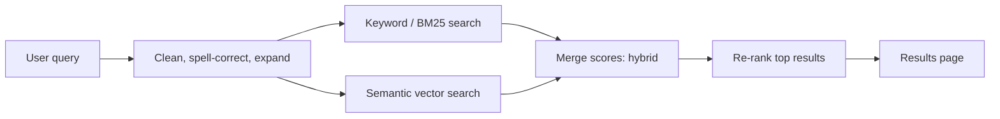

# Session 13: Intelligent Search and Recommendation Systems

> Module: Next-Gen NLP Applications with AI · Term 6 (AI) · ⏱ ~2 hours

Every time you search on Daraz, scroll YouTube or get a "you may also like" email, two AI systems are at work: **search** (finding what you asked for) and **recommendation** (suggesting what you did not ask for but will probably like). NLP made both far smarter: search now understands meaning, not just keywords, and recommenders can read product descriptions and reviews. This session builds both from scratch on a small course catalogue, and prepares you for the recommendation engine in your Term 6 capstone.

## 🎯 Learning Objectives

By the end of this session you will be able to:

- Explain the difference between keyword, TF-IDF/BM25 and semantic (embedding) search
- Build a ranked search engine with TF-IDF and cosine similarity
- Describe how semantic and hybrid search improve results, and where re-ranking fits
- Build a content-based recommender from item descriptions
- Build a user-based collaborative filtering recommender from a ratings matrix
- Evaluate search and recommendations, and handle the cold-start problem

## 📖 Concepts Explained

### 1. Search: three generations

| Generation | How it matches | Weakness |
|---|---|---|
| Keyword (boolean) | Document contains the query words | No ranking; misses synonyms; matches on common words |
| TF-IDF / BM25 | Weighs words: frequent in this document, rare in others = important | Still needs the same words ("websites" ≠ "web pages") |
| Semantic (dense) | Compares embedding vectors that capture meaning | Can miss exact codes, names and rare terms |

**TF-IDF** = Term Frequency × Inverse Document Frequency. "Python" appearing in only 3 of 8 courses gets a higher weight than "learn" appearing everywhere. **BM25** is an improved version used by search engines like Elasticsearch and OpenSearch.

**Hybrid search** combines a keyword score and a semantic score, getting exact matches *and* paraphrases. A **re-ranker** (a cross-encoder model that reads the query and each candidate together) can then re-order the top 20-50 results for higher precision.



### 2. Query understanding

Smart search engines also work on the query itself: **spelling correction** ("pyhton" → "python"), **synonym expansion**, **intent detection** (is "react" a course or a verb?), **entity extraction** (city, price range) and, with LLMs, **query rewriting** ("cheap course for kids coding" → filters plus keywords).

### 3. Recommendation systems

| Type | Idea | Needs | Example |
|---|---|---|---|
| Popularity | Recommend what is most popular | Counts only | "Top 10 courses this month" |
| Content-based | Recommend items **similar to items the user liked** | Item descriptions or features | "Because you liked Python for Beginners..." |
| Collaborative filtering | Recommend what **similar users** liked | User-item interactions (ratings, clicks, purchases) | "Students like you also took..." |
| Hybrid | Combine the above | Both | Most real platforms |
| LLM / sequence-based | Model the order of actions or describe items with LLMs | Large interaction logs | Next-video prediction |

### 4. Collaborative filtering in detail

Start with a **user-item matrix**: rows are users, columns are items, values are ratings (0 = unknown).

1. Measure how similar the target user is to every other user (cosine similarity of their rating rows).
2. For each item the target has not rated, predict a score as the **similarity-weighted average** of other users' ratings.
3. Recommend the items with the highest predicted scores.

Large systems use **matrix factorization**: they learn a short "taste vector" for each user and each item so that their dot product predicts the rating. This handles millions of users and fills in the very sparse matrix.

### 5. Challenges

| Challenge | Meaning | Common fix |
|---|---|---|
| Cold start | New user or new item has no history | Use content features, ask for preferences, show popular items |
| Sparsity | Most users rate very few items | Matrix factorization, implicit feedback (views, clicks) |
| Filter bubble | Users only see more of the same | Add diversity and some exploration |
| Popularity bias | Popular items dominate | Re-balance, boost long-tail items |
| Privacy | Behaviour data is personal | Consent, anonymization, data minimization |

### 6. Evaluation

| System | Metric | Meaning |
|---|---|---|
| Search | Precision@k | Of the top k results, how many are relevant? |
| Search | Recall@k | Of all relevant documents, how many are in the top k? |
| Search | MRR | How high is the first relevant result? (1/rank, averaged) |
| Recommender | RMSE | Error of predicted vs actual ratings |
| Recommender | Hit rate@k | Did the item the user actually chose appear in our top k? |
| Both (online) | Click-through rate, A/B tests | Real user behaviour |

## 💻 Code Examples

Install: `pip install scikit-learn numpy` (and optionally `sentence-transformers` for Example 3). All examples share the catalogue in [`courses.py`](courses.py).

📄 Saved in this folder as [`courses.py`](courses.py).

```python
"""Session 13 - shared sample data: a small course catalogue.

Every example imports COURSES from here so they all use the same data.
"""
COURSES = [
    {"id": 1, "title": "Python for Beginners", "text": "Learn Python basics: variables, loops, functions and lists."},
    {"id": 2, "title": "Machine Learning with scikit-learn", "text": "Train classification and regression models in Python with scikit-learn."},
    {"id": 3, "title": "Deep Learning with PyTorch", "text": "Build neural networks for images and text with PyTorch."},
    {"id": 4, "title": "Web Design with HTML and CSS", "text": "Create responsive web pages and websites using HTML, CSS and Bootstrap."},
    {"id": 5, "title": "React Front-End Development", "text": "Build interactive web pages and user interfaces with React components and hooks."},
    {"id": 6, "title": "NLP and Chatbots", "text": "Process text, build chatbots and use large language models in Python."},
    {"id": 7, "title": "Data Analysis with pandas", "text": "Clean, analyse and visualise data tables in Python with pandas and Matplotlib."},
    {"id": 8, "title": "Digital Marketing Basics", "text": "Plan SEO, social media marketing and online advertising campaigns."},
]
```

### Example 1: Keyword search

📄 Saved in this folder as [`keyword_search.py`](keyword_search.py).

```python
"""Session 13 - Example 1: the simplest search - count matching words.

Run: python keyword_search.py
"""
from courses import COURSES

def keyword_search(query, top_k=3):
    query_words = set(query.lower().split())
    results = []
    for course in COURSES:
        # Step 1: put title and description together and split into words
        course_words = set((course["title"] + " " + course["text"]).lower().replace(",", "").replace(".", "").split())
        # Step 2: score = how many query words appear in the course
        score = len(query_words & course_words)
        if score > 0:
            results.append((score, course["title"]))
    # Step 3: highest score first
    results.sort(reverse=True)
    return results[:top_k]

for query in ["python models", "build websites", "teach a computer to talk"]:
    print(f"\nQuery: {query}")
    print(keyword_search(query) or "  no results")
```

**How it works**

- The score is the number of query words that appear in a course, computed with a set intersection (`&`).
- "build websites" partly works, but courses with "build" tie with the web courses, and "teach a computer to talk" finds nothing.

### Example 2: TF-IDF ranked search

📄 Saved in this folder as [`tfidf_search.py`](tfidf_search.py).

```python
"""Session 13 - Example 2: ranked search with TF-IDF and cosine similarity.

Rare, specific words (like "pytorch") count more than common ones (like "learn").
Install: pip install scikit-learn
Run:     python tfidf_search.py
"""
from sklearn.feature_extraction.text import TfidfVectorizer
from sklearn.metrics.pairwise import cosine_similarity
from courses import COURSES

# Step 1: one document per course
documents = [c["title"] + ". " + c["text"] for c in COURSES]

# Step 2: build the TF-IDF index
vectorizer = TfidfVectorizer(stop_words="english")
index = vectorizer.fit_transform(documents)

def search(query, top_k=3):
    # Step 3: turn the query into a vector and compare with every course
    scores = cosine_similarity(vectorizer.transform([query]), index)[0]
    ranked = scores.argsort()[::-1][:top_k]
    return [(round(float(scores[i]), 3), COURSES[i]["title"]) for i in ranked if scores[i] > 0]

for query in ["python models", "build websites", "teach a computer to talk"]:
    print(f"\nQuery: {query}")
    print(search(query) or "  no results")
```

**How it works**

- `TfidfVectorizer` gives each word a weight; English stop words are removed.
- Cosine similarity ranks every course; the specific word "websites" now pushes Web Design to the top.
- It still cannot match "talk" to "chatbots", because no words are shared.

### Example 3: Semantic search with a fallback

📄 Saved in this folder as [`semantic_search.py`](semantic_search.py).

```python
"""Session 13 - Example 3: semantic search (meaning, not exact words).

Uses sentence-transformers if installed. Otherwise it falls back to
TF-IDF with a small synonym list, so the script always runs.
Install (optional): pip install sentence-transformers
Run: python semantic_search.py
"""
import numpy as np
from courses import COURSES

documents = [c["title"] + ". " + c["text"] for c in COURSES]
query = "teach a computer to talk with people"

try:
    # Option A: real embeddings
    from sentence_transformers import SentenceTransformer
    model = SentenceTransformer("all-MiniLM-L6-v2")
    doc_vectors = model.encode(documents, normalize_embeddings=True)
    query_vector = model.encode([query], normalize_embeddings=True)[0]
    scores = doc_vectors @ query_vector
    mode = "embeddings"
except ImportError:
    # Option B: fallback - expand the query with synonyms, then TF-IDF
    from sklearn.feature_extraction.text import TfidfVectorizer
    from sklearn.metrics.pairwise import cosine_similarity
    SYNONYMS = {"talk": "chatbots language text", "computer": "models", "websites": "web pages"}
    expanded = query + " " + " ".join(SYNONYMS.get(w, "") for w in query.split())
    vectorizer = TfidfVectorizer(stop_words="english")
    index = vectorizer.fit_transform(documents)
    scores = cosine_similarity(vectorizer.transform([expanded]), index)[0]
    mode = "TF-IDF + synonyms (install sentence-transformers for real embeddings)"

print("Mode :", mode)
print("Query:", query)
for i in np.argsort(scores)[::-1][:3]:
    print(f"  {scores[i]:.3f}  {COURSES[i]['title']}")
```

**How it works**

- With `sentence-transformers`, documents and query become meaning vectors, so "talk with people" finds the chatbot course.
- Without it, a tiny synonym dictionary expands the query before TF-IDF, showing how query expansion helps.

### Example 4: Content-based recommender

📄 Saved in this folder as [`content_recommender.py`](content_recommender.py).

```python
"""Session 13 - Example 4: content-based recommendations ("more like this").

If a student liked one course, recommend courses whose DESCRIPTIONS are similar.
Install: pip install scikit-learn
Run:     python content_recommender.py
"""
from sklearn.feature_extraction.text import TfidfVectorizer
from sklearn.metrics.pairwise import cosine_similarity
from courses import COURSES

# Step 1: vectors for every course description
documents = [c["title"] + ". " + c["text"] for c in COURSES]
vectors = TfidfVectorizer(stop_words="english").fit_transform(documents)

# Step 2: course-to-course similarity table (8 x 8)
similarity = cosine_similarity(vectors)

def recommend(course_id, top_k=3):
    row = course_id - 1                               # ids start at 1, rows at 0
    ranked = similarity[row].argsort()[::-1]
    picks = [i for i in ranked if i != row][:top_k]   # skip the course itself
    return [(round(float(similarity[row][i]), 2), COURSES[i]["title"]) for i in picks]

for liked in [1, 4]:
    print(f"\nBecause you liked '{COURSES[liked - 1]['title']}':")
    for score, title in recommend(liked):
        print(f"  {score:.2f}  {title}")
```

**How it works**

- A full course-to-course similarity table is computed once with `cosine_similarity(vectors)`.
- For a liked course, the most similar other courses are recommended (the course itself is skipped).
- Scores of 0.00 show items with no shared words; in a real system you would hide them or add other features.

### Example 5: Collaborative filtering

📄 Saved in this folder as [`collaborative_filtering.py`](collaborative_filtering.py).

```python
"""Session 13 - Example 5: collaborative filtering ("students like you also took...").

No text needed: we only use who rated what. Similar users -> similar tastes.
Install: pip install numpy
Run:     python collaborative_filtering.py
"""
import numpy as np

courses = ["Python", "ML", "Deep Learning", "HTML/CSS", "React", "NLP"]
students = ["Ali", "Sana", "Bilal", "Hira", "Usman"]

# Step 1: ratings matrix (rows = students, columns = courses), 0 = not taken yet
ratings = np.array([
    [5, 4, 0, 1, 0, 5],   # Ali
    [4, 5, 5, 0, 1, 4],   # Sana
    [1, 0, 0, 5, 5, 0],   # Bilal
    [0, 1, 1, 4, 5, 1],   # Hira
    [5, 0, 4, 0, 0, 0],   # Usman  <- we recommend for him
])

def cosine(a, b):
    return a @ b / (np.linalg.norm(a) * np.linalg.norm(b))

target = students.index("Usman")

# Step 2: how similar is Usman to every other student?
similarities = []
for i in range(len(students)):
    if i != target:
        similarities.append((float(cosine(ratings[target], ratings[i])), i))
similarities.sort(reverse=True)
print("Most similar students:", [(students[i], round(s, 2)) for s, i in similarities])

# Step 3: predict Usman's rating for each course he has NOT taken
#         = weighted average of other students' ratings (weights = similarity)
predictions = {}
for c in range(len(courses)):
    if ratings[target, c] == 0:
        weighted_sum = sum(s * ratings[i, c] for s, i in similarities if ratings[i, c] > 0)
        weight_total = sum(s for s, i in similarities if ratings[i, c] > 0)
        predictions[courses[c]] = weighted_sum / weight_total if weight_total else 0

# Step 4: recommend the highest predicted ratings
for course, score in sorted(predictions.items(), key=lambda item: item[1], reverse=True):
    print(f"Predicted rating for {course:<9}: {score:.2f}")
```

**How it works**

- Usman's rating row is compared with every other student's row using cosine similarity; Sana is most similar.
- Each untaken course gets a predicted rating, weighted towards similar students' opinions.
- ML and NLP are recommended because the students most like Usman rated them highly; no course text was used at all.

## 🧪 Lab Practice

1. Add three new courses to `courses.py` and test all five examples again.
2. Implement Precision@3 for `tfidf_search.py` using five queries and your own list of relevant course ids.
3. In `semantic_search.py`, add synonyms so that "make mobile apps" finds a sensible course (add a Flutter course first).
4. In `collaborative_filtering.py`, add yourself as a student with three ratings and get your recommendations.
5. Build a hybrid score: `0.5 * content_score + 0.5 * popularity_score` and compare the ranking with Example 4.

## 📝 Assignment

Create `book_recommender.py` for a small library of 15 books (title, short description, genre) and 6 readers with ratings. Implement: (a) TF-IDF search over the books, (b) "more like this" content recommendations, (c) collaborative filtering for one reader, and (d) a cold-start rule for a new reader who has rated nothing. Print a short report comparing the three recommendation outputs.

## ❓ Quick Quiz

**Q1.** Why does TF-IDF give a low weight to a word like "learn" in this catalogue?

<details><summary>Show answer</summary>

Because it appears in many documents, so its inverse document frequency is low; it does not help tell documents apart.

</details>

**Q2.** What is the difference between content-based and collaborative filtering?

<details><summary>Show answer</summary>

Content-based uses item features (such as descriptions) to find similar items; collaborative filtering uses the behaviour of similar users, without needing item content.

</details>

**Q3.** What is the cold-start problem?

<details><summary>Show answer</summary>

New users or items have no interaction history, so collaborative filtering cannot make good recommendations for them.

</details>

**Q4.** What does hybrid search combine?

<details><summary>Show answer</summary>

Keyword (lexical, e.g. BM25) scores and semantic (embedding) scores.

</details>

**Q5.** Top 5 results contain 3 relevant documents. What is Precision@5?

<details><summary>Show answer</summary>

3 / 5 = 0.6.

</details>

## 💼 Interview Questions

**1. How would you design search for an online store with 1 million products?**

<details><summary>Model answer</summary>

Index products in a search engine with BM25 plus a vector index for semantic search, merge them as hybrid search, add filters (price, brand, category), spelling correction and synonyms, re-rank the top results with a learned model using clicks and sales, and measure with offline metrics and A/B tests.

</details>

**2. How do you recommend items to a brand-new user?**

<details><summary>Model answer</summary>

Show popular or trending items, ask a few onboarding questions, use context such as location or the page they came from, and switch to personalised methods as soon as they click or buy something.

</details>

**3. Why can a recommender create a filter bubble, and how do you reduce it?**

<details><summary>Model answer</summary>

It keeps showing items similar to past behaviour, narrowing what users see. Reduce it by adding diversity constraints, occasional exploration of new items, and balancing relevance with novelty.

</details>

## ✅ Summary

- Search evolved from keyword matching to TF-IDF/BM25 to semantic embeddings; hybrid search and re-ranking combine their strengths.
- Query understanding (spelling, synonyms, intent, rewriting) improves results before searching.
- Content-based recommenders use item descriptions; collaborative filtering uses similar users' ratings.
- Cold start, sparsity, filter bubbles and privacy are the main practical challenges.
- Evaluate with Precision@k, Recall@k, MRR, RMSE, hit rate and real A/B tests.

---

[⬅ Previous](../Session-12-Ethics-Bias-and-Safety-in-LLMs/README.md) · [🏠 Module Home](../README.md) · [Next ➡](../Session-14-Domain-Specific-NLP-Healthcare-and-Finance/README.md)

Prepared by Zeeshan Abbas · Aptech Learning North Nazimabad
