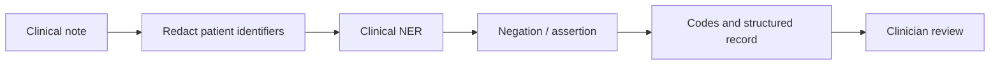

# Session 14: Domain-Specific NLP: Healthcare and Finance

> Module: Next-Gen NLP Applications with AI · Term 6 (AI) · ⏱ ~2 hours

General NLP models are trained mostly on everyday web text. Put them in a hospital or a stock exchange and they stumble: "positive" test results are bad news, "no fever" means the fever is absent, and "the bank cut rates" is not about scissors. **Domain-specific NLP** adapts language technology to the vocabulary, rules and risks of one field. In this session you work with two of the most valuable and most regulated domains: healthcare and finance.

## 🎯 Learning Objectives

By the end of this session you will be able to:

- Explain why general NLP models fail on domain text and how domain adaptation helps
- Extract medicines, doses and symptoms from clinical notes and detect negation
- Describe key healthcare NLP applications and their privacy and safety rules
- Measure financial sentiment with a domain word list and classify financial news
- Describe key finance NLP applications and their regulatory and risk concerns
- Design a domain-safe LLM prompt with redaction and strict rules

## 📖 Concepts Explained

### 1. Why domains are different

| Challenge | Healthcare example | Finance example |
|---|---|---|
| Special vocabulary | "HbA1c", "MI", "b.i.d." | "basis points", "EBITDA", "T-bills" |
| Same word, new meaning | "positive" test = disease found | "liability" is an accounting term, not always bad |
| Abbreviations | "SOB" = shortness of breath | "EPS", "YoY", "KSE-100" |
| Negation and uncertainty | "no evidence of pneumonia", "rule out MI" | "may not meet guidance" |
| Numbers matter | 500 mg vs 50 mg | 1.5% vs 15% |
| High stakes and regulation | Patient safety, medical privacy laws | Market rules, anti-fraud and audit requirements |

### 2. How to adapt NLP to a domain

| Approach | Description | Example |
|---|---|---|
| Domain dictionaries and rules | Curated term lists and patterns | Drug lists, finance sentiment word lists |
| Domain pre-trained models | Models trained further on domain text | BioBERT, ClinicalBERT (medicine), FinBERT (finance) |
| Fine-tuning | Train on labelled domain examples (Session 06) | Classify radiology reports |
| RAG over domain sources | Ground answers in guidelines, filings, policies (Session 07) | Answer from clinical guidelines or annual reports |
| Human in the loop | Experts review outputs before use | Doctor approves the generated summary |

### 3. Healthcare NLP

| Application | What it does |
|---|---|
| Clinical NER | Finds problems, medicines, doses, tests, body parts in notes |
| Negation and assertion detection | Present, absent, possible, family history ("mother had diabetes") |
| Clinical coding | Suggests ICD-10 diagnosis codes for billing and statistics |
| Summarization | Discharge summaries, patient-friendly explanations |
| Ambient documentation | Turns doctor-patient conversation (speech, Session 10) into notes |
| Triage chatbots | Ask about symptoms and suggest the level of care, never a final diagnosis |
| Pharmacovigilance | Detects reports of side effects in notes or social media |

**Negation** is critical. The NegEx idea: if a trigger word such as "no", "denies" or "without" appears a few words before a medical term in the same sentence, mark the term as absent.



**Rules for healthcare NLP:** protect patient privacy (consent, de-identification, access control; laws such as HIPAA in the US and GDPR in Europe), never let a model make final diagnoses or prescriptions on its own, prefer explainable outputs, and test on local data (Pakistani hospitals write notes differently from American ones, often mixing English and Urdu).

### 4. Finance NLP

| Application | What it does |
|---|---|
| Financial sentiment | Scores news, reports and social media as positive or negative for a company or market |
| News classification and event detection | Earnings, mergers, rate decisions, defaults |
| Document analysis | Extracts figures and risks from annual reports, prospectuses, loan files |
| KYC and compliance | Checks names against sanctions lists, reviews contracts and communications |
| Fraud and scam detection | Flags phishing messages and suspicious transaction descriptions |
| Customer service | Banking chatbots for balances, card blocking, complaints |
| Earnings call analysis | Transcribes calls and measures management tone |

**Why a finance word list?** General sentiment lists mark "liability", "tax" or "cost" as negative, but in reports they are neutral. Finance lists (such as the Loughran-McDonald dictionary) and models such as FinBERT were built from financial text and are more accurate.

**Rules for finance NLP:** outputs can move money, so they need audit trails, explainability for regulators, protection of customer data, strict checks of numbers, and clear disclaimers. Sentiment signals are one input to decisions, not investment advice.

### 5. LLMs in regulated domains

LLMs can draft summaries and answer questions, but in these domains you add extra layers:

1. **Redact** identifiers before text leaves your system.
2. **Strict prompts**: use only given facts, no new doses or figures, plain language, fixed format.
3. **Ground** answers in approved sources with citations (RAG).
4. **Validate** numbers and entities in code against the source.
5. **Human review** before anything reaches a patient or a client.

## 💻 Code Examples

Examples 1-3 use plain Python. Example 4 needs `pip install scikit-learn`. Example 5 uses [`llm_client.py`](llm_client.py) (mock answer without a key). All data is invented for teaching.

### Example 1: Medical entity extraction

📄 Saved in this folder as [`medical_entity_extractor.py`](medical_entity_extractor.py).

```python
"""Session 14 - Example 1: pull medicines, doses and symptoms out of a clinical note.

Uses a small dictionary + regular expressions. Real systems use trained
medical NER models (e.g. scispaCy) and large vocabularies.
Run: python medical_entity_extractor.py
"""
import re

# Step 1: small dictionaries of known terms (lower case)
MEDICINES = ["paracetamol", "amoxicillin", "metformin", "ibuprofen", "omeprazole"]
SYMPTOMS = ["fever", "cough", "headache", "chest pain", "nausea", "sore throat"]

# Step 2: a pattern for doses like "500 mg", "5 ml", "1 g"
DOSE_PATTERN = r"\b\d+(?:\.\d+)?\s?(?:mg|ml|g|mcg)\b"
# and for frequencies like "twice daily" or "every 8 hours"
FREQUENCY_PATTERN = r"\b(?:once|twice|three times) (?:a day|daily)\b|\bevery \d+ hours\b"

def extract(note):
    text = note.lower()
    return {
        "medicines": [m for m in MEDICINES if m in text],
        "symptoms": [s for s in SYMPTOMS if s in text],
        "doses": re.findall(DOSE_PATTERN, text),
        "frequency": re.findall(FREQUENCY_PATTERN, text),
    }

note = ("Patient has fever and sore throat for 3 days. No chest pain. "
        "Start Amoxicillin 500 mg three times a day and Paracetamol 1 g every 8 hours if needed.")

print("Note:", note, "\n")
for key, values in extract(note).items():
    print(f"{key:<10}: {values}")
```

**How it works**

- Dictionary lookups find known medicines and symptoms; regular expressions find doses and frequencies.
- Notice that "chest pain" is extracted even though the note says "No chest pain". Example 2 fixes this.

### Example 2: Negation detection

📄 Saved in this folder as [`negation_detection.py`](negation_detection.py).

```python
"""Session 14 - Example 2: is a symptom present or NEGATED?

"No chest pain" must not be recorded as chest pain! This is a tiny version
of the well-known NegEx idea: look for a negation word shortly BEFORE the term.
Run: python negation_detection.py
"""
import re

SYMPTOMS = ["fever", "cough", "headache", "chest pain", "nausea", "sore throat"]
NEGATION_WORDS = ["no", "denies", "without", "not", "negative for"]
WINDOW = 4          # how many words before the symptom we check

def symptom_status(note):
    results = {}
    for sentence in re.split(r"[.;]", note.lower()):          # Step 1: one sentence at a time
        words = sentence.split()
        for symptom in SYMPTOMS:
            if symptom not in sentence:
                continue
            # Step 2: find the word position where the symptom starts
            first_word = symptom.split()[0]
            position = words.index(first_word)
            # Step 3: look at the few words before it for a negation
            before = " ".join(words[max(0, position - WINDOW):position])
            negated = any(re.search(rf"\b{neg}\b", before) for neg in NEGATION_WORDS)
            results[symptom] = "ABSENT" if negated else "PRESENT"
    return results

note = "Patient reports fever and cough. Denies chest pain. No nausea or headache today."
print("Note:", note)
for symptom, status in symptom_status(note).items():
    print(f"  {symptom:<11} -> {status}")
```

**How it works**

- The note is split into sentences so a negation does not leak into the next sentence.
- For each symptom, the four words before it are checked for negation triggers.
- "No nausea or headache" marks both as absent, because "no" is within the window.

### Example 3: Financial sentiment

📄 Saved in this folder as [`finance_sentiment.py`](finance_sentiment.py).

```python
"""Session 14 - Example 3: financial sentiment with a domain word list.

General sentiment tools get finance wrong: "liability" or "debt" is not
always negative, and "beat estimates" is very positive. A finance-specific
word list gives better results. (Research uses lists like Loughran-McDonald
or models like FinBERT.)
Run: python finance_sentiment.py
"""

POSITIVE = ["profit", "growth", "beat", "record", "surge", "upgrade", "dividend", "gain", "strong"]
NEGATIVE = ["loss", "decline", "miss", "default", "downgrade", "lawsuit", "plunge", "weak", "fraud"]

def finance_sentiment(headline):
    words = headline.lower().replace(",", "").split()
    # Step 1: count positive and negative finance words (handles "losses" via startswith)
    pos = sum(1 for w in words for p in POSITIVE if w.startswith(p))
    neg = sum(1 for w in words for n in NEGATIVE if w.startswith(n))
    # Step 2: turn the counts into a label
    score = pos - neg
    if score > 0:
        return "positive", score
    if score < 0:
        return "negative", score
    return "neutral", score

headlines = [
    "Bank reports record profit and higher dividend",
    "Cement maker posts quarterly loss as demand declines",
    "Textile exporter beats estimates despite weak rupee",
    "Company announces board meeting date",
]
for h in headlines:
    label, score = finance_sentiment(h)
    print(f"{label:<8} ({score:+d})  {h}")
```

**How it works**

- Words are matched by prefix, so "declines" matches "decline" and "beats" matches "beat".
- The score is positives minus negatives. The third headline shows a limit: "beats" and "weak" cancel out, while a human reads it as positive because of "despite".

### Example 4: Financial news topic classifier

📄 Saved in this folder as [`financial_news_classifier.py`](financial_news_classifier.py).

```python
"""Session 14 - Example 4: train a classifier to label financial news topics.

Domain models learn from domain data. We train TF-IDF + Logistic Regression
on a few labelled headlines and predict new ones.
Install: pip install scikit-learn
Run:     python financial_news_classifier.py
"""
from sklearn.feature_extraction.text import TfidfVectorizer
from sklearn.linear_model import LogisticRegression
from sklearn.pipeline import make_pipeline

# Step 1: labelled training headlines (real projects use thousands)
train = [
    ("Central bank raises policy rate by 100 basis points", "monetary_policy"),
    ("State bank keeps interest rate unchanged", "monetary_policy"),
    ("Inflation slows, rate cut expected next month", "monetary_policy"),
    ("Oil company reports 20 percent rise in quarterly earnings", "earnings"),
    ("Bank profit falls on higher provisions", "earnings"),
    ("Fertilizer firm announces final dividend and earnings growth", "earnings"),
    ("Stock index hits all-time high in heavy trading", "markets"),
    ("Shares slide as investors book profits", "markets"),
    ("Rupee gains against the dollar in interbank market", "markets"),
]
texts = [t for t, _ in train]
labels = [label for _, label in train]

# Step 2: build and train the model
model = make_pipeline(TfidfVectorizer(ngram_range=(1, 2)), LogisticRegression(max_iter=1000))
model.fit(texts, labels)

# Step 3: predict topics for new headlines, with the model's confidence
new_headlines = [
    "Policy rate cut by 150 basis points",
    "Cement company earnings jump on strong sales",
    "Shares rally as index crosses new record",
]
for headline in new_headlines:
    probabilities = model.predict_proba([headline])[0]
    best = probabilities.argmax()
    print(f"{model.classes_[best]:<16} {probabilities[best]:.0%}  {headline}")
```

**How it works**

- TF-IDF with word pairs (`ngram_range=(1, 2)`) captures phrases like "basis points" and "policy rate".
- Logistic regression learns which words signal each topic; `predict_proba` gives the confidence.
- With only nine examples the confidence is low; more domain data raises it.

### Example 5: Domain-safe LLM summary

📄 Saved in this folder as [`clinical_summary_llm.py`](clinical_summary_llm.py).

```python
"""Session 14 - Example 5: a safer LLM prompt for a domain task.

We ask an LLM to turn a doctor's note into a patient-friendly summary.
Domain prompts need extra rules: no new facts, no diagnosis, plain words,
and a reminder to follow the doctor. A redaction step removes personal data.
Run: python clinical_summary_llm.py   (mock answer without OPENAI_API_KEY)
"""
import re
from llm_client import ask_llm

note = ("Mr. Imran Ali, MRN 445821, 52y. Type 2 diabetes. HbA1c 8.9%. "
        "Increase metformin to 1000 mg twice daily. Review in 3 months. Advise daily walk 30 min.")

# Step 1: remove direct identifiers before the text leaves our system
redacted = re.sub(r"\bMRN \d+\b", "MRN [ID]", note)
redacted = re.sub(r"\bMr\. [A-Z][a-z]+ [A-Z][a-z]+", "[PATIENT]", redacted)

# Step 2: a domain-safe prompt with clear rules
system = ("You explain medical notes to patients in simple English. Use ONLY facts in the note. "
          "Do not add diagnoses, doses or advice that are not in the note. "
          "End with: 'Please follow your doctor's advice and ask them if anything is unclear.'")
prompt = f"Rewrite this note for the patient in 4 short bullet points:\n{redacted}"

mock = ("- You have type 2 diabetes and your sugar test (HbA1c) is 8.9%, which is higher than the goal.\n"
        "- Your metformin dose is increased to 1000 mg, taken twice a day.\n"
        "- Walk for 30 minutes every day.\n"
        "- Come back for a check-up in 3 months.\n"
        "Please follow your doctor's advice and ask them if anything is unclear.")

print("Sent to the model:", redacted, "\n")
print(ask_llm(prompt, mock_answer=mock, system=system, temperature=0))
```

**How it works**

- Regular expressions replace the patient's name and record number before the prompt is built.
- The system prompt forbids new facts and requires a safety line at the end.
- In a real product, code would also check that every dose in the summary appears in the original note.

## 🧪 Lab Practice

1. Add five medicines and three symptoms to Example 1 and test it on a note you write yourself.
2. Extend `negation_detection.py` to detect **uncertainty** ("possible", "suspected", "rule out") and label those symptoms `POSSIBLE`.
3. Add a rule to `finance_sentiment.py` so that words after "despite" count less. Does the third headline become positive?
4. Add 6 more headlines and a new topic `mergers` to Example 4 and test new predictions.
5. In Example 5, add a check in Python that every number in the LLM reply also appears in the redacted note.

## 📝 Assignment

Choose **one** domain. **Healthcare**: build `discharge_helper.py` that reads 5 short invented discharge notes, extracts medicines, doses and present/absent symptoms, and writes a CSV. **Finance**: build `market_mood.py` that reads 15 invented headlines, scores sentiment, classifies the topic and prints a daily "market mood" summary per topic. In both cases add a `README.md` explaining the limitations and the privacy or regulatory risks.

## ❓ Quick Quiz

**Q1.** Why can a general sentiment model misread "The test came back positive"?

<details><summary>Show answer</summary>

In medicine "positive" usually means the disease or condition was found, which is bad news, while general models treat "positive" as a good word.

</details>

**Q2.** What does negation detection decide?

<details><summary>Show answer</summary>

Whether a mentioned medical term is actually present or is negated (absent), as in "denies chest pain".

</details>

**Q3.** Name one domain pre-trained model for finance and one for medicine.

<details><summary>Show answer</summary>

Finance: FinBERT. Medicine: BioBERT or ClinicalBERT.

</details>

**Q4.** Give two reasons finance NLP needs audit trails.

<details><summary>Show answer</summary>

Regulators may require explanations of automated decisions, and errors can cause financial loss, so decisions must be traceable and reviewable.

</details>

**Q5.** What should happen before an LLM-generated clinical summary reaches a patient?

<details><summary>Show answer</summary>

Identifiers are protected and a qualified clinician reviews and approves it, with numbers checked against the source.

</details>

## 💼 Interview Questions

**1. How would you adapt an NLP model to a new domain with little labelled data?**

<details><summary>Model answer</summary>

Start with a domain pre-trained model if one exists, add domain dictionaries and rules, use few-shot prompting or RAG over domain documents, label a small high-quality set with experts for evaluation and LoRA fine-tuning, and use active learning to label the most useful examples next.

</details>

**2. What are the main privacy steps for processing patient notes?**

<details><summary>Model answer</summary>

Get proper approval and consent, de-identify names, IDs, dates and addresses, restrict and log access, keep data in approved locations, avoid sending raw data to external services without agreements, and delete data when no longer needed.

</details>

**3. A sentiment signal from news is used in trading. What risks do you watch?**

<details><summary>Model answer</summary>

Misclassification of sarcasm or domain terms, fake or manipulated news, delays, overfitting to past data, and regulatory requirements. Use it as one signal among many, monitor accuracy and keep human oversight.

</details>

## ✅ Summary

- Domain text has special vocabulary, meanings, abbreviations and higher stakes.
- Adapt with dictionaries, domain models (BioBERT, FinBERT), fine-tuning, RAG and expert review.
- Healthcare NLP extracts clinical entities, detects negation and summarizes, under strict privacy rules.
- Finance NLP scores sentiment, classifies news and analyses documents, with audit and compliance needs.
- LLMs in regulated domains need redaction, strict prompts, validation and human approval.

---

[⬅ Previous](../Session-13-Intelligent-Search-and-Recommendation/README.md) · [🏠 Module Home](../README.md) · [Next ➡](../Session-15-Build-and-Deploy-Your-NLP-Application/README.md)

Prepared by Zeeshan Abbas · Aptech Learning North Nazimabad
