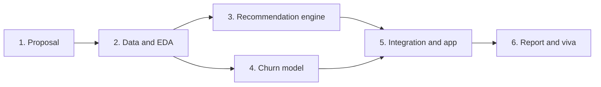

# Term 6 Capstone: Recommendation Engine and Customer Churn Prediction

     

> ACCP in AI · Term 6 · about 24 hours (mostly hands-on lab work) · individual or small team (confirm team size with your faculty)

The capstone is where you prove you can take a real business problem from raw data to a working AI product. You build **two connected solutions for one imaginary company**:

1. A **Recommendation Engine** that suggests the right products, courses or content to each customer.
2. A **Customer Churn Prediction** model that warns the business which customers are likely to leave.

Together they answer the two questions every subscription business asks: *"How do we keep customers happy?"* and *"Who are we about to lose?"* A good capstone links them: customers flagged as high churn risk receive personalised recommendations to win them back.

## 🎯 What You Will Demonstrate

- Framing a business problem as a machine learning task with clear success metrics
- Data collection, cleaning, exploration (EDA) and feature engineering with pandas
- Building and evaluating recommenders: popularity, content-based and collaborative filtering
- Building and evaluating classifiers for churn on imbalanced data
- Explaining model results to non-technical stakeholders
- Packaging models behind an API or a simple dashboard
- Responsible AI: fairness, privacy and honest limitations
- Professional documentation and presentation

## 🧭 Choose Your Scenario

Pick one company type, or propose your own with your faculty's approval. Use the same company for both parts.

| Scenario | Recommendation part | Churn part |
|---|---|---|
| Online learning platform | Recommend courses from enrolments and ratings | Predict students who will cancel their subscription |
| Telecom operator | Recommend data bundles and add-ons | Predict customers who will switch network |
| Food delivery app | Recommend restaurants and dishes | Predict users who will stop ordering |
| Streaming service | Recommend movies or songs | Predict members who will cancel |
| Online store | Recommend products ("customers also bought") | Predict customers who will not buy again in 90 days |

## 📦 Suggested Public Datasets

Use real public data, or generate a realistic synthetic dataset with Python and document how you created it.

| Dataset | Use | Link |
|---|---|---|
| MovieLens (small, 100k ratings) | Recommendation | https://grouplens.org/datasets/movielens/ |
| Telco Customer Churn (IBM sample data) | Churn | https://www.kaggle.com/datasets/blastchar/telco-customer-churn |
| UCI Online Retail II | Recommendation (purchases) and churn (inactivity) | https://archive.ics.uci.edu/dataset/502/online+retail+ii |
| Book-Crossing / Goodbooks-10k | Book recommendation | https://www.kaggle.com/datasets/zygmunt/goodbooks-10k |

Read each dataset's licence and cite it in your report.

## 🛠 Phases and Timeline



| Phase | Approx. hours | What you do | Output |
|---|---|---|---|
| 1. Proposal | 2 | Pick scenario and datasets, define users, goals and metrics | One-page proposal approved by faculty |
| 2. Data and EDA | 4 | Load, clean, handle missing values and duplicates, explore with charts | `01_eda.ipynb`, cleaned data, 5 key insights |
| 3. Recommendation engine | 6 | Popularity baseline → content-based → collaborative filtering; evaluate | `02_recommender.ipynb`, `recommender.py` |
| 4. Churn prediction | 6 | Features, train/test split, baseline → better models, handle imbalance, explain | `03_churn.ipynb`, saved model file |
| 5. Integration and app | 4 | API or dashboard: recommendations for a user + churn risk for a customer | `app/` folder that runs locally |
| 6. Report and viva | 2 | Write report, prepare slides and demo | `report.pdf`, slides, live demo |

## 🔍 Part A: Recommendation Engine

Build in layers so you always have something working:

1. **Popularity baseline**: top-N items by number of ratings or purchases (the fallback for new users).
2. **Content-based**: TF-IDF or embeddings of item descriptions, genres or tags; recommend items similar to what the user liked (Module 02, Session 13).
3. **Collaborative filtering**: user-based or item-based similarity on the user-item matrix; optionally matrix factorization (for example `TruncatedSVD` from scikit-learn).
4. **Hybrid (bonus)**: blend scores, for example `0.6 × collaborative + 0.4 × content`.

**Evaluate with:** Precision@10, Recall@10 or hit rate@10 on held-out interactions, RMSE if you predict ratings, plus coverage (how many different items you ever recommend). Show 2-3 example users with their history and recommendations.

**Handle:** cold start (new users and items), and avoid recommending items the user already has.

## 📉 Part B: Customer Churn Prediction

1. **Define churn clearly** (e.g. "no purchase in 90 days" or "cancelled subscription").
2. **Feature engineering**: tenure, monthly charges, number of complaints, last activity date (recency), frequency, total spend (RFM), contract type, support tickets.
3. **Baseline**: always predict "no churn", and a simple logistic regression.
4. **Better models**: decision tree, random forest or gradient boosting; tune with cross-validation.
5. **Imbalanced data**: churners are usually a minority, so use class weights or resampling and do not rely on accuracy alone.
6. **Explain**: feature importance (or permutation importance) and 3 plain-English insights the business can act on.

**Evaluate with:** confusion matrix, precision, recall, F1 and ROC-AUC. Explain your choice of threshold: missing a churner (false negative) usually costs more than contacting a happy customer (false positive).

## 🔗 Part C: Integration (bring it together)

Build **one** of these:

- A **FastAPI** service with `GET /recommend/{user_id}` and `POST /churn-risk` (JSON customer features → probability), plus `/health`.
- A **Streamlit** or simple web dashboard: choose a customer, see their churn risk and their top recommendations.

**Win-back idea (bonus):** for customers with churn risk above your threshold, generate a personalised offer using their recommendations, and optionally an LLM-written message (with mock fallback and a human review step).

## ✅ Deliverables Checklist

- [ ] Approved one-page proposal
- [ ] Clean, organised GitHub repository with the folder structure below
- [ ] `requirements.txt` and clear setup steps in `README.md`
- [ ] EDA notebook with charts and written insights
- [ ] Recommender notebook and reusable `recommender.py`, with evaluation results
- [ ] Churn notebook, saved model and evaluation (confusion matrix, F1, ROC-AUC)
- [ ] Working API or dashboard that loads the saved models
- [ ] At least 5 automatic tests (data checks, API responses)
- [ ] Final report (10-15 pages): problem, data, methods, results, business recommendations, limitations, ethics
- [ ] Slides (10-12) and a 10-minute live demo

## 🗂 Suggested Folder Structure

```text
capstone-<your-name>/
├── README.md               # overview, setup, how to run, results summary
├── requirements.txt
├── data/
│   ├── raw/                # original downloads (do not edit)
│   └── processed/          # cleaned files created by your code
├── notebooks/
│   ├── 01_eda.ipynb
│   ├── 02_recommender.ipynb
│   └── 03_churn.ipynb
├── src/
│   ├── data_prep.py        # cleaning and feature engineering
│   ├── recommender.py      # recommendation functions
│   └── churn_model.py      # training and prediction
├── models/                 # saved .joblib files
├── app/
│   └── main.py             # FastAPI or Streamlit app
├── tests/
│   └── test_app.py
└── docs/
    ├── report.pdf
    └── slides.pdf
```

Keep large datasets out of Git if they exceed GitHub's limits; add download instructions instead.

## 📊 How Your Work Is Judged (guide)

| Area | What reviewers look for |
|---|---|
| Problem framing | Clear business goal, sensible churn definition, right metrics |
| Data work | Careful cleaning, meaningful EDA, thoughtful features |
| Modelling | Baselines first, fair comparison, correct validation, no data leakage |
| Results and insight | Honest metrics, examples, actionable business recommendations |
| Engineering | Clean code, reusable modules, working app, tests, reproducible setup |
| Responsible AI | Privacy, fairness check across customer groups, stated limitations |
| Communication | Clear report, confident demo, good answers in the viva |

Your faculty will share the official marking scheme and deadlines; follow those if they differ from this guide.

## 💡 Tips for Success

- **Start simple.** A popularity recommender and a logistic regression in week one beat a perfect model that never finishes.
- **Split before you scale or encode.** Fit preprocessing on training data only to avoid data leakage.
- **Never judge churn by accuracy alone.** With 15% churners, a model that always says "no churn" is 85% accurate and useless.
- **Fix random seeds** (`random_state=42`) so results are reproducible.
- **Commit to GitHub often** with clear messages; it is your backup and your portfolio.
- **Write as you go.** Copy key charts and numbers into a draft report after each phase.
- **Rehearse the demo** on a fresh environment the day before; have screenshots ready in case of network problems.
- **Use AI tools responsibly.** You may use assistants to learn and debug, but you must understand and be able to explain every line you submit.

## 📚 Revise These Sessions

| Topic | Where |
|---|---|
| ML workflow, evaluation metrics | [Module 01: AI Essentials](../01-AI-Essentials/README.md) |
| Search and recommendation systems | [Module 02, Session 13](../02-Next-Gen-NLP-Applications-with-AI/Session-13-Intelligent-Search-and-Recommendation/README.md) |
| Deploying models as APIs | [Module 02, Session 11](../02-Next-Gen-NLP-Applications-with-AI/Session-11-Deploying-NLP-Applications/README.md) |
| Ethics, bias and fairness metrics | [Module 02, Session 12](../02-Next-Gen-NLP-Applications-with-AI/Session-12-Ethics-Bias-and-Safety-in-LLMs/README.md) |
| End-to-end project blueprint | [Module 02, Session 15](../02-Next-Gen-NLP-Applications-with-AI/Session-15-Build-and-Deploy-Your-NLP-Application/README.md) |

Official documentation: [pandas](https://pandas.pydata.org/docs/) · [scikit-learn user guide](https://scikit-learn.org/stable/user_guide.html) · [imbalanced-learn](https://imbalanced-learn.org/stable/) · [FastAPI](https://fastapi.tiangolo.com/) · [Streamlit](https://docs.streamlit.io/)

---

[🏠 Term Home](../README.md) · [⬅ Module 02: Next-Gen NLP](../02-Next-Gen-NLP-Applications-with-AI/README.md)

Prepared by Zeeshan Abbas · Aptech Learning North Nazimabad
