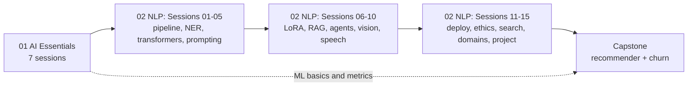

# Term 6: AI (Artificial Intelligence Specialisation)

     

> ACCP in AI · Term 6 (Year 3) · 22 module sessions + a ~24-hour capstone · ⏱ ~2 hours per session

Term 6 is the final, AI-focused term of the ACCP in AI programme. You have spent five terms learning to build software: websites, databases, back-end services, mobile apps and Python data science. Now you learn to make that software **intelligent**. You start with the foundations of Artificial Intelligence (agents, search, knowledge, logic, neural networks), then move to modern **Natural Language Processing and Large Language Models**: transformers, prompt engineering, RAG, fine-tuning, chat agents, vision, speech, deployment and responsible AI. The term ends with a **capstone project**: a recommendation engine and a customer churn prediction system for one business.

## Modules

| No | Module | Sessions | Link |
|---|---|---|---|
| 01 | AI Essentials | 7 | [Open module](./01-AI-Essentials/README.md) |
| 02 | Next-Gen NLP Applications with AI | 15 | [Open module](./02-Next-Gen-NLP-Applications-with-AI/README.md) |
| — | Capstone: Recommendation Engine and Customer Churn Prediction | ~24 hours | [Open capstone guide](./Capstone/README.md) |

## Learning Outcomes

After completing Term 6 you will be able to:

- Explain what AI and machine learning are, and how neural networks and deep learning work
- Formulate problems for intelligent agents and solve them with uninformed and informed search
- Represent knowledge with rules, semantic networks, frames and logic, and reason over it
- Build the classic NLP pipeline and NLU features: tokens, tags, entities, intents and slots
- Use transformer models and LLMs for entity extraction, summarization and generation
- Apply advanced prompting (few-shot, chain-of-thought, ReAct) and evaluate prompts on data
- Adapt LLMs with LoRA/QLoRA fine-tuning and ground them in your own documents with RAG
- Build conversational agents with memory and tool calling, and add vision and speech
- Deploy NLP models as tested, containerised APIs and monitor them
- Identify and reduce bias, privacy and safety risks in AI systems
- Build search, recommendation and domain-specific (healthcare, finance) NLP solutions
- Deliver an end-to-end recommendation and churn prediction capstone with a report and demo

## Suggested Study Order

Module 01 gives you the vocabulary and the machine learning basics that everything else depends on. In Module 02, Session 13 (search and recommendation), Session 11 (deployment), Session 12 (fairness) and Session 15 (project blueprint) feed directly into the capstone, so start thinking about your capstone scenario once you reach Session 13.

## Capstone

A hands-on project of about **24 hours**: choose one business scenario (online learning, telecom, food delivery, streaming or retail) and build a **recommendation engine** and a **customer churn prediction model** for it, then connect them in an API or dashboard. You submit a GitHub repository, a report and slides, and present a live demo in a viva. Read the [capstone guide](./Capstone/README.md) for scenarios, datasets, phases, deliverables and tips.

## What You Need

| Tool | Why | Link |
|---|---|---|
| Python 3.12 | All examples and projects | https://www.python.org/downloads/ |
| VS Code + Python and Jupyter extensions | Editor and notebooks | https://code.visualstudio.com/ |
| Google Colab | Free GPU for heavier labs (fine-tuning, speech) | https://colab.research.google.com/ |
| Git and a GitHub account | Version control and portfolio | https://git-scm.com/downloads |
| OpenAI API key (optional) | Real LLM answers; every example also runs in mock mode without one | https://platform.openai.com/docs/quickstart |
| Docker Desktop (optional) | Packaging and deployment labs | https://docs.docker.com/get-docker/ |

Each module README lists the exact libraries to install.

## How to Study

1. **Set up once:** install Python 3.12, VS Code and Git, and create a virtual environment for each module (`python -m venv .venv`).
2. **One session at a time:** read the concepts, then type (do not copy-paste) and run every example in the session folder.
3. **No key? No problem:** scripts that call an LLM print `(mock)` answers without `OPENAI_API_KEY`, so you can always follow the logic. Never paste your key into code or commit it to GitHub.
4. **Do the labs:** change the examples, break them, fix them. That is where understanding grows.
5. **Check yourself:** answer the quiz before opening the answers and practise the interview questions aloud.
6. **Build as you go:** grow one small assistant through Module 02 (the module mini-project) and reuse its parts in your capstone.
7. **Push to GitHub weekly:** your repositories become your AI portfolio for internships and jobs.
8. **Ask early:** bring questions to class or open an Issue on this repository.

---

[🏠 Repository Home](../README.md) · [Start Module 01 ➡](./01-AI-Essentials/README.md)

Prepared by Zeeshan Abbas · Aptech Learning North Nazimabad
